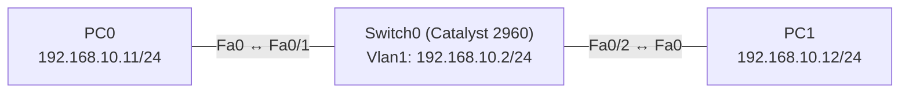

# Übung 1.1: Das erste Netzwerk – zwei PCs und ein Switch

| | |
|---|---|
| **Modul** | 1 – Grundlagen |
| **Stufe** | Grundlage |
| **Geschätzte Zeit** | ca. 45–60 Minuten |
| **Werkzeug** | Cisco Packet Tracer |
| **Vorwissen** | keines |

> **Stand der Prüfung:** Entwurf. Die IOS-Befehle am Switch (`interface vlan 1`, `ip address`, `no shutdown`, `show ip interface brief`) sind durch ein Cisco-Lab und einen Kurs belegt (siehe Quellen). Die gezeigten **Ausgaben** (`ipconfig`, `ping`, Interface- und MAC-Tabelle) sind sinngemäß beschrieben und noch nicht in Packet Tracer bestätigt, ebenso die GUI-Wege *Inspect* und *Add Simple PDU*.

## Lernziele

Nach dieser Übung kannst du

- erklären, was ein Netzwerk, ein Endgerät (Host) und ein Switch sind,
- erklären, was eine IP-Adresse und eine Subnetzmaske sind und woran zwei Geräte erkennen, dass sie im *gleichen* Netz liegen,
- in Packet Tracer ein Netzwerk mit zwei PCs und einem Switch aufbauen und verkabeln,
- statische IP-Adressen an PCs vergeben, dem Switch mit `ip address` eine Verwaltungsadresse geben und die Verbindung mit `ping` testen,
- beschreiben, was im Netzwerk passiert, wenn ein `ping` gesendet wird (ARP, ICMP, MAC-Adresstabelle).

## Voraussetzungen

Kein Vorwissen. Du brauchst den installierten Cisco Packet Tracer (kostenlos über die Cisco Networking Academy). Du kannst nichts kaputt machen, im schlimmsten Fall beginnst du ein neues Projekt.

## Grundbegriffe

| Begriff | Bedeutung |
|---|---|
| Netzwerk | Mehrere Geräte, die miteinander Daten austauschen können. |
| Host / Endgerät | Ein Gerät, das Daten sendet oder empfängt, z. B. PC, Smartphone, Drucker. |
| Switch | Ein Verteiler im lokalen Netz. Er leitet Daten gezielt an den Port weiter, an dem der Empfänger hängt. |
| Port / Interface | Ein Anschluss an einem Gerät, z. B. `FastEthernet0/1`, kurz `Fa0/1`. |
| IP-Adresse | Die „Postadresse“ eines Geräts, z. B. `192.168.10.11` (vier Zahlen von 0 bis 255, IPv4). |
| Subnetzmaske | Legt fest, welcher Teil der IP-Adresse das *Netz* und welcher das *Gerät* bezeichnet. Bei `255.255.255.0` (`/24`) sind die ersten drei Zahlen das Netz, die letzte das Gerät. |
| MAC-Adresse | Fest eingebaute Hardware-Adresse einer Netzwerkkarte. Switches arbeiten mit MAC-Adressen, nicht mit IP-Adressen. |
| Frame | Ein „Datenpaket“ auf Ebene der MAC-Adressen, so wie es über das Kabel geht. |
| IOS | Das Betriebssystem der Cisco-Router und -Switches mit eigener Kommandozeile (CLI). Die PCs in Packet Tracer laufen *nicht* mit IOS; ihre Eingabeaufforderung kennt andere Befehle. |
| SVI | *Switch Virtual Interface*: ein virtuelles Interface des Switches (hier `Vlan1`), dem man eine IP-Adresse geben kann, um den Switch selbst zu erreichen (Verwaltungsadresse). |
| Ping | Ein Test („Bist du da?“), technisch ICMP Echo Request und Echo Reply. |

> **Merksatz:** Die **IP-Adresse** sagt, *wer* du im Netz bist (Netz + Gerät). Die **MAC-Adresse** sagt, *welche Hardware* du bist. Ein Switch schaut beim Weiterleiten nur auf die MAC-Adresse.

## Topologie und Adressplan



| Gerät | Port / Interface | IP-Adresse | Subnetzmaske | Gateway |
|---|---|---|---|---|
| PC0 | FastEthernet0 | `192.168.10.11` | `255.255.255.0` | – |
| PC1 | FastEthernet0 | `192.168.10.12` | `255.255.255.0` | – |
| Switch0 | `Vlan1` (SVI) | `192.168.10.2` | `255.255.255.0` | – |

Alle drei Geräte liegen im Netz `192.168.10.0/24`. Ein Gateway (Router) wird nicht gebraucht, weil alle im selben Netz sind. Die Switch-Ports `Fa0/1` und `Fa0/2` bekommen keine IP-Adresse; die Adresse gehört zum virtuellen Interface `Vlan1`.

## Aufgabe

> **Schema dieser Übungsreihe: zwei Wege pro Schritt.** Jeder Schritt wird über die grafische Oberfläche (**GUI**) und über die Kommandozeile (**CLI**) beschrieben. Wo es in Packet Tracer keinen CLI-Weg gibt (z. B. Geräte platzieren und verkabeln), steht das ausdrücklich dabei. Alle Befehle, die du eingeben sollst, stehen in Codeblöcken. Die CLI-Befehle sind in dieser Entwurfsfassung noch nicht in Packet Tracer bestätigt.

**1. Neues Projekt beginnen**

- **GUI:** Packet Tracer starten, *File* → *New*.
- **CLI:** Entfällt. Die Topologie wird nur grafisch aufgebaut.

**2. Geräte platzieren:** zwei PCs (*End Devices*) und einen Switch (*Switches*, Modell *2960*)

- **GUI:** In der Geräteleiste unten links die Kategorie wählen, das Gerät auswählen und per Klick in den Arbeitsbereich setzen.
- **CLI:** Entfällt (nur grafisch möglich).

**3. Verkabeln** mit *Copper Straight-Through*: PC0 (`FastEthernet0`) ↔ Switch `Fa0/1`, PC1 (`FastEthernet0`) ↔ Switch `Fa0/2`

- **GUI:** Kategorie *Connections* wählen, Kabeltyp anklicken, erst das eine, dann das andere Gerät anklicken und jeweils den Port auswählen.
- **CLI:** Entfällt (Kabel gibt es nur grafisch).

**4. Link-Status prüfen** (zuerst orange, das dauert einige Sekunden)

- **GUI:** Die Link-Punkte an den Kabeln müssen grün sein. Mit *Fast Forward Time* geht es schneller.
- **CLI:** Switch anklicken, Reiter *CLI*:
  ```text
  Switch> enable
  Switch# show interfaces status
  ```
  `Fa0/1` und `Fa0/2` sollen den Status `connected` haben.

**5. IP-Adressen an den PCs vergeben** (Adressplan oben, *Default Gateway* bleibt leer)

- **GUI:** PC anklicken → *Desktop* → *IP Configuration* → *Static*, *IPv4 Address* und *Subnet Mask* eintragen. Das ist der in der Packet-Tracer-Hilfe dokumentierte Weg.
- **CLI:** Die PCs laufen nicht mit IOS, daher gibt es hier **kein** `ip address`. Die Eingabeaufforderung (*Desktop* → *Command Prompt*) kennt laut Packet-Tracer-Hilfe u. a. `ipconfig`, `ping`, `arp` und `tracert`. Ob der folgende Befehl (hier für PC0) dort eine Adresse setzt, steht nicht in der Hilfe, nur in einem Tutorial. Das ist **nicht bestätigt**; bitte ausprobieren und das Ergebnis melden. Verlässlich ist der GUI-Weg.
  ```text
  PC> ipconfig 192.168.10.11 255.255.255.0
  ```

**6. Dem Switch eine Verwaltungsadresse geben** (Interface `Vlan1`, Adressplan oben). Für das Weiterleiten ist das nicht nötig, aber so ist der Switch selbst erreichbar und du lernst `ip address` an einem IOS-Gerät kennen.

- **GUI:** Switch anklicken → Reiter *Config* → links unter *INTERFACE* den Eintrag *VLAN1* wählen, *IP Address* und *Subnet Mask* eintragen und *Port Status* auf *On* stellen.
- **CLI:** Switch anklicken → Reiter *CLI*:
  ```text
  Switch> enable
  Switch# configure terminal
  Switch(config)# interface vlan 1
  Switch(config-if)# ip address 192.168.10.2 255.255.255.0
  Switch(config-if)# no shutdown
  Switch(config-if)# end
  ```

**7. Konfiguration prüfen**

- **GUI:** PC: *Desktop* → *IP Configuration*. Switch: *Config* → *VLAN1*. Die eingetragenen Werte ablesen.
- **CLI:** Am PC (*Command Prompt*), für alle Details mit `/all`:
  ```text
  PC> ipconfig
  PC> ipconfig /all
  ```
  Am Switch (*CLI*):
  ```text
  Switch# show ip interface brief
  ```

**8. Verbindung testen:** PC0 → PC1, PC0 → Switch und Switch → PC0

- **GUI:** Werkzeug *Add Simple PDU* (Briefumschlag, rechte Werkzeugleiste) anklicken, dann Quelle und Ziel anklicken. In *Last Status* bzw. der Ereignisliste steht *Successful*, wenn die Verbindung klappt.
- **CLI:** An PC0 (*Command Prompt*):
  ```text
  PC> ping 192.168.10.12
  PC> ping 192.168.10.2
  ```
  Am Switch (*CLI*):
  ```text
  Switch# ping 192.168.10.11
  ```

**9. MAC-Adresstabelle des Switches anzeigen**

- **GUI:** Werkzeug *Inspect* (Lupe, rechte Werkzeugleiste) wählen, den Switch anklicken und *MAC Table* auswählen.
- **CLI:** Switch → *CLI*:
  ```text
  Switch> enable
  Switch# show mac address-table
  ```

**10. Projekt speichern** als `01.1-erstes-netzwerk.pkt`

- **GUI:** *File* → *Save As* (oder `Strg+S`).
- **CLI:** Entfällt für die Projektdatei. Die Switch-Konfiguration (die Adresse aus Schritt 6) sichert man mit dem folgenden Befehl. Ohne ihn ginge sie bei einem Neustart des Switches verloren.
  ```text
  Switch# copy running-config startup-config
  ```

## Hintergrund: Was passiert beim Ping?

1. **PC0 prüft: Liegt das Ziel im eigenen Netz?** PC0 vergleicht mithilfe seiner Subnetzmaske die Netzanteile. Bei `255.255.255.0` zählen die ersten drei Zahlen: `192.168.10`.11 und `192.168.10`.12 haben denselben Netzanteil. Das Ziel ist also direkt erreichbar, ohne Router.
2. **PC0 kennt die MAC-Adresse des Ziels noch nicht.** Im Kabel werden Frames mit MAC-Adressen verschickt. PC0 fragt per **ARP** (*Address Resolution Protocol*) per Broadcast: „Wer hat `192.168.10.12`? Bitte melde deine MAC-Adresse.“
3. **Der Switch lernt und verteilt.** Er merkt sich: „Die MAC-Adresse von PC0 hängt an `Fa0/1`.“ (MAC-Adresstabelle). Da ein Broadcast an alle gerichtet ist, gibt er den Frame an alle anderen Ports weiter.
4. **PC1 antwortet** mit seiner MAC-Adresse direkt an PC0 (ARP-Reply). Der Switch lernt dabei: „PC1 hängt an `Fa0/2`.“
5. **Jetzt geht der eigentliche Ping.** PC0 packt den ICMP Echo Request in einen Frame mit der MAC-Adresse von PC1. Der Switch leitet ihn gezielt nur an `Fa0/2` weiter. PC1 antwortet mit einem Echo Reply.

> **Warum ist der erste Ping oft anders?** Beim ersten Ping muss zuerst die ARP-Auflösung stattfinden. In Packet Tracer wird das erste Paket deshalb häufig als *Request timed out* angezeigt. Danach hat sich PC0 die Zuordnung IP → MAC gemerkt.

> **Wozu braucht ein Switch eine IP-Adresse?** Zum Weiterleiten von Frames braucht er keine, denn dafür genügen die MAC-Adressen. Eine IP-Adresse braucht er nur, wenn man ihn selbst im Netz ansprechen will, z. B. zum Pingen oder später für die Fernwartung per SSH. Dafür bekommt er ein virtuelles Interface (SVI), dem man mit dem IOS-Befehl `ip address` eine Adresse gibt, genau wie bei einem Router-Interface.

## Hinweise

- Packet Tracer trägt bei `192.168.x.x` die Subnetzmaske `255.255.255.0` meist automatisch ein. Kontrolliere trotzdem, ob sie stimmt.
- Für das reine Weiterleiten braucht der Switch **keine Konfiguration**. Die Verwaltungsadresse (Schritt 6) ist nur dafür da, den Switch selbst ansprechen zu können.
- Der IOS-`ping` sendet fünf Pakete. Ein Ausrufezeichen (`!`) steht für eine Antwort, ein Punkt (`.`) für eine Zeitüberschreitung. Der erste Versuch zeigt häufig `.!!!!`, weil zuerst ARP aufgelöst wird.
- Ein Switch-Port ist ein *physischer* Anschluss, `Vlan1` ein *virtuelles* Interface. Es muss mit `no shutdown` eingeschaltet werden, sonst bleibt es `administratively down`.
- Bleiben die Link-Punkte rot, ist meist der falsche Kabeltyp gewählt oder das Kabel steckt am falschen Port.
- Ein `ping` an die eigene Adresse testet nur die eigene Netzwerkkarte, nicht Kabel oder Switch.

## Prüfbefehle

Am PC (Command Prompt):

```text
PC> ipconfig
PC> ping 192.168.10.12
PC> arp -a
```

Am Switch (CLI):

```text
Switch> enable
Switch# show mac address-table
Switch# show interfaces status
Switch# show ip interface brief
Switch# ping 192.168.10.11
```

| CLI-Befehl | Was er zeigt | GUI-Weg |
|---|---|---|
| `ipconfig` | IP-Adresse, Subnetzmaske und Gateway des PCs | *Desktop* → *IP Configuration* |
| `ping <Ziel>` | Ob das Ziel erreichbar ist | Werkzeug *Add Simple PDU* |
| `arp -a` | Gemerkte IP-zu-MAC-Zuordnungen des PCs | Werkzeug *Inspect* → PC → *ARP Table* |
| `show mac address-table` | Vom Switch gelernte MAC-Adressen mit Port | Werkzeug *Inspect* → Switch → *MAC Table* |
| `show interfaces status` | Status der Switch-Ports | Farbe der Link-Punkte an den Kabeln |
| `show ip interface brief` | IP-Adressen und Status aller Interfaces des Switches, auch `Vlan1` | *Config* → *VLAN1* |

**Kontrollfragen**

1. Woran erkennt PC0, dass PC1 im selben Netz liegt?
2. Warum wird für diese Übung kein Router gebraucht?
3. Was ist der Unterschied zwischen IP-Adresse und MAC-Adresse?
4. Welchen Befehl benutzt du auf einem Cisco-Switch oder -Router, um einem Interface eine IP-Adresse zu geben, und warum gilt das nicht für die PCs in Packet Tracer?

## Erweiterungen

- **Simulationsmodus:** Sende einen Ping im *Simulation Mode* und verfolge ARP-Request, ARP-Reply und ICMP Schritt für Schritt.
- **Dritter PC:** PC2 mit `192.168.10.13` hinzufügen. Wie verändert sich die MAC-Adresstabelle?
- **Fehler provozieren:** PC1 die Adresse `192.168.20.12` geben und von PC0 pingen. Was passiert und warum? (Motivation für Übung 1.2 mit einem Router.)

---

## Musterlösung

<details>
<summary>Musterlösung anzeigen</summary>

**Aufbau (Schritte 1–3, nur GUI):** Zwei PCs und ein Switch 2960 platzieren, mit *Copper Straight-Through* verkabeln: PC0 → `Fa0/1`, PC1 → `Fa0/2`. Dafür gibt es keinen CLI-Weg.

**Link-Status (Schritt 4):** GUI: Nach einigen Sekunden sind beide Link-Punkte grün. CLI (Switch, sinngemäß, nicht bestätigt):

```text
Switch# show interfaces status
Port      Name   Status       Vlan  Duplex  Speed Type
Fa0/1            connected    1     auto    auto  10/100BaseTX
Fa0/2            connected    1     auto    auto  10/100BaseTX
```

**IP-Konfiguration der PCs (Schritt 5):**

| | IPv4 Address | Subnet Mask |
|---|---|---|
| PC0 | `192.168.10.11` | `255.255.255.0` |
| PC1 | `192.168.10.12` | `255.255.255.0` |

Default Gateway bleibt leer. GUI: *Desktop* → *IP Configuration* → *Static*, Werte eintragen. CLI: Die PCs haben kein IOS und damit kein `ip address`. Verlässlich ist der GUI-Weg. Ob `ipconfig <IP> <Maske>` an der PC-Eingabeaufforderung funktioniert, ist nicht bestätigt.

**Verwaltungsadresse am Switch (Schritt 6):** GUI: Switch → *Config* → *VLAN1*: *IP Address* `192.168.10.2`, *Subnet Mask* `255.255.255.0`, *Port Status* *On*. CLI:

```text
Switch> enable
Switch# configure terminal
Switch(config)# interface vlan 1
Switch(config-if)# ip address 192.168.10.2 255.255.255.0
Switch(config-if)# no shutdown
Switch(config-if)# end
```

Nach `no shutdown` meldet der Switch sinngemäß, dass das Line Protocol von `Vlan1` auf `up` gewechselt ist (sobald mindestens ein Port am Netz hängt und aktiv ist).

**Konfiguration prüfen (Schritt 7, sinngemäß, nicht bestätigt):** GUI: PC: *Desktop* → *IP Configuration*, Switch: *Config* → *VLAN1*. CLI am PC0:

```text
PC> ipconfig

   IPv4 Address....................: 192.168.10.11
   Subnet Mask.....................: 255.255.255.0
   Default Gateway.................: 0.0.0.0
```

CLI am Switch (gekürzt):

```text
Switch# show ip interface brief
Interface         IP-Address      OK? Method Status      Protocol
FastEthernet0/1   unassigned      YES manual up          up
FastEthernet0/2   unassigned      YES manual up          up
...
Vlan1             192.168.10.2    YES manual up          up
```

Vor `no shutdown` steht bei `Vlan1` der Status `administratively down`.

**Ping (Schritt 8, sinngemäß, nicht bestätigt):** GUI: Mit *Add Simple PDU* von PC0 zu PC1, von PC0 zum Switch und vom Switch zu PC0: Status jeweils *Successful* (der erste Versuch kann wegen ARP verloren gehen). CLI von PC0 an PC1:

```text
PC> ping 192.168.10.12

Pinging 192.168.10.12 with 32 bytes of data:

Request timed out.
Reply from 192.168.10.12: bytes=32 time<1ms TTL=128
Reply from 192.168.10.12: bytes=32 time<1ms TTL=128
Reply from 192.168.10.12: bytes=32 time<1ms TTL=128

Ping statistics for 192.168.10.12:
    Packets: Sent = 4, Received = 3, Lost = 1 (25% loss)
```

CLI am Switch (IOS-Format):

```text
Switch# ping 192.168.10.11

Type escape sequence to abort.
Sending 5, 100-byte ICMP Echos to 192.168.10.11, timeout is 2 seconds:
.!!!!
Success rate is 80 percent (4/5), round-trip min/avg/max = 0/0/0 ms
```

Ein `!` ist eine Antwort, ein `.` eine Zeitüberschreitung. Beim zweiten Versuch steht in der Regel `!!!!!` und `100 percent`.

**MAC-Adresstabelle (Schritt 9):** GUI: *Inspect* → Switch → *MAC Table* zeigt dieselben Einträge. CLI (Beispiel, MAC-Adressen sind bei dir anders):

```text
Switch# show mac address-table
          Mac Address Table
-------------------------------------------
Vlan    Mac Address       Type        Ports
----    -----------       --------    -----
   1    xxxx.xxxx.xxxx    DYNAMIC     Fa0/1
   1    yyyy.yyyy.yyyy    DYNAMIC     Fa0/2
```

Der Switch hat mindestens zwei Einträge gelernt: je einen pro PC mit dem Port, an dem er hängt. Je nach Reihenfolge der Pings kann ein weiterer Eintrag für die eigene Adresse des Switches auftauchen.

**Antworten auf die Kontrollfragen:**

1. PC0 vergleicht den Netzanteil seiner Adresse mit dem der Zieladresse. Die Subnetzmaske legt fest, wie viel Netzanteil ist. Bei `/24` sind es die ersten drei Zahlen, und die sind bei beiden Adressen gleich.
2. Ein Router wird nur gebraucht, um *zwischen verschiedenen Netzen* zu vermitteln. Hier liegen alle Geräte im selben Netz.
3. Die IP-Adresse ist logisch und vergebbar (sie bestimmt das Netz), die MAC-Adresse gehört fest zur Hardware. PCs und Router nutzen die IP-Adresse, der Switch beim Weiterleiten die MAC-Adresse.
4. Auf IOS-Geräten im Konfigurationsmodus des Interfaces (beim Switch z. B. nach `interface vlan 1`):

   ```text
   Switch(config-if)# ip address <Adresse> <Maske>
   Switch(config-if)# no shutdown
   ```

   Die PCs in Packet Tracer laufen nicht mit IOS; ihre Adresse setzt man im Dialog *IP Configuration*.

</details>

---

## Quellen

- Packet-Tracer-Hilfe, Abschnitt *Configuring PCs* (IP Configuration, Befehle der Eingabeaufforderung).
- Cisco Networking Academy, Lab 2.3.2.5 *Packet Tracer – Implementing Basic Connectivity* (`interface vlan 1`, `ip address`, `no shutdown`).
- OpenClassrooms, *Configure Basic Parameters in a Layer 2 Switch* (`show ip interface brief`, Status von `Vlan1`).
- GeeksforGeeks, *Setting IP Address Using ipconfig Command*: nur Tutorial, in der offiziellen Packet-Tracer-Hilfe nicht belegt (siehe Schritt 5).

---

Lizenz: [CC BY-NC-SA 4.0](https://creativecommons.org/licenses/by-nc-sa/4.0/deed.de), Urheber: AnsibleArtisan4711. Cisco, Cisco IOS und Cisco Packet Tracer sind Marken von Cisco Systems, Inc. und/oder ihrer Tochtergesellschaften; dieses Dokument steht in keiner Verbindung zu Cisco.
