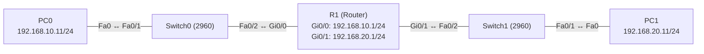

# Übung 1.2: Zwei Netze und ein Router

| | |
|---|---|
| **Modul** | 1 – Grundlagen |
| **Stufe** | Grundlage |
| **Geschätzte Zeit** | ca. 60–75 Minuten |
| **Werkzeug** | Cisco Packet Tracer |
| **Vorwissen** | Übung 1.1 (IP-Adresse, Subnetzmaske, MAC-Adresse, Switch, Ping) |

> **Stand der Prüfung:** Entwurf. Die IOS-Befehle am Router (`interface gigabitethernet 0/0`, `ip address`, `no shutdown`, `description`, `show ip interface brief`, `show ip route`) und das Eintragen des Default Gateway an den PCs sind durch ein Cisco-Lab und weitere Quellen belegt (siehe Quellen). **Nicht bestätigt** sind die gezeigten Ausgaben (`show ip route`, `tracert`, `ping`, Fehlermeldung ohne Gateway), die GUI-Wege am Router (*Config* → Interface), der Kabeltyp *Copper Straight-Through* zwischen Switch und Router (die Packet-Tracer-Hilfe nennt diesen Fall nicht ausdrücklich, ein Lab und ein Tutorial verwenden ihn) und die Portnamen des gewählten Router-Modells.

## Lernziele

Nach dieser Übung kannst du

- erklären, warum zwei Geräte in verschiedenen Netzen nicht ohne Router miteinander sprechen können,
- erklären, was ein Router und ein Default Gateway sind und warum jeder PC ein Gateway braucht, um andere Netze zu erreichen,
- in Packet Tracer zwei Netze mit je einem Switch und einem PC über einen Router verbinden,
- einem Router-Interface mit `ip address` und `no shutdown` eine Adresse geben und sie mit `show ip interface brief` prüfen,
- die Routingtabelle mit `show ip route` lesen und die Einträge `C` (connected) und `L` (local) unterscheiden,
- beschreiben, was im Netzwerk passiert, wenn ein Ping von einem Netz ins andere geht (Default Gateway, ARP, Routing, TTL).

## Voraussetzungen

Übung 1.1 sollte durchgearbeitet sein. Du solltest wissen, was eine IP-Adresse und eine Subnetzmaske sind, woran zwei Geräte erkennen, dass sie im selben Netz liegen, und wie man in Packet Tracer PCs konfiguriert und mit `ping` testet. Alles, was neu dazukommt (Router, Default Gateway, Routingtabelle), wird hier erklärt.

## Grundbegriffe

| Begriff | Bedeutung |
|---|---|
| Router | Ein Gerät, das Daten **zwischen verschiedenen Netzen** weiterleitet. Er hat in jedem Netz, das er verbindet, ein eigenes Interface mit einer IP-Adresse aus diesem Netz. |
| Default Gateway | Die Adresse des Routers im eigenen Netz. Soll ein PC ein Ziel außerhalb seines Netzes erreichen, schickt er die Daten an diese Adresse und lässt den Router weiterleiten. |
| Routingtabelle | Die Liste, in der ein Router nachschaut, über welches Interface er ein Netz erreicht. |
| Connected Route (`C`) | Eintrag für ein Netz, das direkt an einem Interface des Routers hängt. Er entsteht automatisch, sobald das Interface eine Adresse hat und aktiv ist. |
| Local Route (`L`) | Eintrag für die Adresse des Router-Interfaces selbst (Maske `/32`). Er zeigt: „Diese Adresse gehört mir.“ |
| Netzadresse | Die erste Adresse eines Netzes, in dem alle Geräteanteile `0` sind, z. B. `192.168.10.0` bei `/24`. Sie bezeichnet das Netz, nicht ein Gerät. |
| TTL | *Time To Live*: Zähler im IP-Paket, den jeder Router um 1 verringert. Er verhindert, dass Pakete ewig kreisen. |
| `hostname` | Der Name, den ein IOS-Gerät sich selbst gibt. Er erscheint im Prompt (z. B. `R1#`). |

> **Merksatz:** Ein Switch verbindet Geräte **innerhalb** eines Netzes. Ein Router verbindet **verschiedene** Netze. Ein PC schickt alles, was nicht im eigenen Netz liegt, an sein Default Gateway.

## Topologie und Adressplan



| Gerät | Port / Interface | IP-Adresse | Subnetzmaske | Default Gateway |
|---|---|---|---|---|
| PC0 | FastEthernet0 | `192.168.10.11` | `255.255.255.0` | `192.168.10.1` |
| PC1 | FastEthernet0 | `192.168.20.11` | `255.255.255.0` | `192.168.20.1` |
| R1 | `GigabitEthernet0/0` | `192.168.10.1` | `255.255.255.0` | – |
| R1 | `GigabitEthernet0/1` | `192.168.20.1` | `255.255.255.0` | – |
| Switch0, Switch1 | – | keine | – | – |

| Netz | Netzadresse | Adressen für Geräte | Broadcast |
|---|---|---|---|
| Netz A (links) | `192.168.10.0/24` | `192.168.10.1` bis `192.168.10.254` | `192.168.10.255` |
| Netz B (rechts) | `192.168.20.0/24` | `192.168.20.1` bis `192.168.20.254` | `192.168.20.255` |

Es sind **zwei verschiedene Netze**. Die Switches bekommen keine IP-Adresse und keine Konfiguration; sie leiten nur Frames im jeweiligen Netz weiter. Als Router eignet sich ein Modell mit mindestens zwei `GigabitEthernet`-Ports, z. B. 1941 oder 2911 (Portnamen und -anzahl des Modells bitte in Packet Tracer prüfen).

## Aufgabe

> **Schema dieser Übungsreihe: zwei Wege pro Schritt.** Jeder Schritt wird über die grafische Oberfläche (**GUI**) und über die Kommandozeile (**CLI**) beschrieben. Wo es in Packet Tracer keinen CLI-Weg gibt (z. B. Geräte platzieren und verkabeln), steht das ausdrücklich dabei. Alle Befehle, die du eingeben sollst, stehen in Codeblöcken. Die CLI-Befehle und GUI-Wege sind in dieser Entwurfsfassung noch nicht in Packet Tracer bestätigt.

**1. Neues Projekt beginnen**

- **GUI:** Packet Tracer starten, *File* → *New*.
- **CLI:** Entfällt. Die Topologie wird nur grafisch aufgebaut.

**2. Geräte platzieren:** zwei PCs (*End Devices*), zwei Switches (*Switches*, Modell *2960*) und einen Router (*Routers*, z. B. *1941* oder *2911*)

- **GUI:** In der Geräteleiste unten links die Kategorie wählen, das Gerät auswählen und per Klick in den Arbeitsbereich setzen. Ordne die Geräte wie in der Topologie an: PC0, Switch0, Router, Switch1, PC1.
- **CLI:** Entfällt (nur grafisch möglich).

**3. Verkabeln** mit *Copper Straight-Through*: PC0 (`FastEthernet0`) ↔ Switch0 `Fa0/1`, Switch0 `Fa0/2` ↔ R1 `GigabitEthernet0/0`, R1 `GigabitEthernet0/1` ↔ Switch1 `Fa0/2`, Switch1 `Fa0/1` ↔ PC1 (`FastEthernet0`)

- **GUI:** Kategorie *Connections* wählen, Kabeltyp anklicken, erst das eine, dann das andere Gerät anklicken und jeweils den Port auswählen.
- **CLI:** Entfällt (Kabel gibt es nur grafisch).

Die Link-Punkte an den Kabeln zum Router bleiben zunächst **rot**, weil die Router-Interfaces noch ausgeschaltet sind. Das ändert sich in Schritt 4.

**4. Den Router konfigurieren:** Name vergeben, beide Interfaces mit Adresse versehen und einschalten (Adressplan oben)

- **GUI:** Router anklicken → Reiter *Config* → links unter *GLOBAL* bei *Display Name* bzw. *Hostname* `R1` eintragen. Dann links unter *INTERFACE* den Eintrag *GigabitEthernet0/0* wählen, *IP Address* `192.168.10.1` und *Subnet Mask* `255.255.255.0` eintragen und *Port Status* auf *On* stellen. Dasselbe für *GigabitEthernet0/1* mit `192.168.20.1`.
- **CLI:** Router anklicken → Reiter *CLI*:
  ```text
  Router> enable
  Router# configure terminal
  Router(config)# hostname R1
  R1(config)# interface gigabitethernet 0/0
  R1(config-if)# description LAN Netz A zu Switch0
  R1(config-if)# ip address 192.168.10.1 255.255.255.0
  R1(config-if)# no shutdown
  R1(config-if)# exit
  R1(config)# interface gigabitethernet 0/1
  R1(config-if)# description LAN Netz B zu Switch1
  R1(config-if)# ip address 192.168.20.1 255.255.255.0
  R1(config-if)# no shutdown
  R1(config-if)# end
  ```
  Falls beim Start des Routers die Frage nach dem Konfigurationsdialog erscheint (*Would you like to enter the initial configuration dialog?*), antworte mit `no`.

**5. IP-Adressen und Default Gateway an den PCs vergeben** (Adressplan oben)

- **GUI:** PC anklicken → *Desktop* → *IP Configuration* → *Static*, *IPv4 Address*, *Subnet Mask* und **Default Gateway** eintragen.
- **CLI:** Entfällt. Die PCs laufen nicht mit IOS, daher gibt es kein `ip address` und kein `ip default-gateway` am PC. Verlässlich ist der GUI-Weg (siehe Übung 1.1).

**6. Konfiguration prüfen**

- **GUI:** PC: *Desktop* → *IP Configuration*. Router: *Config* → jeweiliges Interface. Die eingetragenen Werte ablesen.
- **CLI:** Am PC (*Command Prompt*):
  ```text
  PC> ipconfig
  ```
  Am Router (*CLI*):
  ```text
  R1# show ip interface brief
  R1# show ip route
  ```
  Beide Interfaces sollen `up` / `up` sein, und in der Routingtabelle stehen zwei Einträge mit `C` und zwei mit `L`.

**7. Verbindung testen:** erst die nähere, dann die weitere Strecke

- **GUI:** Werkzeug *Add Simple PDU* (Briefumschlag) anklicken, dann Quelle und Ziel anklicken. Teste PC0 → R1 (`192.168.10.1`), PC0 → PC1 und PC1 → PC0.
- **CLI:** An PC0 (*Command Prompt*):
  ```text
  PC> ping 192.168.10.1
  PC> ping 192.168.20.1
  PC> ping 192.168.20.11
  ```
  Am Router (*CLI*):
  ```text
  R1# ping 192.168.10.11
  R1# ping 192.168.20.11
  ```

**8. Den Weg des Pakets verfolgen**

- **GUI:** Im *Simulation Mode* einen Ping von PC0 zu PC1 senden und die Pakete Schritt für Schritt verfolgen (Reiter *Event List*).
- **CLI:** An PC0 (*Command Prompt*):
  ```text
  PC> tracert 192.168.20.11
  ```
  Die erste Zeile ist der Router (Default Gateway), die zweite das Ziel.

**9. Gegenprobe: Was passiert ohne Gateway?**

- **GUI:** An PC0 unter *Desktop* → *IP Configuration* das Feld *Default Gateway* leeren. Ping von PC0 zu PC1 und zu `192.168.10.1` wiederholen. Danach das Gateway wieder eintragen.
- **CLI:** Entfällt am PC (Konfiguration nur über die GUI). Test mit den Pings aus Schritt 7:
  ```text
  PC> ping 192.168.10.1
  PC> ping 192.168.20.11
  ```
  Der Ping an den Router im **eigenen** Netz geht weiter, der Ping in das **andere** Netz nicht. Notiere dir, was Packet Tracer ausgibt.

**10. Projekt und Konfiguration speichern** als `01.2-zwei-netze-und-ein-router.pkt`

- **GUI:** *File* → *Save As* (oder `Strg+S`).
- **CLI:** Entfällt für die Projektdatei. Die Konfiguration des Routers sichert man mit dem folgenden Befehl. Ohne ihn ginge sie bei einem Neustart des Routers verloren.
  ```text
  R1# copy running-config startup-config
  ```

## Hintergrund: Was passiert beim Ping von PC0 zu PC1?

1. **PC0 prüft: Liegt das Ziel im eigenen Netz?** PC0 hat `192.168.10.11/24`, das Ziel ist `192.168.20.11`. Die Netzanteile (`192.168.10` und `192.168.20`) sind verschieden. Das Ziel liegt in einem anderen Netz, also ist es nicht direkt erreichbar.
2. **PC0 schickt das Paket an sein Default Gateway.** Er braucht nicht die MAC-Adresse von PC1, sondern die des Routers (`192.168.10.1`). Per **ARP** fragt er per Broadcast: „Wer hat `192.168.10.1`?“ R1 antwortet mit der MAC-Adresse seines Interfaces `Gi0/0`.
3. **Der Frame geht zum Router.** Die IP-Adressen im Paket bleiben `192.168.10.11` (Quelle) und `192.168.20.11` (Ziel). Im Frame stehen als MAC-Adressen die von PC0 (Quelle) und von R1 `Gi0/0` (Ziel). Switch0 leitet den Frame anhand der MAC-Adresse an `Fa0/2` weiter.
4. **R1 schaut in die Routingtabelle.** Das Ziel `192.168.20.11` gehört zum Netz `192.168.20.0/24`, das über `Gi0/1` direkt erreichbar ist (Eintrag `C`). R1 verringert die TTL um 1.
5. **R1 löst die MAC-Adresse von PC1 auf.** Er sendet an `Gi0/1` einen ARP-Request für `192.168.20.11`, PC1 antwortet.
6. **R1 baut einen neuen Frame.** Quell-MAC ist jetzt `Gi0/1` von R1, Ziel-MAC ist PC1. Die IP-Adressen bleiben unverändert. Switch1 leitet den Frame an `Fa0/1` weiter.
7. **PC1 antwortet** auf demselben Weg zurück. Dazu braucht er sein Default Gateway `192.168.20.1`, weil PC0 in einem anderen Netz liegt.

> **Merke:** Die **IP-Adressen** bleiben auf dem ganzen Weg gleich, die **MAC-Adressen** wechseln bei jedem Router. Ein Router trennt außerdem die Netze: ARP-Broadcasts bleiben im eigenen Netz.

> **Warum geht der Ping an den Router, aber nicht ins andere Netz, wenn das Gateway fehlt?** Der Router liegt im selben Netz wie PC0 und ist deshalb ohne Gateway erreichbar. Für ein Ziel im anderen Netz weiß PC0 ohne Gateway nicht, wohin er das Paket schicken soll.

## Hinweise

- Router-Interfaces sind in IOS ab Werk ausgeschaltet. Sie müssen mit `no shutdown` eingeschaltet werden, sonst bleiben sie `administratively down` und der Link bleibt rot.
- Die Reihenfolge am Interface ist wichtig: erst `ip address`, dann `no shutdown`. Umgekehrt geht es auch, aber so siehst du den Statuswechsel erst, wenn das Interface eine Adresse hat.
- Der Router leitet nur Pakete weiter, die an seine eigene MAC-Adresse gehen. Deshalb muss das **Default Gateway** an den PCs genau der Router-Adresse **im eigenen Netz** entsprechen (PC0 → `192.168.10.1`, PC1 → `192.168.20.1`).
- Ein Gateway aus einem anderen Netz ist ein typischer Fehler: PC0 mit `192.168.20.1` als Gateway kann den Router nicht erreichen.
- Die Subnetzmaske muss an PC und Router-Interface im selben Netz gleich sein. Ein Tippfehler bei der Maske führt zu schwer erkennbaren Fehlern.
- Packet Tracer trägt Gateway und Maske nicht für dich ein. Kontrolliere beide Felder im Dialog *IP Configuration*.
- Das Kabel zwischen Switch und Router ist in dieser Übung *Copper Straight-Through* (nicht bestätigt, siehe Stand der Prüfung). Bleibt der Link rot, obwohl das Interface `up` sein sollte, prüfe zuerst den Port, dann den Kabeltyp.

## Prüfbefehle

Am PC (Command Prompt):

```text
PC> ipconfig
PC> ping 192.168.10.1
PC> ping 192.168.20.11
PC> tracert 192.168.20.11
PC> arp -a
```

Am Router (CLI):

```text
Router> enable
R1# show ip interface brief
R1# show ip route
R1# ping 192.168.20.11
```

| CLI-Befehl | Was er zeigt | GUI-Weg |
|---|---|---|
| `ipconfig` | IP-Adresse, Subnetzmaske und Default Gateway des PCs | *Desktop* → *IP Configuration* |
| `ping <Ziel>` | Ob das Ziel erreichbar ist | Werkzeug *Add Simple PDU* |
| `tracert <Ziel>` | Die Router auf dem Weg zum Ziel | *Simulation Mode*, *Event List* |
| `arp -a` | Gemerkte IP-zu-MAC-Zuordnungen des PCs | Werkzeug *Inspect* → PC → *ARP Table* |
| `show ip interface brief` | IP-Adresse und Status (`up`/`down`) aller Router-Interfaces | *Config* → jeweiliges Interface |
| `show ip route` | Routingtabelle des Routers (`C` und `L`) | Werkzeug *Inspect* → Router → *Routing Table* |

**Kontrollfragen**

1. Woran erkennt PC0, dass PC1 nicht im selben Netz liegt?
2. An welche Adresse schickt PC0 ein Paket für `192.168.20.11`, und warum nicht direkt an PC1?
3. Warum braucht jeder der beiden PCs ein Default Gateway, und welche Adresse trägst du jeweils ein?
4. Was bedeutet `C 192.168.10.0/24 is directly connected, GigabitEthernet0/0` in der Routingtabelle, und was bedeutet dagegen die Zeile mit `L`?
5. Welche Adressen bleiben auf dem Weg von PC0 zu PC1 gleich, welche ändern sich, und warum?

## Erweiterungen

- **Dritter PC:** PC2 mit `192.168.10.12` an Switch0 hinzufügen. Kann PC2 ohne Konfiguration am Router PC1 erreichen? Warum?
- **Fehler provozieren:** Eine falsche Subnetzmaske (z. B. `255.255.255.128`) an PC1 eintragen, das Gateway belassen und von PC0 aus pingen. Was passiert und warum?
- **Router-ARP-Tabelle:** Am Router `show ip arp` ausführen und die Zuordnungen zu den beiden PCs und zum Gegenstück ansehen (Befehl nicht bestätigt).
- **Verwaltungsadresse am Switch:** Switch0 eine Adresse `192.168.10.2/24` am Interface `Vlan1` geben (wie in Übung 1.1). Danach `ip default-gateway 192.168.10.1` im globalen Konfigurationsmodus setzen und den Switch von PC1 aus pingen. Was ändert sich durch das Gateway?
- **Weiter:** Übung 1.3 behandelt das Subnetting von Hand, also warum `/24` nicht immer die richtige Größe ist.

---

## Musterlösung

<details>
<summary>Musterlösung anzeigen</summary>

**Aufbau (Schritte 1–3, nur GUI):** Zwei PCs, zwei Switches 2960 und einen Router (z. B. 1941 oder 2911) platzieren, mit *Copper Straight-Through* verkabeln: PC0 → Switch0 `Fa0/1`, Switch0 `Fa0/2` → R1 `Gi0/0`, R1 `Gi0/1` → Switch1 `Fa0/2`, Switch1 `Fa0/1` → PC1. Dafür gibt es keinen CLI-Weg. Die Kabel zum Router sind zunächst rot.

**Router konfigurieren (Schritt 4):** GUI: *Config* → *GigabitEthernet0/0*: `192.168.10.1` / `255.255.255.0`, *Port Status* *On*; *GigabitEthernet0/1*: `192.168.20.1` / `255.255.255.0`, *On*. CLI:

```text
Router> enable
Router# configure terminal
Router(config)# hostname R1
R1(config)# interface gigabitethernet 0/0
R1(config-if)# description LAN Netz A zu Switch0
R1(config-if)# ip address 192.168.10.1 255.255.255.0
R1(config-if)# no shutdown
R1(config-if)# exit
R1(config)# interface gigabitethernet 0/1
R1(config-if)# description LAN Netz B zu Switch1
R1(config-if)# ip address 192.168.20.1 255.255.255.0
R1(config-if)# no shutdown
R1(config-if)# end
```

Nach `no shutdown` meldet der Router sinngemäß (nicht bestätigt), dass das Interface und sein Line Protocol auf `up` gewechselt sind:

```text
%LINK-5-CHANGED: Interface GigabitEthernet0/0, changed state to up
%LINEPROTO-5-UPDOWN: Line protocol on Interface GigabitEthernet0/0, changed state to up
```

Die Link-Punkte werden grün, sobald die Gegenstelle am Switch aktiv ist (das kann einige Sekunden dauern).

**IP-Konfiguration der PCs (Schritt 5):**

| | IPv4 Address | Subnet Mask | Default Gateway |
|---|---|---|---|
| PC0 | `192.168.10.11` | `255.255.255.0` | `192.168.10.1` |
| PC1 | `192.168.20.11` | `255.255.255.0` | `192.168.20.1` |

GUI: *Desktop* → *IP Configuration* → *Static*, Werte eintragen. Einen CLI-Weg gibt es am PC nicht.

**Konfiguration prüfen (Schritt 6, sinngemäß, nicht bestätigt):** CLI am PC0:

```text
PC> ipconfig

   IPv4 Address....................: 192.168.10.11
   Subnet Mask.....................: 255.255.255.0
   Default Gateway.................: 192.168.10.1
```

CLI am Router (gekürzt):

```text
R1# show ip interface brief
Interface              IP-Address      OK? Method Status                Protocol
GigabitEthernet0/0     192.168.10.1    YES manual up                    up
GigabitEthernet0/1     192.168.20.1    YES manual up                    up
...
```

```text
R1# show ip route
Codes: L - local, C - connected, S - static, ...
Gateway of last resort is not set

     192.168.10.0/24 is variably subnetted, 2 subnets, 2 masks
C       192.168.10.0/24 is directly connected, GigabitEthernet0/0
L       192.168.10.1/32 is directly connected, GigabitEthernet0/0
     192.168.20.0/24 is variably subnetted, 2 subnets, 2 masks
C       192.168.20.0/24 is directly connected, GigabitEthernet0/1
L       192.168.20.1/32 is directly connected, GigabitEthernet0/1
```

`C` steht für das angeschlossene **Netz**, `L` für die **Adresse des Interfaces** selbst (`/32`). Die Zeile „Gateway of last resort is not set“ heißt: Es gibt noch keine Standardroute. Die Codes `L` erscheinen laut Tutorial ab IOS 15; die Version in Packet Tracer hängt vom Router-Modell ab (nicht bestätigt).

**Ping (Schritt 7, sinngemäß, nicht bestätigt):** GUI: Mit *Add Simple PDU* PC0 → R1, PC0 → PC1 und PC1 → PC0: Status jeweils *Successful* (der erste Versuch kann wegen ARP verloren gehen). CLI von PC0 an PC1:

```text
PC> ping 192.168.20.11

Pinging 192.168.20.11 with 32 bytes of data:

Request timed out.
Reply from 192.168.20.11: bytes=32 time<1ms TTL=127
Reply from 192.168.20.11: bytes=32 time<1ms TTL=127
Reply from 192.168.20.11: bytes=32 time<1ms TTL=127

Ping statistics for 192.168.20.11:
    Packets: Sent = 4, Received = 3, Lost = 1 (25% loss)
```

Die TTL ist hier um 1 kleiner als in Übung 1.1 (`128` → `127`), weil das Paket einen Router passiert hat. Der genaue Wert hängt vom Betriebssystem des Zielgeräts ab. CLI am Router (IOS-Format):

```text
R1# ping 192.168.20.11

Type escape sequence to abort.
Sending 5, 100-byte ICMP Echos to 192.168.20.11, timeout is 2 seconds:
.!!!!
Success rate is 80 percent (4/5), round-trip min/avg/max = 0/0/1 ms
```

**Weg des Pakets (Schritt 8, sinngemäß, nicht bestätigt):**

```text
PC> tracert 192.168.20.11

Tracing route to 192.168.20.11 over a maximum of 30 hops:

  1   0 ms      0 ms      0 ms      192.168.10.1
  2   0 ms      0 ms      0 ms      192.168.20.11

Trace complete.
```

Der erste Sprung ist das Default Gateway (R1), der zweite das Ziel.

**Gegenprobe (Schritt 9):** Ohne Default Gateway an PC0 funktioniert der Ping an `192.168.10.1` weiterhin, weil der Router im selben Netz liegt. Der Ping an `192.168.20.11` schlägt fehl, weil PC0 nicht weiß, an wen er das Paket schicken soll. Die genaue Fehlermeldung in Packet Tracer ist nicht bestätigt; bitte notieren und melden. Danach das Gateway wieder eintragen.

**Antworten auf die Kontrollfragen:**

1. PC0 vergleicht den Netzanteil seiner Adresse mit dem der Zieladresse. Bei `/24` sind es die ersten drei Zahlen: `192.168.10` gegen `192.168.20`. Sie sind verschieden, also liegt das Ziel in einem anderen Netz.
2. Er schickt es an sein Default Gateway `192.168.10.1` (Router R1). Direkt an PC1 kann er es nicht schicken, weil ein Frame nur innerhalb des eigenen Netzes zugestellt wird. Die Weiterleitung in das andere Netz übernimmt der Router.
3. Jeder PC liegt in einem eigenen Netz und muss Pakete für fremde Netze an einen Router übergeben. PC0 trägt `192.168.10.1` ein, PC1 trägt `192.168.20.1` ein, jeweils das Router-Interface im eigenen Netz.
4. `C` bedeutet: Das Netz `192.168.10.0/24` hängt direkt am Interface `GigabitEthernet0/0`. `L` bedeutet: Die Adresse `192.168.10.1/32` ist die eigene Adresse des Routers an diesem Interface. Beide entstehen automatisch, sobald das Interface eine Adresse hat und aktiv ist.
5. Die **IP-Adressen** (Quelle `192.168.10.11`, Ziel `192.168.20.11`) bleiben gleich. Die **MAC-Adressen** ändern sich, weil ein Frame nur innerhalb eines Netzes gilt: Im linken Netz gehen die Frames von PC0 an `Gi0/0` von R1, im rechten Netz von `Gi0/1` von R1 an PC1. Die **TTL** sinkt um 1.

</details>

---

## Quellen

- Packet-Tracer-Hilfe, Abschnitt *Connections / Links* ([tutorials.ptnetacad.net](https://tutorials.ptnetacad.net/help/default/connectionsLinks.htm)): Beschreibung der Kabeltypen *Copper Straight-Through* und *Copper Cross-over*. Der Fall Switch ↔ Router wird dort nicht ausdrücklich genannt.
- Cisco Networking Academy, *Packet Tracer – Connect a Router to a LAN* (Wiedergabe: [ccnav5-lab.blogspot.com](https://ccnav5-lab.blogspot.com/2015/02/6433-packet-tracer-connect-router-to.html)): `interface gigabitethernet 0/0`, `ip address`, `no shutdown`, `description`, `show ip interface brief`, `show ip route`, Default Gateway an den PCs. Ein Tutorial-Spiegel des Labs, nicht die Originalseite von Cisco.
- Ultimate Systems Blog, *How to Connect a Router with a Switch in Cisco Packet Tracer* ([blog.usro.net](https://blog.usro.net/de/2025/02/how-to-connect-a-router-with-a-switch-in-cisco-packet-tracer/)): *Copper Straight-Through* zwischen Router und Switch. Tutorial ohne offiziellen Beleg.
- Flackbox, *Cisco Connected and Local Routes* ([flackbox.com](https://www.flackbox.com/cisco-connected-and-local-routes)): Bedeutung von `C` und `L` in der Routingtabelle, `L`-Einträge ab IOS 15. Tutorial ohne offiziellen Beleg.

---

Lizenz: [CC BY-NC-SA 4.0](https://creativecommons.org/licenses/by-nc-sa/4.0/deed.de), Urheber: AnsibleArtisan4711. Cisco, Cisco IOS und Cisco Packet Tracer sind Marken von Cisco Systems, Inc. und/oder ihrer Tochtergesellschaften; dieses Dokument steht in keiner Verbindung zu Cisco.
