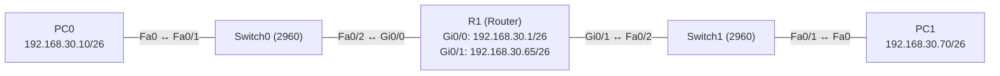

# Übung 1.3: Subnetting von Hand – ein /24 in vier Netze

| | |
|---|---|
| **Modul** | 1 – Grundlagen |
| **Stufe** | Grundlage |
| **Geschätzte Zeit** | ca. 75–90 Minuten (Teil A Rechnen ca. 40 Minuten, Teil B Packet Tracer ca. 40 Minuten) |
| **Werkzeug** | Papier und Stift, Cisco Packet Tracer |
| **Vorwissen** | Übung 1.1 und 1.2 (IP-Adresse, Subnetzmaske, Router, Default Gateway) |

> **Stand der Prüfung:** Entwurf. Alle Rechenergebnisse (Subnetze, Masken, Hostzahlen, Binärwerte) sind nachgerechnet und stimmen. Die IOS-Befehle sind dieselben wie in Übung 1.2 (`ip address`, `no shutdown`, `show ip route`) und dort belegt. **Nicht bestätigt** sind die gezeigten Ausgaben in Packet Tracer (`show ip route`, `ping`, Verhalten bei falscher Maske) sowie der GUI-Weg am Router (*Config* → Interface).

## Lernziele

Nach dieser Übung kannst du

- eine IPv4-Adresse und eine Subnetzmaske in Binärschreibweise umrechnen und die Präfixschreibweise (`/26`) lesen,
- aus Adresse und Maske die **Netzadresse**, die **Broadcast-Adresse**, den **Bereich der Geräteadressen** und die **Anzahl der Geräte** bestimmen,
- ein `/24`-Netz von Hand in vier gleich große Subnetze teilen,
- entscheiden, ob zwei Geräte im selben Subnetz liegen,
- zwei Subnetze in Packet Tracer mit einem Router verbinden und mit `show ip route` prüfen,
- erklären, was passiert, wenn eine Subnetzmaske falsch eingetragen ist.

## Voraussetzungen

Die Übungen 1.1 und 1.2. Du solltest wissen, was IP-Adresse, Subnetzmaske, Router und Default Gateway sind und wie man PCs und Router in Packet Tracer konfiguriert. Binärzahlen werden hier Schritt für Schritt erklärt, du brauchst dafür keine Vorkenntnisse.

## Grundbegriffe

| Begriff | Bedeutung |
|---|---|
| Bit | Eine Stelle einer Binärzahl, `0` oder `1`. Eine IPv4-Adresse besteht aus 32 Bit, geschrieben als vier Zahlen (Oktette) zu je 8 Bit. |
| Oktett | Eine der vier Zahlen einer IPv4-Adresse, 8 Bit, Wert 0 bis 255. |
| Präfixlänge | Die Zahl nach dem Schrägstrich, z. B. `/26`. Sie sagt, wie viele Bit **von links** zum Netzanteil gehören. |
| Netzanteil / Geräteanteil | Netzanteil: die ersten Bit, die das Netz bezeichnen. Geräteanteil (Host-Bits): die restlichen Bit, die das Gerät im Netz bezeichnen. |
| Subnetz | Ein Teilnetz. Beim Subnetting „leiht“ man sich Bit aus dem Geräteanteil, um mehrere kleinere Netze zu bilden. |
| Netzadresse | Die erste Adresse eines Netzes (alle Host-Bit `0`). Sie bezeichnet das Netz und wird keinem Gerät gegeben. |
| Broadcast-Adresse | Die letzte Adresse eines Netzes (alle Host-Bit `1`). Ein Paket an sie geht an alle Geräte des Netzes. Sie wird keinem Gerät gegeben. |
| Blockgröße | Der Abstand zwischen den Netzadressen zweier aufeinanderfolgender Subnetze, hier `256 − 192 = 64`. |

**Binär lesen:** Jedes Bit eines Oktetts hat einen Stellenwert:

| Stellenwert | 128 | 64 | 32 | 16 | 8 | 4 | 2 | 1 |
|---|---|---|---|---|---|---|---|---|
| Beispiel `192` | 1 | 1 | 0 | 0 | 0 | 0 | 0 | 0 |
| Beispiel `100` | 0 | 1 | 1 | 0 | 0 | 1 | 0 | 0 |

`192 = 128 + 64`, also `11000000`. `100 = 64 + 32 + 4`, also `01100100`.

**Die Subnetzmaske** ist eine Folge aus Einsen (Netzanteil), gefolgt von Nullen (Geräteanteil). `/26` bedeutet 26 Einsen:

```text
11111111.11111111.11111111.11000000  =  255.255.255.192  =  /26
```

**Wichtige Präfixlängen im letzten Oktett:**

| Präfix | Maske | Blockgröße | Geräteadressen je Subnetz |
|---|---|---|---|
| `/24` | `255.255.255.0` | 256 | 254 |
| `/25` | `255.255.255.128` | 128 | 126 |
| `/26` | `255.255.255.192` | 64 | 62 |
| `/27` | `255.255.255.224` | 32 | 30 |
| `/28` | `255.255.255.240` | 16 | 14 |
| `/29` | `255.255.255.248` | 8 | 6 |
| `/30` | `255.255.255.252` | 4 | 2 |

Die Zahl der Geräteadressen ist `2^(Host-Bit) − 2`. Die beiden abgezogenen Adressen sind Netzadresse und Broadcast-Adresse.

> **Merksatz:** Ein Gerät gehört zu einem Netz, wenn seine Adresse **UND** die Subnetzmaske (Bit für Bit) die Netzadresse ergibt. Zwei Geräte liegen im selben Netz, wenn dabei dieselbe Netzadresse herauskommt.

## Topologie und Adressplan

Für Teil B: Zwei der vier Subnetze werden an den Router gehängt, die anderen zwei bleiben vorerst frei.



| Gerät | Port / Interface | IP-Adresse | Subnetzmaske | Default Gateway |
|---|---|---|---|---|
| PC0 | FastEthernet0 | `192.168.30.10` | `255.255.255.192` | `192.168.30.1` |
| PC1 | FastEthernet0 | `192.168.30.70` | `255.255.255.192` | `192.168.30.65` |
| R1 | `GigabitEthernet0/0` | `192.168.30.1` | `255.255.255.192` | – |
| R1 | `GigabitEthernet0/1` | `192.168.30.65` | `255.255.255.192` | – |
| Switch0, Switch1 | – | keine | – | – |

Die Adressen stammen aus der Aufteilung in Teil A (Subnetz 0 und Subnetz 1). Es gilt wieder: Die Switches bekommen keine Konfiguration.

## Aufgabe

> **Schema dieser Übungsreihe: zwei Wege pro Schritt.** Wo ein Schritt keinen GUI- oder CLI-Weg hat (hier Teil A, reine Rechnung auf Papier), steht das ausdrücklich dabei. Alle Befehle, die du eingeben sollst, stehen in Codeblöcken. Die CLI-Befehle und GUI-Wege in Teil B sind in dieser Entwurfsfassung noch nicht in Packet Tracer bestätigt.

### Teil A: Rechnen von Hand

Löse Teil A zuerst **ohne Hilfsmittel**. Prüfe danach die Ergebnisse mit der Musterlösung.

**1. Binär umrechnen**

- **GUI:** Entfällt, Rechenaufgabe auf Papier.
- **CLI:** Entfällt.

Schreibe `192`, `100` und `70` als 8-Bit-Zahl. Welche Maske gehört zu `/26`, und wie lautet ihr letztes Oktett binär?

**2. Eigenschaften von `192.168.30.0/24` und `/26`**

- **GUI:** Entfällt, Rechenaufgabe auf Papier.
- **CLI:** Entfällt.

Wie viele Host-Bit hat ein `/24`, wie viele ein `/26`? Wie viele Bit werden dafür „geliehen“, wie viele Subnetze entstehen, und wie viele Geräteadressen hat jedes?

**3. Das `/24` in vier Subnetze teilen**

- **GUI:** Entfällt, Rechenaufgabe auf Papier.
- **CLI:** Entfällt.

Teile `192.168.30.0/24` in vier gleich große Subnetze. Fülle für jedes Subnetz diese Tabelle aus:

| Subnetz | Netzadresse | Maske | Erste Geräteadresse | Letzte Geräteadresse | Broadcast |
|---|---|---|---|---|---|
| 0 | | | | | |
| 1 | | | | | |
| 2 | | | | | |
| 3 | | | | | |

**4. Zu welchem Subnetz gehört eine Adresse?**

- **GUI:** Entfällt, Rechenaufgabe auf Papier.
- **CLI:** Entfällt.

Bestimme für `192.168.30.100/26` und `192.168.30.200/26` Netzadresse und Broadcast-Adresse. Rechne bei `192.168.30.100` einmal mit der binären UND-Verknüpfung.

**5. Liegen zwei Geräte im selben Netz?**

- **GUI:** Entfällt, Rechenaufgabe auf Papier.
- **CLI:** Entfällt.

Beide Geräte haben die Maske `255.255.255.192`.

| Gerät A | Gerät B | Selbes Netz? |
|---|---|---|
| `192.168.30.60` | `192.168.30.70` | |
| `192.168.30.10` | `192.168.30.60` | |

**6. Welche Größe reicht?**

- **GUI:** Entfällt, Rechenaufgabe auf Papier.
- **CLI:** Entfällt.

In einem Netz sollen 50 Geräte plus der Router arbeiten. Reicht ein `/26`? Welches ist das kleinste Netz (`/25` bis `/30`), das für 25 Geräte plus Router ausreicht?

### Teil B: Umsetzung in Packet Tracer

**7. Neues Projekt beginnen** und Geräte platzieren: zwei PCs, zwei Switches (*2960*), ein Router (z. B. *1941* oder *2911*)

- **GUI:** Packet Tracer starten, *File* → *New*. Geräte wie in Übung 1.2 platzieren.
- **CLI:** Entfällt.

**8. Verkabeln** mit *Copper Straight-Through*: PC0 ↔ Switch0 `Fa0/1`, Switch0 `Fa0/2` ↔ R1 `GigabitEthernet0/0`, R1 `GigabitEthernet0/1` ↔ Switch1 `Fa0/2`, Switch1 `Fa0/1` ↔ PC1

- **GUI:** Kategorie *Connections*, Kabeltyp anklicken, beide Geräte anklicken, Ports wählen.
- **CLI:** Entfällt.

**9. Den Router konfigurieren** (Adressplan oben, mit den Adressen aus Teil A, Subnetz 0 und 1)

- **GUI:** Router → *Config* → *GigabitEthernet0/0*: *IP Address* `192.168.30.1`, *Subnet Mask* `255.255.255.192`, *Port Status* *On*. *GigabitEthernet0/1*: `192.168.30.65`, `255.255.255.192`, *On*.
- **CLI:** Router → Reiter *CLI*:
  ```text
  Router> enable
  Router# configure terminal
  Router(config)# hostname R1
  R1(config)# interface gigabitethernet 0/0
  R1(config-if)# description Subnetz 0 zu Switch0
  R1(config-if)# ip address 192.168.30.1 255.255.255.192
  R1(config-if)# no shutdown
  R1(config-if)# exit
  R1(config)# interface gigabitethernet 0/1
  R1(config-if)# description Subnetz 1 zu Switch1
  R1(config-if)# ip address 192.168.30.65 255.255.255.192
  R1(config-if)# no shutdown
  R1(config-if)# end
  ```

**10. PCs konfigurieren** (Adressplan oben)

- **GUI:** PC → *Desktop* → *IP Configuration* → *Static*, *IPv4 Address*, *Subnet Mask* (`255.255.255.192`) und *Default Gateway* eintragen.
- **CLI:** Entfällt am PC (siehe Übung 1.1).

Achte darauf, dass Packet Tracer die Maske nicht von selbst richtig einträgt: Bei `192.168.x.x` schlägt es meist `255.255.255.0` vor. Überschreibe sie.

**11. Prüfen**

- **GUI:** PC: *Desktop* → *IP Configuration*. Router: *Config* → jeweiliges Interface.
- **CLI:** Am PC (*Command Prompt*):
  ```text
  PC> ipconfig
  ```
  Am Router (*CLI*):
  ```text
  R1# show ip interface brief
  R1# show ip route
  ```

**12. Verbindung testen**

- **GUI:** Werkzeug *Add Simple PDU*: PC0 → R1, PC0 → PC1, PC1 → PC0.
- **CLI:** An PC0 (*Command Prompt*):
  ```text
  PC> ping 192.168.30.1
  PC> ping 192.168.30.65
  PC> ping 192.168.30.70
  ```

**13. Gegenprobe: falsche Maske**

- **GUI:** An PC0 unter *Desktop* → *IP Configuration* die Maske auf `255.255.255.0` ändern, Gateway belassen. Ping von PC0 zu PC1 (`192.168.30.70`) wiederholen. Danach die Maske wieder auf `255.255.255.192` stellen.
- **CLI:** Entfällt am PC (Konfiguration nur über die GUI). Test mit:
  ```text
  PC> ping 192.168.30.70
  ```
  Notiere, was Packet Tracer ausgibt, und überlege, warum.

**14. Projekt und Konfiguration speichern** als `01.3-subnetting-von-hand.pkt`

- **GUI:** *File* → *Save As* (oder `Strg+S`).
- **CLI:** Entfällt für die Projektdatei. Die Router-Konfiguration sichert man mit:
  ```text
  R1# copy running-config startup-config
  ```

## Hintergrund: Wie Subnetting funktioniert

1. **Ausgangslage:** `192.168.30.0/24` hat 24 Bit Netzanteil und 8 Bit Geräteanteil, also 256 Adressen (254 für Geräte).
2. **Bit leihen:** Für vier Subnetze braucht man 2 zusätzliche Netzbit (`2^2 = 4`). Die Präfixlänge wird `/26`, der Geräteanteil schrumpft auf 6 Bit, also `2^6 = 64` Adressen je Subnetz (62 für Geräte).
3. **Die geliehenen Bit nummerieren die Subnetze:** `00`, `01`, `10`, `11`. Im letzten Oktett ergibt das die Netzadressen `0`, `64`, `128`, `192`, also im Abstand der Blockgröße 64.
4. **Der Router sieht jedes Subnetz als eigenes Netz.** Er legt für jedes Interface einen `C`-Eintrag (`192.168.30.0/26` und `192.168.30.64/26`) und einen `L`-Eintrag an.
5. **Warum die Maske entscheidend ist:** PC0 (`192.168.30.10`) vergleicht mit seiner Maske die Netzanteile. Bei `/26` ist `192.168.30.70` ein **fremdes** Netz, PC0 schickt das Paket an sein Gateway. Bei einer falschen Maske `/24` hält PC0 dasselbe Ziel für **lokal**, sendet einen ARP-Request für `192.168.30.70` direkt in sein Netz, und dort antwortet niemand, denn PC1 liegt hinter dem Router. Der ARP-Broadcast geht nicht über den Router.

> **Merke:** Ein Router kann dieselbe Netzadresse (`192.168.30.x`) in mehreren Subnetzen verbinden, aber die Maske muss überall zu den Subnetzen passen. Eine falsche Maske am PC wirkt wie ein falsch eingetragenes Gateway: Das Paket nimmt den falschen Weg.

## Hinweise

- Netzadresse und Broadcast-Adresse eines Subnetzes dürfen keinem Gerät gegeben werden. Bei Subnetz 1 sind das `192.168.30.64` und `192.168.30.127`.
- Die Schreibweise `192.168.30.64/26` bezeichnet das **Netz**, `192.168.30.70/26` ein **Gerät** darin.
- Die Router-Adresse ist hier jeweils die erste Geräteadresse des Subnetzes (`.1`, `.65`). Das ist eine Konvention, keine Pflicht.
- Prüfe Adressen selbst gegen deine Tabelle aus Teil A. Ob Packet Tracer die Eingabe einer Netz- oder Broadcast-Adresse als Geräteadresse verhindert, ist nicht bestätigt.
- Wenn ein Ping nicht klappt, vergleiche zuerst Maske und Gateway an PC und Router. Die meisten Subnetting-Fehler stecken dort.
- Ein Router-Interface kann nur ein Subnetz anbinden. Zwei Interfaces mit Adressen aus **demselben** Subnetz akzeptiert IOS nicht (Meldung: `% 192.168.30.0 overlaps with GigabitEthernet0/0`, sinngemäß, nicht bestätigt).

## Prüfbefehle

Am PC (Command Prompt):

```text
PC> ipconfig
PC> ping 192.168.30.1
PC> ping 192.168.30.70
PC> arp -a
```

Am Router (CLI):

```text
Router> enable
R1# show ip interface brief
R1# show ip route
R1# ping 192.168.30.70
```

| CLI-Befehl | Was er zeigt | GUI-Weg |
|---|---|---|
| `ipconfig` | Adresse, Subnetzmaske und Gateway des PCs | *Desktop* → *IP Configuration* |
| `ping <Ziel>` | Ob das Ziel erreichbar ist | Werkzeug *Add Simple PDU* |
| `arp -a` | Gemerkte IP-zu-MAC-Zuordnungen des PCs | Werkzeug *Inspect* → PC → *ARP Table* |
| `show ip interface brief` | Adresse und Status der Router-Interfaces | *Config* → jeweiliges Interface |
| `show ip route` | Routingtabelle (`C` und `L`) | Werkzeug *Inspect* → Router → *Routing Table* |

**Kontrollfragen**

1. Wie viele Geräteadressen hat ein `/26`, und wie rechnet man das aus?
2. Welche Netzadresse und welche Broadcast-Adresse hat das Subnetz, zu dem `192.168.30.100/26` gehört?
3. Warum liegen `192.168.30.60` und `192.168.30.70` bei `/26` in verschiedenen Netzen, bei `/24` aber im selben?
4. Warum ist die erste nutzbare Adresse eines Subnetzes nicht die Netzadresse selbst?
5. Was passiert, wenn an PC0 die Maske `255.255.255.0` statt `255.255.255.192` eingetragen ist und PC0 `192.168.30.70` anpingt?

## Erweiterungen

- **Subnetz 2 anbinden:** Dritter PC mit `192.168.30.130`, Gateway `192.168.30.129`, an `GigabitEthernet0/2` des Routers (Modell 2911 hat drei Gigabit-Ports; bei 1941 nicht vorhanden). Danach mit `show ip route` die sechs Einträge prüfen.
- **Anderes Netz teilen:** `192.168.40.0/24` in acht gleich große Subnetze teilen (`/27`). Wie viele Geräte passen in jedes?
- **Ungleich große Subnetze:** Drei Abteilungen brauchen 50, 25 und 10 Geräte. Wie teilst du ein `/24` sinnvoll, wenn die Subnetze verschieden groß sein dürfen? (Vorbereitung auf VLSM, spätere Übung.)
- **Fehler provozieren:** Router-Interface `Gi0/1` die Adresse `192.168.30.130/26` geben, PC1 aber `192.168.30.70/26` lassen. Warum geht kein Ping?

---

## Musterlösung

<details>
<summary>Musterlösung anzeigen</summary>

**Aufgabe 1: Binär umrechnen.**

| Dezimal | Binär | Rechnung |
|---|---|---|
| `192` | `11000000` | `128 + 64` |
| `100` | `01100100` | `64 + 32 + 4` |
| `70` | `01000110` | `64 + 4 + 2` |

`/26` bedeutet 26 Einsen: `11111111.11111111.11111111.11000000`, also `255.255.255.192`. Das letzte Oktett ist `11000000` (= 192).

**Aufgabe 2: Eigenschaften.** Ein `/24` hat 8 Host-Bit (`32 − 24`), ein `/26` hat 6 (`32 − 26`). Es werden 2 Bit geliehen (`26 − 24`), daraus entstehen `2^2 = 4` Subnetze. Jedes hat `2^6 = 64` Adressen, davon `64 − 2 = 62` für Geräte.

**Aufgabe 3: Die vier Subnetze.**

| Subnetz | Netzadresse | Maske | Erste Geräteadresse | Letzte Geräteadresse | Broadcast |
|---|---|---|---|---|---|
| 0 | `192.168.30.0/26` | `255.255.255.192` | `192.168.30.1` | `192.168.30.62` | `192.168.30.63` |
| 1 | `192.168.30.64/26` | `255.255.255.192` | `192.168.30.65` | `192.168.30.126` | `192.168.30.127` |
| 2 | `192.168.30.128/26` | `255.255.255.192` | `192.168.30.129` | `192.168.30.190` | `192.168.30.191` |
| 3 | `192.168.30.192/26` | `255.255.255.192` | `192.168.30.193` | `192.168.30.254` | `192.168.30.255` |

Vorgehen: Blockgröße `256 − 192 = 64`. Netzadressen sind Vielfache von 64 (`0`, `64`, `128`, `192`). Der Broadcast ist die nächste Netzadresse minus 1. Die Geräteadressen liegen dazwischen.

**Aufgabe 4: Zugehörigkeit.**

`192.168.30.100/26`: `100` liegt zwischen `64` und `127`, also Subnetz 1: Netzadresse `192.168.30.64`, Broadcast `192.168.30.127`. Binär:

```text
100  =  01100100
192  =  11000000   (Maske, letztes Oktett)
UND  =  01000000  =  64   -> Netzadresse 192.168.30.64
```

`192.168.30.200/26`: `200` liegt zwischen `192` und `255`, also Subnetz 3: Netzadresse `192.168.30.192`, Broadcast `192.168.30.255`.

**Aufgabe 5: Selbes Netz?**

| Gerät A | Gerät B | Selbes Netz? |
|---|---|---|
| `192.168.30.60` (Netz `.0`) | `192.168.30.70` (Netz `.64`) | nein |
| `192.168.30.10` (Netz `.0`) | `192.168.30.60` (Netz `.0`) | ja |

**Aufgabe 6: Welche Größe?** Für 50 Geräte plus Router (51 Adressen) reicht ein `/26` mit 62 Geräteadressen. Für 25 Geräte plus Router (26 Adressen) reicht ein `/27` (30 Geräteadressen); ein `/28` hat nur 14.

**Aufbau (Schritte 7–8, nur GUI):** Wie in Übung 1.2: PC0 → Switch0 `Fa0/1`, Switch0 `Fa0/2` → R1 `Gi0/0`, R1 `Gi0/1` → Switch1 `Fa0/2`, Switch1 `Fa0/1` → PC1.

**Router (Schritt 9):** GUI wie in der Aufgabe beschrieben. CLI:

```text
Router> enable
Router# configure terminal
Router(config)# hostname R1
R1(config)# interface gigabitethernet 0/0
R1(config-if)# description Subnetz 0 zu Switch0
R1(config-if)# ip address 192.168.30.1 255.255.255.192
R1(config-if)# no shutdown
R1(config-if)# exit
R1(config)# interface gigabitethernet 0/1
R1(config-if)# description Subnetz 1 zu Switch1
R1(config-if)# ip address 192.168.30.65 255.255.255.192
R1(config-if)# no shutdown
R1(config-if)# end
```

**PCs (Schritt 10):**

| | IPv4 Address | Subnet Mask | Default Gateway |
|---|---|---|---|
| PC0 | `192.168.30.10` | `255.255.255.192` | `192.168.30.1` |
| PC1 | `192.168.30.70` | `255.255.255.192` | `192.168.30.65` |

**Prüfen (Schritt 11, sinngemäß, nicht bestätigt):** `show ip interface brief` zeigt beide Interfaces `up` / `up`. `show ip route` (gekürzt):

```text
R1# show ip route
Codes: L - local, C - connected, S - static, ...
Gateway of last resort is not set

     192.168.30.0/24 is variably subnetted, 4 subnets, 2 masks
C       192.168.30.0/26 is directly connected, GigabitEthernet0/0
L       192.168.30.1/32 is directly connected, GigabitEthernet0/0
C       192.168.30.64/26 is directly connected, GigabitEthernet0/1
L       192.168.30.65/32 is directly connected, GigabitEthernet0/1
```

Die Kopfzeile nennt das klassische `/24` des Adressblocks, darunter stehen die vier Einträge (zwei Netze, zwei Interface-Adressen). Die genaue Darstellung in Packet Tracer ist nicht bestätigt.

**Ping (Schritt 12, sinngemäß, nicht bestätigt):** `ping 192.168.30.1` und `ping 192.168.30.65` gehen durch (die Adresse `.65` liegt im anderen Subnetz, PC0 erreicht sie über sein Gateway). `ping 192.168.30.70` gelingt ebenfalls, der erste Versuch kann wegen ARP verloren gehen. Die TTL der Antworten von PC1 ist um 1 kleiner (`127`, wenn der Standardwert `128` ist).

**Gegenprobe (Schritt 13):** Mit der falschen Maske `255.255.255.0` hält PC0 das Ziel `192.168.30.70` für **lokal** (`192.168.30` ist gleich), sendet direkt einen ARP-Request für `192.168.30.70` und erhält keine Antwort, weil der Router ARP-Broadcasts nicht weiterleitet. Der Ping schlägt fehl. Ein Ping an das Gateway `192.168.30.1` klappt weiter. Die genaue Ausgabe in Packet Tracer ist nicht bestätigt.

**Antworten auf die Kontrollfragen:**

1. `2^(Host-Bit) − 2`. Beim `/26` sind es 6 Host-Bit, also `2^6 − 2 = 62`. Die beiden Abzüge sind Netzadresse und Broadcast-Adresse.
2. `192.168.30.64` und `192.168.30.127`.
3. Bei `/26` ist `192.168.30.60` in Subnetz 0 (`0` bis `63`) und `192.168.30.70` in Subnetz 1 (`64` bis `127`). Bei `/24` ist der Netzanteil nur `192.168.30`, und der ist bei beiden gleich.
4. Die Netzadresse (alle Host-Bit `0`) bezeichnet das Netz selbst, nicht ein Gerät. Deshalb fängt die Vergabe mit der nächsten Adresse an.
5. PC0 hält `192.168.30.70` für lokal, sendet ARP-Requests direkt in sein Netz, bekommt keine Antwort (der Router leitet kein ARP weiter), und der Ping schlägt fehl.

</details>

---

## Quellen

- Aufteilung, Maske, Blockgröße und Hostzahlen: nachgerechnet (Python-Modul `ipaddress`) und von Hand geprüft. Das Verfahren (geliehene Bit, Blockgröße, UND-Verknüpfung) ist Standardstoff der IPv4-Adressierung.
- Cisco Networking Academy, *Packet Tracer – Connect a Router to a LAN* (Wiedergabe: [ccnav5-lab.blogspot.com](https://ccnav5-lab.blogspot.com/2015/02/6433-packet-tracer-connect-router-to.html)): Router-Konfiguration und Gateway an den PCs (dasselbe Vorgehen wie in Übung 1.2).
- Flackbox, *Cisco Connected and Local Routes* ([flackbox.com](https://www.flackbox.com/cisco-connected-and-local-routes)): Bedeutung von `C` und `L`. Tutorial ohne offiziellen Beleg.

---

Lizenz: [CC BY-NC-SA 4.0](https://creativecommons.org/licenses/by-nc-sa/4.0/deed.de), Urheber: AnsibleArtisan4711. Cisco, Cisco IOS und Cisco Packet Tracer sind Marken von Cisco Systems, Inc. und/oder ihrer Tochtergesellschaften; dieses Dokument steht in keiner Verbindung zu Cisco.
