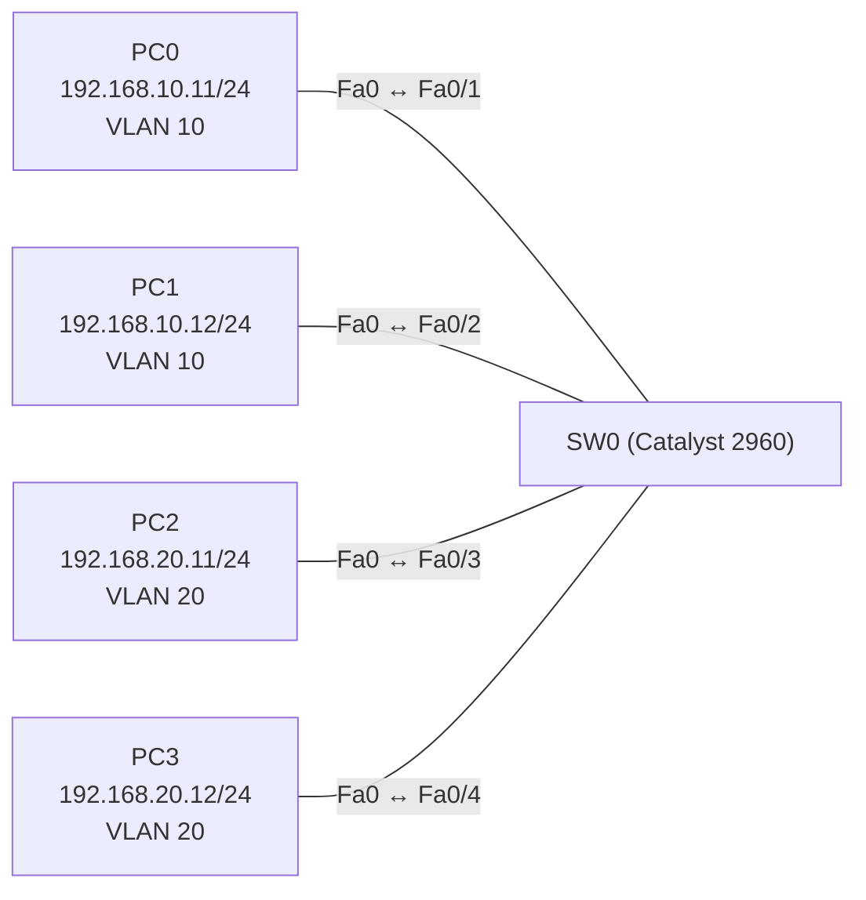

# Übung 2.1: VLANs anlegen und Ports zuweisen

| | |
|---|---|
| **Modul** | 2 – Switching |
| **Stufe** | Grundlage |
| **Geschätzte Zeit** | ca. 45–60 Minuten |
| **Werkzeug** | Cisco Packet Tracer |
| **Vorwissen** | Modul 1 (IP-Adresse, Subnetzmaske, Switch, Ping) |

> **Stand der Prüfung:** Entwurf. Die IOS-Befehle (`vlan`, `name`, `switchport mode access`, `switchport access vlan`, `show vlan brief`) sind durch Lab- und Tutorial-Quellen belegt (siehe Quellen). **Nicht bestätigt** sind die gezeigten Ausgaben (`show vlan brief`, `ping`, Fehlerfall), der GUI-Weg über *Config* → *VLAN Database* am Switch sowie das Verhalten in Packet Tracer, wenn ein Port nach einer VLAN-Änderung neu zugeordnet wird.

## Lernziele

Nach dieser Übung kannst du

- erklären, was ein VLAN ist und warum man ein Netz damit in getrennte Bereiche teilt,
- auf einem Switch VLANs anlegen und benennen,
- Switch-Ports einem VLAN zuweisen (Access-Ports),
- mit `show vlan brief` prüfen, welcher Port in welchem VLAN liegt,
- beschreiben, warum Geräte in verschiedenen VLANs sich ohne Router nicht erreichen, obwohl sie am selben Switch hängen.

## Voraussetzungen

Modul 1, insbesondere Übung 1.1 (zwei PCs und ein Switch) und 1.2 (Netze, Default Gateway). Neu in dieser Übung sind VLANs und Access-Ports; beides wird hier erklärt.

## Grundbegriffe

| Begriff | Bedeutung |
|---|---|
| VLAN | *Virtual Local Area Network*. Ein Switch wird logisch in mehrere getrennte Netze geteilt. Geräte in verschiedenen VLANs sehen sich nicht, auch wenn sie am selben Switch hängen. |
| VLAN-ID | Die Nummer eines VLANs (1 bis 4094). VLAN 1 ist das Standard-VLAN, in dem alle Ports ab Werk liegen. |
| Access-Port | Ein Switch-Port, der genau **einem** VLAN angehört und an dem ein Endgerät (z. B. ein PC) hängt. |
| Broadcast-Domäne | Der Bereich, in dem ein Broadcast (z. B. ein ARP-Request) alle erreicht. Jedes VLAN ist eine eigene Broadcast-Domäne. |
| `show vlan brief` | IOS-Befehl, der alle VLANs mit den zugehörigen Ports anzeigt. |

> **Merksatz:** Ein VLAN macht aus einem Switch mehrere getrennte Switches. Zwischen VLANs kommt man nur über einen Router (Modul 3).

## Topologie und Adressplan



| Gerät | Port / Interface | IP-Adresse | Subnetzmaske | VLAN |
|---|---|---|---|---|
| PC0 | Fa0 ↔ `Fa0/1` | `192.168.10.11` | `255.255.255.0` | 10 (Verkauf) |
| PC1 | Fa0 ↔ `Fa0/2` | `192.168.10.12` | `255.255.255.0` | 10 (Verkauf) |
| PC2 | Fa0 ↔ `Fa0/3` | `192.168.20.11` | `255.255.255.0` | 20 (Technik) |
| PC3 | Fa0 ↔ `Fa0/4` | `192.168.20.12` | `255.255.255.0` | 20 (Technik) |

Es gibt keinen Router und kein Default Gateway. Die beiden VLANs sind absichtlich getrennt, jedes mit einem eigenen Netz.

## Aufgabe

> **Schema dieser Übungsreihe: zwei Wege pro Schritt.** Jeder Schritt wird über die grafische Oberfläche (**GUI**) und über die Kommandozeile (**CLI**) beschrieben. Wo es in Packet Tracer keinen CLI-Weg gibt, steht das ausdrücklich dabei. Alle Befehle, die du eingeben sollst, stehen in Codeblöcken. Die CLI-Befehle und GUI-Wege sind in dieser Entwurfsfassung noch nicht in Packet Tracer bestätigt.

**1. Neues Projekt beginnen** und Geräte platzieren: einen Switch (*2960*) und vier PCs

- **GUI:** *File* → *New*. Geräte aus der Geräteleiste in den Arbeitsbereich setzen.
- **CLI:** Entfällt (nur grafisch möglich).

**2. Verkabeln** mit *Copper Straight-Through*: PC0 → `Fa0/1`, PC1 → `Fa0/2`, PC2 → `Fa0/3`, PC3 → `Fa0/4`

- **GUI:** Kategorie *Connections*, Kabeltyp anklicken, erst den PC, dann den Switch anklicken, Ports wählen.
- **CLI:** Entfällt (Kabel gibt es nur grafisch).

**3. PCs konfigurieren** (Adressplan oben, Gateway leer)

- **GUI:** PC → *Desktop* → *IP Configuration* → *Static*, *IPv4 Address* und *Subnet Mask* eintragen.
- **CLI:** Entfällt am PC (siehe Übung 1.1).

**4. Den Ausgangszustand ansehen:** alle Ports liegen im VLAN 1

- **GUI:** Switch anklicken → Reiter *Config* → *VLAN Database*. Dort steht VLAN 1 (*default*).
- **CLI:** Switch → Reiter *CLI*:
  ```text
  Switch> enable
  Switch# show vlan brief
  ```
  Alle Ports `Fa0/1` bis `Fa0/24` und `Gi0/1`, `Gi0/2` stehen beim VLAN 1 `default`. Dazu gibt es vier vordefinierte VLANs (1002 bis 1005), die du ignorieren kannst.

Teste jetzt einmal `ping 192.168.10.12` von PC0: Im VLAN 1 sind PC0 und PC1 verbunden, der Ping klappt. Der Ping von PC0 zu PC2 (`192.168.20.11`) klappt nicht, aber aus einem anderen Grund: PC0 und PC2 liegen in **verschiedenen IP-Netzen**, und es gibt kein Gateway.

**5. Hostnamen vergeben und VLANs anlegen und benennen:** VLAN 10 `Verkauf`, VLAN 20 `Technik`

- **GUI:** *Config* → *VLAN Database*: *VLAN Number* `10`, *VLAN Name* `Verkauf`, *Add*; danach `20` und `Technik`.
- **CLI:**
  ```text
  Switch> enable
  Switch# configure terminal
  Switch(config)# hostname SW0
  SW0(config)# vlan 10
  SW0(config-vlan)# name Verkauf
  SW0(config-vlan)# exit
  SW0(config)# vlan 20
  SW0(config-vlan)# name Technik
  SW0(config-vlan)# exit
  ```

**6. Ports den VLANs zuweisen:** `Fa0/1` und `Fa0/2` zu VLAN 10, `Fa0/3` und `Fa0/4` zu VLAN 20

- **GUI:** Switch → *Config* → jeweiliger Port (z. B. *FastEthernet0/1*): *Mode* auf *Access*, *VLAN* auf das gewünschte VLAN (10 bzw. 20) stellen.
- **CLI:**
  ```text
  SW0(config)# interface range fastethernet 0/1 - 2
  SW0(config-if-range)# switchport mode access
  SW0(config-if-range)# switchport access vlan 10
  SW0(config-if-range)# exit
  SW0(config)# interface range fastethernet 0/3 - 4
  SW0(config-if-range)# switchport mode access
  SW0(config-if-range)# switchport access vlan 20
  SW0(config-if-range)# end
  ```

**7. Prüfen**

- **GUI:** Switch → *Config* → *VLAN Database* und jeweilige Ports ansehen.
- **CLI:**
  ```text
  SW0# show vlan brief
  ```
  `Fa0/1` und `Fa0/2` stehen jetzt bei VLAN 10 `Verkauf`, `Fa0/3` und `Fa0/4` bei VLAN 20 `Technik`.

**8. Verbindung testen**

- **GUI:** Werkzeug *Add Simple PDU*: PC0 → PC1, PC2 → PC3, PC0 → PC2.
- **CLI:** An PC0 (*Command Prompt*):
  ```text
  PC> ping 192.168.10.12
  PC> ping 192.168.20.11
  ```
  Der erste Ping (gleiches VLAN) klappt, der zweite (anderes VLAN) nicht. Teste auch an PC2:
  ```text
  PC> ping 192.168.20.12
  PC> ping 192.168.10.11
  ```

**9. Gegenprobe: Ein PC im falschen VLAN**

- **GUI:** *Config* → `Fa0/2` → VLAN auf `20` stellen. Danach von PC1 (`192.168.10.12`, jetzt in VLAN 20) PC0 und PC3 anpingen. Danach `Fa0/2` wieder auf VLAN 10 stellen.
- **CLI:**
  ```text
  SW0# configure terminal
  SW0(config)# interface fastethernet 0/2
  SW0(config-if)# switchport access vlan 20
  SW0(config-if)# end
  ```
  An PC1:
  ```text
  PC> ping 192.168.10.11
  PC> ping 192.168.20.12
  ```
  Notiere, was passiert und warum. Danach zurücksetzen:
  ```text
  SW0# configure terminal
  SW0(config)# interface fastethernet 0/2
  SW0(config-if)# switchport access vlan 10
  SW0(config-if)# end
  ```

**10. Projekt und Konfiguration speichern** als `02.1-vlans-anlegen-und-ports-zuweisen.pkt`

- **GUI:** *File* → *Save As* (oder `Strg+S`).
- **CLI:** Entfällt für die Projektdatei. Die Konfiguration des Switches sichert man mit:
  ```text
  SW0# copy running-config startup-config
  ```

## Hintergrund: Was macht ein VLAN?

1. **Ohne VLANs ist der Switch ein einziges Netz.** Ein Broadcast (z. B. ein ARP-Request) geht an alle Ports. Je mehr Geräte, desto mehr Störverkehr.
2. **Mit VLANs wird der Switch geteilt.** Jeder Port gehört zu genau einem VLAN, und der Switch leitet Frames nur zwischen Ports **desselben VLANs** weiter. Broadcasts bleiben im VLAN.
3. **PC0 und PC1 (VLAN 10)** reden miteinander wie in Übung 1.1: ARP, dann Ping.
4. **PC0 und PC2 (VLAN 10 und 20)** sehen sich nicht. Der ARP-Request von PC0 erreicht PC2 nicht, weil der Switch den Broadcast nur in VLAN 10 verteilt. Zusätzlich liegen beide in **verschiedenen IP-Netzen**, PC0 würde das Paket ohnehin an ein Gateway schicken wollen.
5. **Ein VLAN entspricht in der Regel einem IP-Netz.** Zwischen VLANs verbindet nur ein Router (Modul 3, Inter-VLAN-Routing).

> **Warum bringt das Verschieben von PC1 in VLAN 20 (Schritt 9) nichts?** PC1 behält seine Adresse `192.168.10.12/24`. Im VLAN 20 sieht er PC2 und PC3, aber er hat eine Adresse aus einem anderen Netz. VLAN-Zuordnung und IP-Netz müssen zusammenpassen.

## Hinweise

- Alle Ports sind ab Werk im VLAN 1. VLAN 1 kann man nicht löschen.
- Ein Port kann nur in **einem** VLAN liegen, wenn er als Access-Port arbeitet.
- `switchport mode access` legt den Port eindeutig als Access-Port fest. Ohne den Befehl handelt der Port die Rolle selbst aus (DTP), das ist für Endgeräte unerwünscht.
- Benenne VLANs sprechend. Der Name hat keinen Einfluss auf die Funktion, hilft dir aber beim Lesen von `show vlan brief`.
- Wird einem Port ein VLAN zugewiesen, das noch nicht existiert, legt IOS es je nach Version automatisch an. Lege VLANs trotzdem immer vorher selbst an (nicht bestätigt in Packet Tracer).
- Die Reihenfolge `vlan` zuerst, dann Port zuweisen, vermeidet Überraschungen.

## Prüfbefehle

Am PC (Command Prompt):

```text
PC> ipconfig
PC> ping 192.168.10.12
PC> arp -a
```

Am Switch (CLI):

```text
SW0> enable
SW0# show vlan brief
SW0# show interfaces status
SW0# show running-config
```

| CLI-Befehl | Was er zeigt | GUI-Weg |
|---|---|---|
| `show vlan brief` | Alle VLANs mit Namen, Status und zugehörigen Ports | *Config* → *VLAN Database* |
| `show interfaces status` | Status der Ports, auch das VLAN je Port | Farbe der Link-Punkte; *Config* → jeweiliger Port |
| `show running-config` | Die gesamte aktuelle Konfiguration | *Config* → *Settings* (Reiter *Config*) |
| `ping <Ziel>` | Ob das Ziel erreichbar ist | Werkzeug *Add Simple PDU* |

**Kontrollfragen**

1. Was ist ein VLAN, und was ist der Nutzen?
2. In welchem VLAN liegen alle Ports eines neuen Switches?
3. Warum erreicht PC0 (VLAN 10) den PC2 (VLAN 20) nicht, obwohl beide am selben Switch hängen?
4. Was bewirkt `switchport mode access`, und warum setzt man es für Ports zu PCs?
5. Was macht der Befehl `switchport access vlan 20` auf `Fa0/2`?

## Erweiterungen

- **Drittes VLAN:** VLAN 30 `Verwaltung` mit einem fünften PC (`192.168.30.11`) an `Fa0/5` anlegen.
- **VLAN-Name ändern:** Mit `name` den Namen von VLAN 20 ändern und in `show vlan brief` prüfen.
- **VLAN löschen:** Mit `no vlan 20` das VLAN löschen. Was zeigt `show vlan brief` danach für `Fa0/3` und `Fa0/4`, und was zeigt `show interfaces status`? (Verhalten nicht bestätigt, bitte notieren.)
- **Weiter:** Übung 2.2 verbindet zwei Switches mit einem Trunk, damit die VLANs über beide Switches reichen.

---

## Musterlösung

<details>
<summary>Musterlösung anzeigen</summary>

**Aufbau (Schritte 1–2, nur GUI):** Einen Switch 2960 und vier PCs platzieren, mit *Copper Straight-Through* verkabeln: PC0 → `Fa0/1`, PC1 → `Fa0/2`, PC2 → `Fa0/3`, PC3 → `Fa0/4`.

**PC-Konfiguration (Schritt 3):**

| | IPv4 Address | Subnet Mask | Default Gateway |
|---|---|---|---|
| PC0 | `192.168.10.11` | `255.255.255.0` | leer |
| PC1 | `192.168.10.12` | `255.255.255.0` | leer |
| PC2 | `192.168.20.11` | `255.255.255.0` | leer |
| PC3 | `192.168.20.12` | `255.255.255.0` | leer |

**Ausgangszustand (Schritt 4, sinngemäß, nicht bestätigt):**

```text
Switch# show vlan brief

VLAN Name                             Status    Ports
---- -------------------------------- --------- -------------------------------
1    default                          active    Fa0/1, Fa0/2, Fa0/3, Fa0/4
                                                Fa0/5, Fa0/6, ...
                                                Gi0/1, Gi0/2
1002 fddi-default                     active
1003 token-ring-default               active
1004 fddinet-default                  active
1005 trnet-default                    active
```

**VLANs und Ports (Schritte 5–6):** GUI wie in der Aufgabe. CLI:

```text
Switch> enable
Switch# configure terminal
Switch(config)# hostname SW0
SW0(config)# vlan 10
SW0(config-vlan)# name Verkauf
SW0(config-vlan)# exit
SW0(config)# vlan 20
SW0(config-vlan)# name Technik
SW0(config-vlan)# exit
SW0(config)# interface range fastethernet 0/1 - 2
SW0(config-if-range)# switchport mode access
SW0(config-if-range)# switchport access vlan 10
SW0(config-if-range)# exit
SW0(config)# interface range fastethernet 0/3 - 4
SW0(config-if-range)# switchport mode access
SW0(config-if-range)# switchport access vlan 20
SW0(config-if-range)# end
```

**Prüfen (Schritt 7, sinngemäß, nicht bestätigt):**

```text
SW0# show vlan brief

VLAN Name                             Status    Ports
---- -------------------------------- --------- -------------------------------
1    default                          active    Fa0/5, Fa0/6, Fa0/7, ...
                                                Gi0/1, Gi0/2
10   Verkauf                          active    Fa0/1, Fa0/2
20   Technik                          active    Fa0/3, Fa0/4
1002 fddi-default                     active
...
```

**Ping (Schritt 8, sinngemäß, nicht bestätigt):** PC0 → PC1 und PC2 → PC3 klappen (der erste Versuch kann wegen ARP verloren gehen). PC0 → PC2 und PC2 → PC0 schlagen fehl. Die genaue Ausgabe in Packet Tracer ist nicht bestätigt, bitte notieren.

**Gegenprobe (Schritt 9):** Mit `Fa0/2` in VLAN 20 erreicht PC1 weder PC0 (anderes VLAN) noch PC3 (anderes IP-Netz, kein Gateway). PC0 erreicht PC1 ebenfalls nicht mehr. Nach dem Zurücksetzen auf VLAN 10 klappt der Ping wieder.

**Antworten auf die Kontrollfragen:**

1. Ein VLAN teilt einen Switch logisch in getrennte Netze. Nutzen: Geräte werden nach Funktion getrennt, Broadcasts bleiben im VLAN, und der Datenverkehr lässt sich besser steuern und absichern.
2. Im VLAN 1 (*default*).
3. Der Switch leitet Frames nur zwischen Ports desselben VLANs weiter, und ein Broadcast bleibt im VLAN. Außerdem liegen die PCs in verschiedenen IP-Netzen. Zwischen VLANs vermittelt nur ein Router.
4. Der Befehl legt den Port fest als Access-Port: Er gehört zu genau einem VLAN und sendet keine VLAN-Tags. Ohne ihn könnte der Port seine Rolle mit dem Nachbarn aushandeln (DTP), was für Endgeräte unerwünscht ist.
5. Er weist den Port `Fa0/2` dem VLAN 20 zu (Voraussetzung: `switchport mode access`). Frames von diesem Port gehören dann zu VLAN 20.

</details>

---

## Quellen

- Cisco Networking Academy, *Packet Tracer – Implement VLANs and Trunking* (Aufgabenblatt, ohne Befehle): VLAN-Namen und Beispiele wie `Admin`, `Accounts`, `HR` ([sites.radford.edu](https://sites.radford.edu/~hlee3/classes/cs451_spring2025/lab/Cisco/CCNA2_v7_SRWE_spring2020/SRWE%20v7%20Student%20Packet%20Tracer%20Source%20Files/3.6.1%20Packet%20Tracer%20-%20Implement%20VLANs%20and%20Trunking.docx)).
- IPCisco, *VLAN Configuration on Cisco Packet Tracer* ([ipcisco.com](https://ipcisco.com/?p=17087)): `switchport mode access`, `switchport access vlan`, `show vlan brief` (Tutorial ohne offiziellen Beleg).
- Computer Networking Notes, *VLAN Configuration Commands Step by Step Explained* ([computernetworkingnotes.com](https://www.computernetworkingnotes.com/ccna-study-guide/vlan-configuration-commands-step-by-step-explained.html)): `vlan <ID>`, Port zuweisen (Tutorial ohne offiziellen Beleg).
- Der Befehl `name` und `show vlan brief` mit Ausgabeformat: Standard-IOS, in den genannten Quellen nur teilweise gezeigt, deshalb als nicht bestätigt markiert.

---

Lizenz: [CC BY-NC-SA 4.0](https://creativecommons.org/licenses/by-nc-sa/4.0/deed.de), Urheber: AnsibleArtisan4711. Cisco, Cisco IOS und Cisco Packet Tracer sind Marken von Cisco Systems, Inc. und/oder ihrer Tochtergesellschaften; dieses Dokument steht in keiner Verbindung zu Cisco.
