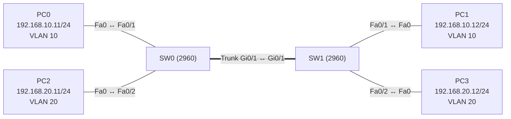

# Übung 2.2: Trunks zwischen Switches

| | |
|---|---|
| **Modul** | 2 – Switching |
| **Stufe** | Grundlage |
| **Geschätzte Zeit** | ca. 60–75 Minuten |
| **Werkzeug** | Cisco Packet Tracer |
| **Vorwissen** | Übung 2.1 (VLANs, Access-Ports) |

> **Stand der Prüfung:** Entwurf. Die IOS-Befehle (`switchport mode trunk`, `switchport trunk allowed vlan`, `show interfaces trunk`) sind durch Tutorial-Quellen belegt (siehe Quellen). **Nicht bestätigt** sind die gezeigten Ausgaben, der Kabeltyp *Copper Cross-Over* zwischen zwei Switches in Packet Tracer (die Hilfe nennt ihn für Geräte auf gleicher Ebene), die GUI-Wege am Switch, der Befehl `switchport trunk native vlan` in dieser Form und die Meldung bei unterschiedlichem Native VLAN. Beim Modell 2960 ist `switchport trunk encapsulation dot1q` laut Tutorials nicht nötig (nur 802.1Q), das ist aber nicht in Packet Tracer bestätigt.

## Lernziele

Nach dieser Übung kannst du

- erklären, warum man zwischen zwei Switches einen Trunk braucht, wenn VLANs über beide Switches reichen sollen,
- einen Trunk-Port mit `switchport mode trunk` einrichten,
- erklären, was 802.1Q-Tagging ist und was das Native VLAN bedeutet,
- die erlaubten VLANs eines Trunks einschränken,
- einen Trunk mit `show interfaces trunk` prüfen.

## Voraussetzungen

Übung 2.1. Du solltest VLANs anlegen, Ports zuweisen und mit `show vlan brief` prüfen können.

## Grundbegriffe

| Begriff | Bedeutung |
|---|---|
| Trunk | Eine Verbindung zwischen zwei Switches (oder Switch und Router), die Frames **mehrerer VLANs** über **ein** Kabel überträgt. |
| 802.1Q | Der Standard (IEEE), der festlegt, wie VLAN-Frames markiert („getaggt“) werden: Der Frame bekommt ein zusätzliches Feld mit der VLAN-ID. |
| Tag | Die VLAN-Markierung im Frame. So weiß der Switch am anderen Ende, zu welchem VLAN der Frame gehört. |
| Native VLAN | Das VLAN, dessen Frames auf dem Trunk **ohne Tag** gesendet werden. Standard ist VLAN 1. Es muss auf beiden Seiten gleich sein. |
| Erlaubte VLANs | Die VLANs, die ein Trunk überträgt. Standard ist: alle. |
| Cross-Over-Kabel | Kabel, das Sende- und Empfangsadern vertauscht. In Packet Tracer für Verbindungen zwischen Geräten gleicher Art (Switch zu Switch). |

> **Merksatz:** Ein Access-Port gehört zu **einem** VLAN, ein Trunk-Port transportiert **mehrere** VLANs und markiert sie dazu mit einem Tag.

## Topologie und Adressplan



| Gerät | Port | IP-Adresse | Subnetzmaske | VLAN |
|---|---|---|---|---|
| PC0 | Fa0 ↔ SW0 `Fa0/1` | `192.168.10.11` | `255.255.255.0` | 10 (Verkauf) |
| PC2 | Fa0 ↔ SW0 `Fa0/2` | `192.168.20.11` | `255.255.255.0` | 20 (Technik) |
| PC1 | Fa0 ↔ SW1 `Fa0/1` | `192.168.10.12` | `255.255.255.0` | 10 (Verkauf) |
| PC3 | Fa0 ↔ SW1 `Fa0/2` | `192.168.20.12` | `255.255.255.0` | 20 (Technik) |
| SW0 ↔ SW1 | `Gi0/1` ↔ `Gi0/1` | – | – | Trunk |

Kein Router, kein Gateway. Das Ziel: PC0 erreicht PC1 (beide VLAN 10) und PC2 erreicht PC3 (beide VLAN 20) über den Trunk, aber nicht umgekehrt.

## Aufgabe

> **Schema dieser Übungsreihe: zwei Wege pro Schritt.** Wo es in Packet Tracer keinen CLI-Weg gibt (Geräte platzieren, verkabeln, PC-Adressen), steht das ausdrücklich dabei. Alle Befehle stehen in Codeblöcken. Die CLI-Befehle und GUI-Wege sind in dieser Entwurfsfassung noch nicht in Packet Tracer bestätigt.

**1. Neues Projekt beginnen** und Geräte platzieren: zwei Switches (*2960*) und vier PCs

- **GUI:** *File* → *New*. Geräte platzieren.
- **CLI:** Entfällt (nur grafisch möglich).

**2. Verkabeln:** PCs mit *Copper Straight-Through* an die Access-Ports (PC0 → SW0 `Fa0/1`, PC2 → SW0 `Fa0/2`, PC1 → SW1 `Fa0/1`, PC3 → SW1 `Fa0/2`). Die beiden Switches mit *Copper Cross-Over* verbinden: SW0 `Gi0/1` ↔ SW1 `Gi0/1`

- **GUI:** Kategorie *Connections*, Kabeltyp anklicken, beide Geräte anklicken, Ports wählen.
- **CLI:** Entfällt (Kabel gibt es nur grafisch).

**3. PCs konfigurieren** (Adressplan oben, Gateway leer)

- **GUI:** PC → *Desktop* → *IP Configuration* → *Static*.
- **CLI:** Entfällt am PC.

**4. VLANs und Access-Ports auf beiden Switches einrichten** (VLANs gelten pro Switch, deshalb auf **beiden**)

- **GUI:** Switch → *Config* → *VLAN Database*: VLAN 10 `Verkauf`, VLAN 20 `Technik` anlegen. Dann *Config* → `FastEthernet0/1` (VLAN 10) und `FastEthernet0/2` (VLAN 20): *Mode* *Access*.
- **CLI:** Auf SW0 (die gleichen Befehle auf SW1 mit `hostname SW1`):
  ```text
  Switch> enable
  Switch# configure terminal
  Switch(config)# hostname SW0
  SW0(config)# vlan 10
  SW0(config-vlan)# name Verkauf
  SW0(config-vlan)# exit
  SW0(config)# vlan 20
  SW0(config-vlan)# name Technik
  SW0(config-vlan)# exit
  SW0(config)# interface fastethernet 0/1
  SW0(config-if)# switchport mode access
  SW0(config-if)# switchport access vlan 10
  SW0(config-if)# exit
  SW0(config)# interface fastethernet 0/2
  SW0(config-if)# switchport mode access
  SW0(config-if)# switchport access vlan 20
  SW0(config-if)# end
  ```

**5. Vorher testen: Verbindung ohne Trunk**

- **GUI:** Werkzeug *Add Simple PDU*: PC0 → PC1 und PC2 → PC3.
- **CLI:** An PC0 (*Command Prompt*):
  ```text
  PC> ping 192.168.10.12
  ```
  Der Ping klappt noch nicht, obwohl beide PCs im VLAN 10 liegen. Der Link zwischen den Switches ist ein Access-Port im VLAN 1 und überträgt VLAN 10 nicht. Notiere das Ergebnis.

**6. Den Trunk einrichten** (auf beiden Switches)

- **GUI:** Switch → *Config* → `GigabitEthernet0/1`: *Mode* (bzw. *Trunk*) auf *Trunk* stellen.
- **CLI:** Auf SW0 und SW1:
  ```text
  SW0# configure terminal
  SW0(config)# interface gigabitethernet 0/1
  SW0(config-if)# switchport mode trunk
  SW0(config-if)# end
  ```

**7. Trunk prüfen**

- **GUI:** Switch → *Config* → `GigabitEthernet0/1` ansehen.
- **CLI:**
  ```text
  SW0# show interfaces trunk
  ```
  Der Port `Gi0/1` steht mit Status `trunking` und Native VLAN `1` in der Tabelle, bei den erlaubten VLANs steht `1-1005`.

**8. Verbindung testen**

- **GUI:** *Add Simple PDU*: PC0 → PC1, PC2 → PC3, PC0 → PC3.
- **CLI:** An PC0:
  ```text
  PC> ping 192.168.10.12
  PC> ping 192.168.20.12
  ```
  Der erste Ping (gleiches VLAN über den Trunk) klappt, der zweite (anderes VLAN) nicht.

**9. Erlaubte VLANs einschränken:** nur VLAN 10 auf dem Trunk erlauben

- **GUI:** Entfällt, für die Einschränkung gibt es in der GUI keinen direkten Weg (nicht bestätigt). Nutze die CLI.
- **CLI:** Auf SW0 und SW1:
  ```text
  SW0# configure terminal
  SW0(config)# interface gigabitethernet 0/1
  SW0(config-if)# switchport trunk allowed vlan 10
  SW0(config-if)# end
  SW0# show interfaces trunk
  ```
  Teste danach `ping 192.168.20.12` von PC2 aus (VLAN 20): Er klappt nicht mehr. VLAN 10 klappt weiter. Zurück zum Ausgangszustand:
  ```text
  SW0# configure terminal
  SW0(config)# interface gigabitethernet 0/1
  SW0(config-if)# switchport trunk allowed vlan all
  SW0(config-if)# end
  ```
  (Auf beiden Switches.)

**10. Projekt und Konfiguration speichern** als `02.2-trunks-zwischen-switches.pkt`

- **GUI:** *File* → *Save As* (oder `Strg+S`).
- **CLI:** Die Switch-Konfiguration sichern, auf beiden Switches:
  ```text
  SW0# copy running-config startup-config
  ```

## Hintergrund: Was macht ein Trunk?

1. **PC0 sendet an PC1.** PC0 sendet einen normalen Frame ohne VLAN-Information. SW0 empfängt ihn auf `Fa0/1`, einem Access-Port in VLAN 10, und weiß dadurch: Der Frame gehört zu VLAN 10.
2. **SW0 schickt den Frame über den Trunk zu SW1.** Auf dem Trunk fügt SW0 ein **802.1Q-Tag** mit der VLAN-ID 10 in den Frame ein. Ohne das Tag wüsste SW1 nicht, zu welchem VLAN der Frame gehört.
3. **SW1 entfernt das Tag** und leitet den Frame nur an Ports in VLAN 10 weiter, also an `Fa0/1` zu PC1.
4. **VLAN 20** läuft genauso, mit dem Tag 20. Beide VLANs teilen sich das eine Kabel, bleiben aber getrennt.
5. **Das Native VLAN** ist die Ausnahme: Seine Frames werden ohne Tag gesendet. Stimmt das Native VLAN auf beiden Seiten nicht überein, werden Frames in das falsche VLAN gelegt. Deshalb muss es an beiden Enden gleich sein.

> **Warum ging der Ping in Schritt 5 nicht?** Der Link zwischen den Switches war ein normaler Access-Port in VLAN 1. VLAN 10 und 20 existieren zwar auf beiden Switches, sind aber nur über getaggte Frames auf einem Trunk verbunden.

## Hinweise

- VLANs müssen auf **jedem** Switch angelegt werden, den die Frames durchlaufen. Ein Trunk überträgt nur das Tag, legt aber das VLAN nicht auf dem anderen Switch an (in dieser Übung ohne VTP).
- Der Trunk muss an **beiden** Enden eingerichtet sein. Ein Ende als Trunk und das andere als Access ergibt keine funktionierende Verbindung.
- Beim Modell 2960 gibt es nur 802.1Q. Der Befehl `switchport trunk encapsulation dot1q` ist laut Tutorials nicht nötig (nicht in Packet Tracer bestätigt).
- Erlaubte VLANs: Erst `switchport trunk allowed vlan 10` legt die Liste auf **nur** VLAN 10 fest. Mit `switchport trunk allowed vlan add 20` ergänzt man ein VLAN, ohne die Liste zu überschreiben. Der Unterschied ist eine häufige Fehlerquelle.
- Das Native VLAN stellt man mit `switchport trunk native vlan <ID>` ein. Es muss auf beiden Seiten gleich sein.
- Bleibt der Link rot oder orange, prüfe zuerst das Kabel (Cross-Over zwischen Switches, nicht bestätigt) und danach, ob der Port eingeschaltet ist.

## Prüfbefehle

Am PC (Command Prompt):

```text
PC> ipconfig
PC> ping 192.168.10.12
```

Am Switch (CLI):

```text
SW0> enable
SW0# show vlan brief
SW0# show interfaces trunk
SW0# show interfaces gigabitethernet 0/1 switchport
```

| CLI-Befehl | Was er zeigt | GUI-Weg |
|---|---|---|
| `show vlan brief` | VLANs und Access-Ports. Trunk-Ports stehen hier **nicht** | *Config* → *VLAN Database* |
| `show interfaces trunk` | Trunk-Ports, Native VLAN, erlaubte VLANs | *Config* → `GigabitEthernet0/1` |
| `show interfaces gigabitethernet 0/1 switchport` | Betriebsart des Ports (access/trunk), Native VLAN, Trunking-Verhandlung | – |
| `ping <Ziel>` | Ob das Ziel erreichbar ist | Werkzeug *Add Simple PDU* |

**Kontrollfragen**

1. Warum geht der Ping von PC0 zu PC1 nicht, solange der Link zwischen den Switches ein Access-Port ist?
2. Was macht ein Switch mit einem Frame, den er über den Trunk sendet?
3. Welche Aufgabe hat das Native VLAN, und warum muss es auf beiden Seiten gleich sein?
4. Was ist der Unterschied zwischen `switchport trunk allowed vlan 10` und `switchport trunk allowed vlan add 20`?
5. Warum taucht der Trunk-Port in `show vlan brief` nicht bei den VLANs 10 und 20 auf?

## Erweiterungen

- **Dritter Switch:** Einen dritten Switch über einen zweiten Trunk anbinden und das VLAN 10 auch dort einrichten.
- **Native VLAN ändern:** `switchport trunk native vlan 99` nur auf SW0 setzen. Was meldet Packet Tracer? Das Ergebnis ist hier nicht bestätigt, bitte notieren. Danach auf SW1 angleichen.
- **Trunk absichern:** `switchport nonegotiate` am Trunk-Port (verhindert die automatische Verhandlung mit DTP, nicht in Packet Tracer bestätigt).
- **Weiter:** Übung 2.3 baut Schleifen zwischen Switches und zeigt, wie das Spanning Tree Protocol sie verhindert.

---

## Musterlösung

<details>
<summary>Musterlösung anzeigen</summary>

**Aufbau (Schritte 1–2, nur GUI):** Zwei Switches 2960 und vier PCs platzieren. PCs mit *Copper Straight-Through* an die Access-Ports, die Switches untereinander mit *Copper Cross-Over* an `Gi0/1` (nicht bestätigt).

**PC-Konfiguration (Schritt 3):**

| | IPv4 Address | Subnet Mask | Default Gateway |
|---|---|---|---|
| PC0 | `192.168.10.11` | `255.255.255.0` | leer |
| PC2 | `192.168.20.11` | `255.255.255.0` | leer |
| PC1 | `192.168.10.12` | `255.255.255.0` | leer |
| PC3 | `192.168.20.12` | `255.255.255.0` | leer |

**VLANs und Access-Ports (Schritt 4):** wie in der Aufgabe, auf beiden Switches (auf SW1 mit `hostname SW1`).

**Ohne Trunk (Schritt 5):** Der Ping von PC0 an PC1 schlägt fehl, weil der Link `Gi0/1` zwischen den Switches im VLAN 1 liegt und VLAN 10 nicht überträgt.

**Trunk (Schritt 6):** GUI wie in der Aufgabe. CLI auf beiden Switches:

```text
SW0# configure terminal
SW0(config)# interface gigabitethernet 0/1
SW0(config-if)# switchport mode trunk
SW0(config-if)# end
```

**Prüfen (Schritt 7, sinngemäß, nicht bestätigt):**

```text
SW0# show interfaces trunk
Port        Mode         Encapsulation  Status        Native vlan
Gi0/1       on           802.1q         trunking      1

Port        Vlans allowed on trunk
Gi0/1       1-1005

Port        Vlans allowed and active in management domain
Gi0/1       1,10,20

Port        Vlans in spanning tree forwarding state and not pruned
Gi0/1       1,10,20
```

**Ping (Schritt 8, sinngemäß, nicht bestätigt):** PC0 → PC1 und PC2 → PC3 klappen (der erste Versuch kann wegen ARP verloren gehen). PC0 → PC3 schlägt fehl (VLAN 10 gegen VLAN 20, verschiedene IP-Netze, kein Router).

**Erlaubte VLANs (Schritt 9):** Nach `switchport trunk allowed vlan 10` zeigt `show interfaces trunk` bei `Vlans allowed on trunk` nur noch `10`. Der Ping zwischen PC2 und PC3 (VLAN 20) schlägt fehl, der zwischen PC0 und PC1 (VLAN 10) klappt weiter. Mit `switchport trunk allowed vlan all` ist wieder alles erlaubt.

**Antworten auf die Kontrollfragen:**

1. Ein Access-Port im VLAN 1 überträgt nur VLAN-1-Frames und fügt kein Tag ein. Die Frames aus VLAN 10 erreichen den anderen Switch deshalb nicht.
2. Er fügt ein 802.1Q-Tag mit der VLAN-ID ein. Der Switch am anderen Ende liest das Tag, entfernt es und leitet den Frame in das richtige VLAN.
3. Das Native VLAN ist das VLAN, dessen Frames auf dem Trunk ohne Tag laufen. Stimmt es an beiden Enden nicht überein, landen Frames im falschen VLAN.
4. `switchport trunk allowed vlan 10` **ersetzt** die Liste durch nur VLAN 10. `switchport trunk allowed vlan add 20` **ergänzt** VLAN 20 zur bestehenden Liste.
5. Ein Trunk-Port gehört keinem einzelnen VLAN an, er transportiert mehrere. `show vlan brief` listet nur Access-Ports, die Trunk-Ports zeigt `show interfaces trunk`.

</details>

---

## Quellen

- IPCisco, *VLAN Configuration on Cisco Packet Tracer* ([ipcisco.com](https://ipcisco.com/?p=17087)): `switchport mode trunk`, `switchport nonegotiate`, `switchport trunk allowed vlan`, `show interfaces trunk` (Tutorial ohne offiziellen Beleg).
- Computer Networking Notes, *VLAN Configuration Commands Step by Step Explained* ([computernetworkingnotes.com](https://www.computernetworkingnotes.com/ccna-study-guide/vlan-configuration-commands-step-by-step-explained.html)): `switchport mode trunk`, beide Seiten (Tutorial ohne offiziellen Beleg).
- Packet-Tracer-Hilfe, Abschnitt *Connections / Links* ([tutorials.ptnetacad.net](https://tutorials.ptnetacad.net/help/default/connectionsLinks.htm)): Cross-Over-Kabel für Geräte auf gleicher Ebene.
- Cisco Networking Academy, *Packet Tracer – Implement VLANs and Trunking* (Aufgabenblatt, ohne Befehle): Aufgabenstellung für Trunks, Native VLAN und DTP ([sites.radford.edu](https://sites.radford.edu/~hlee3/classes/cs451_spring2025/lab/Cisco/CCNA2_v7_SRWE_spring2020/SRWE%20v7%20Student%20Packet%20Tracer%20Source%20Files/3.6.1%20Packet%20Tracer%20-%20Implement%20VLANs%20and%20Trunking.docx)).
- `switchport trunk native vlan` und `switchport trunk allowed vlan add`: Standard-IOS, in den genannten Quellen nicht gezeigt, daher nicht bestätigt.

---

Lizenz: [CC BY-NC-SA 4.0](https://creativecommons.org/licenses/by-nc-sa/4.0/deed.de), Urheber: AnsibleArtisan4711. Cisco, Cisco IOS und Cisco Packet Tracer sind Marken von Cisco Systems, Inc. und/oder ihrer Tochtergesellschaften; dieses Dokument steht in keiner Verbindung zu Cisco.
