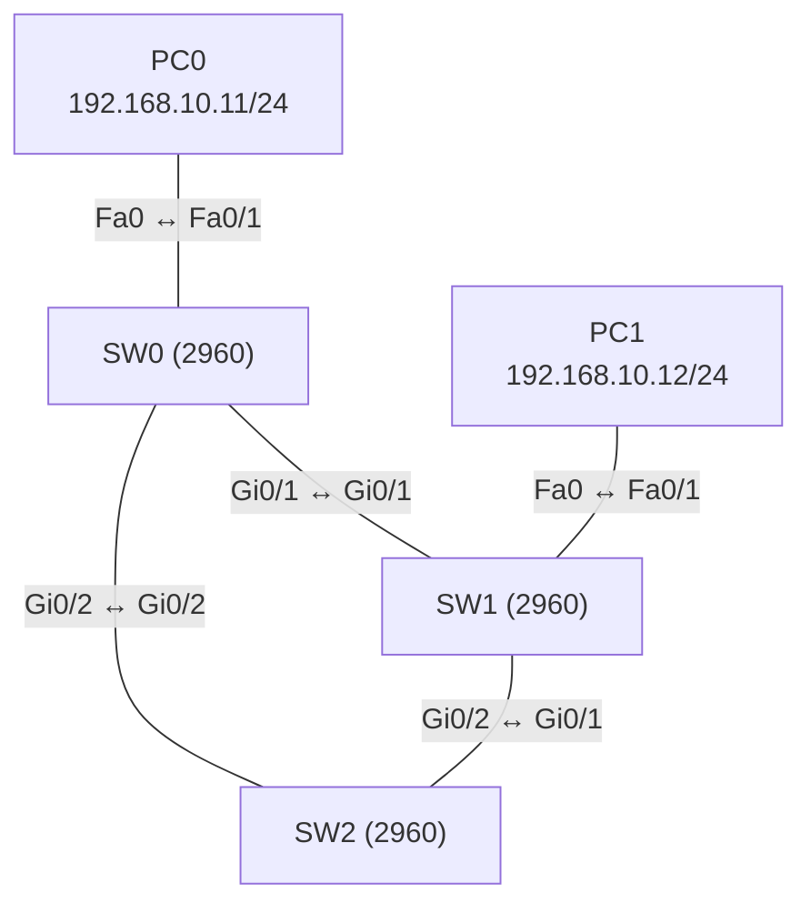

# Übung 2.3: Spanning Tree beobachten

| | |
|---|---|
| **Modul** | 2 – Switching |
| **Stufe** | Aufbau |
| **Geschätzte Zeit** | ca. 60–75 Minuten |
| **Werkzeug** | Cisco Packet Tracer |
| **Vorwissen** | Übung 2.2 (Trunks), Modul 1 |

> **Stand der Prüfung:** Entwurf. Der Befehl `show spanning-tree vlan 1` ist durch ein Cisco-Lab belegt (siehe Quellen), ebenso die Begriffe Root Bridge, Port-Rollen und Port-Zustände. **Nicht bestätigt** sind alle gezeigten Ausgaben (welche Switch zur Root Bridge wird, welcher Port blockiert, Kosten und Port-IDs), das Verhalten beim Ziehen eines Kabels in Packet Tracer und die Farben der Link-Punkte. Da die MAC-Adressen in deinem Projekt anders sind, kann sich die Root Bridge bei dir von der Musterlösung unterscheiden. Die Auswertung der Aufgabe ist deshalb Teil der Übung.

## Lernziele

Nach dieser Übung kannst du

- erklären, warum eine Schleife zwischen Switches ein Netz lahmlegen kann,
- erklären, was das Spanning Tree Protocol (STP) tut und was ein BPDU ist,
- die Root Bridge bestimmen und begründen, warum sie gewählt wurde,
- die Port-Rollen (Root, Designated, Alternate) und Port-Zustände (Forwarding, Blocking) mit `show spanning-tree` ablesen,
- beschreiben, wie das Netz auf den Ausfall einer Verbindung reagiert.

## Voraussetzungen

Übung 2.2. Du solltest Switches verbinden und mit `show`-Befehlen die Konfiguration prüfen können. STP selbst wird hier von Grund auf erklärt.

## Grundbegriffe

| Begriff | Bedeutung |
|---|---|
| Schleife (Loop) | Ein Weg zwischen Switches, der im Kreis führt. Broadcasts laufen dann endlos im Kreis und überlasten das Netz (Broadcast-Sturm). |
| STP | *Spanning Tree Protocol* (IEEE 802.1D). Schaltet im Netz so viele redundante Verbindungen logisch ab, dass keine Schleife entsteht, und schaltet sie bei einem Ausfall wieder ein. |
| BPDU | *Bridge Protocol Data Unit*. Nachricht, mit der Switches STP-Informationen austauschen. |
| Bridge-ID | Name eines Switches in STP: Priorität (Standard 32768, plus VLAN-Nummer) und MAC-Adresse. |
| Root Bridge | Der Switch mit der **niedrigsten** Bridge-ID. Er ist der Mittelpunkt des Baums. Alle anderen Switches berechnen ihren günstigsten Weg zu ihm. |
| Pfadkosten (Cost) | Wert für die Strecke zu einem Switch. Je schneller der Link, desto kleiner. Üblich: 100 Mbit/s = 19, 1 Gbit/s = 4. |
| Root Port | Der Port eines Nicht-Root-Switches mit den günstigsten Kosten zur Root Bridge. |
| Designated Port | Der Port eines Segments, der in Richtung Root am günstigsten ist und Frames weiterleitet. |
| Alternate Port | Ein Port, der blockiert, weil es einen besseren Weg gibt. Er ist die Reserve. |
| Forwarding / Blocking | Zustände eines Ports: leitet Frames weiter oder blockiert sie (empfängt nur BPDUs). |

> **Merksatz:** STP wählt eine Root Bridge, berechnet von ihr aus einen schleifenfreien Baum und blockiert alle anderen Wege. Fällt ein Weg aus, schaltet STP einen blockierten Port wieder frei.

## Topologie und Adressplan

Drei Switches im Dreieck, jeder mit jedem verbunden, dazu zwei PCs.



| Gerät | Port | IP-Adresse | Subnetzmaske |
|---|---|---|---|
| PC0 | Fa0 ↔ SW0 `Fa0/1` | `192.168.10.11` | `255.255.255.0` |
| PC1 | Fa0 ↔ SW1 `Fa0/1` | `192.168.10.12` | `255.255.255.0` |
| SW0 ↔ SW1 | `Gi0/1` ↔ `Gi0/1` | – | – |
| SW1 ↔ SW2 | `Gi0/2` ↔ `Gi0/1` | – | – |
| SW2 ↔ SW0 | `Gi0/2` ↔ `Gi0/2` | – | – |

Alle Ports liegen im Standard-VLAN 1, es werden keine VLANs konfiguriert. Alle Switch-Verbindungen sind *Copper Cross-Over* (nicht bestätigt, siehe Übung 2.2).

## Aufgabe

> **Schema dieser Übungsreihe: zwei Wege pro Schritt.** Wo es in Packet Tracer keinen CLI-Weg gibt (Geräte platzieren, verkabeln, PC-Adressen), steht das ausdrücklich dabei. Die Befehle und GUI-Wege sind in dieser Entwurfsfassung noch nicht in Packet Tracer bestätigt.

**1. Neues Projekt beginnen** und Geräte platzieren: drei Switches (*2960*) und zwei PCs

- **GUI:** *File* → *New*, Geräte setzen.
- **CLI:** Entfällt (nur grafisch möglich).

**2. Zuerst nur eine Kette verkabeln** (ohne Schleife): PC0 → SW0 `Fa0/1`, PC1 → SW1 `Fa0/1`, SW0 `Gi0/1` ↔ SW1 `Gi0/1`, SW1 `Gi0/2` ↔ SW2 `Gi0/1`

- **GUI:** Switches untereinander mit *Copper Cross-Over*, PCs mit *Copper Straight-Through*.
- **CLI:** Entfällt (Kabel gibt es nur grafisch).

**3. PCs konfigurieren** (Adressplan oben)

- **GUI:** PC → *Desktop* → *IP Configuration* → *Static*.
- **CLI:** Entfällt am PC.

**4. Ping testen** (Kette, noch keine Schleife)

- **GUI:** Werkzeug *Add Simple PDU*: PC0 → PC1.
- **CLI:** An PC0:
  ```text
  PC> ping 192.168.10.12
  ```
  Der Ping klappt (der erste Versuch kann wegen ARP verloren gehen).

**5. Die Schleife schließen:** SW2 `Gi0/2` ↔ SW0 `Gi0/2` verbinden, 30 bis 60 Sekunden warten (*Fast Forward Time*)

- **GUI:** Kabel *Copper Cross-Over* ziehen. Die Link-Punkte werden zunächst orange und dann grün. **Ein** Link bleibt nach dem Durchlaufen orange.
- **CLI:** Entfällt (Kabel gibt es nur grafisch).

Das ist STP bei der Arbeit: Es blockiert genau einen Port, damit die Schleife aufgetrennt wird. Notiere, welcher Link dauerhaft orange bleibt.

**6. Spanning Tree auf jedem Switch anzeigen**

- **GUI:** Entfällt, für STP gibt es keine eigene Ansicht (nicht bestätigt). Nutze die CLI.
- **CLI:** Auf jedem der drei Switches (Reiter *CLI*):
  ```text
  Switch> enable
  Switch# show spanning-tree vlan 1
  ```
  Notiere für jeden Switch: *Root ID* (Priorität, MAC-Adresse), *Bridge ID* und die Tabelle mit *Interface*, *Role*, *Sts* (Status).

**7. Die Root Bridge bestimmen**

- **GUI:** Entfällt.
- **CLI:** Die Root Bridge erkennt man an der Zeile `This bridge is the root` in der Ausgabe oder daran, dass *Root ID* und *Bridge ID* gleich sind. Fülle die Tabelle aus:

  | Switch | Bridge-ID (Priorität, MAC) | Ist Root? |
  |---|---|---|
  | SW0 | | |
  | SW1 | | |
  | SW2 | | |

  Die Root Bridge ist der Switch mit der **niedrigsten** Bridge-ID. Bei gleicher Priorität (Standard) entscheidet die kleinste MAC-Adresse.

**8. Port-Rollen und Zustände eintragen**

- **GUI:** Entfällt.
- **CLI:** Trage aus den Ausgaben von Schritt 6 ein:

  | Switch | Port | Rolle (Root / Desg / Altn) | Status (FWD / BLK) |
  |---|---|---|---|
  | SW0 | `Gi0/1` | | |
  | SW0 | `Gi0/2` | | |
  | SW1 | `Gi0/1` | | |
  | SW1 | `Gi0/2` | | |
  | SW2 | `Gi0/1` | | |
  | SW2 | `Gi0/2` | | |

  Auf der Root Bridge sind alle Ports Designated und Forwarding. Genau ein Port im Netz ist Alternate und Blocking.

**9. Den Weg des Pings nachvollziehen**

- **GUI:** Im *Simulation Mode* einen Ping von PC0 nach PC1 senden und die Pakete verfolgen (*Event List*).
- **CLI:** An PC0:
  ```text
  PC> ping 192.168.10.12
  ```
  Beschreibe den Weg und überlege: Warum geht das Paket nicht über den blockierten Port?

**10. Ausfall simulieren und beobachten**

- **GUI:** Ein Kabel zwischen zwei Switches entfernen, das **nicht** der blockierte Link ist (am besten ein Link, der an einem Root Port hängt). Beobachte die Link-Punkte: Der bisher blockierte Port wird nach etwa 30 bis 50 Sekunden grün. Danach das Kabel wieder anschließen und die Änderung beobachten.
- **CLI:** Während der Unterbrechung auf dem Switch, dessen Port blockierte:
  ```text
  Switch# show spanning-tree vlan 1
  ```
  Der frühere Alternate Port ist nun Root oder Designated und Forwarding. Der Ping aus Schritt 9 klappt wieder, sobald der Port umgeschaltet hat.

**11. Projekt speichern** als `02.3-spanning-tree-beobachten.pkt`

- **GUI:** *File* → *Save As* (oder `Strg+S`).
- **CLI:** Entfällt für die Projektdatei.

## Hintergrund: Warum STP?

1. **Schleifen sind gefährlich.** Ein Broadcast (z. B. ARP) wird von einem Switch an alle Ports geschickt. Gibt es einen Kreis, kommt er beim nächsten Switch an, wird wieder an alle Ports verteilt und kreist endlos. Das Netz ist in Sekunden überlastet. Ein Frame hat anders als ein IP-Paket **keine TTL**, die ihn irgendwann stoppt.
2. **Redundanz ist trotzdem wünschenswert.** Fällt ein Kabel aus, soll das Netz über einen zweiten Weg weiterlaufen. STP verbindet beides: Es blockiert redundante Wege und schaltet sie nur bei Ausfall frei.
3. **Die Root Bridge wird gewählt.** Alle Switches senden BPDUs mit ihrer Bridge-ID. Der Switch mit der niedrigsten Bridge-ID (Priorität, dann MAC-Adresse) wird Root.
4. **Jeder Nicht-Root-Switch bestimmt seinen Root Port:** den Port mit den geringsten Kosten zur Root Bridge. Bei gleichen Kosten entscheiden die kleinere Bridge-ID des Nachbarn und danach die Port-ID.
5. **Pro Segment gibt es einen Designated Port:** Der Port, der von dem Segment aus den günstigsten Weg zur Root hat, leitet Frames weiter.
6. **Alle übrigen Ports blockieren** (Alternate). Sie empfangen nur BPDUs.
7. **Bei Ausfall** merken die Switches am Ausbleiben der BPDUs, dass ein Weg fehlt, und berechnen den Baum neu. Ein blockierter Port durchläuft die Zustände *Listening*, *Learning* und *Forwarding*. Das klassische STP (802.1D) braucht dafür bis zu etwa 50 Sekunden (Zeitangabe nicht in Packet Tracer bestätigt).

> **Wichtig:** STP arbeitet pro VLAN (in Cisco-Switches als PVST+). Hier gibt es nur VLAN 1. Die genaue Betriebsart in Packet Tracer ist nicht bestätigt.

## Hinweise

- Warte nach dem Verkabeln, bis alle Link-Punkte stabil sind. In Packet Tracer hilft *Fast Forward Time*.
- Die Root Bridge ist bei Standardwerten reiner **Zufall**: Es gewinnt der Switch mit der kleinsten MAC-Adresse. Das ist in der Praxis meist unerwünscht und Thema von Übung 2.4.
- Ports zu Endgeräten (PCs) nehmen an STP teil. Sie brauchen beim Anstecken deshalb einige Sekunden bis `forwarding`. Das behebt PortFast (Übung 2.4).
- Der Status `BLK` bedeutet nicht, dass etwas defekt ist, sondern dass STP den Port absichtlich blockiert.
- Die Port-ID `128.25` ist Priorität und Portnummer. `Gi0/1` hat beim 2960 üblicherweise die Nummer 25 (nicht bestätigt).

## Prüfbefehle

Am Switch (CLI):

```text
Switch> enable
Switch# show spanning-tree
Switch# show spanning-tree vlan 1
Switch# show spanning-tree summary
Switch# show interfaces status
```

| CLI-Befehl | Was er zeigt | GUI-Weg |
|---|---|---|
| `show spanning-tree vlan 1` | Root ID, Bridge ID, Rollen und Status der Ports im VLAN 1 | – (nur CLI) |
| `show spanning-tree` | Dasselbe für alle VLANs | – |
| `show spanning-tree summary` | Betriebsart und Zusammenfassung (nicht bestätigt) | – |
| `show interfaces status` | Status der Ports | Farbe der Link-Punkte |

**Kontrollfragen**

1. Warum entsteht in einem Netz mit einer Schleife aus Switches ein Broadcast-Sturm?
2. Wie wird die Root Bridge gewählt?
3. Was ist der Unterschied zwischen Root Port, Designated Port und Alternate Port?
4. Warum blockiert STP einen Port, statt alle Verbindungen zu nutzen?
5. Was passiert, wenn ein Kabel im aktiven Baum ausfällt?

## Erweiterungen

- **Eine weitere Schleife:** Einen vierten Switch mit zwei Links anbinden und die Rollen neu bestimmen.
- **Unterschiedliche Geschwindigkeiten:** Einen Link als Fast Ethernet (`Fa0/23`) statt Gigabit ausführen. Wie verändern sich die Kosten und die Wahl des blockierten Ports?
- **Mehrere VLANs:** VLAN 10 und 20 aus Übung 2.2 anlegen, die Links als Trunks einrichten und `show spanning-tree` ohne VLAN-Angabe ansehen. Gibt es pro VLAN eine eigene Root Bridge?
- **Weiter:** Übung 2.4 steuert die Wahl der Root Bridge gezielt und sichert Endgeräte-Ports ab.

---

## Musterlösung

<details>
<summary>Musterlösung anzeigen</summary>

**Aufbau (Schritte 1–5, nur GUI):** Drei Switches 2960 und zwei PCs platzieren, mit *Copper Cross-Over* zwischen den Switches und *Copper Straight-Through* zu den PCs verkabeln. Erst die Kette (SW0–SW1–SW2), dann `SW2 Gi0/2 ↔ SW0 Gi0/2` zum Dreieck schließen.

**Hinweis zur Auswertung:** Welcher Switch Root Bridge ist, hängt von den MAC-Adressen ab, die Packet Tracer deinem Projekt zuweist. Deshalb zeigt die Musterlösung ein **Beispiel**; deine Ergebnisse können davon abweichen. Entscheidend ist, dass du die Regeln anwendest.

**Beispielausgabe (sinngemäß, nicht bestätigt):** Angenommen, SW0 hat die niedrigste MAC-Adresse und ist Root.

```text
SW0# show spanning-tree vlan 1
VLAN0001
  Spanning tree enabled protocol ieee
  Root ID    Priority    32769
             Address     000A.0000.0001
             This bridge is the root
  Bridge ID  Priority    32769  (priority 32768 sys-id-ext 1)
             Address     000A.0000.0001

Interface        Role Sts Cost      Prio.Nbr Type
---------------- ---- --- --------- -------- ----
Gi0/1            Desg FWD 4         128.25   P2p
Gi0/2            Desg FWD 4         128.26   P2p
Fa0/1            Desg FWD 19        128.1    P2p
```

```text
SW1# show spanning-tree vlan 1
VLAN0001
  Root ID    Priority    32769
             Address     000A.0000.0001
             Cost        4
             Port        25(GigabitEthernet0/1)
  Bridge ID  Priority    32769  (priority 32768 sys-id-ext 1)
             Address     000B.0000.0002

Interface        Role Sts Cost      Prio.Nbr Type
---------------- ---- --- --------- -------- ----
Gi0/1            Root FWD 4         128.25   P2p
Gi0/2            Desg FWD 4         128.26   P2p
Fa0/1            Desg FWD 19        128.1    P2p
```

```text
SW2# show spanning-tree vlan 1
VLAN0001
  Root ID    Priority    32769
             Address     000A.0000.0001
             Cost        4
             Port        26(GigabitEthernet0/2)
  Bridge ID  Priority    32769  (priority 32768 sys-id-ext 1)
             Address     000C.0000.0003

Interface        Role Sts Cost      Prio.Nbr Type
---------------- ---- --- --------- -------- ----
Gi0/1            Altn BLK 4         128.25   P2p
Gi0/2            Root FWD 4         128.26   P2p
```

**Wie man zu dem Ergebnis kommt:**

- *Root Bridge:* SW0, weil die Prioritäten gleich sind (32769 = 32768 + VLAN 1) und seine MAC-Adresse die kleinste ist.
- *Root Ports:* SW1 `Gi0/1` und SW2 `Gi0/2` sind jeweils der direkte Link zur Root Bridge, Kosten 4.
- *Designated Ports:* Auf der Root Bridge sind alle Ports Designated. Auf dem Segment SW1 ↔ SW2 haben beide Seiten den gleichen Weg zur Root (Kosten 4 über den jeweiligen Root Port). Die Bridge-ID von SW1 ist kleiner als die von SW2, also wird SW1 `Gi0/2` Designated.
- *Alternate Port:* SW2 `Gi0/1` am Segment zu SW1. SW2 hat bereits einen Root Port, und der Port ist nicht Designated. Er blockiert.

In dieser Beispielausgabe blockiert also `SW2 Gi0/1`, und der Link SW1 ↔ SW2 bleibt orange. Bei dir kann ein anderer Port betroffen sein.

**Weg des Pings (Schritt 9):** Von PC0 geht der Frame über SW0 `Gi0/1` zu SW1 und zu PC1. Der blockierte Port liegt auf einem anderen Segment und wird nicht benutzt.

**Ausfall (Schritt 10):** Fällt in diesem Beispiel der Link SW0 ↔ SW2 aus, verliert SW2 seinen Root Port. Der blockierte Port `Gi0/1` wird zum neuen Root Port, durchläuft die Zustände *Listening*, *Learning* und *Forwarding* und leitet nach einigen Sekunden wieder Frames. Danach geht SW2 über SW1 zur Root Bridge. Der Ping zwischen PC0 und PC1 ist davon nicht betroffen, weil er nicht über SW2 läuft.

**Antworten auf die Kontrollfragen:**

1. Ein Broadcast wird von jedem Switch an alle anderen Ports weitergegeben. In einer Schleife kommt er wieder beim Ausgangspunkt an und kreist endlos, weil Ethernet-Frames keine TTL haben. Dabei wächst die Zahl der Kopien und das Netz ist überlastet.
2. Alle Switches tauschen Bridge-IDs aus. Die niedrigste Bridge-ID gewinnt: erst die kleinere Priorität, bei gleicher Priorität die kleinere MAC-Adresse.
3. Der Root Port ist der günstigste Weg eines Nicht-Root-Switches zur Root Bridge. Der Designated Port ist pro Segment der Port, der in Richtung Root am günstigsten ist und Frames weiterleitet. Ein Alternate Port ist ein Reserveweg, der blockiert.
4. Würden alle Verbindungen aktiv sein, gäbe es eine Schleife. Der blockierte Port ist die Reserve, die bei Ausfall übernimmt.
5. Die Switches merken am Ausbleiben der BPDUs den Ausfall und berechnen den Baum neu. Ein blockierter Port wird freigeschaltet, was bei klassischem STP bis zu etwa 50 Sekunden dauert (nicht in Packet Tracer bestätigt).

</details>

---

## Quellen

- Cisco Networking Academy, *Packet Tracer – Investigate STP Loop Prevention* (Aufgabenblatt, Antworten leer): drei Switches mit redundanten Gigabit-Links, `show spanning-tree vlan 1`, Beobachtung von blockierten Ports und orangen Link-Punkten ([sites.radford.edu](https://sites.radford.edu/~hlee3/classes/cs451_spring2025/lab/Cisco/CCNA2_v7_SRWE_spring2020/SRWE%20v7%20Student%20Packet%20Tracer%20Source%20Files/5.1.9%20Packet%20Tracer%20-%20Investigate%20STP%20Loop%20Prevention.docx)).
- Cisco Networking Academy, *Lab – Configuring Rapid PVST+, PortFast, and BPDU Guard* ([cisco.tu-sofia.bg](https://cisco.tu-sofia.bg/wp-content/uploads/courses/CCNA3/course/files/2.3.2.3%20Lab%20-%20Configuring%20Rapid%20PVST,%20PortFast,%20and%20BPDU%20Guard.pdf)): Port-Rollen (Root, Alternate), Zustände beim Umschalten. Das Lab nennt die Wahlkriterien der Root Bridge nicht vollständig.
- Wahl der Root Bridge nach niedrigster Bridge-ID, Pfadkosten 19 bzw. 4, Zustände Listening, Learning, Forwarding: allgemeines STP-Wissen (IEEE 802.1D), hier nicht aus den genannten Quellen belegt.
- Die gezeigten Ausgaben sind ein konstruiertes Beispiel im IOS-Format und nicht aus Packet Tracer übernommen.

---

Lizenz: [CC BY-NC-SA 4.0](https://creativecommons.org/licenses/by-nc-sa/4.0/deed.de), Urheber: AnsibleArtisan4711. Cisco, Cisco IOS und Cisco Packet Tracer sind Marken von Cisco Systems, Inc. und/oder ihrer Tochtergesellschaften; dieses Dokument steht in keiner Verbindung zu Cisco.
