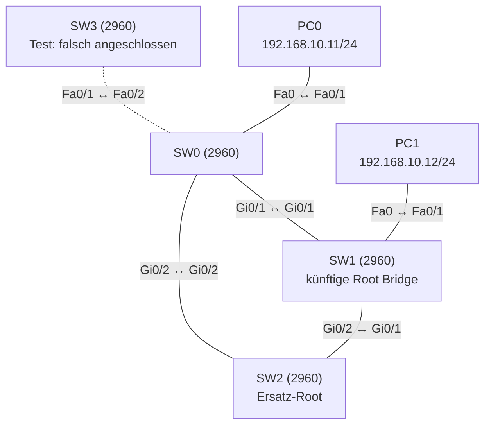

# Übung 2.4: Spanning Tree gezielt steuern

| | |
|---|---|
| **Modul** | 2 – Switching |
| **Stufe** | Aufbau |
| **Geschätzte Zeit** | ca. 60–75 Minuten |
| **Werkzeug** | Cisco Packet Tracer |
| **Vorwissen** | Übung 2.3 (STP beobachten) |

> **Stand der Prüfung:** Entwurf. Die Befehle `spanning-tree vlan <ID> root primary` bzw. `root secondary`, `spanning-tree portfast` und `spanning-tree bpduguard enable` sind durch ein Cisco-Lab belegt (siehe Quellen). Der Befehl `spanning-tree vlan <ID> priority <Wert>` ist Standard-IOS und im Lab nicht gezeigt, daher **nicht bestätigt**. Ebenso nicht bestätigt sind alle Ausgaben, die Warnmeldung bei PortFast, **ob Packet Tracer BPDU Guard tatsächlich umsetzt** (Port wird `err-disabled`) und die Wiederherstellung per `shutdown` / `no shutdown`.

## Lernziele

Nach dieser Übung kannst du

- die Root Bridge gezielt festlegen, statt sie dem Zufall (MAC-Adresse) zu überlassen,
- eine zweite Root Bridge als Ersatz vorbereiten,
- erklären, was PortFast tut und für welche Ports es gedacht ist,
- BPDU Guard einrichten und seinen Zweck erklären,
- die Wirkung der Änderungen mit `show spanning-tree` überprüfen.

## Voraussetzungen

Übung 2.3: Du solltest Root Bridge, Port-Rollen (Root, Designated, Alternate) und Zustände (Forwarding, Blocking) kennen und `show spanning-tree vlan 1` lesen können.

## Grundbegriffe

| Begriff | Bedeutung |
|---|---|
| Bridge-Priorität | Teil der Bridge-ID. Standard ist 32768 (plus VLAN-Nummer). Kleiner ist besser. Wird in Schritten von 4096 vergeben (0, 4096, 8192, …). |
| `root primary` | IOS-Kurzbefehl, der die Priorität des Switches so weit senkt, dass er Root Bridge wird. |
| `root secondary` | Setzt die Priorität so, dass der Switch Ersatz-Root wird, falls die Root ausfällt. |
| PortFast | Ein Port wechselt sofort in den Zustand Forwarding und überspringt Listening und Learning. Nur für Ports mit **Endgeräten** gedacht. |
| BPDU Guard | Schützt PortFast-Ports: Empfängt ein solcher Port ein BPDU, schaltet er sich ab (Zustand `err-disabled`). Verhindert, dass jemand einen Switch an einen Endgeräte-Port hängt und STP stört. |
| `err-disabled` | Der Port wurde wegen eines Fehlers abgeschaltet und leitet nichts mehr weiter, bis man ihn zurücksetzt. |

> **Merksatz:** Die Root Bridge sollte ein Switch sein, den **du** gewählt hast, und Endgeräte-Ports bekommen PortFast mit BPDU Guard.

## Topologie und Adressplan

Dieselbe Topologie wie in Übung 2.3 (drei Switches im Dreieck, zwei PCs), dazu ein vierter Switch für den BPDU-Guard-Test:



| Gerät | Port | IP-Adresse | Subnetzmaske |
|---|---|---|---|
| PC0 | Fa0 ↔ SW0 `Fa0/1` | `192.168.10.11` | `255.255.255.0` |
| PC1 | Fa0 ↔ SW1 `Fa0/1` | `192.168.10.12` | `255.255.255.0` |
| SW0 ↔ SW1 | `Gi0/1` ↔ `Gi0/1` | – | – |
| SW1 ↔ SW2 | `Gi0/2` ↔ `Gi0/1` | – | – |
| SW2 ↔ SW0 | `Gi0/2` ↔ `Gi0/2` | – | – |
| SW3 ↔ SW0 | `Fa0/1` ↔ `Fa0/2` | nur für den Test in Schritt 9 | – |

## Aufgabe

> **Schema dieser Übungsreihe: zwei Wege pro Schritt.** Wo es in Packet Tracer keinen CLI-Weg gibt (Geräte platzieren, verkabeln, PC-Adressen), steht das ausdrücklich dabei. Die Befehle und GUI-Wege sind in dieser Entwurfsfassung noch nicht in Packet Tracer bestätigt. Für STP gibt es in Packet Tracer keine eigene GUI-Ansicht, nutze die CLI.

**1. Projekt aus Übung 2.3 öffnen** und unter neuem Namen speichern (`02.4-spanning-tree-gezielt-steuern.pkt`). Alternativ die Topologie neu aufbauen: drei Switches im Dreieck, zwei PCs.

- **GUI:** *File* → *Open*, dann *File* → *Save As*.
- **CLI:** Entfällt.

**2. Hostnamen setzen** (damit du die Switches in der CLI unterscheiden kannst)

- **GUI:** Switch → *Config* → *Display Name* bzw. *Hostname*.
- **CLI:** Auf jedem Switch (hier SW0, entsprechend SW1 und SW2):
  ```text
  Switch> enable
  Switch# configure terminal
  Switch(config)# hostname SW0
  SW0(config)# end
  ```

**3. Ausgangslage notieren**

- **GUI:** Entfällt.
- **CLI:** Auf jedem Switch:
  ```text
  SW0# show spanning-tree vlan 1
  ```
  Notiere, welcher Switch Root Bridge ist und welcher Port blockiert. Das ist der Zustand ohne gezielte Steuerung.

**4. SW1 zur Root Bridge machen**

- **GUI:** Entfällt.
- **CLI:** Auf SW1:
  ```text
  SW1# configure terminal
  SW1(config)# spanning-tree vlan 1 priority 4096
  SW1(config)# end
  ```
  Alternativ der Kurzbefehl, den das Cisco-Lab verwendet:
  ```text
  SW1(config)# spanning-tree vlan 1 root primary
  ```
  Beide Wege führen zum selben Ziel. Mit `priority` bestimmst du den Wert selbst, `root primary` rechnet IOS aus. Verwende in dieser Übung `priority`.

**5. SW2 zum Ersatz-Root machen**

- **GUI:** Entfällt.
- **CLI:** Auf SW2:
  ```text
  SW2# configure terminal
  SW2(config)# spanning-tree vlan 1 priority 8192
  SW2(config)# end
  ```
  Oder mit dem Kurzbefehl `spanning-tree vlan 1 root secondary`.

**6. Wirkung prüfen**

- **GUI:** Entfällt.
- **CLI:** Auf allen drei Switches:
  ```text
  SW1# show spanning-tree vlan 1
  ```
  SW1 zeigt `This bridge is the root` mit Priorität `4097` (4096 + VLAN 1). Auf SW0 und SW2 ist die Root ID jetzt SW1. Trage die Port-Rollen ein und vergleiche mit Schritt 3:

  | Switch | Port | Rolle | Status |
  |---|---|---|---|
  | SW0 | `Gi0/1` | | |
  | SW0 | `Gi0/2` | | |
  | SW1 | `Gi0/1` | | |
  | SW1 | `Gi0/2` | | |
  | SW2 | `Gi0/1` | | |
  | SW2 | `Gi0/2` | | |

**7. PortFast auf den Ports zu den PCs**

- **GUI:** Entfällt, für PortFast gibt es keine GUI-Einstellung (nicht bestätigt).
- **CLI:** Auf SW0 (und genauso auf SW1 für `Fa0/1`):
  ```text
  SW0# configure terminal
  SW0(config)# interface fastethernet 0/1
  SW0(config-if)# spanning-tree portfast
  SW0(config-if)# end
  ```
  Je nach IOS-Version erscheint eine Warnung, dass PortFast nur an Ports mit einem einzelnen Endgerät aktiviert werden soll (nicht bestätigt).

**8. BPDU Guard auf demselben Port**

- **GUI:** Entfällt.
- **CLI:** Auf SW0 (und SW1 für `Fa0/1`):
  ```text
  SW0# configure terminal
  SW0(config)# interface fastethernet 0/1
  SW0(config-if)# spanning-tree bpduguard enable
  SW0(config-if)# end
  ```

**9. BPDU Guard testen:** Einen vierten Switch an einen geschützten Port anschließen

- **GUI:** Vierten Switch (SW3, *2960*) hinzufügen und mit *Copper Cross-Over* an `Fa0/2` von SW0 anschließen (Switch zu Switch, nicht bestätigt, siehe Übung 2.2). Auf SW0 für diesen Port vorher PortFast und BPDU Guard einrichten.
- **CLI:** Auf SW0:
  ```text
  SW0# configure terminal
  SW0(config)# interface fastethernet 0/2
  SW0(config-if)# spanning-tree portfast
  SW0(config-if)# spanning-tree bpduguard enable
  SW0(config-if)# end
  ```
  Verbinde dann SW3 `Fa0/1` mit SW0 `Fa0/2` und warte einige Sekunden. Prüfe:
  ```text
  SW0# show interfaces status
  ```
  Wenn Packet Tracer BPDU Guard umsetzt, steht `Fa0/2` auf `err-disabled`, und der Link-Punkt ist rot. **Ob das in Packet Tracer so funktioniert, ist nicht bestätigt**; notiere, was du siehst. Es ist ein Ergebnis dieser Übung.

**10. Port wiederherstellen** (falls er `err-disabled` ist)

- **GUI:** Entfällt.
- **CLI:** Erst SW3 abstecken oder entfernen, dann auf SW0:
  ```text
  SW0# configure terminal
  SW0(config)# interface fastethernet 0/2
  SW0(config-if)# shutdown
  SW0(config-if)# no shutdown
  SW0(config-if)# end
  ```

**11. Projekt und Konfiguration speichern**

- **GUI:** *File* → *Save* (oder `Strg+S`).
- **CLI:** Auf jedem Switch:
  ```text
  SW0# copy running-config startup-config
  ```

## Hintergrund: Warum die Root Bridge nicht dem Zufall überlassen?

1. **Standard ist Zufall.** Bei gleicher Priorität gewinnt der Switch mit der kleinsten MAC-Adresse. Das kann ein alter, schwacher Switch am Rand des Netzes sein. Dann laufen alle Wege über ihn.
2. **Die Priorität steuert die Wahl.** Ein Switch mit Priorität 4096 gewinnt gegen alle mit dem Standardwert 32768. Eine Zahl nur in Schritten von 4096 ist zulässig, weil die unteren 12 Bit der Bridge-ID für die VLAN-Nummer (*system ID extension*) reserviert sind. Daher steht in der Ausgabe `4097` (4096 + VLAN 1).
3. **Ersatz-Root:** Fällt die Root Bridge aus, wird der Switch mit der nächsthöheren Bridge-ID neue Root. Mit Priorität 8192 auf SW2 legst du diesen Switch fest, sonst würde wieder die MAC-Adresse entscheiden.
4. **PortFast:** Ein normaler Port durchläuft nach dem Anstecken Blocking, Listening, Learning und Forwarding und braucht dafür bis zu etwa 30 Sekunden (Zeitangabe nicht in Packet Tracer bestätigt). Ein PC muss nicht warten, denn an einem Endgeräte-Port kann keine Schleife entstehen. PortFast überspringt die Wartezeit.
5. **Gefahr bei PortFast:** Schließt jemand einen Switch an einen PortFast-Port, kann eine Schleife entstehen, bevor STP sie erkennt. Deshalb **BPDU Guard**: Ein Endgerät sendet keine BPDUs. Kommt auf einem solchen Port ein BPDU an, ist es ein Switch, und BPDU Guard schaltet den Port ab.

> **Merke:** PortFast und BPDU Guard gehören **nur** auf Ports zu Endgeräten, nie auf Verbindungen zwischen Switches.

## Hinweise

- Die Priorität muss ein Vielfaches von 4096 sein. Andere Werte weist IOS zurück.
- `root primary` setzt die Priorität nur so weit herunter, wie nötig, um aktuell die Root zu sein. Ein späteres Hinzufügen eines Switches mit niedrigerer Priorität ändert die Wahl. Ein fester Wert mit `priority` ist stabiler.
- Die Root Bridge sollte zentral im Netz stehen, nicht am Rand.
- Ändere Prioritäten im produktiven Netz mit Bedacht: Die Root-Wahl kann kurz zu Unterbrechungen führen.
- `err-disabled` ist Schutz, kein Fehler im Gerät. Erst die Ursache beseitigen, dann den Port mit `shutdown` und `no shutdown` zurücksetzen.
- Für Packet-Tracer-Versionen ohne BPDU-Guard-Unterstützung gilt: Die Übung bleibt sinnvoll als Konfigurationsübung. Notiere dann, dass der Port nicht abgeschaltet wurde.

## Prüfbefehle

Am Switch (CLI):

```text
SW1> enable
SW1# show spanning-tree vlan 1
SW1# show spanning-tree interface fastethernet 0/1 detail
SW1# show interfaces status
SW1# show running-config
```

| CLI-Befehl | Was er zeigt | GUI-Weg |
|---|---|---|
| `show spanning-tree vlan 1` | Root ID, Bridge ID, Rollen und Status der Ports | – (nur CLI) |
| `show spanning-tree interface fastethernet 0/1 detail` | Details eines Ports, auch ob PortFast aktiv ist (nicht bestätigt) | – |
| `show interfaces status` | Status der Ports, auch `err-disabled` | Farbe der Link-Punkte |
| `show running-config` | Aktuelle Konfiguration, auch `spanning-tree`-Zeilen | *Config* → *Settings* |

**Kontrollfragen**

1. Warum ist es sinnvoll, die Root Bridge selbst festzulegen?
2. Warum muss die Priorität ein Vielfaches von 4096 sein, und warum steht in der Ausgabe `4097` statt `4096`?
3. Was bewirkt PortFast, und für welche Ports ist es gedacht?
4. Was passiert, wenn an einem Port mit BPDU Guard ein BPDU ankommt?
5. Wie nimmt man einen `err-disabled`-Port wieder in Betrieb?

## Erweiterungen

- **Root Bridge ausfallen lassen:** SW1 ausschalten (oder alle seine Kabel ziehen). Wird SW2 wie geplant neue Root Bridge?
- **Rapid PVST+:** Mit `spanning-tree mode rapid-pvst` auf allen Switches die schnellere STP-Variante einschalten und die Umschaltzeit bei einem Kabelausfall vergleichen (Befehl laut Cisco-Lab belegt, Ausgabe in Packet Tracer nicht bestätigt).
- **PortFast global:** `spanning-tree portfast default` im globalen Konfigurationsmodus (nicht bestätigt).
- **Weiter:** Übung 2.5 bündelt mehrere Leitungen zu einem logischen Link (EtherChannel).

---

## Musterlösung

<details>
<summary>Musterlösung anzeigen</summary>

**Ausgangslage (Schritt 3):** Wie in Übung 2.3: Die Root Bridge ist der Switch mit der kleinsten MAC-Adresse, ein Port blockiert. Das Ergebnis ist bei dir MAC-abhängig.

**Root Bridge und Ersatz (Schritte 4–5):** CLI:

```text
SW1# configure terminal
SW1(config)# spanning-tree vlan 1 priority 4096
SW1(config)# end
```

```text
SW2# configure terminal
SW2(config)# spanning-tree vlan 1 priority 8192
SW2(config)# end
```

**Wirkung (Schritt 6):** Das Ergebnis ist hier unabhängig von den MAC-Adressen, weil die Prioritäten eindeutig sind (SW1: 4096, SW2: 8192, SW0: 32768). Erwartet (sinngemäß, nicht bestätigt):

| Switch | Port | Rolle | Status | Begründung |
|---|---|---|---|---|
| SW1 | `Gi0/1` | Desg | FWD | Root Bridge, alle Ports Designated |
| SW1 | `Gi0/2` | Desg | FWD | Root Bridge, alle Ports Designated |
| SW0 | `Gi0/1` | Root | FWD | direkter Link zu SW1, Kosten 4 |
| SW0 | `Gi0/2` | Altn | BLK | Segment SW0 ↔ SW2: beide haben Kosten 4 zur Root, SW2 hat die kleinere Bridge-ID (8193 < 32769) |
| SW2 | `Gi0/1` | Root | FWD | direkter Link zu SW1, Kosten 4 |
| SW2 | `Gi0/2` | Desg | FWD | Designated am Segment zu SW0 |

Ausgabe auf SW1 (sinngemäß):

```text
SW1# show spanning-tree vlan 1
VLAN0001
  Spanning tree enabled protocol ieee
  Root ID    Priority    4097
             Address     xxxx.xxxx.xxxx
             This bridge is the root
  Bridge ID  Priority    4097  (priority 4096 sys-id-ext 1)
             Address     xxxx.xxxx.xxxx

Interface        Role Sts Cost      Prio.Nbr Type
---------------- ---- --- --------- -------- ----
Gi0/1            Desg FWD 4         128.25   P2p
Gi0/2            Desg FWD 4         128.26   P2p
Fa0/1            Desg FWD 19        128.1    P2p
```

**PortFast und BPDU Guard (Schritte 7–8):**

```text
SW0# configure terminal
SW0(config)# interface fastethernet 0/1
SW0(config-if)# spanning-tree portfast
SW0(config-if)# spanning-tree bpduguard enable
SW0(config-if)# end
```

Auf SW1 genauso für `Fa0/1`.

**BPDU-Guard-Test (Schritt 9):** Wenn Packet Tracer BPDU Guard umsetzt, schaltet SW0 den Port `Fa0/2` ab, sobald SW3 BPDUs sendet. `show interfaces status` zeigt dann `err-disabled`. Das Ergebnis ist nicht bestätigt; bitte notieren.

**Wiederherstellung (Schritt 10):**

```text
SW0# configure terminal
SW0(config)# interface fastethernet 0/2
SW0(config-if)# shutdown
SW0(config-if)# no shutdown
SW0(config-if)# end
```

**Antworten auf die Kontrollfragen:**

1. Bei Standardwerten entscheidet die MAC-Adresse. Das kann ein ungeeigneter Switch am Netzrand sein, über den dann alle Wege laufen. Mit gesetzter Priorität bestimmst du eine zentrale Root Bridge und eine Ersatz-Root.
2. Die Bridge-Priorität belegt nur die oberen 4 Bit des 16-Bit-Feldes, die unteren 12 Bit tragen die VLAN-Nummer (*system ID extension*). Deshalb sind nur Vielfache von 4096 möglich. `4097` ist 4096 plus VLAN 1.
3. PortFast lässt einen Port sofort in den Zustand Forwarding wechseln. Es ist für Ports zu Endgeräten gedacht (PC, Drucker, Server), an denen keine Schleife entstehen kann.
4. Der Port wird abgeschaltet (`err-disabled`). Ein Endgerät sendet keine BPDUs, ein BPDU zeigt also einen angeschlossenen Switch.
5. Ursache beseitigen (den Switch abstecken), dann auf dem Port `shutdown` und `no shutdown`.

</details>

---

## Quellen

- Cisco Networking Academy, *Lab – Configuring Rapid PVST+, PortFast, and BPDU Guard* ([cisco.tu-sofia.bg](https://cisco.tu-sofia.bg/wp-content/uploads/courses/CCNA3/course/files/2.3.2.3%20Lab%20-%20Configuring%20Rapid%20PVST,%20PortFast,%20and%20BPDU%20Guard.pdf)): `spanning-tree vlan 1,10,99 root primary` und `root secondary`, `spanning-tree mode rapid-pvst`, `spanning-tree portfast`, `spanning-tree bpduguard enable` (Appendix A). Das Lab erklärt, dass eine Root-Wahl nach MAC-Adresse „zu einer ungünstigen Konfiguration führen kann“.
- Cisco Networking Academy, *Packet Tracer – Investigate STP Loop Prevention* ([sites.radford.edu](https://sites.radford.edu/~hlee3/classes/cs451_spring2025/lab/Cisco/CCNA2_v7_SRWE_spring2020/SRWE%20v7%20Student%20Packet%20Tracer%20Source%20Files/5.1.9%20Packet%20Tracer%20-%20Investigate%20STP%20Loop%20Prevention.docx)): Beobachtung von Rollen und Zuständen.
- `spanning-tree vlan <ID> priority <Wert>`, die Schrittweite 4096 und die System-ID-Extension: Standard-IOS bzw. IEEE-802.1D/-Wissen, in den genannten Quellen nicht gezeigt, daher nicht bestätigt.
- Die gezeigten Ausgaben sind ein konstruiertes Beispiel im IOS-Format und nicht aus Packet Tracer übernommen.

---

Lizenz: [CC BY-NC-SA 4.0](https://creativecommons.org/licenses/by-nc-sa/4.0/deed.de), Urheber: AnsibleArtisan4711. Cisco, Cisco IOS und Cisco Packet Tracer sind Marken von Cisco Systems, Inc. und/oder ihrer Tochtergesellschaften; dieses Dokument steht in keiner Verbindung zu Cisco.
