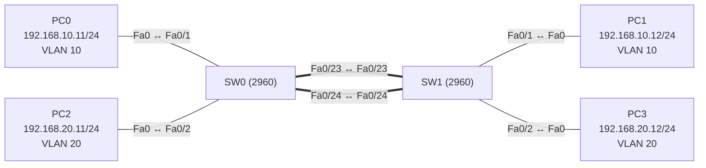

# Übung 2.5: EtherChannel – mehrere Leitungen bündeln

| | |
|---|---|
| **Modul** | 2 – Switching |
| **Stufe** | Aufbau |
| **Geschätzte Zeit** | ca. 60–75 Minuten |
| **Werkzeug** | Cisco Packet Tracer |
| **Vorwissen** | Übung 2.2 (Trunks), Übung 2.3 (STP) |

> **Stand der Prüfung:** Entwurf. Die Befehle `interface range`, `channel-group <Nr> mode active`, `interface port-channel`, `switchport mode trunk`, `show etherchannel summary` und `show interfaces trunk` sind durch ein Cisco-Packet-Tracer-Lab belegt (siehe Quellen); dort werden LACP (`active`/`passive`) und PAgP (`desirable`/`auto`) auf Switches eingesetzt. **Nicht bestätigt** sind alle gezeigten Ausgaben in deinem Projekt, die Reihenfolge `no switchport mode trunk` vor `channel-group` (siehe Schritt 6), die Reaktion beim Ziehen eines Kabels, die genaue Anzeige bei nicht zustande gekommenem Channel und die Switch-Ports `Fa0/23` und `Fa0/24` als Kabelanschlüsse in deinem Modell.

## Lernziele

Nach dieser Übung kannst du

- erklären, warum zwei parallele Leitungen zwischen Switches ohne EtherChannel nur eine nutzbar ist (STP blockiert die andere),
- mehrere physische Ports mit `channel-group` zu einem logischen Port-Channel bündeln,
- den Unterschied zwischen LACP und PAgP und die Modi `active`, `passive`, `desirable` und `auto` erklären,
- den Port-Channel mit `show etherchannel summary` und `show interfaces trunk` prüfen,
- beschreiben, was bei Ausfall einer Leitung des Bündels passiert.

## Voraussetzungen

Die Übungen 2.2 (Trunks) und 2.3 (STP). Du solltest einen Trunk einrichten und `show spanning-tree` lesen können.

## Grundbegriffe

| Begriff | Bedeutung |
|---|---|
| EtherChannel | Technik von Cisco, mehrere physische Verbindungen zwischen zwei Switches zu **einer** logischen Verbindung zu bündeln. Mehr Bandbreite und Ausfallsicherheit. |
| Port-Channel | Das logische Interface, das aus den gebündelten Ports entsteht (`Port-channel1`, kurz `Po1`). Konfigurationen für den Link gehören auf dieses Interface. |
| LACP | *Link Aggregation Control Protocol* (IEEE 802.3ad). Offener Standard, funktioniert mit Geräten anderer Hersteller. Modi: `active`, `passive`. |
| PAgP | *Port Aggregation Protocol*. Cisco-eigenes Verfahren. Modi: `desirable`, `auto`. |
| `on` | Bündelung ohne Verhandlung: Beide Seiten müssen `on` sein. |
| Channel-Group | Die Nummer, die ausgewählte Ports zu einem Bündel zusammenfasst (hier `1`). Sie hat nur lokale Bedeutung. |
| Flags `SU` und `P` | In `show etherchannel summary`: `S` = Layer 2, `U` = in Benutzung; `P` = Port ist im Bündel. |

**Modus-Kombinationen** (laut Cisco-Lab):

| Seite A | Seite B | Bündel entsteht? |
|---|---|---|
| `active` | `active` | ja |
| `active` | `passive` | ja |
| `passive` | `passive` | nein |
| `desirable` | `desirable` oder `auto` | ja |
| `auto` | `auto` | nein |
| LACP-Modus | PAgP-Modus | nein |

> **Merksatz:** EtherChannel macht aus zwei oder mehr Kabeln **einen** logischen Link. STP sieht nur den Port-Channel und blockiert deshalb keine der gebündelten Leitungen.

## Topologie und Adressplan

Zwei Switches, zwei parallele Leitungen, dazu je zwei PCs in zwei VLANs (wie in Übung 2.2).



| Gerät | Port | IP-Adresse | Subnetzmaske | VLAN |
|---|---|---|---|---|
| PC0 | Fa0 ↔ SW0 `Fa0/1` | `192.168.10.11` | `255.255.255.0` | 10 (Verkauf) |
| PC2 | Fa0 ↔ SW0 `Fa0/2` | `192.168.20.11` | `255.255.255.0` | 20 (Technik) |
| PC1 | Fa0 ↔ SW1 `Fa0/1` | `192.168.10.12` | `255.255.255.0` | 10 (Verkauf) |
| PC3 | Fa0 ↔ SW1 `Fa0/2` | `192.168.20.12` | `255.255.255.0` | 20 (Technik) |
| SW0 ↔ SW1 | `Fa0/23` ↔ `Fa0/23` | – | – | Trunk (Bündel) |
| SW0 ↔ SW1 | `Fa0/24` ↔ `Fa0/24` | – | – | Trunk (Bündel) |

## Aufgabe

> **Schema dieser Übungsreihe: zwei Wege pro Schritt.** Wo es in Packet Tracer keinen CLI-Weg gibt (Geräte platzieren, verkabeln, PC-Adressen), steht das ausdrücklich dabei. Die Befehle und GUI-Wege sind in dieser Entwurfsfassung noch nicht in Packet Tracer bestätigt. Für EtherChannel gibt es in Packet Tracer keine eigene GUI-Ansicht, nutze die CLI.

**1. Neues Projekt beginnen** und Geräte platzieren: zwei Switches (*2960*) und vier PCs

- **GUI:** *File* → *New*, Geräte setzen.
- **CLI:** Entfällt (nur grafisch möglich).

**2. Verkabeln:** PCs mit *Copper Straight-Through* an die Access-Ports (PC0 und PC2 an SW0 `Fa0/1` und `Fa0/2`, PC1 und PC3 an SW1 `Fa0/1` und `Fa0/2`). Switches mit **zwei** *Copper Cross-Over*-Kabeln verbinden: `Fa0/23` ↔ `Fa0/23` und `Fa0/24` ↔ `Fa0/24`

- **GUI:** Kategorie *Connections*, Kabeltyp anklicken, beide Geräte anklicken, Ports wählen.
- **CLI:** Entfällt (Kabel gibt es nur grafisch).

**3. PCs konfigurieren** (Adressplan oben, Gateway leer)

- **GUI:** PC → *Desktop* → *IP Configuration* → *Static*.
- **CLI:** Entfällt am PC.

**4. VLANs und Access-Ports auf beiden Switches einrichten** (wie in Übung 2.2)

- **GUI:** Switch → *Config* → *VLAN Database*: VLAN 10 `Verkauf`, VLAN 20 `Technik`; Ports `Fa0/1` (VLAN 10) und `Fa0/2` (VLAN 20) als *Access*.
- **CLI:** Auf SW0, entsprechend auf SW1 mit `hostname SW1`:
  ```text
  Switch> enable
  Switch# configure terminal
  Switch(config)# hostname SW0
  SW0(config)# vlan 10
  SW0(config-vlan)# name Verkauf
  SW0(config-vlan)# exit
  SW0(config)# vlan 20
  SW0(config-vlan)# name Technik
  SW0(config-vlan)# exit
  SW0(config)# interface fastethernet 0/1
  SW0(config-if)# switchport mode access
  SW0(config-if)# switchport access vlan 10
  SW0(config-if)# exit
  SW0(config)# interface fastethernet 0/2
  SW0(config-if)# switchport mode access
  SW0(config-if)# switchport access vlan 20
  SW0(config-if)# end
  ```

**5. Zwei Trunks ohne EtherChannel einrichten und das Problem beobachten**

- **GUI:** Switch → *Config* → `FastEthernet0/23` und `FastEthernet0/24`: *Mode* auf *Trunk*.
- **CLI:** Auf SW0 und SW1:
  ```text
  SW0# configure terminal
  SW0(config)# interface range fastethernet 0/23 - 24
  SW0(config-if-range)# switchport mode trunk
  SW0(config-if-range)# end
  ```
  Warte, bis die Link-Punkte stabil sind (*Fast Forward Time*), und prüfe auf beiden Switches:
  ```text
  SW0# show spanning-tree vlan 10
  ```
  Einer der beiden Links bleibt orange: STP blockiert einen Port (Rolle `Altn`, Status `BLK`), obwohl zwei Kabel stecken. Das Bündel soll genau das beheben. Teste die Pings PC0 → PC1 und PC2 → PC3, sie klappen.

**6. EtherChannel einrichten (LACP):** Beide Leitungen zu einem Port-Channel bündeln

- **GUI:** Entfällt, für EtherChannel gibt es in Packet Tracer keine GUI-Einstellung (nicht bestätigt). Nutze die CLI.
- **CLI:** Auf SW0:
  ```text
  SW0# configure terminal
  SW0(config)# interface range fastethernet 0/23 - 24
  SW0(config-if-range)# shutdown
  SW0(config-if-range)# no switchport mode trunk
  SW0(config-if-range)# channel-group 1 mode active
  SW0(config-if-range)# no shutdown
  SW0(config-if-range)# exit
  SW0(config)# interface port-channel 1
  SW0(config-if)# switchport mode trunk
  SW0(config-if)# end
  ```
  Auf SW1 mit dem Modus `passive`:
  ```text
  SW1# configure terminal
  SW1(config)# interface range fastethernet 0/23 - 24
  SW1(config-if-range)# shutdown
  SW1(config-if-range)# no switchport mode trunk
  SW1(config-if-range)# channel-group 1 mode passive
  SW1(config-if-range)# no shutdown
  SW1(config-if-range)# exit
  SW1(config)# interface port-channel 1
  SW1(config-if)# switchport mode trunk
  SW1(config-if)# end
  ```
  Das `shutdown` vor dem Bündeln empfiehlt das Cisco-Lab, damit die Ports nicht mit uneinheitlicher Konfiguration eingeschaltet sind. `no switchport mode trunk` setzt den Port auf die Standardbetriebsart zurück. Ob IOS diese Reihenfolge in Packet Tracer so akzeptiert, ist nicht bestätigt. Wenn eine Fehlermeldung kommt, notiere sie.

**7. Port-Channel prüfen**

- **GUI:** Entfällt.
- **CLI:** Auf SW0 und SW1:
  ```text
  SW0# show etherchannel summary
  SW0# show interfaces trunk
  SW0# show spanning-tree vlan 10
  ```
  In `show etherchannel summary` steht `Po1(SU)` mit `LACP` und beiden Ports `Fa0/23(P)` und `Fa0/24(P)`. `show interfaces trunk` zeigt jetzt `Po1` als Trunk statt zweier einzelner Ports. In `show spanning-tree` gibt es nur noch `Po1`, keinen blockierten Port mehr.

**8. Verbindung testen und einen Ausfall simulieren**

- **GUI:** Werkzeug *Add Simple PDU*: PC0 → PC1, PC2 → PC3. Dann **ein** Kabel des Bündels (z. B. `Fa0/24`) entfernen und die Pings wiederholen. Kabel danach wieder anschließen.
- **CLI:** An PC0 (*Command Prompt*):
  ```text
  PC> ping 192.168.10.12
  ```
  Auf SW0 nach dem Ziehen eines Kabels:
  ```text
  SW0# show etherchannel summary
  ```
  Der Ping klappt weiter (höchstens ein Paket geht verloren), der Port-Channel bleibt bestehen und enthält nur noch einen aktiven Port.

**9. Gegenprobe: zwei passive Seiten**

- **GUI:** Entfällt.
- **CLI:** Auf SW0 den Modus von `active` auf `passive` ändern:
  ```text
  SW0# configure terminal
  SW0(config)# interface range fastethernet 0/23 - 24
  SW0(config-if-range)# channel-group 1 mode passive
  SW0(config-if-range)# end
  SW0# show etherchannel summary
  ```
  Beide Seiten sind jetzt `passive`: Keiner beginnt die Verhandlung, das Bündel kommt nicht zustande. Notiere, was `show etherchannel summary` anzeigt (nicht bestätigt). Danach wieder `mode active` auf SW0 einstellen.

**10. Projekt und Konfiguration speichern** als `02.5-etherchannel.pkt`

- **GUI:** *File* → *Save As* (oder `Strg+S`).
- **CLI:** Auf beiden Switches:
  ```text
  SW0# copy running-config startup-config
  ```

## Hintergrund: Was macht EtherChannel?

1. **Das Problem:** Zwei parallele Kabel zwischen Switches sind eine Schleife. STP blockiert eines davon. Du hast zwei Kabel bezahlt, nutzt aber nur eines, das zweite ist nur Reserve.
2. **Die Lösung:** EtherChannel fasst beide Ports zu **einem logischen Port** zusammen, dem Port-Channel. Für STP gibt es nur diesen einen Link, also gibt es keine Schleife und keine Blockierung.
3. **Aushandeln:** Beide Seiten tauschen mit LACP (oder PAgP) Nachrichten aus und prüfen, ob die Ports zusammenpassen (gleiche Geschwindigkeit, gleicher Duplex-Modus, gleiche VLAN-Konfiguration). Passt alles, entsteht das Bündel. Bei `on` gibt es keine Verhandlung, dann muss man selbst für gleiche Konfiguration sorgen.
4. **Lastverteilung:** Frames werden anhand einer Rechenvorschrift (Hash über Adressen) auf die Leitungen verteilt. Ein einzelner Datenstrom (z. B. ein Ping) nutzt dabei immer dieselbe Leitung, mehrere Datenströme verteilen sich.
5. **Ausfall:** Fällt eine Leitung aus, verteilt das Bündel den Verkehr auf die übrigen. Es gibt keine neue STP-Berechnung, deshalb ist die Umschaltung fast unmerklich.
6. **Konfiguriert wird auf dem Port-Channel:** Trunk, erlaubte VLANs und Native VLAN gehören auf das Interface `Port-channel1`. Die physischen Ports erben die Einstellungen.

> **Warum sehe ich nach dem Bündeln in STP nur noch `Po1`?** Weil STP den Port-Channel als einen einzelnen Port behandelt. Die beiden physischen Ports sind für STP unsichtbar.

## Hinweise

- Die Ports eines Bündels müssen **gleich** konfiguriert sein: Geschwindigkeit, Duplex, VLAN bzw. Trunk-Einstellungen. Eine Abweichung verhindert das Bündel.
- Beide Seiten müssen kompatible Modi haben. `passive` mit `passive` und `auto` mit `auto` bilden **nie** ein Bündel. LACP und PAgP lassen sich nicht mischen.
- Die Channel-Group-Nummer muss auf beiden Seiten **nicht** gleich sein, ist aber übersichtlicher.
- Die Konfiguration des Trunks (`switchport mode trunk`, erlaubte VLANs) gehört auf `interface port-channel 1`, nicht auf die einzelnen Ports.
- Bündeln bringt **keine** höhere Geschwindigkeit für einen einzelnen Datenstrom, sondern mehr Gesamtbandbreite und Ausfallsicherheit.
- Wenn ein Bündel nicht zustande kommt, hilft laut Cisco-Lab: die Ports auf beiden Seiten mit `shutdown` ausschalten und mit `no shutdown` wieder einschalten.
- Die Anzahl der Ports pro Bündel ist begrenzt (üblich sind bis zu 8 aktive Ports). Der Wert ist hier nicht in Packet Tracer bestätigt.

## Prüfbefehle

Am Switch (CLI):

```text
SW0> enable
SW0# show etherchannel summary
SW0# show interfaces trunk
SW0# show spanning-tree vlan 10
SW0# show interfaces port-channel 1
SW0# show running-config
```

| CLI-Befehl | Was er zeigt | GUI-Weg |
|---|---|---|
| `show etherchannel summary` | Port-Channels, Protokoll (LACP/PAgP), Mitglieds-Ports mit Flags (`SU`, `P`) | – (nur CLI) |
| `show interfaces trunk` | Trunk-Ports, jetzt auch `Po1` | *Config* → Port |
| `show spanning-tree vlan 10` | STP-Sicht: Port-Channel statt einzelner Ports | – |
| `show interfaces port-channel 1` | Status und Daten des logischen Interfaces | – |

**Kontrollfragen**

1. Warum nutzt man bei zwei parallelen Leitungen ohne EtherChannel nur eine?
2. Was sieht STP, wenn zwei Leitungen zu einem Port-Channel gebündelt sind?
3. Was ist der Unterschied zwischen LACP und PAgP?
4. Welche Kombinationen der Modi bilden ein Bündel, welche nicht?
5. Was passiert mit dem Datenverkehr, wenn eine Leitung des Bündels ausfällt?

## Erweiterungen

- **PAgP:** Das Bündel mit `desirable` / `auto` statt `active` / `passive` einrichten und die Anzeige in `show etherchannel summary` mit der LACP-Variante vergleichen.
- **Drei Leitungen:** Eine dritte Leitung (`Fa0/22`) in das Bündel aufnehmen. Was ändert sich in `show etherchannel summary`?
- **Erlaubte VLANs:** Auf dem Port-Channel nur VLAN 10 erlauben (`switchport trunk allowed vlan 10` auf `interface port-channel 1`) und prüfen, welche Pings noch klappen.
- **Weiter:** Modul 3 beginnt mit Routing: Wie bringt man Geräte aus verschiedenen Netzen und VLANs zusammen?

---

## Musterlösung

<details>
<summary>Musterlösung anzeigen</summary>

**Aufbau (Schritte 1–2, nur GUI):** Zwei Switches 2960 und vier PCs platzieren. PCs mit *Copper Straight-Through*, die Switches untereinander mit zwei *Copper Cross-Over*-Kabeln an `Fa0/23` und `Fa0/24` verbinden.

**PC-Konfiguration (Schritt 3):**

| | IPv4 Address | Subnet Mask | Default Gateway |
|---|---|---|---|
| PC0 | `192.168.10.11` | `255.255.255.0` | leer |
| PC2 | `192.168.20.11` | `255.255.255.0` | leer |
| PC1 | `192.168.10.12` | `255.255.255.0` | leer |
| PC3 | `192.168.20.12` | `255.255.255.0` | leer |

**VLANs und Access-Ports (Schritt 4):** wie in Übung 2.2, auf beiden Switches.

**Zwei Trunks ohne EtherChannel (Schritt 5, sinngemäß, nicht bestätigt):** Die STP-Ausgabe zeigt auf einem der beiden Switches einen blockierten Port:

```text
SW1# show spanning-tree vlan 10
...
Interface        Role Sts Cost      Prio.Nbr Type
---------------- ---- --- --------- -------- ----
Fa0/1            Desg FWD 19        128.1    P2p
Fa0/23           Root FWD 19        128.23   P2p
Fa0/24           Altn BLK 19        128.24   P2p
```

Welcher Switch den Port blockiert, hängt von den MAC-Adressen ab.

**EtherChannel (Schritt 6):** CLI auf beiden Switches wie in der Aufgabe; SW0 mit `mode active`, SW1 mit `mode passive`. Zusammenfassung der Befehle auf SW0:

```text
SW0# configure terminal
SW0(config)# interface range fastethernet 0/23 - 24
SW0(config-if-range)# shutdown
SW0(config-if-range)# no switchport mode trunk
SW0(config-if-range)# channel-group 1 mode active
SW0(config-if-range)# no shutdown
SW0(config-if-range)# exit
SW0(config)# interface port-channel 1
SW0(config-if)# switchport mode trunk
SW0(config-if)# end
```

**Prüfen (Schritt 7, sinngemäß, nicht bestätigt):**

```text
SW0# show etherchannel summary
Flags:  D - down        P - bundled in port-channel
        I - stand-alone s - suspended
        S - Layer2      U - in use
Number of channel-groups in use: 1
Number of aggregators:           1

Group  Port-channel  Protocol    Ports
------+-------------+-----------+----------------------------------------------
1      Po1(SU)         LACP      Fa0/23(P)   Fa0/24(P)
```

```text
SW0# show interfaces trunk
Port        Mode         Encapsulation  Status        Native vlan
Po1         on           802.1q         trunking      1
...
```

`show spanning-tree vlan 10` zeigt nur noch `Po1` mit Rolle `Root` oder `Desg` und Status `FWD`, keinen blockierten Port.

**Ausfall (Schritt 8):** Beim Ziehen von `Fa0/24` bleibt `Po1` bestehen. `show etherchannel summary` zeigt dann nur noch `Fa0/23(P)`, und der Ping klappt weiter, eventuell mit einem verlorenen Paket. Nach dem Wiederanschließen ist `Fa0/24` wieder im Bündel. Die genaue Anzeige in Packet Tracer ist nicht bestätigt.

**Gegenprobe (Schritt 9):** Mit `passive` auf beiden Seiten beginnt keine Seite die LACP-Verhandlung. Das Bündel kommt nicht zustande. Die genaue Anzeige (z. B. Flags `I` oder `s`, `Po1(SD)`) ist in Packet Tracer nicht bestätigt; bitte notieren.

**Antworten auf die Kontrollfragen:**

1. Zwei parallele Leitungen sind eine Schleife. STP blockiert deshalb eine der beiden, die andere dient nur als Reserve.
2. Einen einzigen logischen Link, den `Po1`. Die physischen Ports sind für STP nicht sichtbar, deshalb blockiert er keinen davon.
3. LACP ist ein offener Standard (IEEE 802.3ad) und funktioniert herstellerübergreifend, PAgP ist ein Cisco-eigenes Verfahren. Die beiden lassen sich nicht mischen.
4. Gebündelt wird mit `active` + `active`, `active` + `passive`, `desirable` + `desirable`, `desirable` + `auto`. Nicht gebündelt wird mit `passive` + `passive`, `auto` + `auto` und bei einer Mischung aus LACP- und PAgP-Modus.
5. Der Verkehr wird auf die übrigen Leitungen des Bündels verteilt. Es gibt keine neue STP-Berechnung, die Umschaltung ist fast unmerklich.

</details>

---

## Quellen

- Cisco Networking Academy, *Packet Tracer – Configure EtherChannel* (Lab 6.2.4, Wiedergabe: [sites.radford.edu](https://sites.radford.edu/~hlee3/classes/cs451_spring2025/lab/Cisco/CCNA2_v7_SRWE_spring2020/SRWE%20v7%20Student%20Packet%20Tracer%20Source%20Files/6.2.4%20Packet%20Tracer%20-%20Configure%20EtherChannel.docx)): `interface range`, `shutdown`, `channel-group <Nr> mode desirable|active|passive`, `no shutdown`, `interface port-channel`, `switchport mode trunk`, `show etherchannel summary` (Flags `SU`, `P`), `show interfaces trunk`, Modus-Kombinationen und Hinweis zum Aus- und Einschalten der Ports. Das Lab zeigt keinen Befehl `switchport trunk allowed vlan`.
- Computer Networking Notes, *Link Aggregation Control Protocol (LACP) Explained* ([computernetworkingnotes.com](https://www.computernetworkingnotes.com/ccna-study-guide/link-aggregation-control-protocol-lacp-explained.html)): ergänzende Erklärung (Tutorial, nicht im Detail geprüft).
- Lastverteilung per Hash, Grenze von 8 aktiven Ports und die Aussage, dass STP nur den Port-Channel sieht: allgemeines Fachwissen, hier nicht aus den genannten Quellen belegt.
- Die gezeigten Ausgaben sind ein konstruiertes Beispiel im IOS-Format und nicht aus Packet Tracer übernommen.

---

Lizenz: [CC BY-NC-SA 4.0](https://creativecommons.org/licenses/by-nc-sa/4.0/deed.de), Urheber: AnsibleArtisan4711. Cisco, Cisco IOS und Cisco Packet Tracer sind Marken von Cisco Systems, Inc. und/oder ihrer Tochtergesellschaften; dieses Dokument steht in keiner Verbindung zu Cisco.
