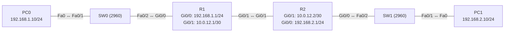

# Übung 3.1: Statisches Routing mit zwei Routern

| | |
|---|---|
| **Modul** | 3 – Routing |
| **Stufe** | Grundlage |
| **Geschätzte Zeit** | ca. 60–75 Minuten |
| **Werkzeug** | Cisco Packet Tracer |
| **Vorwissen** | Übung 1.2 (Router, Default Gateway), Übung 1.3 (Subnetting) |

> **Stand der Prüfung:** Entwurf. Der Befehl `ip route <Netz> <Maske> <Next Hop>` und die Prüfung mit `show ip route` sind durch ein Tutorial mit Packet-Tracer-Beispiel belegt (siehe Quellen). Die Packet-Tracer-Hilfe der Cisco Networking Academy weist darauf hin, dass Packet Tracer „fully specified static routes“ (Route mit Next Hop **und** Austrittsinterface) nicht unterstützt; deshalb wird hier nur die Variante mit Next Hop verwendet. **Nicht bestätigt** sind alle gezeigten Ausgaben (`show ip route`, `ping`, `traceroute`, Fehlerfälle), die GUI-Wege am Router (*Config* → *Static*), der Kabeltyp *Copper Cross-Over* zwischen zwei Routern und die Meldung `Destination host unreachable`.

## Lernziele

Nach dieser Übung kannst du

- erklären, warum zwei Router ohne zusätzliche Information nur ihre **direkt angeschlossenen** Netze kennen,
- mit `ip route` eine statische Route mit Next Hop einrichten,
- die Routingtabelle lesen und die Einträge `C`, `L` und `S` unterscheiden,
- begründen, warum bei einer Verbindung Hin- **und** Rückweg einen Eintrag brauchen,
- einen Ping mit fehlender Rückroute erkennen.

## Voraussetzungen

Übung 1.2 (ein Router, zwei Netze) und 1.3 (Adressen und Masken). Neu in dieser Übung ist ein zweiter Router und der Begriff *Next Hop*.

## Grundbegriffe

| Begriff | Bedeutung |
|---|---|
| Routingtabelle | Liste, in der ein Router nachschaut, über welchen Nachbarn und welches Interface er ein Zielnetz erreicht. |
| Statische Route | Eine Route, die du **von Hand** einträgst. Sie ändert sich nicht von selbst. |
| Next Hop | Die Adresse des **nächsten Routers** auf dem Weg zum Zielnetz. Sie muss in einem Netz liegen, das der Router direkt kennt. |
| Zielnetz | Das Netz, für das die Route gilt (Netzadresse und Maske). |
| `S` (Static) | Kennzeichnung einer statischen Route in `show ip route`. |
| Rückroute | Die Route, die das Antwortpaket zurück zum Absender braucht. Ohne sie kommt der Ping an, aber die Antwort nicht zurück. |
| Administrative Distance | Vertrauenswürdigkeit einer Route. Bei statischen Routen Standardwert `1` (die erste Zahl in `[1/0]`). Die zweite Zahl ist die Metrik. |

> **Merksatz:** Ein Router kennt von selbst nur die Netze, die an seinen Interfaces hängen. Alle anderen Netze muss man ihm sagen (statisch) oder er lernt sie von anderen Routern (dynamisch, ab Übung 3.5).

## Topologie und Adressplan



| Gerät | Port / Interface | IP-Adresse | Subnetzmaske | Default Gateway |
|---|---|---|---|---|
| PC0 | FastEthernet0 | `192.168.1.10` | `255.255.255.0` | `192.168.1.1` |
| PC1 | FastEthernet0 | `192.168.2.10` | `255.255.255.0` | `192.168.2.1` |
| R1 | `GigabitEthernet0/0` | `192.168.1.1` | `255.255.255.0` | – |
| R1 | `GigabitEthernet0/1` | `10.0.12.1` | `255.255.255.252` | – |
| R2 | `GigabitEthernet0/1` | `10.0.12.2` | `255.255.255.252` | – |
| R2 | `GigabitEthernet0/0` | `192.168.2.1` | `255.255.255.0` | – |
| SW0, SW1 | – | keine | – | – |

Drei Netze: LAN A `192.168.1.0/24`, LAN B `192.168.2.0/24` und die Verbindung zwischen den Routern `10.0.12.0/30` (nur zwei Geräteadressen, `.1` und `.2`). Die Switches bekommen keine Konfiguration. Als Router eignet sich ein Modell mit zwei `GigabitEthernet`-Ports (z. B. 1941).

## Aufgabe

> **Schema dieser Übungsreihe: zwei Wege pro Schritt.** Wo es in Packet Tracer keinen CLI-Weg gibt (Geräte platzieren, verkabeln, PC-Adressen), steht das ausdrücklich dabei. Alle Befehle stehen in Codeblöcken. Die CLI-Befehle und GUI-Wege sind in dieser Entwurfsfassung noch nicht in Packet Tracer bestätigt.

**1. Neues Projekt beginnen** und Geräte platzieren: zwei Router (z. B. *1941*), zwei Switches (*2960*), zwei PCs

- **GUI:** *File* → *New*, Geräte aus der Geräteleiste setzen.
- **CLI:** Entfällt (nur grafisch möglich).

**2. Verkabeln:** PC0 → SW0 `Fa0/1` und SW0 `Fa0/2` → R1 `Gi0/0` sowie PC1 → SW1 `Fa0/1` und SW1 `Fa0/2` → R2 `Gi0/0` mit *Copper Straight-Through*. R1 `Gi0/1` ↔ R2 `Gi0/1` mit *Copper Cross-Over*

- **GUI:** Kategorie *Connections*, Kabeltyp anklicken, beide Geräte anklicken, Ports wählen.
- **CLI:** Entfällt (Kabel gibt es nur grafisch).

**3. PCs konfigurieren** (Adressplan oben, mit Default Gateway)

- **GUI:** PC → *Desktop* → *IP Configuration* → *Static*, *IPv4 Address*, *Subnet Mask* und *Default Gateway* eintragen.
- **CLI:** Entfällt am PC (siehe Übung 1.1).

**4. Router R1 konfigurieren** (nur Interfaces, noch keine Routen)

- **GUI:** R1 → *Config* → *GigabitEthernet0/0*: `192.168.1.1` / `255.255.255.0`, *Port Status* *On*. *GigabitEthernet0/1*: `10.0.12.1` / `255.255.255.252`, *On*.
- **CLI:** R1 → Reiter *CLI*:
  ```text
  Router> enable
  Router# configure terminal
  Router(config)# hostname R1
  R1(config)# interface gigabitethernet 0/0
  R1(config-if)# description LAN A
  R1(config-if)# ip address 192.168.1.1 255.255.255.0
  R1(config-if)# no shutdown
  R1(config-if)# exit
  R1(config)# interface gigabitethernet 0/1
  R1(config-if)# description Verbindung zu R2
  R1(config-if)# ip address 10.0.12.1 255.255.255.252
  R1(config-if)# no shutdown
  R1(config-if)# end
  ```

**5. Router R2 konfigurieren** (nur Interfaces, noch keine Routen)

- **GUI:** R2 → *Config* → *GigabitEthernet0/0*: `192.168.2.1` / `255.255.255.0`, *On*. *GigabitEthernet0/1*: `10.0.12.2` / `255.255.255.252`, *On*.
- **CLI:** R2 → Reiter *CLI*:
  ```text
  Router> enable
  Router# configure terminal
  Router(config)# hostname R2
  R2(config)# interface gigabitethernet 0/0
  R2(config-if)# description LAN B
  R2(config-if)# ip address 192.168.2.1 255.255.255.0
  R2(config-if)# no shutdown
  R2(config-if)# exit
  R2(config)# interface gigabitethernet 0/1
  R2(config-if)# description Verbindung zu R1
  R2(config-if)# ip address 10.0.12.2 255.255.255.252
  R2(config-if)# no shutdown
  R2(config-if)# end
  ```

**6. Vorher testen: Was geht, was nicht?**

- **GUI:** Werkzeug *Add Simple PDU*: PC0 → R1 (`192.168.1.1`), R1 → R2 (`10.0.12.2`), PC0 → PC1.
- **CLI:** An PC0 (*Command Prompt*):
  ```text
  PC> ping 192.168.1.1
  PC> ping 192.168.2.10
  ```
  Auf R1 (*CLI*):
  ```text
  R1# ping 10.0.12.2
  R1# show ip route
  ```
  Der Ping an R1 und von R1 an R2 klappt, der Ping von PC0 an PC1 nicht. Die Routingtabelle von R1 zeigt nur `C` und `L`, kein Eintrag für `192.168.2.0/24`. Notiere, was PC0 als Antwort ausgibt.

**7. Statische Route auf R1: LAN B über R2**

- **GUI:** R1 → *Config* → *ROUTING* → *Static*: *Network* `192.168.2.0`, *Mask* `255.255.255.0`, *Next Hop* `10.0.12.2`, *Add*.
- **CLI:** Auf R1:
  ```text
  R1# configure terminal
  R1(config)# ip route 192.168.2.0 255.255.255.0 10.0.12.2
  R1(config)# end
  R1# show ip route
  ```
  Neu in der Tabelle ist eine Zeile mit `S`.

**8. Zwischentest: Nur eine Seite kennt den Weg**

- **GUI:** *Add Simple PDU*: PC0 → PC1.
- **CLI:** An PC0:
  ```text
  PC> ping 192.168.2.10
  ```
  Der Ping klappt trotzdem **noch nicht**. Überlege, warum: R1 schickt das Paket zu R2 und R2 zu PC1. Aber die Antwort von PC1 muss ebenfalls zu PC0 zurück. Notiere das Ergebnis.

**9. Statische Route auf R2: LAN A über R1** (die Rückroute)

- **GUI:** R2 → *Config* → *ROUTING* → *Static*: *Network* `192.168.1.0`, *Mask* `255.255.255.0`, *Next Hop* `10.0.12.1`, *Add*.
- **CLI:** Auf R2:
  ```text
  R2# configure terminal
  R2(config)# ip route 192.168.1.0 255.255.255.0 10.0.12.1
  R2(config)# end
  R2# show ip route
  ```

**10. Verbindung testen und den Weg verfolgen**

- **GUI:** *Add Simple PDU*: PC0 → PC1 und PC1 → PC0. Im *Simulation Mode* die Pakete verfolgen.
- **CLI:** An PC0:
  ```text
  PC> ping 192.168.2.10
  PC> tracert 192.168.2.10
  ```
  Beide Richtungen klappen, `tracert` zeigt als ersten Sprung R1 (`192.168.1.1`), als zweiten R2 (`10.0.12.2`) und als dritten PC1.

**11. Projekt und Konfiguration speichern** als `03.1-statisches-routing-mit-zwei-routern.pkt`

- **GUI:** *File* → *Save As* (oder `Strg+S`).
- **CLI:** Entfällt für die Projektdatei. Die Router-Konfiguration sichert man auf beiden Routern mit:
  ```text
  R1# copy running-config startup-config
  ```

## Hintergrund: Wie ein Router den Weg findet

1. **PC0 sendet an sein Gateway.** `192.168.2.10` liegt nicht im Netz `192.168.1.0/24`, also geht das Paket an `192.168.1.1` (R1). Das kennst du aus Übung 1.2.
2. **R1 schaut in die Routingtabelle.** Er sucht einen Eintrag, der zu `192.168.2.10` passt. Ohne die statische Route findet er keinen und verwirft das Paket. Er schickt eine Fehlermeldung (ICMP *Destination unreachable*) zurück an PC0.
3. **Mit der Route** `192.168.2.0/24 via 10.0.12.2` weiß R1: „Für dieses Netz gib das Paket an die Adresse `10.0.12.2`.“ Das ist der **Next Hop**. R1 löst die MAC-Adresse von `10.0.12.2` per ARP auf und schickt den Frame zu R2.
4. **R2 kennt `192.168.2.0/24` selbst** (angeschlossen, `C`) und liefert das Paket an PC1 aus.
5. **PC1 antwortet.** Die Antwort geht an `192.168.1.10`, das ist ein fremdes Netz, also an das Gateway R2. R2 braucht nun eine Route für `192.168.1.0/24`. Ohne sie geht die Antwort verloren: Der Ping „kommt an“, aber der Absender sieht keine Antwort.
6. **Deshalb braucht jede Strecke zwei Routen:** eine für den Hinweg, eine für den Rückweg.

> **Warum ist der Next Hop nicht einfach das Zielnetz?** Ein Router kann Frames nur an Geräte im **eigenen Netz** schicken. `10.0.12.2` liegt im Verbindungsnetz zu R1, also kann R1 es direkt erreichen. Das Zielnetz liegt dahinter.

## Hinweise

- Der Next Hop muss im Netz eines **direkt angeschlossenen Interfaces** liegen und erreichbar sein. Stimmt die Adresse nicht, wird die Route zwar eingetragen, ist aber wirkungslos.
- Statische Routen gelten nur auf dem Router, auf dem du sie einträgst. Der andere Router lernt nichts davon.
- Statische Routen haben keinen Ausfallschutz: Fällt der Next Hop aus, bleibt die Route in der Tabelle (solange das eigene Interface up ist), und die Pakete gehen ins Leere.
- Das Verbindungsnetz `10.0.12.0/30` hat genau zwei Geräteadressen und ist damit die sparsamste Wahl für eine Punkt-zu-Punkt-Verbindung (siehe Übung 1.3).
- Bei Packet Tracer ist die Variante mit Next Hop die zuverlässige. Eine Route mit Austrittsinterface *und* Next Hop wird laut Cisco-Hilfe nicht unterstützt.
- Ein Ping von einem Router ohne Quelladresse nimmt die Adresse des Austrittsinterfaces. Willst du eine bestimmte Quelle testen, geht das mit dem erweiterten Ping (Erweiterung unten).
- Bleibt ein Link rot, prüfe zuerst `no shutdown` und den Kabeltyp (Cross-Over zwischen den Routern, nicht bestätigt).

## Prüfbefehle

Am PC (Command Prompt):

```text
PC> ipconfig
PC> ping 192.168.2.10
PC> tracert 192.168.2.10
```

Am Router (CLI):

```text
R1> enable
R1# show ip interface brief
R1# show ip route
R1# ping 10.0.12.2
R1# ping 192.168.2.10
```

| CLI-Befehl | Was er zeigt | GUI-Weg |
|---|---|---|
| `ipconfig` | Adresse, Maske und Gateway des PCs | *Desktop* → *IP Configuration* |
| `ping <Ziel>` | Ob das Ziel erreichbar ist | Werkzeug *Add Simple PDU* |
| `tracert <Ziel>` | Die Router auf dem Weg zum Ziel | *Simulation Mode*, *Event List* |
| `show ip interface brief` | Adresse und Status der Router-Interfaces | *Config* → jeweiliges Interface |
| `show ip route` | Routingtabelle mit `C`, `L` und `S` | Werkzeug *Inspect* → Router → *Routing Table* |

**Kontrollfragen**

1. Warum kennt R1 anfangs das Netz `192.168.2.0/24` nicht?
2. Was bedeutet der Next Hop in `ip route 192.168.2.0 255.255.255.0 10.0.12.2`?
3. Warum klappt der Ping nach Schritt 7 noch nicht?
4. Wofür steht `S` in der Routingtabelle, und was bedeutet `[1/0]`?
5. Was ist der Nachteil statischer Routen bei vielen Routern oder Netzen?

## Erweiterungen

- **Ein Netz mehr:** An R2 ein weiteres LAN `192.168.3.0/24` anbinden (Interface oder Loopback) und die nötigen Routen auf R1 ergänzen.
- **Falscher Next Hop:** Auf R1 den Next Hop absichtlich falsch eintragen (z. B. `10.0.12.3`) und prüfen, ob die Route in `show ip route` erscheint und ob der Ping klappt.
- **Route löschen:** Mit `no ip route 192.168.2.0 255.255.255.0 10.0.12.2` die Route wieder entfernen und den Zustand aus Schritt 6 nachvollziehen.
- **Erweiterter Ping:** `ping` ohne Ziel auf dem Router eingeben und die Quelladresse (`192.168.1.1`) vorgeben (nicht bestätigt).
- **Weiter:** Übung 3.2 verkürzt die Konfiguration mit Standardroute und Zusammenfassung.

---

## Musterlösung

<details>
<summary>Musterlösung anzeigen</summary>

**Aufbau (Schritte 1–2, nur GUI):** Zwei Router, zwei Switches und zwei PCs platzieren. PCs und Switches mit Routern über *Copper Straight-Through*, die Router untereinander mit *Copper Cross-Over* (`Gi0/1` ↔ `Gi0/1`, nicht bestätigt).

**PC-Konfiguration (Schritt 3):**

| | IPv4 Address | Subnet Mask | Default Gateway |
|---|---|---|---|
| PC0 | `192.168.1.10` | `255.255.255.0` | `192.168.1.1` |
| PC1 | `192.168.2.10` | `255.255.255.0` | `192.168.2.1` |

**Router (Schritte 4–5):** CLI wie in der Aufgabe; GUI über *Config* → Interface.

**Ausgangszustand (Schritt 6, sinngemäß, nicht bestätigt):**

```text
R1# show ip route
Codes: L - local, C - connected, S - static, ...
Gateway of last resort is not set

     10.0.0.0/8 is variably subnetted, 2 subnets, 2 masks
C       10.0.12.0/30 is directly connected, GigabitEthernet0/1
L       10.0.12.1/32 is directly connected, GigabitEthernet0/1
     192.168.1.0/24 is variably subnetted, 2 subnets, 2 masks
C       192.168.1.0/24 is directly connected, GigabitEthernet0/0
L       192.168.1.1/32 is directly connected, GigabitEthernet0/0
```

`ping 192.168.2.10` von PC0 schlägt fehl. Die Antwort kommt von R1 (`192.168.1.1`) und lautet sinngemäß `Destination host unreachable` (nicht bestätigt).

**Statische Routen (Schritte 7 und 9):**

```text
R1(config)# ip route 192.168.2.0 255.255.255.0 10.0.12.2
```

```text
R2(config)# ip route 192.168.1.0 255.255.255.0 10.0.12.1
```

GUI: *Config* → *ROUTING* → *Static*, mit *Network*, *Mask*, *Next Hop* (nicht bestätigt).

**Routingtabelle R1 nach Schritt 7 (sinngemäß, nicht bestätigt):** Zu den `C`- und `L`-Zeilen kommt eine Zeile für das neue Zielnetz:

```text
R1# show ip route
...
S    192.168.2.0/24 [1/0] via 10.0.12.2
```

Die Zeile bedeutet: Route vom Typ *Static*, Administrative Distance `1`, Metrik `0`, Next Hop `10.0.12.2`. Auf R2 entsprechend `S 192.168.1.0/24 [1/0] via 10.0.12.1`.

**Zwischentest (Schritt 8):** Der Ping von PC0 an PC1 schlägt fehl, weil R2 noch keine Route für die Antwort an `192.168.1.0/24` hat. Das Paket kommt bei PC1 an, die Antwort wird auf R2 verworfen.

**Test (Schritt 10, sinngemäß, nicht bestätigt):**

```text
PC> ping 192.168.2.10

Pinging 192.168.2.10 with 32 bytes of data:

Request timed out.
Reply from 192.168.2.10: bytes=32 time<1ms TTL=126
Reply from 192.168.2.10: bytes=32 time<1ms TTL=126
Reply from 192.168.2.10: bytes=32 time<1ms TTL=126
```

Die TTL ist um 2 kleiner als der Startwert (`128` → `126`), weil das Paket zwei Router passiert hat. Der erste Versuch geht wegen ARP häufig verloren.

```text
PC> tracert 192.168.2.10

Tracing route to 192.168.2.10 over a maximum of 30 hops:

  1   0 ms      0 ms      0 ms      192.168.1.1
  2   0 ms      0 ms      0 ms      10.0.12.2
  3   0 ms      0 ms      0 ms      192.168.2.10

Trace complete.
```

**Antworten auf die Kontrollfragen:**

1. Ein Router kennt von selbst nur die Netze seiner eigenen Interfaces (`C`). `192.168.2.0/24` hängt an R2, nicht an R1.
2. Der Next Hop ist die Adresse des nächsten Routers auf dem Weg, hier die Adresse von R2 im Verbindungsnetz. R1 schickt die Pakete für das Zielnetz an diese Adresse.
3. R2 kennt den Rückweg zu `192.168.1.0/24` noch nicht. Das Paket kommt bei PC1 an, die Antwort wird auf R2 verworfen.
4. `S` steht für *Static*. `[1/0]` ist `[Administrative Distance / Metrik]`: Vertrauenswert 1 und Metrik 0 bei einer statischen Route.
5. Jede Route muss von Hand auf jedem Router eingetragen werden und passt sich nicht an Ausfälle an. Bei vielen Netzen ist das aufwendig und fehleranfällig.

</details>

---

## Quellen

- SysNet Tech Solutions, *How to Configure Static Routing in Cisco Packet Tracer* ([sysnettechsolutions.com](https://sysnettechsolutions.com/en/configure-static-routing-in-cisco-packet-tracer)): `ip route <Netz> <Maske> <Next Hop>` auf zwei Routern, Prüfung mit `show ip route` (Zeilen `S 192.168.10.0/24 [1/0] via 10.1.1.2`), Ping vorher fehlgeschlagen, nachher erfolgreich. Tutorial ohne offiziellen Beleg.
- Computer Networking Notes, *Configure a Static Default Route in Cisco Packet Tracer* ([computernetworkingnotes.com](https://www.computernetworkingnotes.com/ccna-study-guide/configure-a-static-default-route-in-cisco-packet-tracer.html)): Syntax der statischen Route. Tutorial ohne offiziellen Beleg.
- Cisco Networking Academy, *Packet Tracer – Configuring IPv4 Static and Default Routes* (Aufgabenblatt, ohne Befehle; [cisco.tu-sofia.bg](https://cisco.tu-sofia.bg/wp-content/uploads/courses/CCNA2/course/files/6.2.2.4%20Packet%20Tracer%20-%20Configuring%20IPv4%20Static%20and%20Default%20Routes%20Instructions.pdf)): Hinweis, dass Packet Tracer „fully specified static routes“ nicht unterstützt.
- Packet-Tracer-Hilfe, Abschnitt *Connections / Links* ([tutorials.ptnetacad.net](https://tutorials.ptnetacad.net/help/default/connectionsLinks.htm)): Kabeltypen. Der Fall Router ↔ Router wird dort nicht ausdrücklich genannt.
- Flackbox, *Cisco Connected and Local Routes* ([flackbox.com](https://www.flackbox.com/cisco-connected-and-local-routes)): `C` und `L`. Tutorial ohne offiziellen Beleg.
- Die Bedeutung von `[1/0]`, die Meldung `Destination host unreachable` und die Rückroute-Logik: allgemeines Netzwerkwissen, nicht aus den genannten Quellen belegt.
- Die gezeigten Ausgaben sind ein konstruiertes Beispiel im IOS-Format und nicht aus Packet Tracer übernommen.

---

Lizenz: [CC BY-NC-SA 4.0](https://creativecommons.org/licenses/by-nc-sa/4.0/deed.de), Urheber: AnsibleArtisan4711. Cisco, Cisco IOS und Cisco Packet Tracer sind Marken von Cisco Systems, Inc. und/oder ihrer Tochtergesellschaften; dieses Dokument steht in keiner Verbindung zu Cisco.
