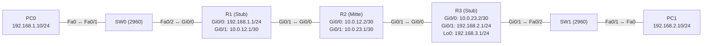

# Übung 3.2: Default-Route und Zusammenfassung

| | |
|---|---|
| **Modul** | 3 – Routing |
| **Stufe** | Aufbau |
| **Geschätzte Zeit** | ca. 60–75 Minuten |
| **Werkzeug** | Cisco Packet Tracer |
| **Vorwissen** | Übung 3.1 (statische Routen), Übung 1.3 (Subnetting) |

> **Stand der Prüfung:** Entwurf. Die Default-Route `ip route 0.0.0.0 0.0.0.0 <Next Hop>` ist durch ein Tutorial belegt (siehe Quellen). Die Zusammenfassung zweier Netze zu einer Route ist reine Rechnung (nachgerechnet, siehe Musterlösung) und verwendet denselben Befehl `ip route`. **Nicht bestätigt** sind alle gezeigten Ausgaben, die Zeile `Gateway of last resort`, das Loopback-Interface (`interface loopback 0`) auf Routern in Packet Tracer, die GUI-Wege (*Config* → *Static*) und der Kabeltyp *Copper Cross-Over* zwischen Routern.

## Lernziele

Nach dieser Übung kannst du

- erklären, was eine Default-Route ist und wann sie sinnvoll ist,
- mit `ip route 0.0.0.0 0.0.0.0 <Next Hop>` eine Default-Route einrichten und in `show ip route` als `S*` erkennen,
- zwei benachbarte Netze von Hand zu einer Zusammenfassung (Summary Route) zusammenfassen,
- eine Zusammenfassung als statische Route eintragen,
- Router als „Stub“ (Randrouter mit nur einem Ausgang) und als Mitte unterscheiden.

## Voraussetzungen

Übung 3.1 (statische Routen mit Next Hop und Rückroute) und 1.3 (Subnetting). Neu in dieser Übung sind die Default-Route und das Zusammenfassen von Netzen.

## Grundbegriffe

| Begriff | Bedeutung |
|---|---|
| Default-Route | Die „Route für alles andere“: `0.0.0.0/0`. Der Router nimmt sie, wenn **keine genauere Route** passt. |
| `S*` | Kennzeichnung einer statischen Route, die als Standardroute (*candidate default*) dient. |
| Gateway of last resort | Zeile in `show ip route`, die den Next Hop der Default-Route nennt. |
| Stub-Router | Randrouter mit nur **einem** Weg nach draußen. Er braucht keine einzelnen Routen, eine Default-Route genügt. |
| Zusammenfassung (Summary Route) | Eine Route, die mehrere benachbarte Netze mit einer kürzeren Maske abdeckt, z. B. `192.168.2.0/23` für `192.168.2.0/24` und `192.168.3.0/24`. |
| Longest Prefix Match | Regel: Der Router wählt unter mehreren passenden Routen die mit der **längsten Maske** (genaueste). |
| Loopback-Interface | Ein virtuelles Interface im Router, das immer „up“ ist und eine Adresse tragen kann. Hier simuliert es ein weiteres Netz. |

> **Merksatz:** Die Default-Route sagt „alles, was du nicht kennst, geh dahin“. Die Summary Route sagt „alle diese Netze liegen in dieser Richtung“.

## Topologie und Adressplan

Drei Router in einer Kette. R1 und R3 sind Randrouter, R2 liegt in der Mitte.



| Gerät | Port / Interface | IP-Adresse | Subnetzmaske | Default Gateway |
|---|---|---|---|---|
| PC0 | FastEthernet0 | `192.168.1.10` | `255.255.255.0` | `192.168.1.1` |
| PC1 | FastEthernet0 | `192.168.2.10` | `255.255.255.0` | `192.168.2.1` |
| R1 | `GigabitEthernet0/0` | `192.168.1.1` | `255.255.255.0` | – |
| R1 | `GigabitEthernet0/1` | `10.0.12.1` | `255.255.255.252` | – |
| R2 | `GigabitEthernet0/0` | `10.0.12.2` | `255.255.255.252` | – |
| R2 | `GigabitEthernet0/1` | `10.0.23.1` | `255.255.255.252` | – |
| R3 | `GigabitEthernet0/0` | `10.0.23.2` | `255.255.255.252` | – |
| R3 | `GigabitEthernet0/1` | `192.168.2.1` | `255.255.255.0` | – |
| R3 | `Loopback0` | `192.168.3.1` | `255.255.255.0` | – |

Netze: LAN A `192.168.1.0/24` (an R1), LAN B `192.168.2.0/24` (an R3), LAN C `192.168.3.0/24` (simuliert durch `Loopback0` an R3) sowie die Verbindungsnetze `10.0.12.0/30` und `10.0.23.0/30`. Router mit zwei `GigabitEthernet`-Ports (z. B. 1941) genügen.

## Aufgabe

> **Schema dieser Übungsreihe: zwei Wege pro Schritt.** Wo es in Packet Tracer keinen CLI-Weg gibt (Geräte platzieren, verkabeln, PC-Adressen), steht das ausdrücklich dabei. Alle Befehle stehen in Codeblöcken. Die CLI-Befehle und GUI-Wege sind in dieser Entwurfsfassung noch nicht in Packet Tracer bestätigt.

### Teil A: Rechnen von Hand

**1. Netze zusammenfassen**

- **GUI:** Entfällt, Rechenaufgabe auf Papier.
- **CLI:** Entfällt.

Fasse `192.168.2.0/24` und `192.168.3.0/24` zu **einer** Route zusammen. Schreibe die dritten Oktette binär (`2` und `3`) und finde heraus, wie viele Bit gleich sind. Welche Präfixlänge und Maske ergibt sich? Welche Adressen deckt die Zusammenfassung ab?

### Teil B: Umsetzung in Packet Tracer

**2. Neues Projekt beginnen** und Geräte platzieren: drei Router, zwei Switches (*2960*), zwei PCs

- **GUI:** *File* → *New*, Geräte setzen.
- **CLI:** Entfällt (nur grafisch möglich).

**3. Verkabeln:** PC0 → SW0 `Fa0/1`, SW0 `Fa0/2` → R1 `Gi0/0`, PC1 → SW1 `Fa0/1`, SW1 `Fa0/2` → R3 `Gi0/1` mit *Copper Straight-Through*. R1 `Gi0/1` ↔ R2 `Gi0/0` und R2 `Gi0/1` ↔ R3 `Gi0/0` mit *Copper Cross-Over*

- **GUI:** Kategorie *Connections*, Kabeltyp anklicken, beide Geräte anklicken, Ports wählen.
- **CLI:** Entfällt (Kabel gibt es nur grafisch).

**4. PCs konfigurieren** (Adressplan oben, mit Default Gateway)

- **GUI:** PC → *Desktop* → *IP Configuration* → *Static*.
- **CLI:** Entfällt am PC.

**5. Interfaces der drei Router konfigurieren** (noch keine Routen)

- **GUI:** Router → *Config* → jeweiliges Interface: Adresse und Maske eintragen, *Port Status* *On*.
- **CLI:** Auf R1:
  ```text
  Router> enable
  Router# configure terminal
  Router(config)# hostname R1
  R1(config)# interface gigabitethernet 0/0
  R1(config-if)# ip address 192.168.1.1 255.255.255.0
  R1(config-if)# no shutdown
  R1(config-if)# exit
  R1(config)# interface gigabitethernet 0/1
  R1(config-if)# ip address 10.0.12.1 255.255.255.252
  R1(config-if)# no shutdown
  R1(config-if)# end
  ```
  Auf R2:
  ```text
  Router> enable
  Router# configure terminal
  Router(config)# hostname R2
  R2(config)# interface gigabitethernet 0/0
  R2(config-if)# ip address 10.0.12.2 255.255.255.252
  R2(config-if)# no shutdown
  R2(config-if)# exit
  R2(config)# interface gigabitethernet 0/1
  R2(config-if)# ip address 10.0.23.1 255.255.255.252
  R2(config-if)# no shutdown
  R2(config-if)# end
  ```
  Auf R3 (mit Loopback für LAN C):
  ```text
  Router> enable
  Router# configure terminal
  Router(config)# hostname R3
  R3(config)# interface gigabitethernet 0/0
  R3(config-if)# ip address 10.0.23.2 255.255.255.252
  R3(config-if)# no shutdown
  R3(config-if)# exit
  R3(config)# interface gigabitethernet 0/1
  R3(config-if)# ip address 192.168.2.1 255.255.255.0
  R3(config-if)# no shutdown
  R3(config-if)# exit
  R3(config)# interface loopback 0
  R3(config-if)# ip address 192.168.3.1 255.255.255.0
  R3(config-if)# end
  ```

**6. Default-Route auf den Randroutern**

- **GUI:** R1 → *Config* → *ROUTING* → *Static*: *Network* `0.0.0.0`, *Mask* `0.0.0.0`, *Next Hop* `10.0.12.2`, *Add*. Auf R3 entsprechend mit *Next Hop* `10.0.23.1`.
- **CLI:** Auf R1:
  ```text
  R1# configure terminal
  R1(config)# ip route 0.0.0.0 0.0.0.0 10.0.12.2
  R1(config)# end
  R1# show ip route
  ```
  Auf R3:
  ```text
  R3# configure terminal
  R3(config)# ip route 0.0.0.0 0.0.0.0 10.0.23.1
  R3(config)# end
  R3# show ip route
  ```
  In beiden Tabellen steht eine Zeile mit `S*` und darüber `Gateway of last resort is ... to network 0.0.0.0`.

**7. Auf R2 die Zusammenfassung und die Route nach links**

- **GUI:** R2 → *Config* → *ROUTING* → *Static*: *Network* `192.168.1.0`, *Mask* `255.255.255.0`, *Next Hop* `10.0.12.1`. Dann *Network* `192.168.2.0`, *Mask* `255.255.254.0`, *Next Hop* `10.0.23.2`.
- **CLI:** Auf R2:
  ```text
  R2# configure terminal
  R2(config)# ip route 192.168.1.0 255.255.255.0 10.0.12.1
  R2(config)# ip route 192.168.2.0 255.255.254.0 10.0.23.2
  R2(config)# end
  R2# show ip route
  ```
  R2 braucht **keine** Default-Route: Er kennt alle Netze seiner beiden Nachbarn. Ersetze `255.255.254.0` nicht durch zwei Einzelrouten, das ist der Sinn der Zusammenfassung.

**8. Verbindung testen**

- **GUI:** *Add Simple PDU*: PC0 → PC1, PC1 → PC0, PC0 → `192.168.3.1`.
- **CLI:** An PC0:
  ```text
  PC> ping 192.168.2.10
  PC> ping 192.168.3.1
  PC> tracert 192.168.2.10
  ```
  Beide Pings klappen, `tracert` zeigt die drei Router.

**9. Longest Prefix Match beobachten**

- **GUI:** Entfällt.
- **CLI:** Auf R2 die Routen ansehen und überlegen, welche für `192.168.3.1` gilt:
  ```text
  R2# show ip route
  R2# show ip route 192.168.3.1
  ```
  `show ip route <Adresse>` (nicht bestätigt in Packet Tracer) zeigt die Route, die der Router für diese Adresse benutzt. Überlege auch, was passiert, wenn du auf R2 zusätzlich `ip route 192.168.3.0 255.255.255.0 10.0.12.1` einträgst. Das ist die genauere Route, und die gewinnt. Entferne sie danach wieder mit `no ip route 192.168.3.0 255.255.255.0 10.0.12.1`.

**10. Projekt und Konfiguration speichern** als `03.2-default-route-und-zusammenfassung.pkt`

- **GUI:** *File* → *Save As* (oder `Strg+S`).
- **CLI:** Entfällt für die Projektdatei. Auf jedem Router:
  ```text
  R1# copy running-config startup-config
  ```

## Hintergrund: Wozu Default-Route und Zusammenfassung?

1. **Stub-Router brauchen nicht viel:** R1 hat nur einen Weg nach draußen, nämlich zu R2. Es genügt zu sagen „alles, was ich nicht selbst kenne, schick zu R2“. Das ist die Default-Route `0.0.0.0/0`. Mit der Maske `0.0.0.0` passt **jede** Adresse, und weil sie die kürzeste Maske hat, wird sie nur genommen, wenn nichts Genaueres passt (*Longest Prefix Match*).
2. **Die Mitte braucht die Details:** R2 muss wissen, hinter welchem Nachbarn welches Netz liegt. Eine Default-Route würde nicht reichen, weil er in zwei Richtungen weiterleiten muss.
3. **Zusammenfassen spart Einträge:** `192.168.2.0/24` und `192.168.3.0/24` unterscheiden sich nur im letzten Bit des dritten Oktetts (`...0010` und `...0011`). Die ersten 23 Bit sind gleich, also deckt `192.168.2.0/23` (Maske `255.255.254.0`) beide ab. R2 braucht einen Eintrag statt zwei.
4. **Grenze der Zusammenfassung:** Sie funktioniert nur, wenn die Netze **zusammenhängend** und passend ausgerichtet sind. `192.168.2.0/24` und `192.168.4.0/24` lassen sich nicht in `/23` zusammenfassen.
5. **Longest Prefix Match** entscheidet bei Überschneidung: Gäbe es auf R2 zusätzlich `192.168.3.0/24`, würde für `192.168.3.1` diese genauere Route gewählt, nicht die `/23`.

> **Merke:** Je genauer (längere Maske) eine Route ist, desto höher ihre Priorität. Die Default-Route ist die ungenaueste und gewinnt nur als letzte Möglichkeit.

## Hinweise

- Die Default-Route zeigt auf einen **Next Hop**, den der Router direkt erreichen kann, nicht auf ein fernes Netz.
- Eine Zusammenfassung darf keine Adressen abdecken, die gar nicht erreichbar sind. Sie würde sonst Pakete in eine Richtung schicken, in der es nichts gibt.
- Bei mehreren Ausgängen (zwei Internet-Anbieter) wird die Default-Route nicht automatisch umgeschaltet. Das lösen Protokolle oder Zusatzfunktionen (später).
- Eine Loopback-Adresse ist immer erreichbar, solange der Router läuft. Deshalb eignet sie sich gut, ein weiteres Netz zu simulieren.
- `S*` bedeutet statisch **und** als Default markiert. In der Tabelle steht sie als `S*   0.0.0.0/0 [1/0] via 10.0.12.2` (sinngemäß).
- Hat ein Router eine Default-Route, ist die Zeile `Gateway of last resort is not set` verschwunden und `Gateway of last resort is <Next Hop> to network 0.0.0.0` steht an der Stelle.

## Prüfbefehle

Am PC (Command Prompt):

```text
PC> ipconfig
PC> ping 192.168.2.10
PC> tracert 192.168.3.1
```

Am Router (CLI):

```text
R2> enable
R2# show ip interface brief
R2# show ip route
R2# ping 192.168.3.1
```

| CLI-Befehl | Was er zeigt | GUI-Weg |
|---|---|---|
| `show ip route` | Routingtabelle mit `C`, `L`, `S`, `S*` | Werkzeug *Inspect* → Router → *Routing Table* |
| `show ip interface brief` | Adresse und Status aller Interfaces, auch `Loopback0` | *Config* → jeweiliges Interface |
| `ping <Ziel>` | Ob das Ziel erreichbar ist | Werkzeug *Add Simple PDU* |
| `tracert <Ziel>` | Die Router auf dem Weg | *Simulation Mode*, *Event List* |

**Kontrollfragen**

1. Wann wird die Default-Route benutzt?
2. Warum genügt auf R1 und R3 eine Default-Route, auf R2 aber nicht?
3. Welche Maske hat die Zusammenfassung von `192.168.2.0/24` und `192.168.3.0/24`, und warum?
4. Was bedeutet *Longest Prefix Match*?
5. Warum lassen sich `192.168.2.0/24` und `192.168.4.0/24` nicht zu einer Route zusammenfassen?

## Erweiterungen

- **Weiteres Netz:** `Loopback1` mit `192.168.4.1/24` an R3 anlegen. Wird es von der Zusammenfassung abgedeckt? Welche Route brauchst du?
- **Vier Netze zusammenfassen:** `192.168.0.0/24` bis `192.168.3.0/24` zu einer Route zusammenfassen. Welche Maske ergibt sich?
- **Falsche Zusammenfassung:** `ip route 192.168.2.0 255.255.0.0 10.0.23.2` eintragen und überlegen, welche Netze fälschlich mit abgedeckt werden.
- **Weiter:** Übung 3.3 verbindet VLANs über einen Router mit einer einzigen Leitung (Router-on-a-Stick).

---

## Musterlösung

<details>
<summary>Musterlösung anzeigen</summary>

**Aufgabe 1: Zusammenfassen.**

```text
192.168.2.0  =  11000000.10101000.00000010.00000000
192.168.3.0  =  11000000.10101000.00000011.00000000
                ----------------------- ^
                gleich: 23 Bit          erstes unterschiedliches Bit
```

Die ersten 23 Bit sind gleich, also ist die Präfixlänge `/23`, die Maske `255.255.254.0`. Die Zusammenfassung `192.168.2.0/23` umfasst `192.168.2.0` bis `192.168.3.255` (512 Adressen). Das sind genau die beiden `/24`-Netze.

**Aufbau (Schritte 2–3, nur GUI):** Drei Router, zwei Switches, zwei PCs. PCs und Switches mit Routern über *Copper Straight-Through*, die Router untereinander mit *Copper Cross-Over* (nicht bestätigt).

**PC-Konfiguration (Schritt 4):**

| | IPv4 Address | Subnet Mask | Default Gateway |
|---|---|---|---|
| PC0 | `192.168.1.10` | `255.255.255.0` | `192.168.1.1` |
| PC1 | `192.168.2.10` | `255.255.255.0` | `192.168.2.1` |

**Interfaces (Schritt 5):** CLI wie in der Aufgabe.

**Default-Routen (Schritt 6) und Routen auf R2 (Schritt 7):**

```text
R1(config)# ip route 0.0.0.0 0.0.0.0 10.0.12.2
```

```text
R3(config)# ip route 0.0.0.0 0.0.0.0 10.0.23.1
```

```text
R2(config)# ip route 192.168.1.0 255.255.255.0 10.0.12.1
R2(config)# ip route 192.168.2.0 255.255.254.0 10.0.23.2
```

**Routingtabelle R1 (sinngemäß, nicht bestätigt):**

```text
R1# show ip route
Codes: L - local, C - connected, S - static, ...
Gateway of last resort is 10.0.12.2 to network 0.0.0.0

     10.0.0.0/8 is variably subnetted, 2 subnets, 2 masks
C       10.0.12.0/30 is directly connected, GigabitEthernet0/1
L       10.0.12.1/32 is directly connected, GigabitEthernet0/1
     192.168.1.0/24 is variably subnetted, 2 subnets, 2 masks
C       192.168.1.0/24 is directly connected, GigabitEthernet0/0
L       192.168.1.1/32 is directly connected, GigabitEthernet0/0
S*   0.0.0.0/0 [1/0] via 10.0.12.2
```

**Routingtabelle R2 (Auszug, sinngemäß, nicht bestätigt):**

```text
R2# show ip route
...
S    192.168.1.0/24 [1/0] via 10.0.12.1
S    192.168.2.0/23 [1/0] via 10.0.23.2
```

**Test (Schritt 8, sinngemäß, nicht bestätigt):** PC0 → PC1 und PC0 → `192.168.3.1` klappen. Die TTL der Antworten von PC1 ist um 3 kleiner als der Startwert (drei Router auf dem Weg). Der Wert bei der Loopback hängt vom Startwert des Routers ab und ist nicht bestätigt. `tracert` zeigt `192.168.1.1`, `10.0.12.2`, `10.0.23.2`, `192.168.2.10`.

**Longest Prefix Match (Schritt 9):** Für `192.168.3.1` passt auf R2 die Route `192.168.2.0/23` (Adressen `192.168.2.0` bis `192.168.3.255`). Mit der zusätzlichen Route `192.168.3.0/24` über `10.0.12.1` würde diese genauere Route gewinnen, und das Paket ginge fälschlich zu R1. Das beweist, warum man bei Überschneidungen vorsichtig sein muss.

**Antworten auf die Kontrollfragen:**

1. Wenn keine genauere Route zur Zieladresse passt.
2. R1 und R3 haben nur einen Weg nach draußen (zu R2), also genügt „alles zu R2“. R2 muss in zwei Richtungen unterscheiden, deshalb braucht er je eine Route pro Richtung.
3. `255.255.254.0` (`/23`), weil die ersten 23 Bit beider Netze gleich sind. Nur das letzte Bit des dritten Oktetts unterscheidet `2` und `3`.
4. Unter mehreren passenden Routen wählt der Router die mit der längsten Maske, also die genaueste.
5. `4` ist binär `00000100`, `2` ist `00000010`. Die Bits unterscheiden sich schon an vorderer Stelle, ein gemeinsames Präfix, das nur diese beiden Netze abdeckt, gibt es nicht. Das kleinste gemeinsame Präfix wäre `192.168.0.0/21` (Adressen `192.168.0.0` bis `192.168.7.255`), und das deckt viel mehr ab.

</details>

---

## Quellen

- Computer Networking Notes, *Configure a Static Default Route in Cisco Packet Tracer* ([computernetworkingnotes.com](https://www.computernetworkingnotes.com/ccna-study-guide/configure-a-static-default-route-in-cisco-packet-tracer.html)): `ip route 0.0.0.0 0.0.0.0 <Next Hop>`, Beispiele mit zwei Routern. Tutorial ohne offiziellen Beleg; das Tutorial zeigt keine Ausgabe von `show ip route`.
- SysNet Tech Solutions, *How to Configure Static Routing in Cisco Packet Tracer* ([sysnettechsolutions.com](https://sysnettechsolutions.com/en/configure-static-routing-in-cisco-packet-tracer)): statische Routen, Zeilenformat `S ... [1/0] via ...`. Tutorial ohne offiziellen Beleg.
- Cisco Networking Academy, *Packet Tracer – Configuring IPv4 Static and Default Routes* (Aufgabenblatt ohne Befehle; [cisco.tu-sofia.bg](https://cisco.tu-sofia.bg/wp-content/uploads/courses/CCNA2/course/files/6.2.2.4%20Packet%20Tracer%20-%20Configuring%20IPv4%20Static%20and%20Default%20Routes%20Instructions.pdf)): Aufgabenstellung mit Default-Route auf einem Randrouter; Packet Tracer unterstützt „fully specified static routes“ nicht.
- Zusammenfassung von Netzen, Longest Prefix Match und die Darstellung `S*` samt `Gateway of last resort`: allgemeines Netzwerkwissen, nicht aus den genannten Quellen belegt. Die Rechnung zur Zusammenfassung ist von Hand nachgerechnet.
- Die gezeigten Ausgaben sind ein konstruiertes Beispiel im IOS-Format und nicht aus Packet Tracer übernommen.

---

Lizenz: [CC BY-NC-SA 4.0](https://creativecommons.org/licenses/by-nc-sa/4.0/deed.de), Urheber: AnsibleArtisan4711. Cisco, Cisco IOS und Cisco Packet Tracer sind Marken von Cisco Systems, Inc. und/oder ihrer Tochtergesellschaften; dieses Dokument steht in keiner Verbindung zu Cisco.
