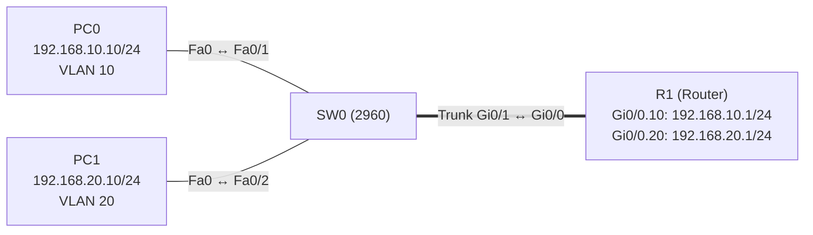

# Übung 3.3: Inter-VLAN-Routing mit Router-on-a-Stick

| | |
|---|---|
| **Modul** | 3 – Routing |
| **Stufe** | Aufbau |
| **Geschätzte Zeit** | ca. 60–75 Minuten |
| **Werkzeug** | Cisco Packet Tracer |
| **Vorwissen** | Übung 2.1 und 2.2 (VLANs, Trunks), Übung 1.2 (Router, Default Gateway) |

> **Stand der Prüfung:** Entwurf. Die Befehle für Subinterfaces (`interface gigabitethernet 0/0.10`, `encapsulation dot1Q 10`, `ip address`), `no shutdown` auf dem physischen Interface und `switchport mode trunk` am Switch sind durch ein Tutorial und ein Cisco-Packet-Tracer-Lab (dort ohne Befehlstext, nur als Schrittbeschreibung) belegt (siehe Quellen). **Nicht bestätigt** sind alle gezeigten Ausgaben (`show ip interface brief`, `show ip route`, `ping`), die GUI-Wege am Router (*Config* → Subinterface), die Namensform `Gi0/0.10` in Packet Tracer und das Verhalten bei fehlendem `no shutdown`.

## Lernziele

Nach dieser Übung kannst du

- erklären, warum zwei VLANs einen Router brauchen, um miteinander zu sprechen,
- erklären, wie *Router-on-a-Stick* mit nur **einer** Leitung zwischen Switch und Router funktioniert,
- am Router **Subinterfaces** mit `encapsulation dot1Q` einrichten und jedem VLAN ein Gateway geben,
- am Switch den Port zum Router als Trunk konfigurieren,
- mit `show ip interface brief` und `show ip route` prüfen, dass die Subinterfaces aktiv sind und die Netze in der Routingtabelle stehen.

## Voraussetzungen

Die Übungen 2.1 und 2.2: VLANs anlegen, Access-Ports, Trunks. Aus Modul 1: Router-Interfaces, Default Gateway. Neu ist, den Router als Gateway für **mehrere VLANs** über einen einzigen Trunk einzusetzen.

## Grundbegriffe

| Begriff | Bedeutung |
|---|---|
| Inter-VLAN-Routing | Weiterleiten von Paketen **zwischen** VLANs. Jedes VLAN ist ein eigenes IP-Netz, deshalb braucht es einen Router (oder Layer-3-Switch). |
| Router-on-a-Stick | Verfahren, bei dem **ein** physisches Router-Interface über einen Trunk mit dem Switch verbunden ist und für jedes VLAN ein logisches Subinterface bekommt. |
| Subinterface | Ein logisches Unter-Interface eines physischen Interfaces, z. B. `Gi0/0.10`. Es bekommt eine eigene IP-Adresse und gehört zu einem VLAN. |
| `encapsulation dot1Q <VLAN>` | Befehl am Subinterface: Der Router soll Frames mit dem 802.1Q-Tag des angegebenen VLANs annehmen und senden. |
| Gateway je VLAN | Die Adresse des Subinterfaces ist das Default Gateway der PCs im jeweiligen VLAN. |
| Physisches Interface | Das Interface (`Gi0/0`), das die Subinterfaces trägt. Es bekommt **keine** IP-Adresse, muss aber mit `no shutdown` eingeschaltet sein. |

> **Merksatz:** Ein Kabel, mehrere VLANs, mehrere Subinterfaces: Der Router hängt wie ein Spieß (*stick*) an einem einzigen Trunk-Link.

## Topologie und Adressplan



| Gerät | Port / Interface | IP-Adresse | Subnetzmaske | Default Gateway | VLAN |
|---|---|---|---|---|---|
| PC0 | Fa0 ↔ SW0 `Fa0/1` | `192.168.10.10` | `255.255.255.0` | `192.168.10.1` | 10 (Verkauf) |
| PC1 | Fa0 ↔ SW0 `Fa0/2` | `192.168.20.10` | `255.255.255.0` | `192.168.20.1` | 20 (Technik) |
| R1 | `GigabitEthernet0/0` | keine | – | – | Trunk |
| R1 | `GigabitEthernet0/0.10` | `192.168.10.1` | `255.255.255.0` | – | 10 |
| R1 | `GigabitEthernet0/0.20` | `192.168.20.1` | `255.255.255.0` | – | 20 |
| SW0 | `Gi0/1` | keine | – | – | Trunk zu R1 |

Das Kabel zwischen `SW0 Gi0/1` und `R1 Gi0/0` ist *Copper Straight-Through*. Das Ziel: PC0 (VLAN 10) erreicht PC1 (VLAN 20) und umgekehrt, über den Router.

## Aufgabe

> **Schema dieser Übungsreihe: zwei Wege pro Schritt.** Wo es in Packet Tracer keinen CLI-Weg gibt (Geräte platzieren, verkabeln, PC-Adressen), steht das ausdrücklich dabei. Alle Befehle stehen in Codeblöcken. Die CLI-Befehle und GUI-Wege sind in dieser Entwurfsfassung noch nicht in Packet Tracer bestätigt.

**1. Neues Projekt beginnen** und Geräte platzieren: einen Router (z. B. *1941*), einen Switch (*2960*), zwei PCs

- **GUI:** *File* → *New*, Geräte setzen.
- **CLI:** Entfällt (nur grafisch möglich).

**2. Verkabeln** mit *Copper Straight-Through*: PC0 → `Fa0/1`, PC1 → `Fa0/2`, SW0 `Gi0/1` → R1 `Gi0/0`

- **GUI:** Kategorie *Connections*, Kabeltyp anklicken, beide Geräte anklicken, Ports wählen.
- **CLI:** Entfällt (Kabel gibt es nur grafisch).

**3. VLANs und Access-Ports am Switch einrichten** (wie in Übung 2.1)

- **GUI:** Switch → *Config* → *VLAN Database*: VLAN 10 `Verkauf`, VLAN 20 `Technik`; *Config* → `FastEthernet0/1` (VLAN 10) und `FastEthernet0/2` (VLAN 20) jeweils als *Access*.
- **CLI:** Switch → Reiter *CLI*:
  ```text
  Switch> enable
  Switch# configure terminal
  Switch(config)# hostname SW0
  SW0(config)# vlan 10
  SW0(config-vlan)# name Verkauf
  SW0(config-vlan)# exit
  SW0(config)# vlan 20
  SW0(config-vlan)# name Technik
  SW0(config-vlan)# exit
  SW0(config)# interface fastethernet 0/1
  SW0(config-if)# switchport mode access
  SW0(config-if)# switchport access vlan 10
  SW0(config-if)# exit
  SW0(config)# interface fastethernet 0/2
  SW0(config-if)# switchport mode access
  SW0(config-if)# switchport access vlan 20
  SW0(config-if)# end
  ```

**4. PCs konfigurieren** (Adressplan oben, mit Default Gateway)

- **GUI:** PC → *Desktop* → *IP Configuration* → *Static*, Adresse, Maske und Gateway eintragen.
- **CLI:** Entfällt am PC.

**5. Vorher testen: ohne Router**

- **GUI:** *Add Simple PDU*: PC0 → PC1.
- **CLI:** An PC0:
  ```text
  PC> ping 192.168.20.10
  ```
  Der Ping schlägt fehl: Es gibt noch keinen Weg zwischen den VLANs. Notiere das Ergebnis.

**6. Den Trunk am Switch einrichten**

- **GUI:** Switch → *Config* → `GigabitEthernet0/1`: *Mode* auf *Trunk*.
- **CLI:** Auf SW0:
  ```text
  SW0# configure terminal
  SW0(config)# interface gigabitethernet 0/1
  SW0(config-if)# switchport mode trunk
  SW0(config-if)# end
  SW0# show interfaces trunk
  ```

**7. Subinterfaces am Router einrichten**

- **GUI:** Router → *Config* → *GigabitEthernet0/0*: *Port Status* *On* (keine IP-Adresse). Für die Subinterfaces gibt es in der GUI keinen direkten Weg (nicht bestätigt). Nutze die CLI.
- **CLI:** Router → Reiter *CLI*:
  ```text
  Router> enable
  Router# configure terminal
  Router(config)# hostname R1
  R1(config)# interface gigabitethernet 0/0
  R1(config-if)# no shutdown
  R1(config-if)# exit
  R1(config)# interface gigabitethernet 0/0.10
  R1(config-subif)# description Gateway VLAN 10
  R1(config-subif)# encapsulation dot1Q 10
  R1(config-subif)# ip address 192.168.10.1 255.255.255.0
  R1(config-subif)# exit
  R1(config)# interface gigabitethernet 0/0.20
  R1(config-subif)# description Gateway VLAN 20
  R1(config-subif)# encapsulation dot1Q 20
  R1(config-subif)# ip address 192.168.20.1 255.255.255.0
  R1(config-subif)# end
  ```
  Die Zahl nach `dot1Q` ist die VLAN-ID. Die Zahl nach dem Punkt im Interface-Namen ist nur eine Nummer; es ist üblich, sie gleich der VLAN-ID zu wählen.

**8. Router prüfen**

- **GUI:** Router → *Config* → *GigabitEthernet0/0* ansehen.
- **CLI:** Auf R1:
  ```text
  R1# show ip interface brief
  R1# show ip route
  ```
  Beide Subinterfaces stehen mit Status `up` und Protocol `up`. Die Routingtabelle enthält `C` und `L` für `192.168.10.0/24` und `192.168.20.0/24`, jeweils am Subinterface.

**9. Verbindung testen**

- **GUI:** *Add Simple PDU*: PC0 → R1 (`192.168.10.1`), PC0 → PC1, PC1 → PC0.
- **CLI:** An PC0:
  ```text
  PC> ping 192.168.10.1
  PC> ping 192.168.20.10
  PC> tracert 192.168.20.10
  ```
  Der Ping an PC1 klappt (der erste Versuch kann wegen ARP verloren gehen). `tracert` zeigt als ersten Sprung `192.168.10.1`, dann PC1.

**10. Gegenprobe: Was, wenn das physische Interface aus ist?**

- **GUI:** R1 → *Config* → *GigabitEthernet0/0*: *Port Status* auf *Off*. Pings wiederholen, dann wieder auf *On*.
- **CLI:** Auf R1:
  ```text
  R1# configure terminal
  R1(config)# interface gigabitethernet 0/0
  R1(config-if)# shutdown
  R1(config-if)# end
  R1# show ip interface brief
  ```
  Beide Subinterfaces fallen mit aus (`down`), weil sie vom physischen Interface abhängen. Danach wieder:
  ```text
  R1(config)# interface gigabitethernet 0/0
  R1(config-if)# no shutdown
  ```
  Notiere, wie sich die Anzeige und der Ping ändern.

**11. Projekt und Konfiguration speichern** als `03.3-inter-vlan-routing-router-on-a-stick.pkt`

- **GUI:** *File* → *Save As* (oder `Strg+S`).
- **CLI:** Entfällt für die Projektdatei. Auf Router und Switch:
  ```text
  R1# copy running-config startup-config
  ```

## Hintergrund: Was passiert beim Ping von PC0 zu PC1?

1. **PC0 prüft:** `192.168.20.10` liegt nicht im Netz `192.168.10.0/24`. Das Paket geht an das Gateway `192.168.10.1`. PC0 löst die MAC-Adresse des Gateways per ARP auf.
2. **Der Frame geht zum Switch.** SW0 empfängt ihn auf `Fa0/1` (VLAN 10) und leitet ihn zum Trunk-Port `Gi0/1`. Dort bekommt er das **802.1Q-Tag** `10`.
3. **Der Router empfängt den Frame** auf `Gi0/0` mit dem Tag 10 und ordnet ihn dem Subinterface `Gi0/0.10` zu (wegen `encapsulation dot1Q 10`).
4. **R1 routet:** Das Ziel `192.168.20.10` liegt im Netz `192.168.20.0/24`, das an `Gi0/0.20` hängt. R1 löst per ARP die MAC-Adresse von PC1 auf.
5. **R1 sendet den Frame zurück** über dieselbe physische Leitung, diesmal mit dem Tag `20` (Subinterface `Gi0/0.20`).
6. **SW0 entfernt das Tag** und liefert den Frame an `Fa0/2` (VLAN 20) zu PC1.

Das Paket hat also dasselbe Kabel zweimal benutzt: hin im VLAN 10, zurück im VLAN 20. Das ist der „Stick“ und zugleich die Grenze des Verfahrens: Die Bandbreite der einen Leitung wird zwischen allen VLANs geteilt.

> **Warum bekommt das physische Interface keine IP-Adresse?** Die Adressen gehören zu den Subinterfaces, eine pro VLAN. Das physische Interface trägt sie nur, muss aber eingeschaltet sein, sonst fallen alle Subinterfaces aus.

## Hinweise

- Die VLAN-ID im Befehl `encapsulation dot1Q` muss mit dem VLAN am Switch übereinstimmen. Ein Tippfehler hier ist ein häufiger Fehler.
- Der Port am Switch muss ein **Trunk** sein, kein Access-Port. Ein Access-Port würde nur ein VLAN übertragen.
- Das Default Gateway der PCs muss die Adresse des **Subinterfaces** im jeweiligen VLAN sein, nicht die im anderen VLAN.
- Die Native-VLAN-Behandlung (Frames ohne Tag) hat in dieser Übung keine Rolle, weil VLAN 1 nicht verwendet wird. In realen Netzen sollte das Native VLAN auf beiden Seiten gleich sein.
- Subinterfaces sind rein logisch: Fällt die Leitung aus, fallen alle VLANs gleichzeitig aus. Router-on-a-Stick ist ein Einzelfehlerpunkt.
- Die Methode ist für kleine Netze gedacht. Bei viel Verkehr zwischen den VLANs wird der eine Link zum Engpass (siehe Übung 3.4).
- Bleibt ein Subinterface `down`, prüfe `no shutdown` auf dem physischen Interface, den Trunk am Switch und die VLAN-ID in `encapsulation`.

## Prüfbefehle

Am PC (Command Prompt):

```text
PC> ipconfig
PC> ping 192.168.10.1
PC> ping 192.168.20.10
PC> tracert 192.168.20.10
```

Am Switch (CLI):

```text
SW0> enable
SW0# show vlan brief
SW0# show interfaces trunk
```

Am Router (CLI):

```text
R1> enable
R1# show ip interface brief
R1# show ip route
R1# show running-config
```

| CLI-Befehl | Was er zeigt | GUI-Weg |
|---|---|---|
| `show vlan brief` (Switch) | VLANs und Access-Ports | *Config* → *VLAN Database* |
| `show interfaces trunk` (Switch) | Trunk-Port `Gi0/1`, erlaubte VLANs | *Config* → `GigabitEthernet0/0`/`Gi0/1` |
| `show ip interface brief` (Router) | Adresse und Status von `Gi0/0` und den Subinterfaces | *Config* → Interface |
| `show ip route` (Router) | Routingtabelle mit `C` und `L` je Subinterface | Werkzeug *Inspect* → Router → *Routing Table* |
| `ping`, `tracert` (PC) | Erreichbarkeit und Weg | Werkzeug *Add Simple PDU* |

**Kontrollfragen**

1. Warum können zwei PCs in verschiedenen VLANs ohne Router nicht miteinander sprechen?
2. Welche Aufgabe haben die Subinterfaces am Router?
3. Was bewirkt `encapsulation dot1Q 20`?
4. Warum bekommt das physische Interface `Gi0/0` keine IP-Adresse, und was passiert, wenn es heruntergefahren wird?
5. Warum ist Router-on-a-Stick bei viel Verkehr zwischen den VLANs ein Engpass?

## Erweiterungen

- **Drittes VLAN:** VLAN 30 `Verwaltung` mit einem weiteren PC (`192.168.30.10`) und dem Subinterface `Gi0/0.30` (`192.168.30.1`) ergänzen.
- **Erlaubte VLANs:** Am Trunk `switchport trunk allowed vlan 10` setzen und prüfen, was mit VLAN 20 passiert.
- **Falsche VLAN-ID:** `encapsulation dot1Q 200` statt `20` eintragen und `show ip interface brief` und den Ping beobachten. Danach korrigieren.
- **Weiter:** Übung 3.4 erledigt dasselbe mit einem Layer-3-Switch, ohne externen Router.

---

## Musterlösung

<details>
<summary>Musterlösung anzeigen</summary>

**Aufbau (Schritte 1–2, nur GUI):** Einen Router, einen Switch 2960 und zwei PCs platzieren und mit *Copper Straight-Through* verkabeln: PC0 → `Fa0/1`, PC1 → `Fa0/2`, SW0 `Gi0/1` → R1 `Gi0/0`.

**VLANs und Access-Ports (Schritt 3):** CLI wie in der Aufgabe.

**PC-Konfiguration (Schritt 4):**

| | IPv4 Address | Subnet Mask | Default Gateway |
|---|---|---|---|
| PC0 | `192.168.10.10` | `255.255.255.0` | `192.168.10.1` |
| PC1 | `192.168.20.10` | `255.255.255.0` | `192.168.20.1` |

**Ohne Router (Schritt 5):** Der Ping von PC0 an PC1 schlägt fehl.

**Trunk (Schritt 6):**

```text
SW0# configure terminal
SW0(config)# interface gigabitethernet 0/1
SW0(config-if)# switchport mode trunk
SW0(config-if)# end
```

**Subinterfaces (Schritt 7):**

```text
Router> enable
Router# configure terminal
Router(config)# hostname R1
R1(config)# interface gigabitethernet 0/0
R1(config-if)# no shutdown
R1(config-if)# exit
R1(config)# interface gigabitethernet 0/0.10
R1(config-subif)# description Gateway VLAN 10
R1(config-subif)# encapsulation dot1Q 10
R1(config-subif)# ip address 192.168.10.1 255.255.255.0
R1(config-subif)# exit
R1(config)# interface gigabitethernet 0/0.20
R1(config-subif)# description Gateway VLAN 20
R1(config-subif)# encapsulation dot1Q 20
R1(config-subif)# ip address 192.168.20.1 255.255.255.0
R1(config-subif)# end
```

**Prüfen (Schritt 8, sinngemäß, nicht bestätigt):**

```text
R1# show ip interface brief
Interface                  IP-Address      OK? Method Status                Protocol
GigabitEthernet0/0         unassigned      YES unset  up                    up
GigabitEthernet0/0.10      192.168.10.1    YES manual up                    up
GigabitEthernet0/0.20      192.168.20.1    YES manual up                    up
GigabitEthernet0/1         unassigned      YES unset  administratively down down
```

```text
R1# show ip route
Codes: L - local, C - connected, S - static, ...
Gateway of last resort is not set

     192.168.10.0/24 is variably subnetted, 2 subnets, 2 masks
C       192.168.10.0/24 is directly connected, GigabitEthernet0/0.10
L       192.168.10.1/32 is directly connected, GigabitEthernet0/0.10
     192.168.20.0/24 is variably subnetted, 2 subnets, 2 masks
C       192.168.20.0/24 is directly connected, GigabitEthernet0/0.20
L       192.168.20.1/32 is directly connected, GigabitEthernet0/0.20
```

Laut dem Cisco-Lab sind die Subinterfaces vor dem Einschalten des physischen Interfaces `down` („Both subinterfaces are down“). Nach `no shutdown` auf `Gi0/0` werden sie `up`.

**Test (Schritt 9, sinngemäß, nicht bestätigt):** `ping 192.168.10.1` und `ping 192.168.20.10` von PC0 klappen (der erste Versuch kann verloren gehen). `tracert 192.168.20.10` zeigt `192.168.10.1` und danach `192.168.20.10`. Die TTL der Antwort von PC1 ist um 1 kleiner als der Startwert, weil ein Router passiert wurde.

**Gegenprobe (Schritt 10):** Mit `shutdown` auf `Gi0/0` fallen beide Subinterfaces aus, kein Ping zwischen den VLANs und auch nicht mehr zum Gateway. Nach `no shutdown` kommen die Subinterfaces zurück.

**Antworten auf die Kontrollfragen:**

1. Jedes VLAN ist ein eigenes IP-Netz, und der Switch leitet Frames nur innerhalb eines VLANs weiter. Zwischen den Netzen vermittelt nur ein Router oder Layer-3-Switch.
2. Jedes Subinterface ist das Gateway eines VLANs: Es hat die IP-Adresse des Gateways, nimmt die Frames mit dem passenden Tag an und sendet die Antworten mit dem richtigen Tag zurück.
3. Das Subinterface nimmt Frames mit dem 802.1Q-Tag der VLAN-ID 20 an und sendet seine Frames mit diesem Tag.
4. Die Adressen gehören zu den Subinterfaces. Das physische Interface trägt sie nur. Wird es heruntergefahren, fallen alle Subinterfaces aus.
5. Alle VLANs teilen sich eine einzige Leitung. Das Paket läuft hin und zurück über denselben Link, daher begrenzt dessen Bandbreite den gesamten Verkehr zwischen den VLANs.

</details>

---

## Quellen

- Computer Networking Notes, *Router on Stick Configuration Explained* ([computernetworkingnotes.com](https://www.computernetworkingnotes.com/ccna-study-guide/router-on-stick-configuration-explained.html)): Befehle `interface fastethernet 0/0.10`, `encapsulation dot1Q 10`, `ip address ...`, physisches Interface `no shutdown` ohne IP-Adresse, `switchport mode trunk` am Switch. Tutorial ohne offiziellen Beleg; es verwendet FastEthernet statt GigabitEthernet.
- Cisco Networking Academy, *Packet Tracer – Configuring Router-on-a-Stick Inter-VLAN Routing* (Aufgabenblatt ohne Befehlstext; [cisco.tu-sofia.bg](https://cisco.tu-sofia.bg/wp-content/uploads/courses/CCNA2/course/files/5.1.3.6%20Packet%20Tracer%20-%20Configuring%20Router-on-a-Stick%20Inter-VLAN%20Routing%20Instructions.pdf)): Schrittfolge (Subinterface, 802.1Q, Adresse, physisches Interface einschalten, Trunk), `show ip interface brief` zeigt vor dem Einschalten beide Subinterfaces `down`.
- Die Namensform `Gi0/0.10`, `show ip route` für Subinterfaces und der Zusammenhang „Subinterfaces fallen mit dem physischen Interface aus“: Standard-IOS bzw. allgemeines Wissen, hier nicht aus den genannten Quellen im Wortlaut belegt.
- Die gezeigten Ausgaben sind ein konstruiertes Beispiel im IOS-Format und nicht aus Packet Tracer übernommen.

---

Lizenz: [CC BY-NC-SA 4.0](https://creativecommons.org/licenses/by-nc-sa/4.0/deed.de), Urheber: AnsibleArtisan4711. Cisco, Cisco IOS und Cisco Packet Tracer sind Marken von Cisco Systems, Inc. und/oder ihrer Tochtergesellschaften; dieses Dokument steht in keiner Verbindung zu Cisco.
