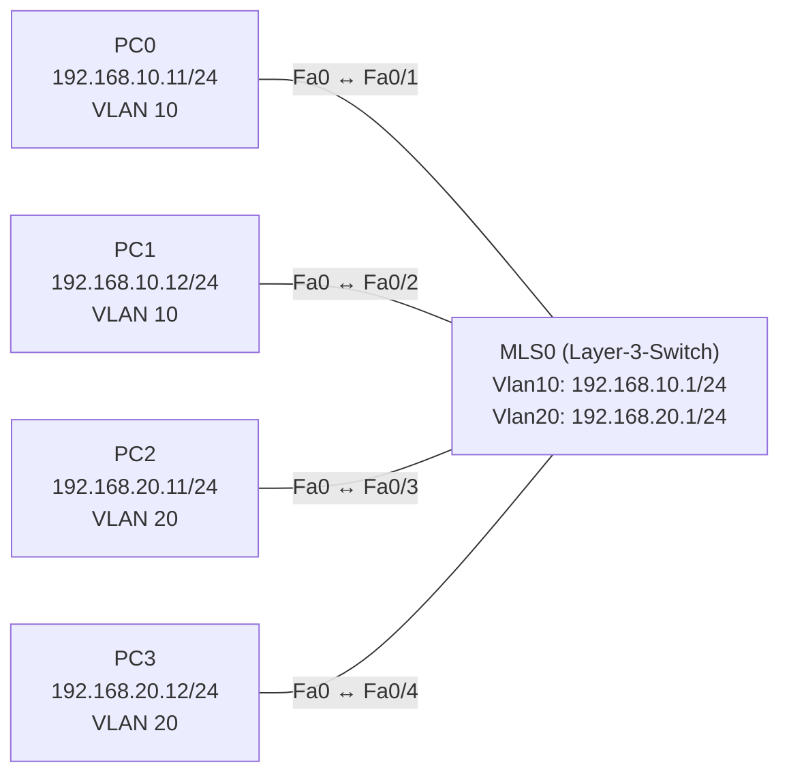

# Übung 3.4: Inter-VLAN-Routing mit Layer-3-Switch

| | |
|---|---|
| **Modul** | 3 – Routing |
| **Stufe** | Aufbau |
| **Geschätzte Zeit** | ca. 45–60 Minuten |
| **Werkzeug** | Cisco Packet Tracer |
| **Vorwissen** | Übung 3.3 (Router-on-a-Stick), Übung 2.1 (VLANs) |

> **Stand der Prüfung:** Entwurf. Die Befehle `ip routing`, `interface vlan <ID>`, `ip address`, `no shutdown` und die VLAN-Befehle sind durch ein Tutorial mit einem echten Layer-3-Switch belegt (siehe Quellen). **Nicht bestätigt** sind alle gezeigten Ausgaben, das Modell *3560-24PS* als „Multilayer Switch“ in Packet Tracer samt Portbezeichnungen, ob `ip routing` dort zwingend nötig ist, ob in der Routingtabelle des Switches die `L`-Zeilen erscheinen, die GUI-Wege und der Befehl `switchport trunk encapsulation dot1q` bei einer Erweiterung (Standard-IOS, nicht in den Quellen gezeigt).

## Lernziele

Nach dieser Übung kannst du

- erklären, was ein Layer-3-Switch (Multilayer-Switch) ist und worin er sich von einem Layer-2-Switch unterscheidet,
- mit `ip routing` die Routingfunktion einschalten,
- für jedes VLAN ein **SVI** (*Switch Virtual Interface*, `interface vlan <ID>`) mit Adresse einrichten und als Gateway nutzen,
- mit `show ip route` prüfen, dass die VLAN-Netze als `C` in der Routingtabelle stehen,
- Router-on-a-Stick und Layer-3-Switch vergleichen.

## Voraussetzungen

Übung 3.3: Du solltest wissen, warum VLANs einen Router brauchen und wie Gateways für VLANs eingerichtet werden. Hier kommt dieselbe Funktion in einem einzigen Gerät.

## Grundbegriffe

| Begriff | Bedeutung |
|---|---|
| Layer-2-Switch | Leitet Frames anhand von MAC-Adressen weiter (Übung 1.1). Kann nicht zwischen IP-Netzen vermitteln. |
| Layer-3-Switch | Switch, der zusätzlich **routen** kann. Er verbindet VLANs selbst und braucht keinen externen Router. |
| SVI | *Switch Virtual Interface*, `interface vlan 10`: ein virtuelles Layer-3-Interface für ein VLAN. Seine IP-Adresse ist das Default Gateway der PCs im VLAN. |
| `ip routing` | Schaltet die Routingfunktion eines Layer-3-Switches ein. Ohne den Befehl arbeitet er nur als Layer-2-Switch. |
| Multilayer-Switch | Anderes Wort für Layer-3-Switch. In Packet Tracer heißt das Modell z. B. *3560-24PS*. |

> **Merksatz:** Router-on-a-Stick braucht zwei Geräte und eine gemeinsame Leitung. Ein Layer-3-Switch routet **intern** zwischen den VLANs und braucht dafür nur SVIs.

## Topologie und Adressplan



| Gerät | Port / Interface | IP-Adresse | Subnetzmaske | Default Gateway | VLAN |
|---|---|---|---|---|---|
| PC0 | Fa0 ↔ MLS `Fa0/1` | `192.168.10.11` | `255.255.255.0` | `192.168.10.1` | 10 (Verkauf) |
| PC1 | Fa0 ↔ MLS `Fa0/2` | `192.168.10.12` | `255.255.255.0` | `192.168.10.1` | 10 (Verkauf) |
| PC2 | Fa0 ↔ MLS `Fa0/3` | `192.168.20.11` | `255.255.255.0` | `192.168.20.1` | 20 (Technik) |
| PC3 | Fa0 ↔ MLS `Fa0/4` | `192.168.20.12` | `255.255.255.0` | `192.168.20.1` | 20 (Technik) |
| MLS0 | `Vlan10` (SVI) | `192.168.10.1` | `255.255.255.0` | – | 10 |
| MLS0 | `Vlan20` (SVI) | `192.168.20.1` | `255.255.255.0` | – | 20 |

Es gibt keinen Router. Die PCs hängen an Access-Ports des Layer-3-Switches, und die SVIs übernehmen die Rolle der Gateways.

## Aufgabe

> **Schema dieser Übungsreihe: zwei Wege pro Schritt.** Wo es in Packet Tracer keinen CLI-Weg gibt (Geräte platzieren, verkabeln, PC-Adressen), steht das ausdrücklich dabei. Alle Befehle stehen in Codeblöcken. Die CLI-Befehle und GUI-Wege sind in dieser Entwurfsfassung noch nicht in Packet Tracer bestätigt.

**1. Neues Projekt beginnen** und Geräte platzieren: einen Layer-3-Switch (Kategorie *Switches*, Modell *3560-24PS*) und vier PCs

- **GUI:** *File* → *New*, Geräte setzen. Wähle bewusst den Multilayer-Switch, nicht den 2960.
- **CLI:** Entfällt (nur grafisch möglich).

**2. Verkabeln** mit *Copper Straight-Through*: PC0 → `Fa0/1`, PC1 → `Fa0/2`, PC2 → `Fa0/3`, PC3 → `Fa0/4`

- **GUI:** Kategorie *Connections*, Kabeltyp anklicken, beide Geräte anklicken, Ports wählen.
- **CLI:** Entfällt (Kabel gibt es nur grafisch).

**3. PCs konfigurieren** (Adressplan oben, mit Default Gateway)

- **GUI:** PC → *Desktop* → *IP Configuration* → *Static*, Adresse, Maske und Gateway eintragen.
- **CLI:** Entfällt am PC.

**4. VLANs anlegen und Ports zuweisen** (wie in Übung 2.1)

- **GUI:** Switch → *Config* → *VLAN Database*: VLAN 10 `Verkauf`, VLAN 20 `Technik`; *Config* → Ports `Fa0/1`, `Fa0/2` (VLAN 10) und `Fa0/3`, `Fa0/4` (VLAN 20) jeweils als *Access*.
- **CLI:** Switch → Reiter *CLI*:
  ```text
  Switch> enable
  Switch# configure terminal
  Switch(config)# hostname MLS0
  MLS0(config)# vlan 10
  MLS0(config-vlan)# name Verkauf
  MLS0(config-vlan)# exit
  MLS0(config)# vlan 20
  MLS0(config-vlan)# name Technik
  MLS0(config-vlan)# exit
  MLS0(config)# interface range fastethernet 0/1 - 2
  MLS0(config-if-range)# switchport mode access
  MLS0(config-if-range)# switchport access vlan 10
  MLS0(config-if-range)# exit
  MLS0(config)# interface range fastethernet 0/3 - 4
  MLS0(config-if-range)# switchport mode access
  MLS0(config-if-range)# switchport access vlan 20
  MLS0(config-if-range)# end
  ```

**5. Vorher testen: ohne Routing**

- **GUI:** *Add Simple PDU*: PC0 → PC1, PC0 → PC2.
- **CLI:** An PC0:
  ```text
  PC> ping 192.168.10.12
  PC> ping 192.168.20.11
  ```
  Innerhalb des VLANs klappt der Ping, zwischen den VLANs nicht.

**6. Die SVIs einrichten und Routing einschalten**

- **GUI:** Entfällt, für SVIs gibt es in der GUI keinen direkten Weg (nicht bestätigt). Nutze die CLI.
- **CLI:** Auf MLS0:
  ```text
  MLS0# configure terminal
  MLS0(config)# ip routing
  MLS0(config)# interface vlan 10
  MLS0(config-if)# description Gateway VLAN 10
  MLS0(config-if)# ip address 192.168.10.1 255.255.255.0
  MLS0(config-if)# no shutdown
  MLS0(config-if)# exit
  MLS0(config)# interface vlan 20
  MLS0(config-if)# description Gateway VLAN 20
  MLS0(config-if)# ip address 192.168.20.1 255.255.255.0
  MLS0(config-if)# no shutdown
  MLS0(config-if)# end
  ```
  Ein SVI geht erst `up`, wenn das VLAN existiert und mindestens ein aktiver Port darin liegt.

**7. Prüfen**

- **GUI:** Werkzeug *Inspect* → Switch → *Routing Table* (nicht bestätigt).
- **CLI:** Auf MLS0:
  ```text
  MLS0# show ip interface brief
  MLS0# show ip route
  ```
  `Vlan10` und `Vlan20` stehen `up` / `up`. In der Routingtabelle stehen `192.168.10.0/24` und `192.168.20.0/24` als `C` (je nach IOS-Version zusätzlich `L`-Zeilen).

**8. Verbindung testen**

- **GUI:** *Add Simple PDU*: PC0 → PC2, PC1 → PC3, PC2 → PC0.
- **CLI:** An PC0:
  ```text
  PC> ping 192.168.10.1
  PC> ping 192.168.20.11
  PC> tracert 192.168.20.11
  ```
  Die Pings klappen, `tracert` zeigt als ersten Sprung `192.168.10.1` (das SVI), dann PC2.

**9. Gegenprobe: Routing ausschalten**

- **GUI:** Entfällt.
- **CLI:** Auf MLS0:
  ```text
  MLS0# configure terminal
  MLS0(config)# no ip routing
  MLS0(config)# end
  ```
  Teste `ping 192.168.20.11` von PC0 und `show ip route` auf dem Switch. Notiere, was passiert (nicht bestätigt). Danach wieder `ip routing` einschalten.

**10. Projekt und Konfiguration speichern** als `03.4-inter-vlan-routing-mit-layer-3-switch.pkt`

- **GUI:** *File* → *Save As* (oder `Strg+S`).
- **CLI:** Entfällt für die Projektdatei. Die Switch-Konfiguration sichert man mit:
  ```text
  MLS0# copy running-config startup-config
  ```

## Hintergrund: Router und Switch in einem Gerät

1. **PC0 sendet an PC2.** `192.168.20.11` liegt nicht im Netz von PC0, also geht das Paket an das Gateway `192.168.10.1`. Das ist das SVI `Vlan10` des Layer-3-Switches.
2. **Der Switch routet intern.** Er nimmt den Frame auf Layer 2 entgegen, schaut auf die IP-Adresse und findet in seiner Routingtabelle `192.168.20.0/24` (angeschlossen, `Vlan20`).
3. **Er sendet den Frame in VLAN 20 an PC2.** Es gibt keinen Trunk und keine Leitung, die zweimal benutzt wird. Der Weg bleibt komplett im Gerät.
4. **Ohne `ip routing` ist er „nur“ ein Switch.** Die SVIs bleiben zwar bestehen (Verwaltungsadresse), aber es wird nichts zwischen den Netzen weitergeleitet.

**Vergleich:**

| | Router-on-a-Stick (Übung 3.3) | Layer-3-Switch (Übung 3.4) |
|---|---|---|
| Geräte | Router **und** Switch | ein Gerät |
| Verbindung | ein Trunk-Link (Engpass) | intern, kein Link nötig |
| Gateway-Adresse | Subinterface (`Gi0/0.10`) | SVI (`Vlan10`) |
| Befehle | `encapsulation dot1Q`, Trunk | `ip routing`, `interface vlan` |
| Typischer Einsatz | kleine Netze, wenig Verkehr | Campus-Netze, viel Verkehr zwischen VLANs |

> **Warum braucht man dann überhaupt noch Router?** Ein Router wird an der Grenze zu anderen Netzen gebraucht (Internet, WAN, VPN). Ein Layer-3-Switch kann meist weniger in diesen Bereichen. Innerhalb eines Standorts übernimmt er das VLAN-Routing.

## Hinweise

- Die Gateway-Adresse der PCs ist die Adresse des SVI des **eigenen** VLANs.
- Ein SVI bleibt `down`, solange das VLAN nicht existiert oder kein aktiver Port im VLAN liegt. Prüfe `show vlan brief`.
- `ip routing` ist bei Layer-3-Switches ab Werk **aus**, ob das in Packet Tracer ebenso ist, ist nicht bestätigt. Setze den Befehl in jedem Fall.
- Ein Layer-3-Switch kann auch einzelne Ports als Router-Port betreiben (`no switchport`). Das ist hier nicht nötig und nicht bestätigt in Packet Tracer.
- In der Routingtabelle eines Layer-3-Switches stehen je nach IOS-Version nur `C`-Zeilen oder zusätzlich `L`-Zeilen. Beides ist normal.
- Layer-3-Switches routen in Hardware und sind deshalb für Verkehr zwischen VLANs schneller als Router-on-a-Stick.

## Prüfbefehle

Am PC (Command Prompt):

```text
PC> ipconfig
PC> ping 192.168.10.1
PC> ping 192.168.20.11
PC> tracert 192.168.20.11
```

Am Layer-3-Switch (CLI):

```text
MLS0> enable
MLS0# show vlan brief
MLS0# show ip interface brief
MLS0# show ip route
MLS0# show running-config
```

| CLI-Befehl | Was er zeigt | GUI-Weg |
|---|---|---|
| `show vlan brief` | VLANs und Access-Ports | *Config* → *VLAN Database* |
| `show ip interface brief` | Adresse und Status der SVIs (`Vlan10`, `Vlan20`) | *Config* → Interface (nicht bestätigt) |
| `show ip route` | Routingtabelle mit den VLAN-Netzen | Werkzeug *Inspect* → *Routing Table* |
| `ping`, `tracert` (PC) | Erreichbarkeit und Weg | Werkzeug *Add Simple PDU* |

**Kontrollfragen**

1. Was unterscheidet einen Layer-3-Switch von einem Layer-2-Switch?
2. Was ist ein SVI, und welche Rolle hat es für die PCs?
3. Was bewirkt `ip routing`?
4. Warum bleibt ein SVI `down`, wenn das VLAN keinen aktiven Port hat?
5. Welchen Vorteil hat der Layer-3-Switch gegenüber Router-on-a-Stick, und wann braucht man trotzdem einen Router?

## Erweiterungen

- **Drittes VLAN:** VLAN 30 `Verwaltung` mit einem PC an `Fa0/5` und dem SVI `Vlan30` (`192.168.30.1`) ergänzen.
- **Zweiter Switch über Trunk:** Einen 2960 mit PCs in VLAN 10 und 20 über einen Trunk anbinden (am 3560 vorher `switchport trunk encapsulation dot1q`, danach `switchport mode trunk`, nicht in den Quellen gezeigt und nicht bestätigt). Die PCs am 2960 nutzen dieselben Gateways.
- **Zusammen mit einem Router:** Einen Router an den Switch anschließen und per Default-Route den Weg „nach draußen“ einrichten (Übung 3.2).
- **Weiter:** Übung 3.5 lässt Router ihre Routen von selbst lernen (OSPF).

---

## Musterlösung

<details>
<summary>Musterlösung anzeigen</summary>

**Aufbau (Schritte 1–2, nur GUI):** Einen Multilayer-Switch (*3560-24PS*) und vier PCs platzieren und mit *Copper Straight-Through* an `Fa0/1` bis `Fa0/4` anschließen.

**PC-Konfiguration (Schritt 3):**

| | IPv4 Address | Subnet Mask | Default Gateway |
|---|---|---|---|
| PC0 | `192.168.10.11` | `255.255.255.0` | `192.168.10.1` |
| PC1 | `192.168.10.12` | `255.255.255.0` | `192.168.10.1` |
| PC2 | `192.168.20.11` | `255.255.255.0` | `192.168.20.1` |
| PC3 | `192.168.20.12` | `255.255.255.0` | `192.168.20.1` |

**VLANs und Ports (Schritt 4):** CLI wie in der Aufgabe.

**SVIs und Routing (Schritt 6):**

```text
MLS0# configure terminal
MLS0(config)# ip routing
MLS0(config)# interface vlan 10
MLS0(config-if)# description Gateway VLAN 10
MLS0(config-if)# ip address 192.168.10.1 255.255.255.0
MLS0(config-if)# no shutdown
MLS0(config-if)# exit
MLS0(config)# interface vlan 20
MLS0(config-if)# description Gateway VLAN 20
MLS0(config-if)# ip address 192.168.20.1 255.255.255.0
MLS0(config-if)# no shutdown
MLS0(config-if)# end
```

**Prüfen (Schritt 7, sinngemäß, nicht bestätigt):**

```text
MLS0# show ip interface brief
Interface              IP-Address      OK? Method Status                Protocol
Vlan10                 192.168.10.1    YES manual up                    up
Vlan20                 192.168.20.1    YES manual up                    up
FastEthernet0/1        unassigned      YES unset  up                    up
...
```

```text
MLS0# show ip route
Codes: C - connected, S - static, ...
Gateway of last resort is not set

C    192.168.10.0/24 is directly connected, Vlan10
C    192.168.20.0/24 is directly connected, Vlan20
```

**Test (Schritt 8, sinngemäß, nicht bestätigt):** Alle Pings zwischen den VLANs klappen (der erste Versuch kann wegen ARP verloren gehen). `tracert 192.168.20.11` zeigt `192.168.10.1` und danach `192.168.20.11`.

**Gegenprobe (Schritt 9):** Ohne `ip routing` leitet der Switch nicht zwischen den VLANs weiter. Der Ping zwischen den VLANs schlägt fehl; die Routingtabelle wird nicht mehr gepflegt bzw. zeigt keine Routen. Die genaue Anzeige in Packet Tracer ist nicht bestätigt.

**Antworten auf die Kontrollfragen:**

1. Ein Layer-2-Switch leitet Frames nach MAC-Adressen weiter. Ein Layer-3-Switch kann zusätzlich Pakete nach IP-Adressen zwischen Netzen (VLANs) routen.
2. Ein SVI ist ein virtuelles Layer-3-Interface für ein VLAN. Seine Adresse ist das Default Gateway der PCs im VLAN.
3. Er schaltet die Routingfunktion des Switches ein. Ohne ihn arbeitet der Switch nur auf Layer 2.
4. Ein SVI geht erst `up`, wenn das VLAN existiert und mindestens ein aktiver Port im VLAN liegt. Ohne Port gäbe es keinen Link, auf den sich das Interface stützen könnte.
5. Das Routing erfolgt intern ohne gemeinsamen Link, schneller und ohne Engpass. Einen Router braucht man weiterhin an der Grenze zu anderen Netzen (WAN, Internet, VPN).

</details>

---

## Quellen

- ComputingForGeeks, *Cisco Layer 3 Switch Inter-VLAN SVI* ([computingforgeeks.com](https://computingforgeeks.com/cisco-layer3-switch-inter-vlan-svi/)): `ip routing`, `vlan <ID>` mit `name`, `switchport mode access`, `switchport access vlan`, `interface Vlan10` mit `ip address` und `no shutdown`; das Tutorial verwendet einen echten Layer-3-Switch mit IOS 15.2 (GNS3), nicht Packet Tracer, und zeigt die Ausgaben nur als Screenshots. Tutorial ohne offiziellen Beleg.
- Cisco Networking Academy, *Packet Tracer – Configure Layer 3 Switching and Inter-VLAN Routing* (Lab 4.3.8, [sites.radford.edu](https://sites.radford.edu/~hlee3/classes/cs451_spring2025/lab/Cisco/CCNA2_v7_SRWE_spring2020/SRWE%20v7%20Student%20Packet%20Tracer%20Source%20Files/4.3.8%20Packet%20Tracer%20-%20Configure%20Layer%203%20Switching%20and%20Inter-VLAN%20Routing.docx)): in den Suchergebnissen genannt, der Inhalt wurde für diese Übung nicht ausgewertet.
- Der Vergleich Router-on-a-Stick gegen Layer-3-Switch, die Bedingung für ein aktives SVI (VLAN vorhanden, aktiver Port) und `switchport trunk encapsulation dot1q` beim 3560: allgemeines Netzwerkwissen bzw. Standard-IOS, nicht aus den genannten Quellen belegt.
- Die gezeigten Ausgaben sind ein konstruiertes Beispiel im IOS-Format und nicht aus Packet Tracer übernommen.

---

Lizenz: [CC BY-NC-SA 4.0](https://creativecommons.org/licenses/by-nc-sa/4.0/deed.de), Urheber: AnsibleArtisan4711. Cisco, Cisco IOS und Cisco Packet Tracer sind Marken von Cisco Systems, Inc. und/oder ihrer Tochtergesellschaften; dieses Dokument steht in keiner Verbindung zu Cisco.
