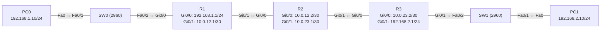

# Übung 3.5: OSPF mit einer Area

| | |
|---|---|
| **Modul** | 3 – Routing |
| **Stufe** | Aufbau |
| **Geschätzte Zeit** | ca. 75–90 Minuten |
| **Werkzeug** | Cisco Packet Tracer |
| **Vorwissen** | Übung 3.1 und 3.2 (statische Routen, Default-Route), Übung 1.3 (Subnetting) |

> **Stand der Prüfung:** Entwurf. Die Befehle `router ospf <Prozess-ID>`, `network <Adresse> <Wildcard> area 0`, `show ip ospf neighbor`, `show ip route`, `show ip protocols` und das Konzept der Prozess-ID sind durch Cisco-Labs belegt (siehe Quellen). **Nicht bestätigt** sind alle gezeigten Ausgaben in Packet Tracer (Nachbarschaften, Rollen DR/BDR, Metriken wie `[110/3]`, Meldungen beim Aufbau der Nachbarschaft), die GUI-Wege (*Config* → *OSPF*), der Kabeltyp *Copper Cross-Over* zwischen Routern und die Zeit bis zur Konvergenz.

## Lernziele

Nach dieser Übung kannst du

- erklären, was ein dynamisches Routingprotokoll ist und was OSPF tut,
- OSPF mit `router ospf` und `network`-Anweisungen (mit Wildcard-Maske) einrichten,
- die Wildcard-Maske aus der Subnetzmaske ableiten,
- mit `show ip ospf neighbor`, `show ip route` und `show ip protocols` prüfen, ob die Nachbarschaften stehen und welche Routen gelernt wurden,
- eine OSPF-Route (`O`) lesen und die Metrik (Kosten) nachvollziehen,
- beobachten, wie OSPF auf den Ausfall einer Verbindung reagiert.

## Voraussetzungen

Die Übungen 3.1 und 3.2 (statische Routen) sowie 1.3 (Subnetting). Neu ist, dass die Router ihre Routen **selbst** austauschen.

## Grundbegriffe

| Begriff | Bedeutung |
|---|---|
| Dynamisches Routing | Router tauschen Routen mit Nachbarn aus und tragen sie selbst in die Routingtabelle ein. |
| OSPF | *Open Shortest Path First*. Offenes Routingprotokoll nach dem Link-State-Prinzip: Jeder Router baut ein Bild des Netzes auf und berechnet daraus den kürzesten Weg. |
| Area | Bereich eines OSPF-Netzes. In dieser Übung nur eine: **Area 0** (Backbone). |
| Prozess-ID | Nummer des OSPF-Prozesses auf einem Router (z. B. `1`). Sie gilt nur lokal und muss auf den Nachbarn **nicht** gleich sein. |
| Nachbar (Neighbor) | Direkt verbundener Router, der OSPF in der gleichen Area spricht. |
| Hello-Paket | Nachricht, mit der Router sich finden und die Nachbarschaft halten. |
| Router-ID | Name eines Routers in OSPF. Standard: höchste Loopback-Adresse, sonst höchste aktive Adresse eines Interfaces (genauer in Übung 3.6). |
| Wildcard-Maske | „Umgekehrte“ Subnetzmaske für die `network`-Anweisung: `0` heißt „muss übereinstimmen“, `1` heißt „egal“. |
| Kosten (Cost) | OSPF-Metrik. Je schneller das Interface, desto kleiner. Die Summe der Kosten bis zum Ziel ist die Metrik. |
| `O` | Kennzeichnung einer von OSPF gelernten Route in `show ip route`. |

> **Merksatz:** Bei statischen Routen schreibst du jede Route selbst. Bei OSPF sagst du den Routern nur, **welche Interfaces** mitmachen sollen, den Rest lernen sie von den Nachbarn.

## Topologie und Adressplan

Drei Router in einer Kette mit je einem LAN an den Enden.



| Gerät | Port / Interface | IP-Adresse | Subnetzmaske | Default Gateway |
|---|---|---|---|---|
| PC0 | FastEthernet0 | `192.168.1.10` | `255.255.255.0` | `192.168.1.1` |
| PC1 | FastEthernet0 | `192.168.2.10` | `255.255.255.0` | `192.168.2.1` |
| R1 | `GigabitEthernet0/0` | `192.168.1.1` | `255.255.255.0` | – |
| R1 | `GigabitEthernet0/1` | `10.0.12.1` | `255.255.255.252` | – |
| R2 | `GigabitEthernet0/0` | `10.0.12.2` | `255.255.255.252` | – |
| R2 | `GigabitEthernet0/1` | `10.0.23.1` | `255.255.255.252` | – |
| R3 | `GigabitEthernet0/0` | `10.0.23.2` | `255.255.255.252` | – |
| R3 | `GigabitEthernet0/1` | `192.168.2.1` | `255.255.255.0` | – |

Alle Interfaces nehmen an OSPF in **Area 0** teil. Die Topologie ist dieselbe wie in Übung 3.2, aber ohne LAN C. Router mit zwei `GigabitEthernet`-Ports (z. B. 1941) genügen.

## Aufgabe

> **Schema dieser Übungsreihe: zwei Wege pro Schritt.** Wo es in Packet Tracer keinen CLI-Weg gibt (Geräte platzieren, verkabeln, PC-Adressen), steht das ausdrücklich dabei. Alle Befehle stehen in Codeblöcken. Die CLI-Befehle und GUI-Wege sind in dieser Entwurfsfassung noch nicht in Packet Tracer bestätigt.

### Teil A: Wildcard-Masken berechnen

**1. Wildcard-Maske aus Subnetzmaske ableiten**

- **GUI:** Entfällt, Rechenaufgabe auf Papier.
- **CLI:** Entfällt.

Die Wildcard-Maske ist `255.255.255.255` minus Subnetzmaske. Bestimme sie für `255.255.255.0` und `255.255.255.252`. Welche `network`-Anweisung gehört zu `192.168.1.0/24` und zu `10.0.12.0/30`?

### Teil B: Umsetzung in Packet Tracer

**2. Neues Projekt beginnen** und Geräte platzieren: drei Router, zwei Switches (*2960*), zwei PCs

- **GUI:** *File* → *New*, Geräte setzen.
- **CLI:** Entfällt (nur grafisch möglich).

**3. Verkabeln:** PCs und Switches mit *Copper Straight-Through* (PC0 → SW0 `Fa0/1`, SW0 `Fa0/2` → R1 `Gi0/0`, PC1 → SW1 `Fa0/1`, SW1 `Fa0/2` → R3 `Gi0/1`); Router untereinander mit *Copper Cross-Over* (R1 `Gi0/1` ↔ R2 `Gi0/0`, R2 `Gi0/1` ↔ R3 `Gi0/0`)

- **GUI:** Kategorie *Connections*, Kabeltyp anklicken, beide Geräte anklicken, Ports wählen.
- **CLI:** Entfällt (Kabel gibt es nur grafisch).

**4. PCs und Interfaces konfigurieren** (Adressplan oben). Noch **keine** Routen, kein OSPF.

- **GUI:** PC → *Desktop* → *IP Configuration* (mit Default Gateway). Router → *Config* → Interface: Adresse, Maske, *Port Status* *On*.
- **CLI:** R1:
  ```text
  Router> enable
  Router# configure terminal
  Router(config)# hostname R1
  R1(config)# interface gigabitethernet 0/0
  R1(config-if)# ip address 192.168.1.1 255.255.255.0
  R1(config-if)# no shutdown
  R1(config-if)# exit
  R1(config)# interface gigabitethernet 0/1
  R1(config-if)# ip address 10.0.12.1 255.255.255.252
  R1(config-if)# no shutdown
  R1(config-if)# end
  ```
  R2:
  ```text
  Router> enable
  Router# configure terminal
  Router(config)# hostname R2
  R2(config)# interface gigabitethernet 0/0
  R2(config-if)# ip address 10.0.12.2 255.255.255.252
  R2(config-if)# no shutdown
  R2(config-if)# exit
  R2(config)# interface gigabitethernet 0/1
  R2(config-if)# ip address 10.0.23.1 255.255.255.252
  R2(config-if)# no shutdown
  R2(config-if)# end
  ```
  R3:
  ```text
  Router> enable
  Router# configure terminal
  Router(config)# hostname R3
  R3(config)# interface gigabitethernet 0/0
  R3(config-if)# ip address 10.0.23.2 255.255.255.252
  R3(config-if)# no shutdown
  R3(config-if)# exit
  R3(config)# interface gigabitethernet 0/1
  R3(config-if)# ip address 192.168.2.1 255.255.255.0
  R3(config-if)# no shutdown
  R3(config-if)# end
  ```

**5. Vorher testen: nur direkte Nachbarn**

- **GUI:** *Add Simple PDU*: PC0 → PC1.
- **CLI:** An PC0:
  ```text
  PC> ping 192.168.2.10
  ```
  Der Ping schlägt fehl, die Router kennen nur ihre direkten Netze. Prüfe zusätzlich `show ip route` auf R1.

**6. OSPF auf R1 einrichten**

- **GUI:** Router → *Config* → *ROUTING* → *OSPF* (nicht bestätigt, die Einstellmöglichkeiten sind eingeschränkt). Nutze die CLI.
- **CLI:** Auf R1:
  ```text
  R1# configure terminal
  R1(config)# router ospf 1
  R1(config-router)# network 192.168.1.0 0.0.0.255 area 0
  R1(config-router)# network 10.0.12.0 0.0.0.3 area 0
  R1(config-router)# end
  ```

**7. OSPF auf R2 und R3 einrichten**

- **GUI:** wie Schritt 6.
- **CLI:** Auf R2:
  ```text
  R2# configure terminal
  R2(config)# router ospf 1
  R2(config-router)# network 10.0.12.0 0.0.0.3 area 0
  R2(config-router)# network 10.0.23.0 0.0.0.3 area 0
  R2(config-router)# end
  ```
  Auf R3:
  ```text
  R3# configure terminal
  R3(config)# router ospf 1
  R3(config-router)# network 10.0.23.0 0.0.0.3 area 0
  R3(config-router)# network 192.168.2.0 0.0.0.255 area 0
  R3(config-router)# end
  ```
  Beim Einrichten erscheinen auf den Routern Meldungen zur Nachbarschaft (`%OSPF-5-ADJCHG ... Loading to Full`, nicht bestätigt). Warte einige Sekunden (*Fast Forward Time*).

**8. Nachbarschaften prüfen**

- **GUI:** Entfällt.
- **CLI:** Auf R2:
  ```text
  R2# show ip ospf neighbor
  ```
  R2 hat zwei Nachbarn (R1 und R3), beide im Zustand `FULL`. Auf R1 und R3 gibt es jeweils einen Nachbarn. Notiere die Router-IDs der Nachbarn und die Rolle (`DR`, `BDR`, `-`).

**9. Gelernte Routen ansehen**

- **GUI:** Werkzeug *Inspect* → Router → *Routing Table* (nicht bestätigt).
- **CLI:** Auf R1:
  ```text
  R1# show ip route
  R1# show ip route ospf
  ```
  Neu sind Zeilen mit `O` für `192.168.2.0/24` und `10.0.23.0/30`. Die Zahl in `[110/…]` ist `[Administrative Distance / Metrik]`. Rechne die Metrik zu `192.168.2.0/24` nach: Wie viele Gigabit-Interfaces durchläuft das Paket, und wie hoch sind deren Kosten?

**10. Protokolle und Interfaces prüfen**

- **GUI:** Entfällt.
- **CLI:** Auf R2:
  ```text
  R2# show ip protocols
  R2# show ip ospf interface brief
  ```
  `show ip protocols` nennt Prozess-ID, Router-ID und die beworbenen Netze. `show ip ospf interface brief` listet die OSPF-Interfaces mit Kosten und Status (der Befehl ist laut Cisco-Lab belegt, die Ausgabe in Packet Tracer nicht bestätigt).

**11. Verbindung testen und den Weg verfolgen**

- **GUI:** *Add Simple PDU*: PC0 → PC1 und PC1 → PC0.
- **CLI:** An PC0:
  ```text
  PC> ping 192.168.2.10
  PC> tracert 192.168.2.10
  ```
  Beide Richtungen klappen, ohne dass du eine einzige statische Route eingetragen hast.

**12. Ausfall simulieren**

- **GUI:** Die Verbindung R2 ↔ R3 entfernen (Kabel löschen) und beobachten. Danach wieder anschließen.
- **CLI:** Auf R2:
  ```text
  R2# configure terminal
  R2(config)# interface gigabitethernet 0/1
  R2(config-if)# shutdown
  R2(config-if)# end
  R2# show ip route
  R2# show ip ospf neighbor
  ```
  Die Route zu `192.168.2.0/24` verschwindet, der Nachbar R3 geht verloren. Danach:
  ```text
  R2(config)# interface gigabitethernet 0/1
  R2(config-if)# no shutdown
  ```
  Nach einigen Sekunden ist die Nachbarschaft wieder `FULL` und die Route zurück.

**13. Gegenprobe: eine `network`-Anweisung fehlt**

- **GUI:** Entfällt.
- **CLI:** Auf R3 die Anweisung für das LAN entfernen:
  ```text
  R3# configure terminal
  R3(config)# router ospf 1
  R3(config-router)# no network 192.168.2.0 0.0.0.255 area 0
  R3(config-router)# end
  ```
  Auf R1 mit `show ip route` prüfen, was mit der Route zu `192.168.2.0/24` passiert. Danach die Anweisung wieder eintragen.

**14. Projekt und Konfiguration speichern** als `03.5-ospf-mit-einer-area.pkt`

- **GUI:** *File* → *Save As* (oder `Strg+S`).
- **CLI:** Entfällt für die Projektdatei. Auf jedem Router:
  ```text
  R1# copy running-config startup-config
  ```

## Hintergrund: Wie arbeitet OSPF?

1. **Interfaces aktivieren:** Die Anweisung `network 10.0.12.0 0.0.0.3 area 0` sagt: „Jedes Interface, dessen Adresse in `10.0.12.0` bis `10.0.12.3` liegt, nimmt an OSPF in Area 0 teil.“ Die Wildcard-Maske `0.0.0.3` bedeutet: Die ersten 30 Bit müssen passen, die letzten 2 sind egal.
2. **Hello-Pakete:** Auf aktivierten Interfaces senden die Router Hello-Pakete an ihre Nachbarn. Stimmen Area, Hello- und Dead-Intervalle und Subnetz überein, werden sie Nachbarn.
3. **Datenbank abgleichen:** Nachbarn tauschen ihre Link-State-Informationen aus („Ich bin R1, ich habe diese Netze und diese Nachbarn“). Nach dem Abgleich steht die Nachbarschaft im Zustand `FULL`.
4. **Alle haben dasselbe Bild:** Jeder Router in der Area hat danach dieselbe Datenbank der Topologie.
5. **Kürzesten Weg berechnen:** Aus der Datenbank berechnet jeder Router mit dem SPF-Algorithmus (Dijkstra) den günstigsten Weg zu jedem Netz. Das Ergebnis trägt er als `O`-Route in die Routingtabelle ein.
6. **Kosten:** Jedes Interface hat Kosten, aus der Bandbreite berechnet. Bei der Standard-Referenzbandbreite von 100 Mbit/s kosten Fast Ethernet 1, Gigabit-Interfaces ebenfalls 1 (Werte unter 1 werden auf 1 gerundet, siehe Übung 3.6). Die Metrik zu einem Ziel ist die Summe der Kosten der ausgehenden Interfaces. Von R1 zu `192.168.2.0/24` sind es drei Interfaces (R1 `Gi0/1`, R2 `Gi0/1`, R3 `Gi0/1`), also `[110/3]` (sinngemäß, nicht bestätigt).
7. **Ausfall:** Fällt eine Verbindung aus, fehlen die Hello-Pakete. Nach dem Dead-Intervall gilt der Nachbar als verloren, die Datenbank wird aktualisiert und alle Router berechnen neu.

> **Warum ist `110` in `[110/3]` die Administrative Distance?** Cisco bewertet Quellen von Routen. OSPF hat den Standardwert 110, statische Routen haben 1 (kleiner = vertrauenswürdiger). Haben ein statischer Eintrag und OSPF dieselbe Route, gewinnt die statische.

## Hinweise

- Die **Prozess-ID** ist nur lokal. Nachbarn müssen dieselbe **Area** und dasselbe **Subnetz** haben, die Prozess-ID aber nicht.
- Die Wildcard-Maske ist nicht die Subnetzmaske. Für `/24` heißt sie `0.0.0.255`, für `/30` `0.0.0.3`.
- Eine `network`-Anweisung wählt **Interfaces** aus, keine Routen. Auch ein Netz, das nicht in einer `network`-Anweisung steht, wird nicht beworben.
- Zwischen zwei Routern über Ethernet wählt OSPF auch bei einer Zweierverbindung DR und BDR (Netzwerktyp *Broadcast*). Das ist normal und kein Fehler (Übung 3.6).
- Interfaces zu LANs ohne weitere Router (hier die Ports zu den Switches) sollten später als *passiv* gesetzt werden (Übung 3.6). In dieser Übung bleiben sie aktiv.
- Der Aufbau der Nachbarschaft kann einige Sekunden bis zu etwa 40 Sekunden dauern (Hello 10 s, Dead 40 s bei Ethernet, nicht bestätigt in Packet Tracer). Nutze *Fast Forward Time*.
- Die PCs brauchen weiterhin ihr Default Gateway. OSPF läuft nur zwischen den Routern.

## Prüfbefehle

Am PC (Command Prompt):

```text
PC> ipconfig
PC> ping 192.168.2.10
PC> tracert 192.168.2.10
```

Am Router (CLI):

```text
R2> enable
R2# show ip interface brief
R2# show ip route
R2# show ip route ospf
R2# show ip ospf neighbor
R2# show ip protocols
R2# show ip ospf interface brief
```

| CLI-Befehl | Was er zeigt | GUI-Weg |
|---|---|---|
| `show ip ospf neighbor` | Nachbarn mit Router-ID, Priorität, Zustand (`FULL`), Rolle und Interface | – (nur CLI) |
| `show ip route` / `show ip route ospf` | Routingtabelle, `O`-Routen mit `[110/Metrik]` | Werkzeug *Inspect* → *Routing Table* |
| `show ip protocols` | OSPF-Prozess, Router-ID, beworbene Netze | – |
| `show ip ospf interface brief` | OSPF-Interfaces mit Area, Kosten, Zustand, Nachbarzahl | – |
| `ping`, `tracert` (PC) | Erreichbarkeit und Weg | Werkzeug *Add Simple PDU* |

**Kontrollfragen**

1. Was ist der Unterschied zwischen statischem und dynamischem Routing?
2. Welche Wildcard-Maske gehört zur Subnetzmaske `255.255.255.252`?
3. Was bewirkt `network 10.0.12.0 0.0.0.3 area 0`?
4. Muss die Prozess-ID auf allen Routern gleich sein? Muss es die Area?
5. Wie setzt sich die Metrik `[110/3]` zusammen, und wofür steht `110`?

## Erweiterungen

- **Ein Netz mehr:** An R3 `Loopback0` mit `192.168.3.1/24` anlegen und in OSPF aufnehmen. Wie sieht die neue Route auf R1 aus?
- **Hello-Intervall beobachten:** `show ip ospf interface gigabitethernet 0/1` auf R1 anzeigen (nicht bestätigt) und die Intervalle ablesen.
- **Weniger Konfiguration:** Statt zwei `network`-Anweisungen pro Router eine mit `0.0.0.0 255.255.255.255`-Wildcard bzw. `network 10.0.0.0 0.255.255.255 area 0` verwenden. Was ändert sich?
- **Weiter:** Übung 3.6 behandelt Router-ID, DR/BDR, passive Interfaces und Kosten.

---

## Musterlösung

<details>
<summary>Musterlösung anzeigen</summary>

**Aufgabe 1: Wildcard-Masken.**

| Subnetzmaske | Wildcard-Maske | Rechnung |
|---|---|---|
| `255.255.255.0` | `0.0.0.255` | `255.255.255.255 − 255.255.255.0` |
| `255.255.255.252` | `0.0.0.3` | `255.255.255.255 − 255.255.255.252` |

Die Anweisungen lauten also `network 192.168.1.0 0.0.0.255 area 0` und `network 10.0.12.0 0.0.0.3 area 0`.

**Aufbau (Schritte 2–4):** Drei Router, zwei Switches, zwei PCs; PCs und Switches mit *Copper Straight-Through*, Router untereinander mit *Copper Cross-Over* (nicht bestätigt).

**PC-Konfiguration:**

| | IPv4 Address | Subnet Mask | Default Gateway |
|---|---|---|---|
| PC0 | `192.168.1.10` | `255.255.255.0` | `192.168.1.1` |
| PC1 | `192.168.2.10` | `255.255.255.0` | `192.168.2.1` |

**Vorher (Schritt 5):** Der Ping von PC0 an PC1 schlägt fehl. `show ip route` auf R1 zeigt nur `C` und `L` für `192.168.1.0/24` und `10.0.12.0/30`.

**OSPF (Schritte 6–7):**

```text
R1(config)# router ospf 1
R1(config-router)# network 192.168.1.0 0.0.0.255 area 0
R1(config-router)# network 10.0.12.0 0.0.0.3 area 0
```

```text
R2(config)# router ospf 1
R2(config-router)# network 10.0.12.0 0.0.0.3 area 0
R2(config-router)# network 10.0.23.0 0.0.0.3 area 0
```

```text
R3(config)# router ospf 1
R3(config-router)# network 10.0.23.0 0.0.0.3 area 0
R3(config-router)# network 192.168.2.0 0.0.0.255 area 0
```

**Nachbarn (Schritt 8, sinngemäß, nicht bestätigt):**

```text
R2# show ip ospf neighbor

Neighbor ID     Pri   State           Dead Time   Address         Interface
10.0.23.2         1   FULL/DR         00:00:36    10.0.23.2       GigabitEthernet0/1
192.168.1.1       1   FULL/BDR        00:00:34    10.0.12.1       GigabitEthernet0/0
```

Die Router-IDs sind hier die höchsten aktiven Interface-Adressen (R1: `192.168.1.1`, R3: `192.168.2.1` bzw. `10.0.23.2`, je nach Packet-Tracer-Version und Reihenfolge); welche Rolle (`DR` oder `BDR`) ein Nachbar hat, hängt von der Router-ID ab und kann bei dir anders sein. Wichtig ist der Zustand `FULL`.

**Routen (Schritt 9, sinngemäß, nicht bestätigt):**

```text
R1# show ip route ospf
     10.0.0.0/8 is variably subnetted, 3 subnets, 2 masks
O       10.0.23.0/30 [110/2] via 10.0.12.2, 00:02:10, GigabitEthernet0/1
O    192.168.2.0/24 [110/3] via 10.0.12.2, 00:01:45, GigabitEthernet0/1
```

Metrik zu `192.168.2.0/24`: R1 `Gi0/1` (1) + R2 `Gi0/1` (1) + R3 `Gi0/1` (1) = 3. Metrik zu `10.0.23.0/30`: R1 `Gi0/1` (1) + R2 `Gi0/1` (1) = 2. `110` ist die Administrative Distance von OSPF.

**Protokolle (Schritt 10, Auszug, sinngemäß, nicht bestätigt):**

```text
R2# show ip protocols
Routing Protocol is "ospf 1"
  Router ID 10.0.23.1
  ...
  Routing for Networks:
    10.0.12.0 0.0.0.3 area 0
    10.0.23.0 0.0.0.3 area 0
```

**Test (Schritt 11):** `ping 192.168.2.10` von PC0 klappt (der erste Versuch kann wegen ARP verloren gehen), `tracert` zeigt `192.168.1.1`, `10.0.12.2`, `10.0.23.2`, `192.168.2.10`.

**Ausfall (Schritt 12):** Mit `shutdown` auf R2 `Gi0/1` verliert R2 den Nachbarn R3. Die Route zu `192.168.2.0/24` verschwindet auf R2 (und nach der Neuberechnung auf R1). Nach `no shutdown` baut sich die Nachbarschaft wieder auf, die Route kommt zurück.

**Gegenprobe (Schritt 13):** Ohne die `network`-Anweisung für `192.168.2.0/24` wirbt R3 dieses LAN nicht mehr an. Die Route verschwindet auf R1 (und R2); der Ping von PC0 an PC1 schlägt fehl. Die Nachbarschaften bleiben bestehen, weil die Verbindungsnetze noch aktiviert sind.

**Antworten auf die Kontrollfragen:**

1. Statische Routen trägst du von Hand ein, sie passen sich nicht an. Dynamische Routen lernen die Router selbst von Nachbarn und passen sie bei Änderungen automatisch an.
2. `0.0.0.3`, also `255.255.255.255` minus `255.255.255.252`.
3. Jedes Interface, dessen Adresse im Bereich `10.0.12.0` bis `10.0.12.3` liegt, nimmt an OSPF in Area 0 teil, und sein Netz wird beworben.
4. Die Prozess-ID muss nicht gleich sein, sie gilt nur lokal. Die Area muss bei Nachbarn gleich sein.
5. `110` ist die Administrative Distance von OSPF. `3` ist die Metrik, die Summe der Interface-Kosten auf dem Weg (3 Gigabit-Interfaces × Kosten 1).

</details>

---

## Quellen

- Cisco Networking Academy, *Lab – Configuring Basic Single-Area OSPFv2* (Lab 8.2.4.5, [cisco.tu-sofia.bg](https://cisco.tu-sofia.bg/wp-content/uploads/courses/CCNA2/course/files/8.2.4.5%20Lab%20-%20Configuring%20Basic%20Single-Area%20OSPFv2.pdf)): `router ospf 1`, `network 192.168.1.0 0.0.0.255 area 0` und weitere `network`-Anweisungen, Aussage „Die Prozess-ID wird lokal geführt und hat für andere Router keine Bedeutung“, `show ip ospf neighbor` (Spalten `Neighbor ID`, `Pri`, `State`, `Dead Time`, `Address`, `Interface`), `show ip ospf interface brief` (Spalten `PID`, `Area`, `Cost`, `State`, `Nbrs F/C`), Standard-Referenzbandbreite 100 Mbit/s.
- Cisco Networking Academy, *Packet Tracer – Configuring OSPFv2 in a Single Area* (Aufgabenblatt, ohne Befehle; [cisco.tu-sofia.bg](https://cisco.tu-sofia.bg/wp-content/uploads/courses/CCNA2/course/files/8.2.2.7%20Packet%20Tracer%20-%20Configuring%20OSPFv2%20in%20a%20Single%20Area%20Instructions.pdf)): Anforderungen Prozess-ID 10, Router-IDs, Ping zwischen allen PCs. Das Blatt nennt keine Befehle.
- Wildcard-Maske, SPF-Algorithmus, Administrative Distance `110`, Zustände und Intervalle (Hello 10 s, Dead 40 s) sowie die Berechnung der Metrik als Summe der Kosten: allgemeines OSPF-Wissen, hier nicht aus den genannten Quellen im Wortlaut belegt.
- Die gezeigten Ausgaben sind ein konstruiertes Beispiel im IOS-Format und nicht aus Packet Tracer übernommen.

---

Lizenz: [CC BY-NC-SA 4.0](https://creativecommons.org/licenses/by-nc-sa/4.0/deed.de), Urheber: AnsibleArtisan4711. Cisco, Cisco IOS und Cisco Packet Tracer sind Marken von Cisco Systems, Inc. und/oder ihrer Tochtergesellschaften; dieses Dokument steht in keiner Verbindung zu Cisco.
