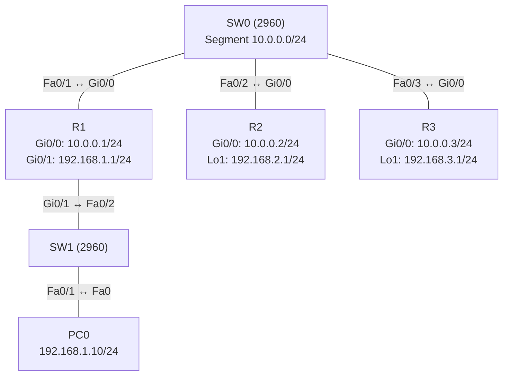

# Übung 3.6: OSPF feinjustieren

| | |
|---|---|
| **Modul** | 3 – Routing |
| **Stufe** | Fortgeschritten |
| **Geschätzte Zeit** | ca. 90–120 Minuten |
| **Werkzeug** | Cisco Packet Tracer |
| **Vorwissen** | Übung 3.5 (OSPF mit einer Area), Übung 2.1 (VLANs/Switch-Grundlagen) |

> **Stand der Prüfung:** Entwurf. Durch Cisco-Labs belegt sind `router-id`, `passive-interface`, `auto-cost reference-bandwidth`, `bandwidth`, `ip ospf cost`, `clear ip ospf process`, `show ip ospf neighbor` und `show ip ospf interface brief` (siehe Quellen). **Nicht bestätigt** sind der Befehl `ip ospf priority` für die DR-Wahl (im herangezogenen Lab nicht gezeigt), das Verhalten von Loopback-Interfaces auf Routern in Packet Tracer, alle gezeigten Ausgaben, die genauen Meldungen (z. B. beim Zurücksetzen des Prozesses) sowie die GUI-Wege.

## Lernziele

Nach dieser Übung kannst du

- die Router-ID bestimmen, ablesen und fest vorgeben,
- erklären, wie DR und BDR gewählt werden, und die Wahl mit der Priorität beeinflussen,
- LAN-Interfaces mit `passive-interface` aus OSPF herausnehmen, ohne das Netz zu verlieren,
- die Kosten eines Interfaces ablesen und gezielt ändern,
- die Referenzbandbreite so anpassen, dass schnelle Verbindungen unterscheidbar bleiben,
- mit `show ip ospf interface brief` und `show ip ospf neighbor` die Wirkung der Einstellungen prüfen.

## Voraussetzungen

Übung 3.5. Du kennst `router ospf`, `network ... area 0` und `show ip ospf neighbor`.

## Grundbegriffe

| Begriff | Bedeutung |
|---|---|
| Router-ID | 32-Bit-Name eines Routers in OSPF (Schreibweise wie IPv4). Wahl: 1. manuell mit `router-id`, 2. höchste Loopback-Adresse, 3. höchste aktive Interface-Adresse. |
| Loopback | Virtuelles Interface, das immer „oben“ ist. Praktisch für stabile Router-IDs und zum Simulieren von LANs. |
| DR / BDR | *Designated Router* und *Backup DR*. In einem Segment mit mehreren Routern (Broadcast) sprechen alle nur mit DR und BDR. |
| DROther | Router im Segment, der weder DR noch BDR ist. |
| Priorität | Wert 0–255 (Standard 1). Der höchste gewinnt die DR-Wahl, bei Gleichstand die höchste Router-ID. Priorität 0 = nie DR/BDR. |
| Passives Interface | Interface, das im Netz beworben wird, aber keine Hello-Pakete sendet und keine Nachbarn bildet. |
| Kosten | OSPF-Metrik eines Interfaces: Referenzbandbreite ÷ Interface-Bandbreite (mindestens 1). |
| Referenzbandbreite | Standard 100 Mbit/s. Damit kosten Fast Ethernet **und** Gigabit je 1. |

> **Merksatz:** Die Router-ID bestimmt, wer ein Router *ist*. Die Priorität bestimmt, wer im Segment die *Leitung* übernimmt. Passive Interfaces halten OSPF aus dem LAN heraus, ohne das LAN zu verstecken.

## Topologie und Adressplan

Drei Router hängen an einem gemeinsamen Switch-Segment (`10.0.0.0/24`). R1 hat ein echtes LAN mit PC, R2 und R3 simulieren ihr LAN mit Loopback-Interfaces.



| Gerät | Port / Interface | IP-Adresse | Subnetzmaske | Default Gateway |
|---|---|---|---|---|
| PC0 | FastEthernet0 | `192.168.1.10` | `255.255.255.0` | `192.168.1.1` |
| R1 | `GigabitEthernet0/0` | `10.0.0.1` | `255.255.255.0` | – |
| R1 | `GigabitEthernet0/1` | `192.168.1.1` | `255.255.255.0` | – |
| R2 | `GigabitEthernet0/0` | `10.0.0.2` | `255.255.255.0` | – |
| R2 | `Loopback1` | `192.168.2.1` | `255.255.255.0` | – |
| R3 | `GigabitEthernet0/0` | `10.0.0.3` | `255.255.255.0` | – |
| R3 | `Loopback1` | `192.168.3.1` | `255.255.255.0` | – |

Alle Interfaces gehören zu OSPF Prozess 1, Area 0. Die Switches bleiben unkonfiguriert (nur Standard-VLAN 1).

## Aufgabe

> **Schema dieser Übungsreihe: zwei Wege pro Schritt.** Wo es in Packet Tracer keinen CLI-Weg gibt, steht das ausdrücklich dabei. Alle Befehle stehen in Codeblöcken. Die CLI-Befehle und GUI-Wege sind in dieser Entwurfsfassung noch nicht in Packet Tracer bestätigt.

### Teil A: Grundaufbau

**1. Neues Projekt beginnen** und Geräte platzieren: drei Router (*1941*), zwei Switches (*2960*), ein PC

- **GUI:** *File* → *New*, Geräte setzen.
- **CLI:** Entfällt (nur grafisch möglich).

**2. Verkabeln** mit *Copper Straight-Through*: SW0 `Fa0/1` → R1 `Gi0/0`, SW0 `Fa0/2` → R2 `Gi0/0`, SW0 `Fa0/3` → R3 `Gi0/0`, R1 `Gi0/1` → SW1 `Fa0/2`, SW1 `Fa0/1` → PC0

- **GUI:** Kategorie *Connections*, Kabeltyp anklicken, beide Geräte anklicken, Ports wählen.
- **CLI:** Entfällt (Kabel gibt es nur grafisch).

**3. Interfaces konfigurieren** (Adressplan oben)

- **GUI:** PC0 → *Desktop* → *IP Configuration*. Router → *Config* → Interface (bei Loopbacks nicht möglich, dann CLI).
- **CLI:** R1:
  ```text
  Router> enable
  Router# configure terminal
  Router(config)# hostname R1
  R1(config)# interface gigabitethernet 0/0
  R1(config-if)# ip address 10.0.0.1 255.255.255.0
  R1(config-if)# no shutdown
  R1(config-if)# exit
  R1(config)# interface gigabitethernet 0/1
  R1(config-if)# ip address 192.168.1.1 255.255.255.0
  R1(config-if)# no shutdown
  R1(config-if)# end
  ```
  R2:
  ```text
  Router> enable
  Router# configure terminal
  Router(config)# hostname R2
  R2(config)# interface gigabitethernet 0/0
  R2(config-if)# ip address 10.0.0.2 255.255.255.0
  R2(config-if)# no shutdown
  R2(config-if)# exit
  R2(config)# interface loopback 1
  R2(config-if)# ip address 192.168.2.1 255.255.255.0
  R2(config-if)# end
  ```
  R3:
  ```text
  Router> enable
  Router# configure terminal
  Router(config)# hostname R3
  R3(config)# interface gigabitethernet 0/0
  R3(config-if)# ip address 10.0.0.3 255.255.255.0
  R3(config-if)# no shutdown
  R3(config-if)# exit
  R3(config)# interface loopback 1
  R3(config-if)# ip address 192.168.3.1 255.255.255.0
  R3(config-if)# end
  ```

**4. OSPF einrichten** (wie in Übung 3.5, noch ohne Feinschliff)

- **GUI:** Entfällt, CLI verwenden.
- **CLI:** R1:
  ```text
  R1# configure terminal
  R1(config)# router ospf 1
  R1(config-router)# network 10.0.0.0 0.0.0.255 area 0
  R1(config-router)# network 192.168.1.0 0.0.0.255 area 0
  R1(config-router)# end
  ```
  R2:
  ```text
  R2# configure terminal
  R2(config)# router ospf 1
  R2(config-router)# network 10.0.0.0 0.0.0.255 area 0
  R2(config-router)# network 192.168.2.0 0.0.0.255 area 0
  R2(config-router)# end
  ```
  R3:
  ```text
  R3# configure terminal
  R3(config)# router ospf 1
  R3(config-router)# network 10.0.0.0 0.0.0.255 area 0
  R3(config-router)# network 192.168.3.0 0.0.0.255 area 0
  R3(config-router)# end
  ```

**5. Ausgangslage dokumentieren**

- **GUI:** Entfällt.
- **CLI:** Auf jedem Router:
  ```text
  R1# show ip ospf neighbor
  R1# show ip ospf interface brief
  R1# show ip protocols
  ```
  Notiere für jeden Router die Router-ID, die Rolle (DR, BDR, DROther) und die Kosten. Zeigt R1 zwei Nachbarn (R2 und R3)? Pingt PC0 die Adressen `192.168.2.1` und `192.168.3.1` an?

### Teil B: Router-ID

**6. Router-ID vorhersagen und prüfen**

- **GUI:** Entfällt.
- **CLI:** Überlege vorab, welche Router-ID jeder Router ohne manuelle Vorgabe hat (Loopback vor physischen Interfaces, jeweils die höchste Adresse). Prüfe mit `show ip protocols` auf jedem Router, ob deine Vorhersage stimmt.

**7. Router-ID fest vorgeben**

- **GUI:** Entfällt.
- **CLI:** Auf R1 `1.1.1.1`, auf R2 `2.2.2.2`, auf R3 `3.3.3.3`:
  ```text
  R1# configure terminal
  R1(config)# router ospf 1
  R1(config-router)# router-id 1.1.1.1
  R1(config-router)# end
  ```
  Die neue Router-ID gilt erst nach einem Neustart des OSPF-Prozesses. Auf jedem Router:
  ```text
  R1# clear ip ospf process
  ```
  Antworte mit `yes`, falls nachgefragt wird (nicht bestätigt). Prüfe danach mit `show ip protocols` und `show ip ospf neighbor`, dass die Router-IDs die neuen Werte haben und die Nachbarn wieder `FULL` sind.

### Teil C: DR und BDR

**8. Rollen im Segment ablesen**

- **GUI:** Entfällt.
- **CLI:** Auf R1, R2 und R3:
  ```text
  R1# show ip ospf neighbor
  ```
  Welcher Router ist DR, welcher BDR? Welche Rolle hat dieser Router selbst (siehe `show ip ospf interface gigabitethernet 0/0`)? Die Wahl entscheidet bei gleicher Priorität die höchste Router-ID, in der Regel hat dann R3 (`3.3.3.3`) die Rolle DR (sinngemäß, nicht bestätigt). Beachte, dass die Wahl nicht erneut stattfindet, wenn bereits ein DR existiert.

**9. R1 zum DR machen**

- **GUI:** Entfällt.
- **CLI:** Auf R1 die Priorität erhöhen, auf R3 senken (nicht bestätigt, Befehl `ip ospf priority`):
  ```text
  R1# configure terminal
  R1(config)# interface gigabitethernet 0/0
  R1(config-if)# ip ospf priority 100
  R1(config-if)# end
  ```
  ```text
  R3# configure terminal
  R3(config)# interface gigabitethernet 0/0
  R3(config-if)# ip ospf priority 0
  R3(config-if)# end
  ```
  Die Rollen ändern sich erst bei einer neuen Wahl. Starte den Prozess auf allen drei Routern neu:
  ```text
  R1# clear ip ospf process
  ```
  Prüfe mit `show ip ospf neighbor`, welche Rolle R1 und welche R2 jetzt haben. R3 mit Priorität 0 darf weder DR noch BDR werden (`DROTHER`).

### Teil D: Passive Interfaces

**10. LAN-Interface von R1 passiv setzen**

- **GUI:** Entfällt.
- **CLI:** Auf R1:
  ```text
  R1# configure terminal
  R1(config)# router ospf 1
  R1(config-router)# passive-interface gigabitethernet 0/1
  R1(config-router)# end
  R1# show ip ospf interface gigabitethernet 0/1
  ```
  Die Ausgabe nennt, dass auf diesem Interface keine Hello-Pakete gesendet werden („No Hellos (Passive interface)“). Prüfe auf R2, ob die Route zu `192.168.1.0/24` weiter vorhanden ist, und ob PC0 weiter erreichbar ist.

**11. Loopbacks passiv setzen**

- **GUI:** Entfällt.
- **CLI:** Auf R2 und R3 jeweils das Loopback-Interface:
  ```text
  R2(config-router)# passive-interface loopback 1
  ```
  Die Netze `192.168.2.0/24` und `192.168.3.0/24` bleiben im OSPF-Netz erreichbar.

### Teil E: Kosten und Referenzbandbreite

**12. Kosten ablesen**

- **GUI:** Entfällt.
- **CLI:** Auf R1:
  ```text
  R1# show ip ospf interface brief
  R1# show ip route ospf
  ```
  Welche Kosten haben die Gigabit-Interfaces? Welche Metrik hat die Route zu `192.168.2.0/24`?

**13. Referenzbandbreite anheben**

- **GUI:** Entfällt.
- **CLI:** Auf **allen drei** Routern denselben Wert:
  ```text
  R1# configure terminal
  R1(config)# router ospf 1
  R1(config-router)# auto-cost reference-bandwidth 10000
  R1(config-router)# end
  ```
  Der Wert ist in Mbit/s (10000 = 10 Gbit/s). Beim Setzen erscheint ein Hinweis, dass der Wert auf allen Routern gleich sein muss (nicht bestätigt). Lies danach die Kosten erneut ab: Gigabit kostet jetzt mehr als Fast Ethernet.

**14. Kosten gezielt setzen**

- **GUI:** Entfällt.
- **CLI:** Auf R1 die Kosten des Segment-Interfaces direkt vorgeben:
  ```text
  R1# configure terminal
  R1(config)# interface gigabitethernet 0/0
  R1(config-if)# ip ospf cost 50
  R1(config-if)# end
  R1# show ip ospf interface brief
  ```
  Alternativ lässt sich die Bandbreite mit `bandwidth 100000` (kbit/s) setzen, daraus wird dann berechnet. Die Bandbreite beeinflusst nur die Kostenberechnung, nicht die tatsächliche Geschwindigkeit.

**15. Gesamttest und Speichern**

- **GUI:** *Add Simple PDU*: PC0 → `192.168.2.1`; Projekt mit `Strg+S` speichern als `03.6-ospf-feinjustieren.pkt`.
- **CLI:** Am PC:
  ```text
  PC> ping 192.168.2.1
  PC> ping 192.168.3.1
  ```
  Auf jedem Router `copy running-config startup-config`.

## Hintergrund

1. **Router-ID:** Sie muss im Netz eindeutig sein. Ohne manuelle Vorgabe nimmt der Router die höchste Loopback-Adresse, sonst die höchste IPv4-Adresse eines aktiven Interfaces. Ändert sich eine Adresse später, ändert sich die Router-ID **nicht** von selbst, erst ein Neustart des Prozesses übernimmt sie. Eine feste `router-id` macht das Netz berechenbar.
2. **DR/BDR:** In einem Segment mit mehr als zwei Routern (Broadcast) würde ohne DR jeder mit jedem Datenbanken tauschen. Mit DR/BDR sprechen alle DROther-Router nur mit diesen zwei. Der DR sammelt und verteilt die Informationen, der BDR springt ein.
3. **Wahl:** Höchste Priorität gewinnt, bei Gleichstand die höchste Router-ID. Die Wahl ist **nicht präemptiv**: Ein später hinzugekommener Router mit höherer Priorität verdrängt einen bestehenden DR nicht, erst eine neue Wahl (z. B. durch Neustart des Prozesses) ändert das.
4. **Passive Interfaces:** An LAN-Ports mit PCs gibt es keine Router, die Hello-Pakete sinnvoll beantworten. Passive Interfaces senden keine Hellos, das Netz wird aber trotzdem beworben. Das spart Verkehr und verhindert, dass ein fremdes Gerät im LAN eine Nachbarschaft aufbaut.
5. **Kosten:** `Kosten = Referenzbandbreite ÷ Bandbreite`, mindestens 1. Bei 100 Mbit/s Referenz kosten 100 Mbit/s und 1 Gbit/s gleich viel (1), OSPF kann sie dann nicht unterscheiden. Mit 10000 kosten Gigabit-Interfaces 10 und Fast-Ethernet-Interfaces 100.
6. **Konsistenz:** Die Referenzbandbreite wird pro Router gesetzt und muss überall gleich sein, sonst berechnen Router Kosten nach verschiedenen Maßstäben.

## Hinweise

- Eine geänderte `router-id` wirkt erst nach `clear ip ospf process` (oder Neustart des Routers).
- `clear ip ospf process` trennt kurz alle Nachbarschaften. In einem echten Netz nicht mitten im Betrieb ausführen.
- Priorität 0 schließt einen Router von der DR/BDR-Wahl aus. Das ist gewollt für schwache Router.
- `passive-interface` gehört in den **OSPF-Prozess** (`router ospf`), nicht ins Interface.
- Die Kosten kannst du auf drei Wegen ändern: Referenzbandbreite, `bandwidth`, `ip ospf cost`. Ein direkt gesetztes `ip ospf cost` hat Vorrang.
- Schreibt man die Loopback-Adresse in die `network`-Anweisung, wird sie als Stub-Netz beworben (bei Loopbacks mit `/24` erscheint sie je nach Version als `/32`, nicht bestätigt).
- Wenn Nachbarschaften nicht entstehen: Subnetz, Area, Hello-/Dead-Intervall und `passive-interface` prüfen.

## Prüfbefehle

Am Router (CLI):

```text
R1> enable
R1# show ip ospf neighbor
R1# show ip ospf interface brief
R1# show ip ospf interface gigabitethernet 0/0
R1# show ip protocols
R1# show ip route ospf
```

| CLI-Befehl | Was er zeigt | GUI-Weg |
|---|---|---|
| `show ip ospf neighbor` | Nachbarn mit Router-ID, Priorität, Zustand und DR/BDR/DROTHER | – (nur CLI) |
| `show ip ospf interface brief` | Interfaces mit Area, Kosten, Zustand, Nachbarzahl | – |
| `show ip ospf interface <Interface>` | Details: Router-ID, Netzwerktyp, Kosten, Priorität, Timer, DR/BDR, passiv | – |
| `show ip protocols` | Router-ID, beworbene Netze, passive Interfaces | – |
| `show ip route ospf` | Nur OSPF-Routen mit Metrik | Werkzeug *Inspect* → *Routing Table* |

**Kontrollfragen**

1. In welcher Reihenfolge wird die Router-ID bestimmt?
2. Warum ändert sich die Router-ID nicht sofort nach `router-id 1.1.1.1`?
3. Wer wird DR, wenn alle Prioritäten gleich sind? Was bewirkt Priorität 0?
4. Was ist der Unterschied zwischen einem passiven und einem heruntergefahrenen Interface?
5. Warum sind bei der Standard-Referenzbandbreite Fast Ethernet und Gigabit nicht unterscheidbar?

## Erweiterungen

- **Verlust-Test:** R1 mit Priorität 100 zum DR machen, dann R1 per `shutdown` des Interfaces ausfallen lassen. Wer wird DR, wer BDR? Was passiert nach `no shutdown`?
- **Zweiter Weg:** Eine Zusatzverbindung R2 ↔ R3 (Cross-Over, eigenes Subnetz) einbauen und mit `ip ospf cost` steuern, welcher Weg zu `192.168.3.0/24` genutzt wird.
- **Netzwerktyp:** Auf einer Zweier-Verbindung `ip ospf network point-to-point` testen (nicht bestätigt) und prüfen, ob DR/BDR entfallen.
- **Weiter:** Die Übungen 3.5/3.6 bilden die OSPF-Grundlage für die Fehlersuche in Modul 8.

---

## Musterlösung

<details>
<summary>Musterlösung anzeigen</summary>

**Grundaufbau (Teil A):** Konfiguration wie in den Schritten 3 und 4. Alle Interfaces `no shutdown`; Loopbacks sind sofort aktiv.

**Router-IDs ohne Vorgabe (Schritt 6, sinngemäß, nicht bestätigt):**

| Router | Router-ID ohne Vorgabe | Grund |
|---|---|---|
| R1 | `192.168.1.1` | höchste aktive Interface-Adresse (kein Loopback) |
| R2 | `192.168.2.1` | Loopback hat Vorrang vor `10.0.0.2` |
| R3 | `192.168.3.1` | Loopback hat Vorrang vor `10.0.0.3` |

**Router-ID vorgeben (Schritt 7):**

```text
R1(config-router)# router-id 1.1.1.1
R2(config-router)# router-id 2.2.2.2
R3(config-router)# router-id 3.3.3.3
```

Danach auf jedem Router `clear ip ospf process`. Ohne diesen Schritt bleibt die alte Router-ID aktiv.

**Rollen bei gleicher Priorität (Schritt 8, sinngemäß, nicht bestätigt):**

```text
R1# show ip ospf neighbor

Neighbor ID     Pri   State           Dead Time   Address         Interface
2.2.2.2           1   FULL/BDR        00:00:33    10.0.0.2        GigabitEthernet0/0
3.3.3.3           1   FULL/DR         00:00:31    10.0.0.3        GigabitEthernet0/0
```

R3 hat die höchste Router-ID und wird DR, R2 BDR, R1 ist DROther. Je nach Reihenfolge des Hochfahrens kann das abweichen, weil die Wahl nicht präemptiv ist.

**Priorität (Schritt 9):** R1 `ip ospf priority 100`, R3 `ip ospf priority 0`, anschließend `clear ip ospf process` auf allen Routern. Erwartung: R1 wird DR, R2 BDR, R3 DROTHER (nicht bestätigt). Ohne Neustart bleibt die alte Verteilung bestehen, weil die Wahl nicht präemptiv ist.

**Passive Interfaces (Schritte 10–11):**

```text
R1(config)# router ospf 1
R1(config-router)# passive-interface gigabitethernet 0/1
R2(config)# router ospf 1
R2(config-router)# passive-interface loopback 1
R3(config)# router ospf 1
R3(config-router)# passive-interface loopback 1
```

`192.168.1.0/24` bleibt auf R2 und R3 als `O`-Route erhalten, weil die `network`-Anweisung das Netz weiterhin bewirbt; nur Hello-Pakete und Nachbarschaften auf diesem Interface entfallen. PC0 bleibt erreichbar.

**Kosten (Schritte 12–14, sinngemäß, nicht bestätigt):**

| Referenzbandbreite | Kosten Gigabit | Kosten Fast Ethernet |
|---|---|---|
| 100 Mbit/s (Standard) | 1 | 1 |
| 10000 Mbit/s | 10 | 100 |

Mit `ip ospf cost 50` auf R1 `Gi0/0` zeigt `show ip ospf interface brief` für dieses Interface die Kosten 50. Die Metrik von R1 zu `192.168.2.0/24` setzt sich dann aus den Kosten 50 (R1 `Gi0/0`) und den Kosten des Ziel-Netzes auf R2 (Loopback, Wert nicht bestätigt) zusammen; lies sie mit `show ip route ospf` ab und rechne nach.

**Gesamttest (Schritt 15):** `ping 192.168.2.1` und `ping 192.168.3.1` von PC0 klappen (der erste Versuch kann wegen ARP verloren gehen).

**Antworten auf die Kontrollfragen:**

1. Manuelle `router-id`, sonst höchste Loopback-Adresse, sonst höchste aktive Interface-Adresse.
2. Der laufende Prozess behält seine Router-ID, bis er neu gestartet wird (`clear ip ospf process`).
3. Der Router mit der höchsten Router-ID. Priorität 0 schließt den Router von der Wahl aus.
4. Ein passives Interface ist aktiv und sein Netz wird beworben, es sendet aber keine Hellos und bildet keine Nachbarn. Ein heruntergefahrenes Interface ist aus, sein Netz ist nicht mehr erreichbar.
5. Referenz 100 Mbit/s ÷ 1000 Mbit/s ergibt 0,1, aufgerundet auf Kosten 1, genau wie bei Fast Ethernet.

</details>

---

## Quellen

- Cisco Networking Academy, *Lab – Configuring Basic Single-Area OSPFv2* (Lab 8.2.4.5, [cisco.tu-sofia.bg](https://cisco.tu-sofia.bg/wp-content/uploads/courses/CCNA2/course/files/8.2.4.5%20Lab%20-%20Configuring%20Basic%20Single-Area%20OSPFv2.pdf)): `router-id`, `clear ip ospf process`, `passive-interface`, `auto-cost reference-bandwidth 10000`, `bandwidth`, `ip ospf cost`, `show ip ospf neighbor`, `show ip ospf interface brief`; Meldung „No Hellos (Passive interface)“; DR/BDR-Rollen in der Ausgabe von `show ip ospf neighbor`. Der Befehl zur Prioritätsänderung wird dort nicht gezeigt.
- Wahlregeln für DR/BDR (Priorität, Router-ID, nicht präemptiv), Reihenfolge der Router-ID-Bestimmung und Kostenformel: allgemeines OSPF-Wissen, hier nicht aus der genannten Quelle im Wortlaut belegt. Der Befehl `ip ospf priority` ist nicht bestätigt.
- Die gezeigten Ausgaben sind ein konstruiertes Beispiel im IOS-Format und nicht aus Packet Tracer übernommen.

---

Lizenz: [CC BY-NC-SA 4.0](https://creativecommons.org/licenses/by-nc-sa/4.0/deed.de), Urheber: AnsibleArtisan4711. Cisco, Cisco IOS und Cisco Packet Tracer sind Marken von Cisco Systems, Inc. und/oder ihrer Tochtergesellschaften; dieses Dokument steht in keiner Verbindung zu Cisco.
