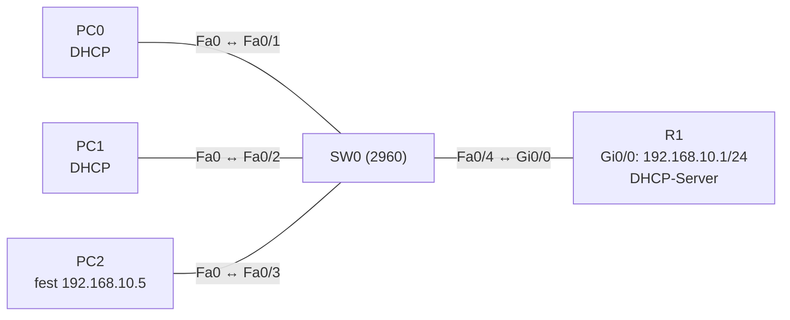

# Übung 4.1: DHCP-Server auf dem Router

| | |
|---|---|
| **Modul** | 4 – Netzdienste |
| **Stufe** | Grundlage |
| **Geschätzte Zeit** | ca. 45–60 Minuten |
| **Werkzeug** | Cisco Packet Tracer |
| **Vorwissen** | Übung 1.2 (zwei Netze und ein Router), Übung 1.3 (Subnetting) |

> **Stand der Prüfung:** Entwurf. Die Befehle `ip dhcp excluded-address`, `ip dhcp pool`, `network`, `default-router`, `dns-server` und `show ip dhcp binding` sind durch Tutorials und Cisco-Labs belegt (siehe Quellen). **Nicht bestätigt** sind alle gezeigten Ausgaben, `show ip dhcp pool`, die Befehle `ipconfig /renew` und `ipconfig /release` am Packet-Tracer-PC, die genauen Meldungen im Fenster *IP Configuration* (auch bei fehlgeschlagener Anfrage), die Wirkung von `lease` sowie die GUI-Wege.

## Lernziele

Nach dieser Übung kannst du

- erklären, warum Adressen automatisch vergeben werden und was DHCP dabei liefert,
- den vierstufigen Ablauf (Discover, Offer, Request, Acknowledge) beschreiben,
- auf einem Router einen DHCP-Pool anlegen und Adressen von der Vergabe ausnehmen,
- PCs auf automatische Adressvergabe umstellen und das Ergebnis prüfen,
- mit `show ip dhcp binding` nachvollziehen, welcher Client welche Adresse hat,
- begründen, warum Router, Server und Drucker feste Adressen außerhalb des Pools bekommen.

## Voraussetzungen

Du kannst Router-Interfaces mit Adresse einrichten (Übung 1.2) und Subnetze berechnen (Übung 1.3). Bisher hast du jedem PC die Adresse von Hand gegeben.

## Grundbegriffe

| Begriff | Bedeutung |
|---|---|
| DHCP | *Dynamic Host Configuration Protocol*. Ein Server verteilt IP-Adresse, Subnetzmaske, Gateway und DNS-Server automatisch. |
| Pool | Adressbereich, aus dem der DHCP-Server vergibt. |
| Lease | Leihdauer einer Adresse. Danach muss der Client sie erneuern. |
| Binding | Zuordnung Adresse ↔ Client (anhand der MAC-Adresse), die der Server führt. |
| Excluded Address | Adresse, die der Server nie vergibt, weil sie fest vergeben ist (Gateway, Server). |
| Discover / Offer / Request / Acknowledge | Ablauf: Client sucht einen Server, Server bietet an, Client fordert an, Server bestätigt. |
| APIPA | Selbstvergebene Adresse `169.254.x.x`, wenn kein DHCP-Server antwortet. |

> **Merksatz:** Der DHCP-Server bekommt selbst eine feste Adresse. Alles, was fest vergeben wird, gehört **vor** den Pool oder wird ausgeschlossen.

## Topologie und Adressplan

Ein Router versorgt ein LAN mit drei PCs.



| Gerät | Port / Interface | IP-Adresse | Subnetzmaske | Default Gateway |
|---|---|---|---|---|
| R1 | `GigabitEthernet0/0` | `192.168.10.1` | `255.255.255.0` | – |
| PC0 | FastEthernet0 | per DHCP | per DHCP | per DHCP |
| PC1 | FastEthernet0 | per DHCP | per DHCP | per DHCP |
| PC2 | FastEthernet0 | `192.168.10.5` (fest) | `255.255.255.0` | `192.168.10.1` |

Pool `LAN10`: Netz `192.168.10.0/24`, Gateway `192.168.10.1`, DNS-Server `8.8.8.8` (hier nur ein Beispielwert, es gibt keinen erreichbaren DNS-Server). Ausgeschlossen: `192.168.10.1` bis `192.168.10.10`. Die ersten vergebenen Adressen sind damit ab `192.168.10.11` zu erwarten.

## Aufgabe

> **Schema dieser Übungsreihe: zwei Wege pro Schritt.** Wo es in Packet Tracer keinen CLI-Weg gibt (Geräte platzieren, verkabeln), steht das ausdrücklich dabei. Alle Befehle stehen in Codeblöcken. Die CLI-Befehle und GUI-Wege sind in dieser Entwurfsfassung noch nicht in Packet Tracer bestätigt.

### Teil A: Aufbau

**1. Neues Projekt beginnen** und Geräte platzieren: ein Router (*1941*), ein Switch (*2960*), drei PCs

- **GUI:** *File* → *New*, Geräte aus der Geräteauswahl ziehen.
- **CLI:** Entfällt (nur grafisch möglich).

**2. Verkabeln** mit *Copper Straight-Through*: PC0 → SW0 `Fa0/1`, PC1 → SW0 `Fa0/2`, PC2 → SW0 `Fa0/3`, SW0 `Fa0/4` → R1 `Gi0/0`

- **GUI:** Kategorie *Connections*, Kabeltyp anklicken, beide Geräte anklicken, Ports wählen.
- **CLI:** Entfällt (Kabel gibt es nur grafisch).

**3. Router-Interface einrichten**

- **GUI:** R1 → *Config* → *GigabitEthernet0/0*: *Port Status* auf *On*, *IP Address* `192.168.10.1`, *Subnet Mask* `255.255.255.0`.
- **CLI:**
  ```text
  Router> enable
  Router# configure terminal
  Router(config)# hostname R1
  R1(config)# interface gigabitethernet 0/0
  R1(config-if)# ip address 192.168.10.1 255.255.255.0
  R1(config-if)# no shutdown
  R1(config-if)# end
  ```

**4. PC2 fest einrichten**

- **GUI:** PC2 → *Desktop* → *IP Configuration* → *Static*: `192.168.10.5`, `255.255.255.0`, Gateway `192.168.10.1`.
- **CLI:** Entfällt (der PC hat keine IOS-CLI). Die Konfiguration erfolgt im Fenster *IP Configuration*.

**5. Vorher testen: ohne DHCP**

- **GUI:** PC0 → *Desktop* → *IP Configuration* → *DHCP*. Notiere, was erscheint (Fehlermeldung, Adresse `169.254.x.x`).
- **CLI:** Im *Command Prompt* von PC0:
  ```text
  PC> ipconfig
  ```
  Ohne DHCP-Server bekommt der PC keine brauchbare Adresse (nicht bestätigt: Packet Tracer zeigt dann oft eine `169.254`-Adresse oder `0.0.0.0`).

### Teil B: DHCP einrichten

**6. Adressen von der Vergabe ausnehmen**

- **GUI:** Entfällt auf dem Router (nur CLI). In Packet Tracer gibt es die Einstellung nur am Server-PT (Übung 4.2).
- **CLI:** Auf R1:
  ```text
  R1# configure terminal
  R1(config)# ip dhcp excluded-address 192.168.10.1 192.168.10.10
  ```
  Der Befehl gehört **vor** den Pool, damit nie kurzzeitig eine reservierte Adresse vergeben wird.

**7. Pool anlegen**

- **GUI:** Entfällt auf dem Router (nur CLI).
- **CLI:**
  ```text
  R1(config)# ip dhcp pool LAN10
  R1(dhcp-config)# network 192.168.10.0 255.255.255.0
  R1(dhcp-config)# default-router 192.168.10.1
  R1(dhcp-config)# dns-server 8.8.8.8
  R1(dhcp-config)# end
  ```

**8. Clients auf DHCP umstellen**

- **GUI:** PC0 und PC1 → *Desktop* → *IP Configuration* → *DHCP*. Nach kurzer Zeit erscheint eine Adresse. Wenn nicht, einmal auf *Static* und wieder auf *DHCP* umschalten.
- **CLI:** Im *Command Prompt* von PC0 und PC1:
  ```text
  PC> ipconfig /renew
  PC> ipconfig /all
  ```
  Notiere Adresse, Maske, Gateway und DNS-Server. Welche Adressen haben PC0 und PC1 bekommen?

**9. Zuordnungen auf dem Router ansehen**

- **GUI:** Entfällt.
- **CLI:** Auf R1:
  ```text
  R1# show ip dhcp binding
  R1# show ip dhcp pool
  ```
  `show ip dhcp binding` listet Adresse, Client-ID (MAC), Ablaufzeit und Typ. `show ip dhcp pool` zeigt Pool-Größe, ausgeschlossene und vergebene Adressen.

**10. Verbindung testen**

- **GUI:** *Add Simple PDU*: PC0 → PC1, PC0 → R1.
- **CLI:** Am PC0:
  ```text
  PC> ping 192.168.10.1
  PC> ping 192.168.10.5
  PC> ping 192.168.10.12
  ```
  Passe die letzte Adresse an die von PC1 erhaltene an.

**11. Adresse freigeben und neu anfordern**

- **GUI:** PC0 → *IP Configuration*: auf *Static* umschalten und wieder auf *DHCP* (gibt es keinen eigenen Knopf, nicht bestätigt).
- **CLI:** Am PC0:
  ```text
  PC> ipconfig /release
  PC> ipconfig /renew
  ```
  Auf R1 mit `show ip dhcp binding` prüfen, ob der Eintrag zwischendurch fehlt und ob PC0 dieselbe Adresse zurückbekommt (nicht bestätigt).

**12. Lease-Dauer ändern**

- **GUI:** Entfällt.
- **CLI:** Auf R1:
  ```text
  R1# configure terminal
  R1(config)# ip dhcp pool LAN10
  R1(dhcp-config)# lease 0 8
  R1(dhcp-config)# end
  ```
  `lease 0 8` bedeutet 0 Tage, 8 Stunden. Ohne Angabe gilt ein Tag (so beschreibt es Cisco allgemein, in Packet Tracer nicht bestätigt). Neue Clients bekommen die neue Dauer; ändert sich die Ablaufzeit bei `show ip dhcp binding`?

**13. Projekt und Konfiguration speichern** als `04.1-dhcp-server-auf-dem-router.pkt`

- **GUI:** *File* → *Save As* (oder `Strg+S`).
- **CLI:** Für die Konfiguration:
  ```text
  R1# copy running-config startup-config
  ```

## Hintergrund: Wie läuft die Vergabe ab?

1. **Discover:** Der Client hat noch keine Adresse. Er sendet an die Broadcast-Adresse `255.255.255.255`: „Gibt es einen DHCP-Server?“
2. **Offer:** Der Server antwortet mit einem Angebot: Adresse aus dem Pool, Maske, Gateway, DNS, Lease.
3. **Request:** Der Client wählt ein Angebot und fordert die Adresse an.
4. **Acknowledge:** Der Server bestätigt und trägt das Binding ein.
5. **Erneuerung:** Nach der halben Lease-Zeit versucht der Client, die Adresse zu verlängern.

Weil Schritt 1 ein Broadcast ist, erreicht er nur das eigene Netz. Soll ein Server in einem anderen Netz antworten, braucht es ein Relay (Übung 4.2).

## Hinweise

- **Excluded** nicht vergessen: Wird das Gateway nicht ausgeschlossen, kann der Server `192.168.10.1` an einen PC vergeben und es entsteht ein Adresskonflikt.
- **Reihenfolge:** `ip dhcp excluded-address` ist ein Befehl im globalen Konfigurationsmodus, nicht im Pool.
- Die Pool-Befehle stehen im Modus `(dhcp-config)#`, nicht im Interface.
- `network` nimmt Adresse **und** Maske (nicht Wildcard) und muss zum Interface-Netz passen.
- Die Adresse des Routers selbst braucht keinen DHCP-Eintrag, aber er muss im Netz des Pools liegen, damit er die Anfragen im LAN erhält.
- Fehlt der DNS-Eintrag, funktioniert die Adressierung trotzdem. Namen lassen sich aber nicht auflösen (Übung 4.3).

## Prüfbefehle

Am PC (Command Prompt):

```text
PC> ipconfig
PC> ipconfig /all
PC> ipconfig /renew
PC> ping 192.168.10.1
```

Am Router (CLI):

```text
R1> enable
R1# show ip interface brief
R1# show ip dhcp binding
R1# show ip dhcp pool
R1# show running-config | section dhcp
```

| CLI-Befehl | Was er zeigt | GUI-Weg |
|---|---|---|
| `ipconfig /all` (PC) | Adresse, Maske, Gateway, DNS, DHCP-Server | PC → *Desktop* → *IP Configuration* |
| `show ip dhcp binding` | Vergebene Adressen mit Client-ID und Typ | – (nur CLI) |
| `show ip dhcp pool` | Pool-Netz, Größe, vergebene und ausgeschlossene Adressen | – |
| `show running-config` | Pool- und Excluded-Befehle im Klartext | Router → *Config* → *Running Config* |

**Kontrollfragen**

1. Welche vier Meldungen gehören zur Adressvergabe, und welche sind Broadcasts?
2. Warum schließt man Adressen aus, statt sie nur nicht in den Pool zu legen?
3. Was passiert, wenn ein Client keinen DHCP-Server findet?
4. Welche vier Angaben liefert dein Pool an den Client?
5. Warum steht `ip dhcp excluded-address` vor dem Pool?

## Erweiterungen

- **Zweiter Pool:** Ein zweites LAN am Interface `Gi0/1` mit eigenem Pool.
- **Reservierung:** Einem PC über `host` und `client-identifier` im Pool immer dieselbe Adresse geben (nicht bestätigt in Packet Tracer).
- **Konflikt:** PC2 mit der festen Adresse `192.168.10.12` versehen, bevor ein Client diese per DHCP bekommt. Was zeigt `show ip dhcp conflict` (nicht bestätigt)?
- **Server statt Router:** DHCP auf einem *Server-PT* (*Services* → *DHCP*) einrichten. Das nutzt Übung 4.2.

---

## Musterlösung

<details>
<summary>Musterlösung anzeigen</summary>

**Router (Teil A/B):**

```text
R1(config)# interface gigabitethernet 0/0
R1(config-if)# ip address 192.168.10.1 255.255.255.0
R1(config-if)# no shutdown
R1(config-if)# exit
R1(config)# ip dhcp excluded-address 192.168.10.1 192.168.10.10
R1(config)# ip dhcp pool LAN10
R1(dhcp-config)# network 192.168.10.0 255.255.255.0
R1(dhcp-config)# default-router 192.168.10.1
R1(dhcp-config)# dns-server 8.8.8.8
```

**PC2:** `192.168.10.5`, Maske `255.255.255.0`, Gateway `192.168.10.1` (liegt im ausgeschlossenen Bereich).

**Vorher (Schritt 5):** Ohne Server schlägt die Anfrage fehl; PC0 hat keine brauchbare Adresse (nicht bestätigt: `169.254.x.x` oder `0.0.0.0`).

**Ergebnis (Schritt 8, sinngemäß, nicht bestätigt):**

| | IPv4 Address | Subnet Mask | Default Gateway | DNS Server |
|---|---|---|---|---|
| PC0 | `192.168.10.11` | `255.255.255.0` | `192.168.10.1` | `8.8.8.8` |
| PC1 | `192.168.10.12` | `255.255.255.0` | `192.168.10.1` | `8.8.8.8` |

Die Reihenfolge der Adressen hängt davon ab, welcher PC zuerst anfragt.

**Bindings (Schritt 9, sinngemäß, nicht bestätigt):**

```text
R1# show ip dhcp binding
IP address       Client-ID/              Lease expiration        Type
                 Hardware address
192.168.10.11    0001.4321.AAAA          --                      Automatic
192.168.10.12    0002.1234.BBBB          --                      Automatic
```

Die MAC-Adressen sind Beispielwerte. PC2 steht nicht in der Liste, denn er hat seine Adresse nicht per DHCP bezogen.

**Test (Schritt 10):** Pings zu `192.168.10.1`, `192.168.10.5` und zum anderen DHCP-Client klappen. Der erste Versuch kann wegen ARP verloren gehen.

**Release/Renew (Schritt 11):** Nach `ipconfig /release` hat PC0 keine Adresse mehr. Nach `ipconfig /renew` bekommt er in der Regel dieselbe Adresse zurück, weil der Server die frühere Zuordnung kennt (nicht bestätigt).

**Lease (Schritt 12):** `lease 0 8` setzt 8 Stunden. Die Ablaufzeit in `show ip dhcp binding` ändert sich für neue Leases.

**Antworten auf die Kontrollfragen:**

1. Discover (Broadcast), Offer, Request (Broadcast im Normalfall), Acknowledge.
2. Der Pool umfasst das ganze Netz; mit `excluded-address` nimmt man gezielt feste Adressen heraus, ohne den Pool zerstückeln zu müssen.
3. Er bleibt ohne brauchbare Adresse, oder er vergibt sich selbst eine `169.254.x.x`-Adresse (APIPA).
4. Adresse, Subnetzmaske (aus `network`), Default Gateway, DNS-Server.
5. Damit der Server schon beim Start des Pools weiß, welche Adressen er nicht vergeben darf.

</details>

---

## Quellen

- Networklessons, *How to configure DHCP Server on Cisco IOS* ([networklessons.com](https://networklessons.com/ip-services/how-to-configure-dhcp-server-on-cisco-ios)): `ip dhcp pool`, `network`, `default-router`, `dns-server`, Hinweis auf `ip dhcp excluded-address`, `show ip dhcp binding`.
- computingforgeeks, *Cisco DHCP Server and Relay Configuration* ([computingforgeeks.com](https://computingforgeeks.com/cisco-dhcp-server-relay-configuration/)): `ip dhcp excluded-address`, Pool mit `lease 0 8`.
- Cisco Networking Academy, *Packet Tracer – Configure DHCPv4* (7.2.10, [contenthub.netacad.com](https://contenthub.netacad.com/courses/srwe-dl/_common/7.2.10-packet-tracer---configure-dhcpv4.pdf)): Aufgabenstellung; nicht im Wortlaut ausgewertet.
- Ablauf Discover/Offer/Request/Acknowledge, Erneuerung nach halber Lease-Zeit und APIPA: allgemeines Wissen, hier nicht aus den genannten Quellen im Wortlaut belegt.
- Die gezeigten Ausgaben sind ein konstruiertes Beispiel im IOS-Format und nicht aus Packet Tracer übernommen.

---

Lizenz: [CC BY-NC-SA 4.0](https://creativecommons.org/licenses/by-nc-sa/4.0/deed.de), Urheber: AnsibleArtisan4711. Cisco, Cisco IOS und Cisco Packet Tracer sind Marken von Cisco Systems, Inc. und/oder ihrer Tochtergesellschaften; dieses Dokument steht in keiner Verbindung zu Cisco.
