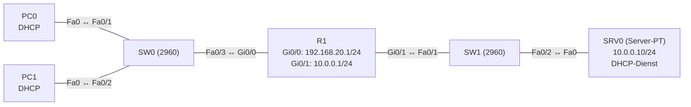

# Übung 4.2: DHCP-Relay

| | |
|---|---|
| **Modul** | 4 – Netzdienste |
| **Stufe** | Aufbau |
| **Geschätzte Zeit** | ca. 60–75 Minuten |
| **Werkzeug** | Cisco Packet Tracer |
| **Vorwissen** | Übung 4.1 (DHCP am Router), Übung 1.2 (zwei Netze und ein Router) |

> **Stand der Prüfung:** Entwurf. Der Befehl `ip helper-address` auf dem Client-Interface und der Pool für das entfernte Netz sind durch ein Tutorial belegt (siehe Quellen). **Nicht bestätigt** sind die Bedienung des DHCP-Dienstes am *Server-PT* (*Services* → *DHCP*, Feldnamen), alle gezeigten Ausgaben, das Verhalten der Clients ohne Relay, ob `show ip dhcp binding` auf dem Router in dieser Variante etwas anzeigt, sowie alle GUI-Wege.

## Lernziele

Nach dieser Übung kannst du

- erklären, warum ein DHCP-Broadcast nicht über einen Router hinauskommt,
- ein DHCP-Relay mit `ip helper-address` auf dem richtigen Interface einrichten,
- am Server einen Pool für ein fremdes Netz anlegen,
- erkennen, woran man ein Relay in den Client-Daten sieht (DHCP-Server-Adresse ist der Server, nicht das Gateway),
- die Fehlersymptome ohne Relay beschreiben.

## Voraussetzungen

Übung 4.1: Ablauf Discover/Offer/Request/Acknowledge und Pools. Hier liegt der Server in einem **anderen** Netz als die Clients.

## Grundbegriffe

| Begriff | Bedeutung |
|---|---|
| Broadcast-Domäne | Bereich, in dem ein Broadcast ankommt. Ein Router trennt Broadcast-Domänen. |
| DHCP-Relay | Ein Router nimmt den DHCP-Broadcast an und leitet ihn als Unicast an einen Server in einem anderen Netz weiter. |
| `ip helper-address` | Interface-Befehl, der die Serveradresse für das Relay nennt. |
| Server-PT | Gerät *Server-PT* in Packet Tracer. Es bietet unter *Services* Dienste wie DHCP, DNS und HTTP. |
| Scope / Pool | Adressbereich, den der Server für ein Netz vergibt. Für jedes Netz ist einer nötig. |

> **Merksatz:** `ip helper-address` gehört auf das Interface, an dem die **Clients** hängen, und zeigt auf den **Server**.

## Topologie und Adressplan

Die Clients liegen im LAN `192.168.20.0/24`. Der DHCP-Server steht in einem eigenen Server-Netz `10.0.0.0/24` hinter R1.



| Gerät | Port / Interface | IP-Adresse | Subnetzmaske | Default Gateway |
|---|---|---|---|---|
| R1 | `GigabitEthernet0/0` | `192.168.20.1` | `255.255.255.0` | – |
| R1 | `GigabitEthernet0/1` | `10.0.0.1` | `255.255.255.0` | – |
| SRV0 | FastEthernet0 | `10.0.0.10` | `255.255.255.0` | `10.0.0.1` |
| PC0, PC1 | FastEthernet0 | per DHCP | per DHCP | per DHCP |

Pool am Server: Name `LAN20`, Default Gateway `192.168.20.1`, DNS-Server `10.0.0.10`, Start-IP `192.168.20.100`, Subnetzmaske `255.255.255.0`, maximal 50 Benutzer.

## Aufgabe

> **Schema dieser Übungsreihe: zwei Wege pro Schritt.** Wo es in Packet Tracer keinen CLI-Weg gibt (Geräte platzieren, verkabeln, Server-Dienste), steht das ausdrücklich dabei. Alle Befehle stehen in Codeblöcken. Die CLI-Befehle und GUI-Wege sind in dieser Entwurfsfassung noch nicht in Packet Tracer bestätigt.

**1. Neues Projekt beginnen** und Geräte platzieren: ein Router (*1941*), zwei Switches (*2960*), ein *Server-PT*, zwei PCs

- **GUI:** *File* → *New*, Geräte aus der Geräteauswahl ziehen (Server unter *End Devices*).
- **CLI:** Entfällt (nur grafisch möglich).

**2. Verkabeln** mit *Copper Straight-Through*: PC0 → SW0 `Fa0/1`, PC1 → SW0 `Fa0/2`, SW0 `Fa0/3` → R1 `Gi0/0`, R1 `Gi0/1` → SW1 `Fa0/1`, SW1 `Fa0/2` → SRV0 `Fa0`

- **GUI:** Kategorie *Connections*, Kabeltyp anklicken, beide Geräte anklicken, Ports wählen.
- **CLI:** Entfällt (Kabel gibt es nur grafisch).

**3. Router-Interfaces einrichten**

- **GUI:** R1 → *Config* → Interface: *Port Status* *On*, Adresse und Maske laut Plan.
- **CLI:**
  ```text
  Router> enable
  Router# configure terminal
  Router(config)# hostname R1
  R1(config)# interface gigabitethernet 0/0
  R1(config-if)# ip address 192.168.20.1 255.255.255.0
  R1(config-if)# no shutdown
  R1(config-if)# exit
  R1(config)# interface gigabitethernet 0/1
  R1(config-if)# ip address 10.0.0.1 255.255.255.0
  R1(config-if)# no shutdown
  R1(config-if)# end
  ```

**4. Server einrichten (Adresse)**

- **GUI:** SRV0 → *Desktop* → *IP Configuration* → *Static*: `10.0.0.10`, `255.255.255.0`, Gateway `10.0.0.1`.
- **CLI:** Entfällt (Server-PT hat keine IOS-CLI).

**5. DHCP-Pool am Server anlegen**

- **GUI:** SRV0 → *Services* → *DHCP*. *Service* auf *On*. Den vorhandenen Pool (meist `serverPool`) ändern oder einen neuen anlegen: *Pool Name* `LAN20`, *Default Gateway* `192.168.20.1`, *DNS Server* `10.0.0.10`, *Start IP Address* `192.168.20.100`, *Subnet Mask* `255.255.255.0`, *Maximum Number of Users* `50`. Mit *Add* (bzw. *Save*) übernehmen.
- **CLI:** Entfällt (Server-PT hat keine IOS-CLI).

**6. Vorher testen: ohne Relay**

- **GUI:** PC0 und PC1 → *Desktop* → *IP Configuration* → *DHCP*. Notiere das Ergebnis.
- **CLI:** Im *Command Prompt* der PCs:
  ```text
  PC> ipconfig /renew
  PC> ipconfig
  ```
  Die Anfrage bleibt im LAN `192.168.20.0/24` hängen. Der Server sieht sie nie, die PCs bekommen keine brauchbare Adresse (nicht bestätigt).

**7. Relay auf R1 einrichten**

- **GUI:** Entfällt auf dem Router (nur CLI).
- **CLI:** Auf R1, am **Client**-Interface:
  ```text
  R1# configure terminal
  R1(config)# interface gigabitethernet 0/0
  R1(config-if)# ip helper-address 10.0.0.10
  R1(config-if)# end
  ```

**8. Clients erneut anfragen**

- **GUI:** PC0 und PC1 → *IP Configuration*: wenn nötig *Static* und wieder *DHCP* wählen.
- **CLI:** Im *Command Prompt*:
  ```text
  PC> ipconfig /renew
  PC> ipconfig /all
  ```
  Welche Adressen haben die PCs bekommen? Welche Adresse steht bei *DHCP Server*?

**9. Zuordnungen am Server ansehen**

- **GUI:** SRV0 → *Services* → *DHCP*: Die Liste der vergebenen Adressen (Schaltfläche *Leases* bzw. Tabelle unten, nicht bestätigt).
- **CLI:** Entfällt am Server. Auf R1 kannst du die Konfiguration prüfen:
  ```text
  R1# show running-config interface gigabitethernet 0/0
  ```

**10. Verbindung testen**

- **GUI:** *Add Simple PDU*: PC0 → SRV0, PC0 → PC1.
- **CLI:** Am PC0:
  ```text
  PC> ping 10.0.0.10
  PC> ping 192.168.20.1
  ```

**11. Gegenprobe: Relay auf dem falschen Interface**

- **GUI:** Entfällt.
- **CLI:** Auf R1 `ip helper-address` von `Gi0/0` entfernen und stattdessen auf `Gi0/1` setzen:
  ```text
  R1# configure terminal
  R1(config)# interface gigabitethernet 0/0
  R1(config-if)# no ip helper-address 10.0.0.10
  R1(config-if)# exit
  R1(config)# interface gigabitethernet 0/1
  R1(config-if)# ip helper-address 10.0.0.10
  R1(config-if)# end
  ```
  Setze die PCs über `ipconfig /release` und `ipconfig /renew` zurück. Funktioniert die Vergabe? Danach den ursprünglichen Zustand wiederherstellen.

**12. Projekt und Konfiguration speichern** als `04.2-dhcp-relay.pkt`

- **GUI:** *File* → *Save As* (oder `Strg+S`).
- **CLI:** Für die Konfiguration:
  ```text
  R1# copy running-config startup-config
  ```

## Hintergrund: Warum ein Relay?

1. **Broadcast bleibt im Netz.** Der DHCP-Discover geht an `255.255.255.255`. Ein Router leitet Broadcasts nicht weiter. Ohne Relay erreicht die Anfrage den Server im anderen Netz nie.
2. **Der Router vermittelt.** Mit `ip helper-address` nimmt R1 die Anfrage an, schreibt die Adresse seines Client-Interfaces (`192.168.20.1`) als „Giaddr“ hinein und schickt sie als Unicast an `10.0.0.10`.
3. **Der Server wählt den Pool.** Anhand der Giaddr-Adresse erkennt der Server, aus welchem Netz die Anfrage kommt, und nimmt den Pool `LAN20`.
4. **Die Antwort kommt zurück.** Der Server schickt Offer/Acknowledge an R1, und R1 gibt sie im LAN an den Client weiter.
5. **Ein Pool pro Netz.** Für jedes Netz, das über ein Relay versorgt wird, braucht der Server einen eigenen Pool.

## Hinweise

- `ip helper-address` leitet standardmäßig mehr als nur DHCP weiter (auch einige andere UDP-Dienste, z. B. TFTP, DNS). Das ist für die Übung unerheblich.
- Der Server braucht eine Route zurück zum Client-Netz. In dieser Übung liegt er direkt an R1, sein Default Gateway zeigt auf R1. Liegt er weiter weg, braucht er und jeder Router dazwischen eine Route (Erweiterung).
- Es gibt am Server mehrere Pools. Welcher gilt, entscheidet die Netzzugehörigkeit der Giaddr-Adresse.
- Wenn die Vergabe nicht klappt: Gateway-Adresse am Pool prüfen, Pool-Netz (Start-IP muss im Client-Netz liegen), DHCP-Dienst am Server *On*, `helper-address` auf dem richtigen Interface.

## Prüfbefehle

Am PC (Command Prompt):

```text
PC> ipconfig /all
PC> ping 10.0.0.10
PC> ping 192.168.20.1
```

Am Router (CLI):

```text
R1> enable
R1# show ip interface brief
R1# show running-config interface gigabitethernet 0/0
R1# show ip route
```

| CLI-Befehl | Was er zeigt | GUI-Weg |
|---|---|---|
| `ipconfig /all` (PC) | Adresse, Gateway, DNS und die Adresse des DHCP-Servers (`10.0.0.10`) | PC → *Desktop* → *IP Configuration* |
| `show running-config interface …` | Ob `ip helper-address` auf dem Interface steht | Router → *Config* → *Running Config* |
| `show ip interface brief` | Adressen und Zustand der Interfaces | Router → *Config* → Interface |
| `ping 10.0.0.10` (PC) | Ob der Server vom Client-Netz aus erreichbar ist | *Add Simple PDU* |

**Kontrollfragen**

1. Warum erreicht der DHCP-Broadcast den Server im anderen Netz nicht?
2. Auf welches Interface gehört `ip helper-address`, und welche Adresse trägt man ein?
3. Woran erkennt der Server, aus welchem Netz eine Anfrage kommt?
4. Welche Adresse steht bei den Clients als *DHCP Server*, und was beweist das?
5. Was passiert, wenn für ein Netz kein Pool am Server existiert?

## Erweiterungen

- **Router als Server:** Den Pool `LAN20` auf einem zweiten Router R2 anlegen (`ip dhcp pool`, siehe 4.1) statt auf dem Server-PT. R2 braucht eine Route zum Client-Netz `192.168.20.0/24` über R1 (so zeigt es das Tutorial).
- **Zweites Client-Netz:** Ein zweites LAN am Router mit eigenem Pool am Server und eigener `helper-address`.
- **Anderer Server-Standort:** Den Server hinter einen zweiten Router stellen und die nötigen Routen (Modul 3) eintragen.
- **Weiter:** DNS (Übung 4.3) nutzt den hier verteilten DNS-Server `10.0.0.10`.

---

## Musterlösung

<details>
<summary>Musterlösung anzeigen</summary>

**Router:**

```text
R1(config)# interface gigabitethernet 0/0
R1(config-if)# ip address 192.168.20.1 255.255.255.0
R1(config-if)# ip helper-address 10.0.0.10
R1(config-if)# no shutdown
R1(config-if)# exit
R1(config)# interface gigabitethernet 0/1
R1(config-if)# ip address 10.0.0.1 255.255.255.0
R1(config-if)# no shutdown
```

**Server (Services → DHCP, Service On):**

| Feld | Wert |
|---|---|
| Pool Name | `LAN20` |
| Default Gateway | `192.168.20.1` |
| DNS Server | `10.0.0.10` |
| Start IP Address | `192.168.20.100` |
| Subnet Mask | `255.255.255.0` |
| Maximum Number of Users | `50` |

**Vorher (Schritt 6):** Ohne Relay bekommen die PCs keine brauchbare Adresse.

**Ergebnis (Schritt 8, sinngemäß, nicht bestätigt):**

| | IPv4 Address | Subnet Mask | Default Gateway | DNS Server | DHCP Server |
|---|---|---|---|---|---|
| PC0 | `192.168.20.100` | `255.255.255.0` | `192.168.20.1` | `10.0.0.10` | `10.0.0.10` |
| PC1 | `192.168.20.101` | `255.255.255.0` | `192.168.20.1` | `10.0.0.10` | `10.0.0.10` |

Die Reihenfolge der Adressen hängt davon ab, welcher PC zuerst anfragt. Dass als DHCP-Server `10.0.0.10` und nicht `192.168.20.1` erscheint, beweist, dass die Anfrage über das Relay lief.

**Test (Schritt 10):** `ping 10.0.0.10` und `ping 192.168.20.1` klappen (der erste Versuch kann wegen ARP verloren gehen).

**Gegenprobe (Schritt 11):** Mit `ip helper-address` auf `Gi0/1` bekommen die PCs wieder keine Adresse, weil der Broadcast der Clients an `Gi0/0` ankommt und dort kein Relay arbeitet. Das Relay muss auf dem Interface liegen, an dem die Anfragen **eintreffen**.

**Antworten auf die Kontrollfragen:**

1. Routerschnittstellen leiten Broadcasts nicht weiter; jedes Interface ist eine eigene Broadcast-Domäne.
2. Auf das Interface zu den Clients (`Gi0/0`); eingetragen wird die Adresse des Servers (`10.0.0.10`).
3. An der Giaddr-Adresse, die das Relay in die Anfrage schreibt (`192.168.20.1`); sie liegt im Pool-Netz.
4. `10.0.0.10`, also der Server. Das zeigt, dass der Server die Antwort über das Relay gesendet hat.
5. Der Server kann kein Angebot machen; der Client bleibt ohne Adresse.

</details>

---

## Quellen

- computingforgeeks, *Cisco DHCP Server and Relay Configuration* ([computingforgeeks.com](https://computingforgeeks.com/cisco-dhcp-server-relay-configuration/)): `ip helper-address` auf dem Interface zum entfernten LAN, Pool mit `excluded-address`, `default-router`, `dns-server`, `lease 0 8` für das entfernte Netz, Route zurück zum Relay-Netz, Hinweis, dass bei `show ip dhcp binding` ein über das Relay vergebenes Binding das Interface als „Unknown“ zeigt.
- Cisco Networking Academy, *Packet Tracer – Implement DHCPv4* (7.4.1, Aufgabenblatt, [sites.radford.edu](https://sites.radford.edu/~hlee3/classes/cs451_spring2025/lab/Cisco/CCNA2_v7_SRWE_spring2020/SRWE%20v7%20Student%20Packet%20Tracer%20Source%20Files/7.4.1%20Packet%20Tracer%20-%20Implement%20DHCPv4.docx)): Thema Relay und Server-Pools; nicht im Wortlaut ausgewertet.
- Giaddr, Auswahl des Pools anhand der Giaddr-Adresse, Weiterleitung weiterer UDP-Dienste durch `ip helper-address` und die Bedienung des Server-PT: allgemeines Wissen, hier nicht aus den genannten Quellen im Wortlaut belegt.
- Die gezeigten Ausgaben sind ein konstruiertes Beispiel und nicht aus Packet Tracer übernommen.

---

Lizenz: [CC BY-NC-SA 4.0](https://creativecommons.org/licenses/by-nc-sa/4.0/deed.de), Urheber: AnsibleArtisan4711. Cisco, Cisco IOS und Cisco Packet Tracer sind Marken von Cisco Systems, Inc. und/oder ihrer Tochtergesellschaften; dieses Dokument steht in keiner Verbindung zu Cisco.
