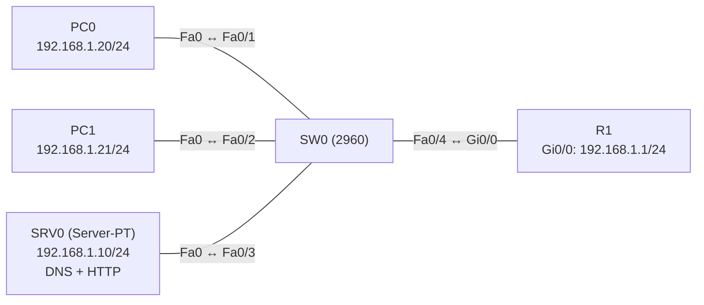

# Übung 4.3: DNS und Namensauflösung

| | |
|---|---|
| **Modul** | 4 – Netzdienste |
| **Stufe** | Aufbau |
| **Geschätzte Zeit** | ca. 45–60 Minuten |
| **Werkzeug** | Cisco Packet Tracer |
| **Vorwissen** | Übung 4.1 (DHCP), Übung 1.1 (erstes Netzwerk) |

> **Stand der Prüfung:** Entwurf. Die Begriffe DNS, A-Record und CNAME sowie die Router-Befehle `ip domain-lookup` und `ip name-server` sind allgemeines Cisco- und DNS-Wissen und in dieser Fassung nicht aus einer Quelle im Wortlaut belegt (siehe Quellen). **Nicht bestätigt** sind die Bedienung des DNS-Dienstes am *Server-PT* (*Services* → *DNS*, Feldnamen, *CNAME*), das Verhalten von `nslookup` und des *Web Browser* in Packet Tracer, die Meldungen bei fehlgeschlagener Auflösung, das Auflösen von Namen direkt auf dem Router sowie alle Ausgaben und GUI-Wege.

## Lernziele

Nach dieser Übung kannst du

- erklären, wozu DNS dient und was ein A-Record und ein CNAME sind,
- am Server-PT den DNS-Dienst einschalten und Einträge anlegen,
- Clients so einrichten, dass sie den DNS-Server nutzen,
- mit `ping`, `nslookup` und dem Web Browser prüfen, ob die Namensauflösung klappt,
- zwischen einem Fehler bei der Namensauflösung und einem Fehler bei der Erreichbarkeit unterscheiden,
- einen Router so einrichten, dass er Namen auflöst.

## Voraussetzungen

Du kannst Adressen vergeben (Übung 4.1) und kennst `ping`. Neu ist, dass du Namen statt Adressen verwendest.

## Grundbegriffe

| Begriff | Bedeutung |
|---|---|
| DNS | *Domain Name System*. Übersetzt Namen (`www.firma.lan`) in IP-Adressen. |
| DNS-Server | Gerät, das die Einträge (Records) führt und Anfragen beantwortet. |
| Resolver / Client | Gerät, das einen Namen auflösen will, z. B. ein PC. |
| A-Record | Eintrag *Name → IPv4-Adresse*. |
| CNAME | Eintrag *Alias → anderer Name* (z. B. `web.firma.lan` → `www.firma.lan`). |
| FQDN | Vollständiger Name mit Domain (`www.firma.lan`). |
| `nslookup` | Befehl, der eine Namensabfrage ausführt und die Antwort samt DNS-Server anzeigt. |

> **Merksatz:** Ein Ping auf die Adresse klappt, ein Ping auf den Namen nicht? Dann ist das Netz in Ordnung, und die Namensauflösung ist das Problem.

## Topologie und Adressplan

Ein Netz mit einem Server (DNS und Web), zwei PCs und einem Router.



| Gerät | Port / Interface | IP-Adresse | Subnetzmaske | Default Gateway | DNS-Server |
|---|---|---|---|---|---|
| SRV0 | FastEthernet0 | `192.168.1.10` | `255.255.255.0` | `192.168.1.1` | `192.168.1.10` |
| PC0 | FastEthernet0 | `192.168.1.20` | `255.255.255.0` | `192.168.1.1` | `192.168.1.10` |
| PC1 | FastEthernet0 | `192.168.1.21` | `255.255.255.0` | `192.168.1.1` | `192.168.1.10` |
| R1 | `GigabitEthernet0/0` | `192.168.1.1` | `255.255.255.0` | – | – |

Domain: `firma.lan`. Einträge am Server:

| Typ | Name | Wert |
|---|---|---|
| A | `www.firma.lan` | `192.168.1.10` |
| A | `pc1.firma.lan` | `192.168.1.21` |
| A | `router.firma.lan` | `192.168.1.1` |
| CNAME | `web.firma.lan` | `www.firma.lan` |

## Aufgabe

> **Schema dieser Übungsreihe: zwei Wege pro Schritt.** Wo es in Packet Tracer keinen CLI-Weg gibt (Geräte platzieren, verkabeln, Server-Dienste), steht das ausdrücklich dabei. Alle Befehle stehen in Codeblöcken. Die CLI-Befehle und GUI-Wege sind in dieser Entwurfsfassung noch nicht in Packet Tracer bestätigt.

**1. Neues Projekt beginnen** und Geräte platzieren: ein Router (*1941*), ein Switch (*2960*), ein *Server-PT*, zwei PCs

- **GUI:** *File* → *New*, Geräte aus der Geräteauswahl ziehen.
- **CLI:** Entfällt (nur grafisch möglich).

**2. Verkabeln** mit *Copper Straight-Through*: PC0 → SW0 `Fa0/1`, PC1 → SW0 `Fa0/2`, SRV0 → SW0 `Fa0/3`, SW0 `Fa0/4` → R1 `Gi0/0`

- **GUI:** Kategorie *Connections*, Kabeltyp anklicken, beide Geräte anklicken, Ports wählen.
- **CLI:** Entfällt (Kabel gibt es nur grafisch).

**3. Adressen einrichten** (Plan oben, **mit** DNS-Server `192.168.1.10`)

- **GUI:** Server und PCs → *Desktop* → *IP Configuration* → *Static*, alle Felder inklusive *DNS Server*. Router → *Config* → *GigabitEthernet0/0*.
- **CLI:** Am Router:
  ```text
  Router> enable
  Router# configure terminal
  Router(config)# hostname R1
  R1(config)# interface gigabitethernet 0/0
  R1(config-if)# ip address 192.168.1.1 255.255.255.0
  R1(config-if)# no shutdown
  R1(config-if)# end
  ```
  PC und Server haben keine IOS-CLI, dort erfolgt die Konfiguration im Fenster *IP Configuration*.

**4. Vorher testen: Adresse statt Name**

- **GUI:** *Add Simple PDU*: PC0 → SRV0.
- **CLI:** Am PC0:
  ```text
  PC> ping 192.168.1.10
  PC> ping www.firma.lan
  ```
  Der erste Ping klappt, der zweite nicht, denn der DNS-Dienst ist noch nicht eingerichtet (nicht bestätigt: Meldung ähnlich „Ping request could not find host“).

**5. DNS-Dienst am Server einschalten und Einträge anlegen**

- **GUI:** SRV0 → *Services* → *DNS*. *DNS Service* auf *On*. Dann unter *Resource Records*: *Name* `www.firma.lan`, *Type* *A Record*, *Address* `192.168.1.10`, *Add*. Ebenso `pc1.firma.lan` → `192.168.1.21` und `router.firma.lan` → `192.168.1.1`. Für `web.firma.lan` den Typ *CNAME* wählen und als Ziel `www.firma.lan` eintragen.
- **CLI:** Entfällt (Server-PT hat keine IOS-CLI).

**6. Namensauflösung prüfen**

- **GUI:** PC0 → *Desktop* → *Command Prompt* (siehe CLI).
- **CLI:** Am PC0:
  ```text
  PC> nslookup www.firma.lan
  PC> ping www.firma.lan
  PC> ping router.firma.lan
  PC> ping web.firma.lan
  ```
  `nslookup` zeigt den befragten DNS-Server und die Adresse. Bei `ping` auf den Namen erscheint die aufgelöste Adresse (nicht bestätigt).

**7. Web Browser mit Namen**

- **GUI:** PC0 → *Desktop* → *Web Browser*, Adresse `http://www.firma.lan` und `http://web.firma.lan` eingeben, *Go*. Die Standardseite des Servers erscheint (HTTP-Dienst am Server ist standardmäßig an, nicht bestätigt).
- **CLI:** Entfällt (der Browser ist nur grafisch).

**8. Gegenprobe: falscher DNS-Server**

- **GUI:** PC1 → *IP Configuration*: *DNS Server* auf `192.168.1.99` ändern.
- **CLI:** Am PC1:
  ```text
  PC> ping 192.168.1.10
  PC> ping www.firma.lan
  ```
  Die Adresse ist erreichbar, der Name nicht. Danach den DNS-Server wieder auf `192.168.1.10` setzen.

**9. Gegenprobe: fehlender Eintrag**

- **GUI:** SRV0 → *Services* → *DNS*: den Eintrag `pc1.firma.lan` löschen (*Remove*).
- **CLI:** Am PC0:
  ```text
  PC> ping pc1.firma.lan
  PC> ping 192.168.1.21
  ```
  Der Name wird nicht mehr aufgelöst, die Adresse bleibt erreichbar. Danach den Eintrag wieder anlegen.

**10. Router löst Namen auf**

- **GUI:** Entfällt (nur CLI).
- **CLI:** Auf R1:
  ```text
  R1# configure terminal
  R1(config)# ip domain-lookup
  R1(config)# ip name-server 192.168.1.10
  R1(config)# end
  R1# ping www.firma.lan
  ```
  `ip domain-lookup` ist standardmäßig an. Der Router fragt dann den eingetragenen Server (nicht bestätigt in Packet Tracer).

**11. Projekt und Konfiguration speichern** als `04.3-dns-namensaufloesung.pkt`

- **GUI:** *File* → *Save As* (oder `Strg+S`).
- **CLI:** Für die Konfiguration:
  ```text
  R1# copy running-config startup-config
  ```

## Hintergrund: Wie läuft eine DNS-Abfrage ab?

1. Der Client will `www.firma.lan` erreichen und kennt nur den Namen.
2. Er fragt seinen **konfigurierten DNS-Server** (`192.168.1.10`): „Welche Adresse gehört zu diesem Namen?“
3. Der Server schaut in seine Einträge. Ein A-Record liefert direkt die Adresse, ein CNAME verweist auf einen anderen Namen, der dann ebenfalls aufgelöst wird.
4. Der Client bekommt die Antwort und sendet seine eigentliche Anfrage an die Adresse.
5. **Im Internet** ist die Auflösung auf viele Server verteilt (Root, Top-Level-Domain, Domain-Server). Ein Resolver fragt sich durch und merkt sich Antworten (Cache). In dieser Übung gibt es nur den einen, lokalen Server.

## Hinweise

- Der Server-PT löst nur Namen auf, die du als Einträge angelegt hast. Er leitet unbekannte Namen nicht an das Internet weiter (nicht bestätigt).
- DNS-Server-Adresse und Namensformat müssen übereinstimmen. `www.firma.lan` und `www` sind zwei verschiedene Eingaben.
- Der PC kann den DNS-Server per DHCP bekommen (Übung 4.1/4.2). Ist er falsch eingetragen, funktioniert die Namensauflösung nicht, die Verbindung per Adresse aber schon.
- Ein CNAME zeigt immer auf einen **Namen**, nicht auf eine Adresse.
- Der Web Browser in Packet Tracer lässt sich auch mit einer Adresse bedienen (`http://192.168.1.10`). Das ist ein guter Test, ob der Fehler an DNS oder am Webserver liegt.

## Prüfbefehle

Am PC (Command Prompt):

```text
PC> ipconfig /all
PC> nslookup www.firma.lan
PC> ping www.firma.lan
PC> ping 192.168.1.10
```

Am Router (CLI):

```text
R1> enable
R1# show hosts
R1# show running-config | include name-server
```

| CLI-Befehl | Was er zeigt | GUI-Weg |
|---|---|---|
| `ipconfig /all` (PC) | Eingetragene DNS-Server | PC → *Desktop* → *IP Configuration* |
| `nslookup <Name>` (PC) | Befragter DNS-Server und aufgelöste Adresse | – |
| `ping <Name>` (PC) | Löst den Namen auf und testet die Erreichbarkeit | *Add Simple PDU* (nur Adressen) |
| `show hosts` (Router) | Namenstabelle und Cache des Routers | – |
| Web Browser (PC) | Seite per Name abrufen | PC → *Desktop* → *Web Browser* |

**Kontrollfragen**

1. Was ist der Unterschied zwischen einem A-Record und einem CNAME?
2. Der Ping auf die Adresse klappt, der Ping auf den Namen nicht. Was prüfst du zuerst?
3. Wo tragen die Clients den DNS-Server ein, und wie bekommen sie ihn automatisch?
4. Warum ist `www.firma.lan` besser als die Adresse im Browser einzutippen?
5. Was passiert mit einem CNAME, wenn sein Ziel-Eintrag fehlt?

## Erweiterungen

- **Zweiter Server:** Einen weiteren Server-PT mit eigenem Namen anlegen und per DNS erreichbar machen.
- **DHCP + DNS:** Den DNS-Server per DHCP verteilen (Übung 4.1/4.2) und prüfen, dass die PCs die Namen auflösen.
- **Router als DNS-Client:** `ip host server 192.168.1.10` auf dem Router und `ping server` (nicht bestätigt).
- **Weiter:** Übung 4.4 und 4.5 behandeln die Adressumsetzung zum Internet.

---

## Musterlösung

<details>
<summary>Musterlösung anzeigen</summary>

**Adressen:** laut Plan. Wichtig ist das Feld *DNS Server* `192.168.1.10` an Server und PCs.

**DNS-Einträge (Schritt 5):** Siehe Tabelle im Adressplan. A-Records für `www`, `pc1`, `router`; CNAME `web.firma.lan` → `www.firma.lan`.

**Vorher (Schritt 4):** `ping 192.168.1.10` klappt, `ping www.firma.lan` schlägt fehl.

**Prüfung (Schritt 6, sinngemäß, nicht bestätigt):**

```text
PC> nslookup www.firma.lan
Server: [192.168.1.10]
Address: 192.168.1.10

Non-authoritative answer:
Name: www.firma.lan
Address: 192.168.1.10
```

`ping www.firma.lan` löst auf `192.168.1.10` auf und antwortet (der erste Versuch kann wegen ARP verloren gehen). Für `web.firma.lan` löst DNS über den CNAME auf dieselbe Adresse auf.

**Web Browser (Schritt 7):** `http://www.firma.lan` und `http://web.firma.lan` zeigen dieselbe Seite.

**Gegenprobe falscher DNS-Server (Schritt 8):** Mit `192.168.1.99` als DNS-Server schlägt die Namensauflösung fehl (keine Antwort), `ping 192.168.1.10` klappt weiter. Das zeigt: Netz in Ordnung, DNS-Konfiguration fehlerhaft.

**Gegenprobe fehlender Eintrag (Schritt 9):** `ping pc1.firma.lan` schlägt fehl, `ping 192.168.1.21` klappt.

**Router (Schritt 10):**

```text
R1(config)# ip domain-lookup
R1(config)# ip name-server 192.168.1.10
R1# ping www.firma.lan
```

Der Router löst den Namen über den Server auf und pingt `192.168.1.10` (nicht bestätigt).

**Antworten auf die Kontrollfragen:**

1. Ein A-Record ordnet einem Namen eine IPv4-Adresse zu. Ein CNAME ist ein Alias, der auf einen anderen Namen zeigt.
2. Den DNS-Server am Client (Adresse stimmt?), den DNS-Dienst am Server (an?) und den Eintrag (Schreibweise).
3. Im Fenster *IP Configuration* (Feld *DNS Server*) oder automatisch per DHCP (`dns-server` im Pool).
4. Namen bleiben gleich, auch wenn sich die Adresse ändert; man muss sie nur im DNS ändern.
5. Der Alias kann nicht aufgelöst werden; die Anfrage schlägt fehl.

</details>

---

## Quellen

- DNS, A-Record, CNAME, FQDN, Ablauf der Auflösung sowie die IOS-Befehle `ip domain-lookup`, `ip name-server`, `ip host` und `show hosts`: allgemeines Wissen zu DNS und Cisco IOS. In dieser Fassung nicht aus einer Quelle im Wortlaut belegt und nicht in Packet Tracer nachgebaut.
- Die Bedienung des Server-PT (Services → DNS) und der Befehl `nslookup` am Packet-Tracer-PC sind nicht belegt.
- Die gezeigten Ausgaben sind ein konstruiertes Beispiel und nicht aus Packet Tracer übernommen.

---

Lizenz: [CC BY-NC-SA 4.0](https://creativecommons.org/licenses/by-nc-sa/4.0/deed.de), Urheber: AnsibleArtisan4711. Cisco, Cisco IOS und Cisco Packet Tracer sind Marken von Cisco Systems, Inc. und/oder ihrer Tochtergesellschaften; dieses Dokument steht in keiner Verbindung zu Cisco.
