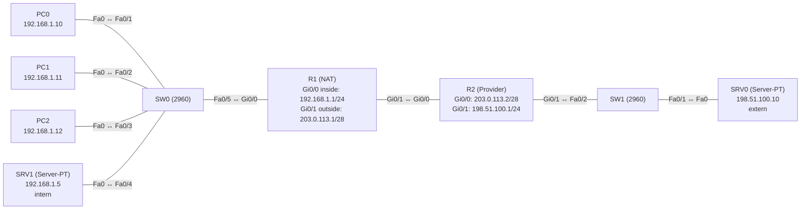

# Übung 4.4: NAT – statisch und dynamisch

| | |
|---|---|
| **Modul** | 4 – Netzdienste |
| **Stufe** | Aufbau |
| **Geschätzte Zeit** | ca. 75–90 Minuten |
| **Werkzeug** | Cisco Packet Tracer |
| **Vorwissen** | Übung 3.2 (Default-Route), Übung 1.3 (Subnetting) |

> **Stand der Prüfung:** Entwurf. Die Befehle `ip nat inside`, `ip nat outside`, `ip nat inside source static`, `ip nat pool`, `ip nat inside source list … pool …`, `access-list` und `show ip nat translations` sind durch ein Cisco-Dokument belegt (siehe Quellen). **Nicht bestätigt** sind alle gezeigten Ausgaben, `show ip nat statistics` und `clear ip nat translation *` (nicht in der Quelle), das Verhalten der Router-ARP-Antworten für Pool-Adressen im selben Subnetz wie die Verbindung, der Kabeltyp zwischen den Routern, die Anzahl und das Timeout dynamischer Einträge in Packet Tracer sowie die GUI-Wege.

## Lernziele

Nach dieser Übung kannst du

- erklären, warum private Adressen im Internet nicht geroutet werden und wozu NAT dient,
- die Begriffe *Inside Local*, *Inside Global*, *Outside Local* und *Outside Global* unterscheiden,
- Interfaces als `inside` und `outside` kennzeichnen,
- eine statische NAT-Übersetzung (1:1) für einen Server einrichten,
- eine dynamische NAT-Übersetzung mit Adresspool und ACL einrichten,
- mit `show ip nat translations` die Übersetzungen lesen und die Grenzen eines kleinen Pools beobachten.

## Voraussetzungen

Statische Routen und Default-Route (Modul 3). Das Netz hat ein privates LAN, eine Verbindung zu einem „Provider“ und einen Server „im Internet“.

## Grundbegriffe

| Begriff | Bedeutung |
|---|---|
| Private Adressen | `10.0.0.0/8`, `172.16.0.0/12`, `192.168.0.0/16`. Werden im Internet nicht geroutet. |
| NAT | *Network Address Translation*. Ein Router ersetzt Adressen in IP-Paketen. |
| Inside / Outside | Das eigene (private) Netz und das Außennetz. Die Interfaces werden entsprechend markiert. |
| Inside Local | Adresse eines Inside-Geräts, wie sie im eigenen Netz gilt (`192.168.1.10`). |
| Inside Global | Adresse, unter der das Inside-Gerät von außen erscheint (`203.0.113.3`). |
| Outside Local / Global | Adresse eines Außen-Geräts aus Sicht des Inside- bzw. Outside-Netzes (hier gleich). |
| Statisches NAT | Feste 1:1-Zuordnung einer privaten zu einer öffentlichen Adresse. |
| Dynamisches NAT | Eine private Adresse bekommt bei Bedarf eine freie Adresse aus einem Pool. |
| Pool | Bereich öffentlicher Adressen, aus dem dynamisch zugeteilt wird. |
| ACL | *Access Control List*. Hier legt sie fest, **welche** Inside-Adressen übersetzt werden. |

> **Merksatz:** Statisch: eine Adresse, ein Ziel, immer. Dynamisch: wer zuerst kommt, bekommt eine freie Adresse, und wenn der Pool leer ist, geht niemand mehr durch.

## Topologie und Adressplan

R1 ist der NAT-Router der Firma, R2 steht für den Provider. Die Adressen `203.0.113.0/28` und `198.51.100.0/24` sind für Dokumentation reserviert und dienen hier als „öffentliche“ Adressen.



| Gerät | Port / Interface | IP-Adresse | Subnetzmaske | Default Gateway |
|---|---|---|---|---|
| PC0 | FastEthernet0 | `192.168.1.10` | `255.255.255.0` | `192.168.1.1` |
| PC1 | FastEthernet0 | `192.168.1.11` | `255.255.255.0` | `192.168.1.1` |
| PC2 | FastEthernet0 | `192.168.1.12` | `255.255.255.0` | `192.168.1.1` |
| SRV1 | FastEthernet0 | `192.168.1.5` | `255.255.255.0` | `192.168.1.1` |
| R1 | `GigabitEthernet0/0` (inside) | `192.168.1.1` | `255.255.255.0` | – |
| R1 | `GigabitEthernet0/1` (outside) | `203.0.113.1` | `255.255.255.240` | – |
| R2 | `GigabitEthernet0/0` | `203.0.113.2` | `255.255.255.240` | – |
| R2 | `GigabitEthernet0/1` | `198.51.100.1` | `255.255.255.0` | – |
| SRV0 | FastEthernet0 | `198.51.100.10` | `255.255.255.0` | `198.51.100.1` |

Öffentliche Adressen für NAT: statisch `203.0.113.5` für SRV1, dynamischer Pool `203.0.113.3` bis `203.0.113.4` (nur **zwei** Adressen). Das Netz `203.0.113.0/28` ist die Verbindung zwischen R1 und R2, deshalb braucht R2 keine zusätzliche Route zu diesen Adressen.

## Aufgabe

> **Schema dieser Übungsreihe: zwei Wege pro Schritt.** Wo es in Packet Tracer keinen CLI-Weg gibt (Geräte platzieren, verkabeln, Server-Adressen), steht das ausdrücklich dabei. Alle Befehle stehen in Codeblöcken. Die CLI-Befehle und GUI-Wege sind in dieser Entwurfsfassung noch nicht in Packet Tracer bestätigt.

### Teil A: Aufbau ohne NAT

**1. Neues Projekt beginnen** und Geräte platzieren: zwei Router (*1941*), zwei Switches (*2960*), zwei *Server-PT*, drei PCs

- **GUI:** *File* → *New*, Geräte aus der Geräteauswahl ziehen.
- **CLI:** Entfällt (nur grafisch möglich).

**2. Verkabeln:** Endgeräte und Switches mit *Copper Straight-Through* (PC0–PC2 → SW0 `Fa0/1`–`Fa0/3`, SRV1 → SW0 `Fa0/4`, SW0 `Fa0/5` → R1 `Gi0/0`, R2 `Gi0/1` → SW1 `Fa0/2`, SW1 `Fa0/1` → SRV0); R1 `Gi0/1` ↔ R2 `Gi0/0` mit *Copper Cross-Over*

- **GUI:** Kategorie *Connections*, Kabeltyp anklicken, beide Geräte anklicken, Ports wählen.
- **CLI:** Entfällt (Kabel gibt es nur grafisch).

**3. Interfaces und Endgeräte einrichten** (Plan oben)

- **GUI:** PCs und Server → *Desktop* → *IP Configuration* → *Static*. Router → *Config* → Interface.
- **CLI:** R1:
  ```text
  Router> enable
  Router# configure terminal
  Router(config)# hostname R1
  R1(config)# interface gigabitethernet 0/0
  R1(config-if)# ip address 192.168.1.1 255.255.255.0
  R1(config-if)# no shutdown
  R1(config-if)# exit
  R1(config)# interface gigabitethernet 0/1
  R1(config-if)# ip address 203.0.113.1 255.255.255.240
  R1(config-if)# no shutdown
  R1(config-if)# exit
  R1(config)# ip route 0.0.0.0 0.0.0.0 203.0.113.2
  R1(config)# end
  ```
  R2:
  ```text
  Router> enable
  Router# configure terminal
  Router(config)# hostname R2
  R2(config)# interface gigabitethernet 0/0
  R2(config-if)# ip address 203.0.113.2 255.255.255.240
  R2(config-if)# no shutdown
  R2(config-if)# exit
  R2(config)# interface gigabitethernet 0/1
  R2(config-if)# ip address 198.51.100.1 255.255.255.0
  R2(config-if)# no shutdown
  R2(config-if)# end
  ```
  R2 hat **keine** Route zu `192.168.1.0/24` und kennt die privaten Adressen nicht, wie ein Provider im Internet.

**4. Vorher testen: ohne NAT**

- **GUI:** *Add Simple PDU*: PC0 → SRV0 (`198.51.100.10`).
- **CLI:** Am PC0:
  ```text
  PC> ping 198.51.100.10
  ```
  Der Ping schlägt fehl. Das Paket kommt mit der privaten Quelladresse `192.168.1.10` beim Server an, aber die Antwort findet den Rückweg nicht, weil R2 das private Netz nicht kennt.

### Teil B: Statisches NAT

**5. Interfaces als inside und outside markieren**

- **GUI:** Entfällt (nur CLI).
- **CLI:** Auf R1:
  ```text
  R1# configure terminal
  R1(config)# interface gigabitethernet 0/0
  R1(config-if)# ip nat inside
  R1(config-if)# exit
  R1(config)# interface gigabitethernet 0/1
  R1(config-if)# ip nat outside
  R1(config-if)# exit
  ```

**6. Statische Übersetzung für den internen Server**

- **GUI:** Entfällt (nur CLI).
- **CLI:**
  ```text
  R1(config)# ip nat inside source static 192.168.1.5 203.0.113.5
  R1(config)# end
  R1# show ip nat translations
  ```
  Die Übersetzung steht in der Tabelle, sobald der Befehl eingegeben ist, auch ohne Verkehr.

**7. Statisches NAT testen: von außen**

- **GUI:** SRV0 → *Desktop* → *Web Browser*: `http://203.0.113.5`, *Go*.
- **CLI:** Im *Command Prompt* von SRV0:
  ```text
  C:\> ping 203.0.113.5
  ```
  Der interne Server antwortet unter der öffentlichen Adresse (nicht bestätigt: der HTTP-Dienst am SRV1 ist standardmäßig an).

**8. Statisches NAT testen: von innen**

- **GUI:** *Add Simple PDU*: SRV1 → SRV0.
- **CLI:** Der Server hat keine IOS-CLI. Im *Command Prompt* von SRV1:
  ```text
  C:\> ping 198.51.100.10
  ```
  Der Ping klappt jetzt, denn SRV1 wird beim Hinausgehen zu `203.0.113.5`. Prüfe auf R1 `show ip nat translations`. PC0 kommt noch **nicht** durch.

### Teil C: Dynamisches NAT

**9. ACL und Pool anlegen**

- **GUI:** Entfällt (nur CLI).
- **CLI:** Auf R1:
  ```text
  R1# configure terminal
  R1(config)# access-list 1 permit 192.168.1.0 0.0.0.255
  R1(config)# ip nat pool OEFFENTLICH 203.0.113.3 203.0.113.4 netmask 255.255.255.240
  R1(config)# ip nat inside source list 1 pool OEFFENTLICH
  R1(config)# end
  ```
  Die ACL bestimmt, **wer** übersetzt wird. Der Pool nennt die Adressen, die zur Verfügung stehen.

**10. Dynamisches NAT testen**

- **GUI:** *Add Simple PDU*: PC0 → SRV0.
- **CLI:** Am PC0:
  ```text
  PC> ping 198.51.100.10
  ```
  Danach auf R1:
  ```text
  R1# show ip nat translations
  ```
  PC0 hat eine Adresse aus dem Pool bekommen. Welche?

**11. Den Pool erschöpfen**

- **GUI:** *Add Simple PDU*: PC1 → SRV0, dann PC2 → SRV0 (nicht aus dem Fenster abbrechen).
- **CLI:** Am PC1 und am PC2:
  ```text
  PC> ping 198.51.100.10
  ```
  Auf R1 mit `show ip nat translations` ansehen, wie viele Adressen vergeben sind. Der dritte PC geht leer aus, weil der Pool nur zwei Adressen hat und beide belegt sind (SRV1 hat seine eigene statische Adresse). Erwartung: Der Ping von PC2 schlägt fehl (nicht bestätigt).

**12. Übersetzungen leeren**

- **GUI:** Entfällt.
- **CLI:**
  ```text
  R1# clear ip nat translation *
  R1# show ip nat translations
  ```
  Dynamische Einträge verschwinden, statische bleiben. Danach klappt der Ping von PC2 wieder (nicht bestätigt, Befehl nicht in der genutzten Quelle).

**13. Statistik ansehen**

- **GUI:** Entfällt.
- **CLI:**
  ```text
  R1# show ip nat statistics
  ```
  Zeigt Anzahl der Übersetzungen, inside/outside-Interfaces, Pool und Treffer/Fehlschläge (nicht bestätigt).

**14. Projekt und Konfiguration speichern** als `04.4-nat-statisch-und-dynamisch.pkt`

- **GUI:** *File* → *Save As* (oder `Strg+S`).
- **CLI:**
  ```text
  R1# copy running-config startup-config
  ```

## Hintergrund: Was macht NAT mit dem Paket?

1. **Ausgehend:** PC0 (`192.168.1.10`) sendet an `198.51.100.10`. Das Paket tritt über das Inside-Interface `Gi0/0` in R1 ein, R1 routet es zum Outside-Interface und ersetzt die Quelladresse durch eine Inside-Global-Adresse (`203.0.113.3`).
2. **Beim Ziel:** SRV0 sieht nur `203.0.113.3` und antwortet an diese Adresse. R2 kennt `203.0.113.0/28` direkt.
3. **Zurück:** R1 schaut in der NAT-Tabelle nach, ersetzt das Ziel `203.0.113.3` durch `192.168.1.10` und leitet es ins LAN.
4. **Statisch** gilt in beide Richtungen und dauerhaft, auch wenn die Verbindung von außen aufgebaut wird (Server). **Dynamisch** gibt es nur für Verbindungen, die von innen beginnen; der Eintrag verfällt nach einiger Zeit ohne Verkehr (Timeout).
5. **Rollen der Adressen:** Inside Local `192.168.1.10`, Inside Global `203.0.113.3`, Outside Local/Global `198.51.100.10`.

> **Hinweis zur Reihenfolge:** Die Reihenfolge in IOS ist: eingehend auf dem Inside-Interface routet R1 zuerst und übersetzt dann; eingehend auf dem Outside-Interface übersetzt R1 zuerst und routet dann (allgemeines Wissen, hier nicht aus einer Quelle im Wortlaut belegt).

## Hinweise

- Ohne `ip nat inside` / `ip nat outside` auf den Interfaces übersetzt der Router nichts, auch wenn die Regeln stimmen.
- Die ACL in `ip nat inside source list` dient nur der **Auswahl** der Adressen, sie blockiert nichts. Achte auf die Wildcard-Maske (`0.0.0.255`).
- Pool und Netzmaske: `netmask` muss zum Subnetz der Pool-Adressen passen (hier `/28`).
- Pool-Adressen im selben Subnetz wie die Verbindung zum Provider sind praktisch, weil R2 sie direkt erreicht. Liegt der Pool in einem anderen Netz, braucht der Provider eine Route dorthin.
- Ein erster Ping kann beim Aufbau eines Eintrags verloren gehen (ARP).
- Statische und dynamische Regeln dürfen nebeneinander bestehen.

## Prüfbefehle

Am PC / Server (Command Prompt):

```text
PC> ipconfig
PC> ping 198.51.100.10
PC> tracert 198.51.100.10
```

Am Router (CLI):

```text
R1> enable
R1# show ip interface brief
R1# show ip route
R1# show access-lists
R1# show ip nat translations
R1# show ip nat statistics
R1# show running-config | section nat
```

| CLI-Befehl | Was er zeigt | GUI-Weg |
|---|---|---|
| `show ip nat translations` | Tabelle: Inside Global ↔ Inside Local (↔ Outside Local/Global) | – (nur CLI) |
| `show ip nat statistics` | Zähler, Interfaces inside/outside, Pool | – |
| `show access-lists` | ACL 1 mit Treffern | – |
| `show ip route` | Routingtabelle, Default-Route zum Provider | Werkzeug *Inspect* → *Routing Table* |
| `ping`, `tracert` (PC) | Erreichbarkeit und Weg | *Add Simple PDU* |

**Kontrollfragen**

1. Warum schlägt der Ping ohne NAT fehl, obwohl R1 die Pakete weiterleitet?
2. Was sind Inside Local und Inside Global in diesem Beispiel?
3. Wozu dient die ACL beim dynamischen NAT?
4. Was passiert, wenn mehr Inside-Geräte gleichzeitig nach außen wollen, als Pool-Adressen vorhanden sind?
5. Wann ist statisches NAT sinnvoller als dynamisches?

## Erweiterungen

- **Statische Übersetzung für einen Port:** Nur Webzugriff auf SRV1 freigeben: `ip nat inside source static tcp 192.168.1.5 80 203.0.113.5 80` (so in der Quelle für Port 25 gezeigt).
- **Größerer Pool:** Den Pool auf `203.0.113.3` bis `203.0.113.6` erweitern und beobachten, wie viele PCs gleichzeitig hinauskommen.
- **Debug:** `debug ip nat` einschalten und beobachten, wie Adressen ersetzt werden (die Quelle zeigt die Ausgabe). Danach `undebug all`.
- **Weiter:** Übung 4.5 löst das Problem des kleinen Pools mit PAT.

---

## Musterlösung

<details>
<summary>Musterlösung anzeigen</summary>

**R1, vollständig (Teile A bis C):**

```text
R1(config)# interface gigabitethernet 0/0
R1(config-if)# ip address 192.168.1.1 255.255.255.0
R1(config-if)# ip nat inside
R1(config-if)# no shutdown
R1(config-if)# exit
R1(config)# interface gigabitethernet 0/1
R1(config-if)# ip address 203.0.113.1 255.255.255.240
R1(config-if)# ip nat outside
R1(config-if)# no shutdown
R1(config-if)# exit
R1(config)# ip route 0.0.0.0 0.0.0.0 203.0.113.2
R1(config)# ip nat inside source static 192.168.1.5 203.0.113.5
R1(config)# access-list 1 permit 192.168.1.0 0.0.0.255
R1(config)# ip nat pool OEFFENTLICH 203.0.113.3 203.0.113.4 netmask 255.255.255.240
R1(config)# ip nat inside source list 1 pool OEFFENTLICH
```

**R2:** Adressen laut Plan, **keine** weiteren Routen.

**Vorher (Schritt 4):** Der Ping von PC0 an SRV0 schlägt fehl. R2 kennt das Netz `192.168.1.0/24` nicht und kann die Antwort nicht zurückschicken.

**Statisches NAT (Schritt 6, sinngemäß, nicht bestätigt):**

```text
R1# show ip nat translations
Pro Inside global     Inside local       Outside local      Outside global
--- 203.0.113.5       192.168.1.5        ---                ---
```

**Dynamisches NAT (Schritt 10, sinngemäß, nicht bestätigt):**

```text
R1# show ip nat translations
Pro Inside global     Inside local       Outside local      Outside global
--- 203.0.113.5       192.168.1.5        ---                ---
--- 203.0.113.3       192.168.1.10       ---                ---
```

Die genaue Darstellung kann abweichen (z. B. mit zusätzlichen `icmp`-Zeilen während eines Pings). PC0 ist hier auf `203.0.113.3` übersetzt, welche der beiden Pool-Adressen er bekommt, hängt von der Reihenfolge ab.

**Pool erschöpft (Schritt 11):** PC0 und PC1 belegen `203.0.113.3` und `203.0.113.4`. PC2 hat keine freie Adresse; sein Ping schlägt fehl (nicht bestätigt). Nach `clear ip nat translation *` oder nach dem Timeout geht es wieder.

**Antworten auf die Kontrollfragen:**

1. Weil R2 die private Adresse `192.168.1.10` nicht routet und keine Route zurück kennt. Der Hinweg funktioniert, der Rückweg nicht.
2. Inside Local `192.168.1.10` (so kennt PC0 sich selbst); Inside Global `203.0.113.3` (so erscheint er außen).
3. Sie wählt aus, welche Inside-Adressen übersetzt werden dürfen. Sie blockiert nichts.
4. Die überzähligen Geräte bekommen keine öffentliche Adresse; ihre Pakete werden nicht übersetzt und kommen nicht zurück. Erst wenn Einträge verfallen, kann ein anderes Gerät durch.
5. Für Server, die von außen unter einer festen, bekannten Adresse erreichbar sein sollen.

</details>

---

## Quellen

- Cisco, *Configuring Static and Dynamic NAT Simultaneously* ([cisco.com](https://www.cisco.com/c/en/us/support/docs/ip/network-address-translation-nat/13778-9.html)): `ip nat inside source static`, `ip nat inside source static tcp … 25 … 25`, `ip nat pool … netmask …`, `ip nat inside source list … pool …`, `access-list`, `ip nat inside`/`ip nat outside` und Ausgabeformat von `show ip nat translations` (Spalten `Pro`, `Inside global`, `Inside local`, `Outside local`, `Outside global`), Hinweis, dass statische Einträge sofort in der Tabelle stehen und dynamische erst bei Verkehr entstehen und ablaufen, `debug ip nat`.
- Adressbereiche für Dokumentation `203.0.113.0/24` und `198.51.100.0/24` sowie die privaten Adressbereiche: allgemeines Wissen (RFC 5737 und RFC 1918), hier nicht aus der genannten Quelle belegt.
- `show ip nat statistics`, `clear ip nat translation *`, die Reihenfolge von Routing und Übersetzung und das Pool-Verhalten in Packet Tracer: nicht aus der genannten Quelle belegt.
- Die gezeigten Ausgaben sind ein konstruiertes Beispiel im IOS-Format und nicht aus Packet Tracer übernommen.

---

Lizenz: [CC BY-NC-SA 4.0](https://creativecommons.org/licenses/by-nc-sa/4.0/deed.de), Urheber: AnsibleArtisan4711. Cisco, Cisco IOS und Cisco Packet Tracer sind Marken von Cisco Systems, Inc. und/oder ihrer Tochtergesellschaften; dieses Dokument steht in keiner Verbindung zu Cisco.
