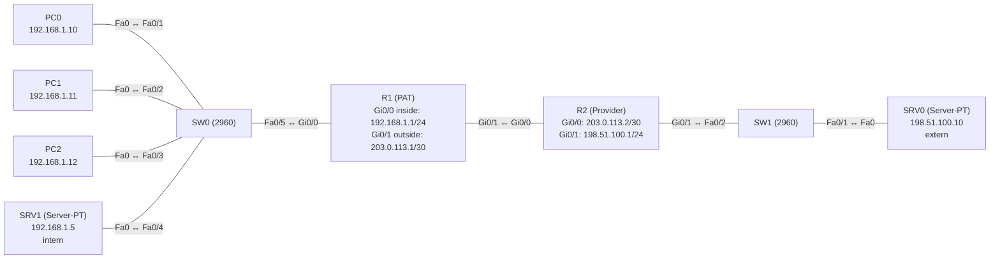

# Übung 4.5: PAT – viele Geräte, eine öffentliche Adresse

| | |
|---|---|
| **Modul** | 4 – Netzdienste |
| **Stufe** | Fortgeschritten |
| **Geschätzte Zeit** | ca. 60–75 Minuten |
| **Werkzeug** | Cisco Packet Tracer |
| **Vorwissen** | Übung 4.4 (statisches und dynamisches NAT), Übung 3.2 (Default-Route) |

> **Stand der Prüfung:** Entwurf. Die Befehle `ip nat inside source list … interface … overload`, `ip nat inside`/`outside`, `access-list` und `show ip nat translations` sind durch ein Cisco-Dokument belegt, ebenso die Port-Weiterleitung `ip nat inside source static tcp …` (siehe Quellen). **Nicht bestätigt** sind alle gezeigten Ausgaben (insbesondere die Portnummern in der Tabelle), `show ip nat statistics`, `clear ip nat translation *`, der Befehl `ip nat pool … overload`-Variante, das Verhalten von `tracert` durch NAT, der Kabeltyp zwischen den Routern, das Verhalten der Webseite beim Port-Forwarding sowie die GUI-Wege.

## Lernziele

Nach dieser Übung kannst du

- erklären, wie PAT (NAT mit `overload`) viele private Adressen auf **eine** öffentliche Adresse abbildet,
- PAT auf dem Outside-Interface einrichten,
- in `show ip nat translations` die Portnummern lesen, mit denen Verbindungen unterschieden werden,
- PAT und dynamisches NAT mit Pool vergleichen,
- eine Port-Weiterleitung (Port Forwarding) für einen internen Webserver einrichten.

## Voraussetzungen

Übung 4.4. Der Pool dort hatte nur zwei Adressen, der dritte PC ging leer aus. PAT löst genau dieses Problem.

## Grundbegriffe

| Begriff | Bedeutung |
|---|---|
| PAT | *Port Address Translation*. Viele Inside-Adressen teilen sich eine öffentliche Adresse, unterschieden durch den Port. Auch „NAT Overload“. |
| `overload` | Schlüsselwort im NAT-Befehl, das PAT einschaltet. |
| Port | Nummer (0–65535), die Verbindungen einer Adresse unterscheidet. |
| Inside Local | Adresse und Port des Inside-Geräts (`192.168.1.10:1025`). |
| Inside Global | Öffentliche Adresse und der von PAT vergebene Port (`203.0.113.1:1024`). |
| Port Forwarding | Statische Übersetzung eines einzelnen Ports (z. B. 80) auf einen internen Server. |

> **Merksatz:** Bei PAT unterscheidet nicht die Adresse, sondern der Port, welche Antwort zu welchem Gerät gehört.

## Topologie und Adressplan

Gleicher Aufbau wie in Übung 4.4, aber die Verbindung zum Provider hat nur noch **eine** nutzbare Adresse für die Firma.



| Gerät | Port / Interface | IP-Adresse | Subnetzmaske | Default Gateway |
|---|---|---|---|---|
| PC0 | FastEthernet0 | `192.168.1.10` | `255.255.255.0` | `192.168.1.1` |
| PC1 | FastEthernet0 | `192.168.1.11` | `255.255.255.0` | `192.168.1.1` |
| PC2 | FastEthernet0 | `192.168.1.12` | `255.255.255.0` | `192.168.1.1` |
| SRV1 | FastEthernet0 | `192.168.1.5` | `255.255.255.0` | `192.168.1.1` |
| R1 | `GigabitEthernet0/0` (inside) | `192.168.1.1` | `255.255.255.0` | – |
| R1 | `GigabitEthernet0/1` (outside) | `203.0.113.1` | `255.255.255.252` | – |
| R2 | `GigabitEthernet0/0` | `203.0.113.2` | `255.255.255.252` | – |
| R2 | `GigabitEthernet0/1` | `198.51.100.1` | `255.255.255.0` | – |
| SRV0 | FastEthernet0 | `198.51.100.10` | `255.255.255.0` | `198.51.100.1` |

Die einzige öffentliche Adresse der Firma ist `203.0.113.1` am Outside-Interface von R1.

## Aufgabe

> **Schema dieser Übungsreihe: zwei Wege pro Schritt.** Wo es in Packet Tracer keinen CLI-Weg gibt (Geräte platzieren, verkabeln, Server-Adressen), steht das ausdrücklich dabei. Alle Befehle stehen in Codeblöcken. Die CLI-Befehle und GUI-Wege sind in dieser Entwurfsfassung noch nicht in Packet Tracer bestätigt.

### Teil A: Aufbau

**1. Neues Projekt beginnen** und Geräte platzieren: zwei Router (*1941*), zwei Switches (*2960*), zwei *Server-PT*, drei PCs

- **GUI:** *File* → *New*, Geräte aus der Geräteauswahl ziehen. Alternativ das Projekt aus Übung 4.4 mit *Save As* kopieren und die Adressen anpassen.
- **CLI:** Entfällt (nur grafisch möglich).

**2. Verkabeln** wie in Übung 4.4 (Endgeräte/Switches *Copper Straight-Through*, R1 `Gi0/1` ↔ R2 `Gi0/0` *Copper Cross-Over*)

- **GUI:** Kategorie *Connections*, Kabeltyp anklicken, beide Geräte anklicken, Ports wählen.
- **CLI:** Entfällt (Kabel gibt es nur grafisch).

**3. Interfaces und Endgeräte einrichten** (Plan oben)

- **GUI:** PCs und Server → *Desktop* → *IP Configuration* → *Static*. Router → *Config* → Interface.
- **CLI:** R1:
  ```text
  Router> enable
  Router# configure terminal
  Router(config)# hostname R1
  R1(config)# interface gigabitethernet 0/0
  R1(config-if)# ip address 192.168.1.1 255.255.255.0
  R1(config-if)# ip nat inside
  R1(config-if)# no shutdown
  R1(config-if)# exit
  R1(config)# interface gigabitethernet 0/1
  R1(config-if)# ip address 203.0.113.1 255.255.255.252
  R1(config-if)# ip nat outside
  R1(config-if)# no shutdown
  R1(config-if)# exit
  R1(config)# ip route 0.0.0.0 0.0.0.0 203.0.113.2
  R1(config)# end
  ```
  R2:
  ```text
  Router> enable
  Router# configure terminal
  Router(config)# hostname R2
  R2(config)# interface gigabitethernet 0/0
  R2(config-if)# ip address 203.0.113.2 255.255.255.252
  R2(config-if)# no shutdown
  R2(config-if)# exit
  R2(config)# interface gigabitethernet 0/1
  R2(config-if)# ip address 198.51.100.1 255.255.255.0
  R2(config-if)# no shutdown
  R2(config-if)# end
  ```
  R2 kennt das private Netz nicht.

**4. Vorher testen: ohne NAT**

- **GUI:** *Add Simple PDU*: PC0 → SRV0.
- **CLI:** Am PC0:
  ```text
  PC> ping 198.51.100.10
  ```
  Der Ping schlägt fehl (R2 kennt `192.168.1.0/24` nicht).

### Teil B: PAT

**5. ACL anlegen: wer wird übersetzt**

- **GUI:** Entfällt (nur CLI).
- **CLI:** Auf R1:
  ```text
  R1# configure terminal
  R1(config)# access-list 1 permit 192.168.1.0 0.0.0.255
  ```

**6. PAT einschalten**

- **GUI:** Entfällt (nur CLI).
- **CLI:**
  ```text
  R1(config)# ip nat inside source list 1 interface gigabitethernet 0/1 overload
  R1(config)# end
  ```
  `overload` ist das Schlüsselwort für PAT, `interface gigabitethernet 0/1` bedeutet: Es wird die Adresse dieses Interfaces verwendet.

**7. Alle drei PCs gleichzeitig hinausschicken**

- **GUI:** *Add Simple PDU*: PC0, PC1 und PC2 jeweils an SRV0.
- **CLI:** An jedem PC:
  ```text
  PC> ping 198.51.100.10
  ```
  Im Gegensatz zu Übung 4.4 kommen **alle** drei durch.

**8. Die Tabelle lesen**

- **GUI:** Entfällt.
- **CLI:** Auf R1, möglichst direkt nach den Pings:
  ```text
  R1# show ip nat translations
  ```
  Alle Einträge zeigen als Inside Global die Adresse `203.0.113.1`, aber mit **verschiedenen Ports**. Notiere die Zuordnung Port ↔ PC.

**9. Wiederholung mit längerem Verkehr**

- **GUI:** PC0 → *Desktop* → *Web Browser*: `http://198.51.100.10`. Im selben Moment PC1 → ebenso.
- **CLI:** Entfällt (Browser nur grafisch). Danach auf R1:
  ```text
  R1# show ip nat translations
  ```
  Bei Web-Verbindungen erscheinen `tcp`-Einträge mit Quell-Ports (nicht bestätigt, dass der HTTP-Dienst am SRV0 standardmäßig läuft).

**10. Statistik und Aufräumen**

- **GUI:** Entfällt.
- **CLI:**
  ```text
  R1# show ip nat statistics
  R1# clear ip nat translation *
  R1# show ip nat translations
  ```
  Nach `clear` ist die Tabelle (bis auf statische Einträge) leer (nicht bestätigt).

### Teil C: Port Forwarding

**11. Von außen ist der interne Server nicht erreichbar**

- **GUI:** SRV0 → *Desktop* → *Web Browser*: `http://203.0.113.1`.
- **CLI:** Im *Command Prompt* von SRV0:
  ```text
  C:\> ping 203.0.113.1
  ```
  `203.0.113.1` ist die Adresse von R1, nicht von SRV1. Der Web-Zugriff von außen führt nirgendwohin.

**12. Port 80 auf SRV1 weiterleiten**

- **GUI:** Entfällt (nur CLI).
- **CLI:** Auf R1:
  ```text
  R1# configure terminal
  R1(config)# ip nat inside source static tcp 192.168.1.5 80 203.0.113.1 80
  R1(config)# end
  R1# show ip nat translations
  ```
  Der Eintrag erscheint sofort in der Tabelle (nach dem Muster in der Quelle).

**13. Web-Zugriff von außen testen**

- **GUI:** SRV0 → *Desktop* → *Web Browser*: `http://203.0.113.1`. Die Startseite von SRV1 erscheint (nicht bestätigt).
- **CLI:** Entfällt (Browser nur grafisch). Prüfe auf R1 mit `show ip nat translations` den neuen Eintrag.

**14. Gegenprobe: anderer Port**

- **GUI:** SRV0 → *Web Browser*: `http://203.0.113.1:8080`.
- **CLI:** Entfällt.
  Nur Port 80 ist weitergeleitet; der Zugriff auf Port 8080 schlägt fehl (nicht bestätigt).

**15. Projekt und Konfiguration speichern** als `04.5-pat-port-address-translation.pkt`

- **GUI:** *File* → *Save As* (oder `Strg+S`).
- **CLI:**
  ```text
  R1# copy running-config startup-config
  ```

## Hintergrund: Wie funktioniert PAT?

1. **Vom LAN nach außen:** PC0 sendet von `192.168.1.10` (Quellport z. B. 1025) an `198.51.100.10`. R1 ersetzt die Quelladresse durch `203.0.113.1` und den Quellport durch einen eigenen Wert (z. B. 1024).
2. **Tabelle:** R1 merkt sich: `203.0.113.1:1024` gehört zu `192.168.1.10:1025`. PC1 und PC2 bekommen andere Ports.
3. **Antwort:** SRV0 antwortet an `203.0.113.1:1024`. R1 schlägt nach, setzt `192.168.1.10:1025` ein und leitet es ins LAN.
4. **Grenzen:** Eine öffentliche Adresse trägt rechnerisch rund 65 000 Verbindungen je Protokoll. Verbindungen von außen ins LAN brauchen Port Forwarding oder eine statische Regel.
5. **ICMP:** Beim Ping gibt es keine Ports; die Zuordnung läuft über die ICMP-ID (allgemeines Wissen, in Packet Tracer nicht bestätigt).

## Hinweise

- Das Wort `overload` macht den Unterschied zwischen dynamischem NAT (Übung 4.4) und PAT.
- Man kann PAT auch mit einem Pool betreiben (`ip nat pool … ` und `… pool … overload`, nicht bestätigt). Bei nur einer Adresse ist die Variante mit `interface` einfacher und folgt einer Änderung der Interface-Adresse automatisch.
- Die ACL wählt nur aus; sie blockiert keine Pakete.
- Port Forwarding und PAT dürfen nebeneinander bestehen.
- Läuft die Tabelle bei starkem Verkehr voll, werden neue Verbindungen verworfen. In dieser Übung ist das kein Thema.
- PAT bricht die direkte Ende-zu-Ende-Verbindung auf. Protokolle, die Adressen in Nutzdaten tragen, brauchen Zusatzfunktionen (allgemeines Wissen).

## Prüfbefehle

Am PC / Server (Command Prompt):

```text
PC> ipconfig
PC> ping 198.51.100.10
PC> tracert 198.51.100.10
```

Am Router (CLI):

```text
R1> enable
R1# show ip interface brief
R1# show ip route
R1# show access-lists
R1# show ip nat translations
R1# show ip nat statistics
R1# show running-config | section nat
```

| CLI-Befehl | Was er zeigt | GUI-Weg |
|---|---|---|
| `show ip nat translations` | Übersetzungen mit Adresse und Port (Inside Global ↔ Inside Local) | – (nur CLI) |
| `show ip nat statistics` | Zähler und Interfaces | – |
| `show access-lists` | ACL 1 mit Treffern | – |
| `clear ip nat translation *` | Löscht dynamische Einträge | – |
| `ping`, Web Browser | Erreichbarkeit, Port Forwarding | *Add Simple PDU*, *Web Browser* |

**Kontrollfragen**

1. Welches Schlüsselwort macht aus NAT ein PAT?
2. Woran erkennt R1 bei einer Antwort, zu welchem PC sie gehört?
3. Warum reichen mit PAT eine einzige öffentliche Adresse und kein Pool?
4. Wozu braucht man Port Forwarding, obwohl PAT läuft?
5. Was ist der Unterschied zwischen statischem NAT (4.4) und der Weiterleitung eines einzelnen Ports (hier)?

## Erweiterungen

- **Pool-Variante:** PAT mit einem Pool aus einer Adresse (`ip nat pool … ` und `ip nat inside source list 1 pool … overload`), nicht bestätigt.
- **Weitere Weiterleitung:** Port 21 oder 25 auf SRV1 weiterleiten und mit einem zweiten Dienst am Server testen.
- **Fehlersuche:** Absichtlich `ip nat outside` auf `Gi0/1` entfernen. Was verändert sich in der Tabelle und im Ping? (Hilfe für Modul 8.)
- **Weiter:** Modul 5 (Sicherheit) zeigt, wie man Zugriffe mit ACLs gezielt erlaubt oder sperrt.

---

## Musterlösung

<details>
<summary>Musterlösung anzeigen</summary>

**R1, vollständig:**

```text
R1(config)# interface gigabitethernet 0/0
R1(config-if)# ip address 192.168.1.1 255.255.255.0
R1(config-if)# ip nat inside
R1(config-if)# no shutdown
R1(config-if)# exit
R1(config)# interface gigabitethernet 0/1
R1(config-if)# ip address 203.0.113.1 255.255.255.252
R1(config-if)# ip nat outside
R1(config-if)# no shutdown
R1(config-if)# exit
R1(config)# ip route 0.0.0.0 0.0.0.0 203.0.113.2
R1(config)# access-list 1 permit 192.168.1.0 0.0.0.255
R1(config)# ip nat inside source list 1 interface gigabitethernet 0/1 overload
R1(config)# ip nat inside source static tcp 192.168.1.5 80 203.0.113.1 80
```

**R2:** Adressen laut Plan, keine weiteren Routen.

**Vorher (Schritt 4):** Ohne NAT schlägt der Ping fehl.

**PAT (Schritt 8, sinngemäß, nicht bestätigt):**

```text
R1# show ip nat translations
Pro Inside global        Inside local        Outside local       Outside global
icmp 203.0.113.1:1024    192.168.1.10:1      198.51.100.10:1     198.51.100.10:1024
icmp 203.0.113.1:1025    192.168.1.11:1      198.51.100.10:1     198.51.100.10:1025
icmp 203.0.113.1:1026    192.168.1.12:1      198.51.100.10:1     198.51.100.10:1026
```

Alle drei Geräte erscheinen unter `203.0.113.1`. Unterschieden werden sie durch den Port. Die tatsächlichen Portnummern und die Darstellung der ICMP-Zeilen können in Packet Tracer abweichen.

**Port Forwarding (Schritt 12, sinngemäß, nicht bestätigt):**

```text
Pro Inside global        Inside local        Outside local       Outside global
tcp 203.0.113.1:80       192.168.1.5:80      ---                 ---
```

**Antworten auf die Kontrollfragen:**

1. `overload`.
2. Am Zielport der Antwort: R1 sucht ihn in der Tabelle und findet die zugehörige Inside-Local-Adresse samt Port.
3. Weil die Verbindungen über Ports unterschieden werden, nicht über Adressen. Es gibt so viele Einträge, wie Ports verfügbar sind.
4. PAT ermöglicht nur Verbindungen von innen nach außen. Für Zugriffe von außen auf einen internen Server braucht es eine feste Zuordnung eines Ports.
5. Statisches NAT übersetzt die komplette Adresse (alle Ports) 1:1. Die Weiterleitung übersetzt nur einen Port (`tcp … 80`), die übrigen Ports der öffentlichen Adresse bleiben beim Router.

</details>

---

## Quellen

- Cisco, *Configuring Static and Dynamic NAT Simultaneously* ([cisco.com](https://www.cisco.com/c/en/us/support/docs/ip/network-address-translation-nat/13778-9.html)): `ip nat inside source list 7 interface serial 0 overload` mit `access-list 7 permit …` (PAT auf dem Outside-Interface), `ip nat inside source static tcp 10.10.10.1 25 172.16.130.2 25` (Weiterleitung eines Ports), `ip nat inside`/`ip nat outside`, Ausgabeformat von `show ip nat translations`.
- Cisco Networking Academy, *Lab – Configuring Port Address Translation (PAT)* (9.2.3.7, [sites.radford.edu](https://sites.radford.edu/~hlee3/classes/cs451_spring2025/lab/Cisco/CCNA2_RSE_spring2017/Student%20Lab%20Source%20Files/9.2.3.7%20Lab%20-%20Configuring%20Port%20Address%20Translation%20(PAT).docx)): Thema der Übung; nicht im Wortlaut ausgewertet.
- Portbereich, ICMP-ID, Verhalten bei vollen Tabellen und Grenzen von PAT: allgemeines Wissen, hier nicht aus den genannten Quellen im Wortlaut belegt.
- `show ip nat statistics`, `clear ip nat translation *` und das Verhalten in Packet Tracer: nicht aus den genannten Quellen belegt.
- Die gezeigten Ausgaben sind ein konstruiertes Beispiel im IOS-Format und nicht aus Packet Tracer übernommen.

---

Lizenz: [CC BY-NC-SA 4.0](https://creativecommons.org/licenses/by-nc-sa/4.0/deed.de), Urheber: AnsibleArtisan4711. Cisco, Cisco IOS und Cisco Packet Tracer sind Marken von Cisco Systems, Inc. und/oder ihrer Tochtergesellschaften; dieses Dokument steht in keiner Verbindung zu Cisco.
