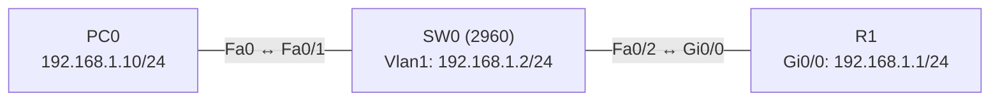

# Übung 5.1: Grundabsicherung von Geräten

| | |
|---|---|
| **Modul** | 5 – Sicherheit |
| **Stufe** | Grundlage |
| **Geschätzte Zeit** | ca. 45–60 Minuten |
| **Werkzeug** | Cisco Packet Tracer |
| **Vorwissen** | Übung 1.2 (Router-Interfaces), Übung 2.1 (Switch-Grundlagen) |

> **Stand der Prüfung:** Entwurf. Der Befehl `username … secret` ist durch ein Cisco-Dokument belegt (siehe Quellen). Alle anderen Befehle (`enable secret`, `line console`, `line vty`, `password`, `login`, `service password-encryption`, `banner motd`, `shutdown` auf Port-Bereichen) sind allgemeines Cisco-IOS-Wissen und hier nicht aus einer Quelle im Wortlaut belegt. **Nicht bestätigt** sind alle Ausgaben, die Meldung bei fehlendem VTY-Passwort, das Telnet-Fenster des PCs und alle GUI-Wege. Alle Passwörter in dieser Übung sind reine Übungswerte.

## Lernziele

Nach dieser Übung kannst du

- den privilegierten Modus mit `enable secret` schützen,
- Konsole und VTY-Zugang (Telnet) mit Passwort sichern,
- erklären, warum `enable secret` besser ist als `enable password`, und was `service password-encryption` leistet und nicht leistet,
- ein Warn-Banner einrichten,
- ungenutzte Switch-Ports abschalten und das prüfen,
- mit `show running-config` kontrollieren, welche Zugangsdaten im Klartext stehen.

## Voraussetzungen

Du kannst Router und Switch grundlegend konfigurieren. Bisher waren alle Geräte ohne Passwort zugänglich.

## Grundbegriffe

| Begriff | Bedeutung |
|---|---|
| Konsole (console) | Direkter Zugang über Kabel am Gerät. |
| VTY | *Virtual Teletype*: Leitungen für den Fernzugang per Telnet oder SSH (`line vty 0 4` = fünf gleichzeitige Sitzungen). |
| `enable secret` | Passwort für den privilegierten Modus, als Hash gespeichert. |
| `enable password` | Älteres Passwort im Klartext (nur ohne `secret` wirksam). |
| Typ 7 | Schwache, umkehrbare Verschleierung durch `service password-encryption`. Kein Ersatz für starke Passwörter. |
| Banner | Text, der beim Anmelden erscheint (rechtlicher Hinweis, kein Willkommensgruß). |
| Härten (Hardening) | Unnötige Zugänge und Dienste abschalten. |

> **Merksatz:** Jede Zugangsart (Konsole, VTY, privilegierter Modus) braucht ein eigenes Passwort. Was nicht gebraucht wird, wird abgeschaltet.

## Topologie und Adressplan



| Gerät | Port / Interface | IP-Adresse | Subnetzmaske | Default Gateway |
|---|---|---|---|---|
| PC0 | FastEthernet0 | `192.168.1.10` | `255.255.255.0` | `192.168.1.1` |
| R1 | `GigabitEthernet0/0` | `192.168.1.1` | `255.255.255.0` | – |
| SW0 | `Vlan1` (SVI) | `192.168.1.2` | `255.255.255.0` | `192.168.1.1` |

Übungswerte für die Zugänge: `enable secret` = `Cisco-Uebung1`, Konsole = `Konsole-1`, VTY = `Telnet-1`.

## Aufgabe

> **Schema dieser Übungsreihe: zwei Wege pro Schritt.** Wo es in Packet Tracer keinen CLI-Weg gibt (Geräte platzieren, verkabeln, PC-Adressen), steht das ausdrücklich dabei. Alle Befehle stehen in Codeblöcken. Die CLI-Befehle und GUI-Wege sind in dieser Entwurfsfassung noch nicht in Packet Tracer bestätigt.

**1. Neues Projekt beginnen** und Geräte platzieren: ein Router (*1941*), ein Switch (*2960*), ein PC

- **GUI:** *File* → *New*, Geräte aus der Geräteauswahl ziehen.
- **CLI:** Entfällt (nur grafisch möglich).

**2. Verkabeln** mit *Copper Straight-Through*: PC0 → SW0 `Fa0/1`, SW0 `Fa0/2` → R1 `Gi0/0`

- **GUI:** Kategorie *Connections*, Kabeltyp anklicken, beide Geräte anklicken, Ports wählen.
- **CLI:** Entfällt (Kabel gibt es nur grafisch).

**3. Adressen einrichten** (Plan oben)

- **GUI:** PC0 → *Desktop* → *IP Configuration*. R1 → *Config* → *GigabitEthernet0/0* (*Port Status* *On*). Beim Switch gibt es die SVI nur in der CLI.
- **CLI:** R1:
  ```text
  Router> enable
  Router# configure terminal
  Router(config)# hostname R1
  R1(config)# interface gigabitethernet 0/0
  R1(config-if)# ip address 192.168.1.1 255.255.255.0
  R1(config-if)# no shutdown
  R1(config-if)# end
  ```
  SW0:
  ```text
  Switch> enable
  Switch# configure terminal
  Switch(config)# hostname SW0
  SW0(config)# interface vlan 1
  SW0(config-if)# ip address 192.168.1.2 255.255.255.0
  SW0(config-if)# no shutdown
  SW0(config-if)# exit
  SW0(config)# ip default-gateway 192.168.1.1
  SW0(config)# end
  ```

**4. Vorher prüfen: alles offen**

- **GUI:** R1 anklicken → *CLI*: Du kommst ohne Passwort bis in den privilegierten Modus.
- **CLI:** Auf R1:
  ```text
  R1> enable
  R1# show running-config
  ```
  Es gibt keinen Passwortschutz. Notiere, welche Abschnitte (`line con 0`, `line vty 0 4`) leer sind.

**5. Privilegierten Modus schützen**

- **GUI:** Router → *Config* → *Global* → *Settings*: Eingaben für ein Passwort sind eingeschränkt, nutze die CLI.
- **CLI:** Auf R1:
  ```text
  R1# configure terminal
  R1(config)# enable secret Cisco-Uebung1
  ```
  Teste: `exit`, dann wieder `enable`. Jetzt wird das Passwort verlangt (nicht bestätigt).

**6. Konsole schützen**

- **GUI:** Entfällt (nur CLI).
- **CLI:**
  ```text
  R1(config)# line console 0
  R1(config-line)# password Konsole-1
  R1(config-line)# login
  R1(config-line)# exec-timeout 5 0
  R1(config-line)# logging synchronous
  R1(config-line)# exit
  ```
  `exec-timeout 5 0` meldet die Sitzung nach 5 Minuten Inaktivität ab, `logging synchronous` verhindert, dass Systemmeldungen die Eingabe zerreißen.

**7. VTY (Telnet) schützen**

- **GUI:** Entfällt (nur CLI).
- **CLI:**
  ```text
  R1(config)# line vty 0 4
  R1(config-line)# password Telnet-1
  R1(config-line)# login
  R1(config-line)# exit
  ```

**8. Telnet vom PC aus testen**

- **GUI:** PC0 → *Desktop* → *Telnet / SSH Client*: *Connection Type* *Telnet*, *Host* `192.168.1.1`, *Connect*.
- **CLI:** Im *Command Prompt* von PC0:
  ```text
  PC> telnet 192.168.1.1
  ```
  Nach der Passwortabfrage (`Telnet-1`) landest du im Benutzermodus von R1. Mit `enable` und `Cisco-Uebung1` kommst du in den privilegierten Modus. Beende mit `exit`.

**9. Gegenprobe: VTY ohne Passwort**

- **GUI:** Entfällt.
- **CLI:** Auf R1 das VTY-Passwort entfernen und erneut per Telnet verbinden:
  ```text
  R1(config)# line vty 0 4
  R1(config-line)# no password
  R1(config-line)# end
  ```
  Telnet wird abgewiesen („Password required, but none set“, nicht bestätigt). Setze danach `password Telnet-1` wieder.

**10. Passwörter verschleiern**

- **GUI:** Entfällt.
- **CLI:**
  ```text
  R1# show running-config | section line
  R1# configure terminal
  R1(config)# service password-encryption
  R1(config)# end
  R1# show running-config | section line
  ```
  Vorher stehen die Passwörter im Klartext, nachher als Typ-7-Zeichenfolge. Typ 7 ist umkehrbar und kein echter Schutz. Die Ausgabe von `enable secret` ist dagegen ein Hash.

**11. Banner einrichten**

- **GUI:** Entfällt.
- **CLI:**
  ```text
  R1(config)# banner motd # Nur fuer autorisierte Benutzer. Zugriffe werden protokolliert. #
  R1(config)# end
  ```
  Verbinde per Telnet erneut: Das Banner erscheint vor der Passwortabfrage.

**12. Ungenutzte Switch-Ports abschalten**

- **GUI:** SW0 → *Config* → Port `FastEthernet0/3` bis `0/24`: *Port Status* auf *Off* (je Port einzeln).
- **CLI:** Auf SW0:
  ```text
  SW0# configure terminal
  SW0(config)# interface range fastethernet 0/3 - 24
  SW0(config-if-range)# description ungenutzt
  SW0(config-if-range)# shutdown
  SW0(config-if-range)# end
  SW0# show ip interface brief
  ```
  Die Ports 3 bis 24 stehen jetzt auf `administratively down`. `Fa0/1` und `Fa0/2` bleiben aktiv.

**13. Switch absichern und speichern**

- **GUI:** Projekt mit `Strg+S` speichern als `05.1-grundabsicherung-von-geraeten.pkt`.
- **CLI:** Auf SW0 dieselben Schritte 5, 6, 7 und 11, dann auf beiden Geräten:
  ```text
  SW0(config)# enable secret Cisco-Uebung1
  SW0(config)# line console 0
  SW0(config-line)# password Konsole-1
  SW0(config-line)# login
  SW0(config-line)# exit
  SW0(config)# line vty 0 15
  SW0(config-line)# password Telnet-1
  SW0(config-line)# login
  SW0(config-line)# end
  SW0# copy running-config startup-config
  ```
  Ein 2960 hat 16 VTY-Leitungen (`0 15`, nicht bestätigt in Packet Tracer).

## Hintergrund: Wozu die einzelnen Schritte?

1. **Drei Türen:** Ein Gerät lässt sich über die Konsole, per Fernzugang (VTY) und über den Wechsel in den privilegierten Modus bedienen. Jede Tür braucht ein eigenes Schloss.
2. **`enable secret` vs. `enable password`:** `secret` wird als Hash gespeichert, `password` im Klartext. Sind beide gesetzt, gilt `secret`.
3. **Telnet ist unverschlüsselt:** Passwörter laufen im Klartext durchs Netz. Telnet dient hier nur als Einstieg, Übung 5.2 ersetzt es durch SSH.
4. **Verschleierung:** `service password-encryption` schützt Konfigurationsdateien vor neugierigen Blicken, nicht vor Angreifern mit dem Werkzeug zum Umkehren.
5. **Angriffsfläche verkleinern:** Offene, ungenutzte Ports erlauben es, ein Gerät unbemerkt anzuschließen.
6. **Banner:** Dient als rechtlicher Hinweis, nicht als Begrüßung. Keine Details zum Gerät oder Unternehmen preisgeben.

## Hinweise

- `login` ohne Passwort sperrt die Leitung aus; `password` ohne `login` prüft kein Passwort.
- Die Passwörter in dieser Übung sind Beispiele. Im Betrieb nutzt man lange, zufällige Passwörter.
- Wer `enable secret` setzt, sollte den älteren Befehl `enable password` nicht zusätzlich verwenden.
- Konfigurationsänderungen gelten nur im laufenden Betrieb, bis sie mit `copy running-config startup-config` gespeichert werden.
- Der Switch braucht für den Fernzugang eine Adresse (SVI) und ein Default Gateway, wenn er aus anderen Netzen erreichbar sein soll.

## Prüfbefehle

Am Router / Switch (CLI):

```text
R1> enable
R1# show running-config
R1# show running-config | section line
R1# show running-config | include enable
R1# show ip interface brief
R1# show users
```

| CLI-Befehl | Was er zeigt | GUI-Weg |
|---|---|---|
| `show running-config \| section line` | Zeilen `line con 0` und `line vty` mit Passwort und `login` | Router → *Config* → *Running Config* |
| `show running-config \| include enable` | `enable secret` (Hash) bzw. `enable password` | – |
| `show ip interface brief` | Status der Ports (`administratively down` bei abgeschalteten) | Switch → *Config* → Port |
| `show users` | Aktive Sitzungen (Konsole, VTY) | – |

**Kontrollfragen**

1. Welche drei Zugangsarten brauchen ein Passwort?
2. Warum ist `enable secret` besser als `enable password`?
3. Was leistet `service password-encryption`, und was nicht?
4. Warum schaltet man ungenutzte Ports ab?
5. Warum ist Telnet für den Fernzugang unsicher?

## Erweiterungen

- **Mindestlänge:** `security passwords min-length 8` ausprobieren und ein zu kurzes Passwort setzen (nicht bestätigt in Packet Tracer).
- **Zugriffe zählen:** `show users` während einer Telnet-Sitzung.
- **Sperren nach Fehlversuchen:** `login block-for 60 attempts 3 within 30` (nicht bestätigt).
- **Weiter:** Übung 5.2 ersetzt Telnet durch SSH.

---

## Musterlösung

<details>
<summary>Musterlösung anzeigen</summary>

**Router (Auszug):**

```text
hostname R1
!
enable secret Cisco-Uebung1
service password-encryption
!
banner motd # Nur fuer autorisierte Benutzer. Zugriffe werden protokolliert. #
!
line con 0
 password Konsole-1
 login
 exec-timeout 5 0
 logging synchronous
line vty 0 4
 password Telnet-1
 login
```

Mit `service password-encryption` erscheinen die Passwörter in `show running-config` als Typ-7-Folge (`password 7 …`). `enable secret` erscheint als Hash.

**Switch:** Dieselbe Absicherung, `interface range fastethernet 0/3 - 24` mit `shutdown`, SVI `192.168.1.2` mit `ip default-gateway 192.168.1.1`.

**Telnet (Schritt 8):** `telnet 192.168.1.1` fragt nach dem VTY-Passwort, dann `enable` mit dem Secret.

**Gegenprobe (Schritt 9):** Ohne VTY-Passwort lehnt der Router die Telnet-Sitzung ab (nicht bestätigt).

**Ports (Schritt 12):** `show ip interface brief` zeigt `administratively down` für `FastEthernet0/3` bis `0/24`.

**Antworten auf die Kontrollfragen:**

1. Konsole, VTY (Fernzugang) und der privilegierte Modus (`enable`).
2. Es wird als Hash gespeichert und nicht im Klartext.
3. Es verschleiert Klartext-Passwörter in der Konfiguration (Typ 7); es ist umkehrbar und schützt nicht vor Angreifern.
4. Ein ungenutzter, aktiver Port erlaubt, unbemerkt ein Gerät anzuschließen.
5. Telnet sendet Benutzername und Passwort im Klartext; wer mitliest, sieht sie.

</details>

---

## Quellen

- Cisco, *Configuring Secure Shell on Routers and Switches Running Cisco IOS* ([cisco.com](https://www.cisco.com/c/de_de/support/docs/security-vpn/secure-shell-ssh/4145-ssh.html)): Format `username … secret …` und Aufbau der VTY-Konfiguration (`line vty 0 4`, `login local`, `transport input ssh`). Die übrigen Befehle dieser Übung kommen nicht aus dieser Quelle.
- `enable secret`, `line console`, `password`, `login`, `exec-timeout`, `banner motd`, `service password-encryption`, `shutdown` und die Aussagen zu Typ 7 und Hash: allgemeines Cisco-IOS-Wissen, hier nicht aus einer Quelle im Wortlaut belegt.
- Die gezeigten Ausgaben sind ein konstruiertes Beispiel im IOS-Format und nicht aus Packet Tracer übernommen.

---

Lizenz: [CC BY-NC-SA 4.0](https://creativecommons.org/licenses/by-nc-sa/4.0/deed.de), Urheber: AnsibleArtisan4711. Cisco, Cisco IOS und Cisco Packet Tracer sind Marken von Cisco Systems, Inc. und/oder ihrer Tochtergesellschaften; dieses Dokument steht in keiner Verbindung zu Cisco.
