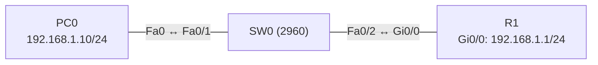

# Übung 5.2: SSH statt Telnet

| | |
|---|---|
| **Modul** | 5 – Sicherheit |
| **Stufe** | Aufbau |
| **Geschätzte Zeit** | ca. 45–60 Minuten |
| **Werkzeug** | Cisco Packet Tracer |
| **Vorwissen** | Übung 5.1 (Grundabsicherung, Telnet) |

> **Stand der Prüfung:** Entwurf. Die Befehle `username … privilege 15 secret …`, `ip domain name`, `ip ssh version 2`, `crypto key generate rsa general-keys modulus …`, `line vty 0 4`, `login local`, `transport input ssh`, `show ip ssh` und `show ssh` sind durch ein Cisco-Dokument belegt (siehe Quellen). **Nicht bestätigt** sind in Packet Tracer die zulässige Schlüssellänge (die Quelle nennt 4096 als Beispiel), der Befehl `ssh -l` am PC, der SSH-Modus des *Telnet / SSH Client*, alle gezeigten Meldungen und Ausgaben sowie alle GUI-Wege.

## Lernziele

Nach dieser Übung kannst du

- erklären, warum SSH Telnet ersetzt,
- auf einem Router Voraussetzungen für SSH schaffen (Hostname, Domain, RSA-Schlüssel, lokaler Benutzer),
- den VTY-Zugang auf SSH beschränken und Telnet sperren,
- sich per SSH vom PC aus anmelden,
- mit `show ip ssh` die Konfiguration prüfen,
- die typischen Fehlerbilder (fehlende Domain, kein Schlüssel, falscher Benutzer) erkennen.

## Voraussetzungen

Übung 5.1. Dort lief der Fernzugang über Telnet im Klartext.

## Grundbegriffe

| Begriff | Bedeutung |
|---|---|
| SSH | *Secure Shell*. Verschlüsselter Fernzugang. |
| RSA-Schlüsselpaar | Öffentlicher und privater Schlüssel, mit denen das Gerät sich ausweist und die Sitzung aufbaut. |
| Modulus | Schlüssellänge in Bit (z. B. 1024, 2048). Länger ist sicherer. |
| Lokale Benutzerdatenbank | Benutzer, die mit `username` auf dem Gerät angelegt sind. |
| `login local` | Anmeldung an der Leitung mit Benutzername und Passwort aus der lokalen Datenbank. |
| `transport input ssh` | Erlaubt auf der Leitung nur SSH (kein Telnet). |
| Privilege 15 | Höchste Berechtigungsstufe, die Anmeldung landet direkt im privilegierten Modus. |

> **Merksatz:** Ohne Hostname, Domain und RSA-Schlüssel kein SSH. Ohne `transport input ssh` bleibt Telnet offen.

## Topologie und Adressplan



| Gerät | Port / Interface | IP-Adresse | Subnetzmaske | Default Gateway |
|---|---|---|---|---|
| PC0 | FastEthernet0 | `192.168.1.10` | `255.255.255.0` | `192.168.1.1` |
| R1 | `GigabitEthernet0/0` | `192.168.1.1` | `255.255.255.0` | – |

Übungswerte: Domain `uebung.lan`, Benutzer `admin`, Passwort `Ssh-Uebung1`.

## Aufgabe

> **Schema dieser Übungsreihe: zwei Wege pro Schritt.** Wo es in Packet Tracer keinen CLI-Weg gibt (Geräte platzieren, verkabeln, PC-Adressen), steht das ausdrücklich dabei. Alle Befehle stehen in Codeblöcken. Die CLI-Befehle und GUI-Wege sind in dieser Entwurfsfassung noch nicht in Packet Tracer bestätigt.

**1. Neues Projekt beginnen** und Geräte platzieren: ein Router (*1941*), ein Switch (*2960*), ein PC. Verkabeln mit *Copper Straight-Through* (PC0 → SW0 `Fa0/1`, SW0 `Fa0/2` → R1 `Gi0/0`)

- **GUI:** *File* → *New*, Geräte ziehen, unter *Connections* verkabeln.
- **CLI:** Entfällt (nur grafisch möglich).

**2. Adressen und Basis-Telnet wie in Übung 5.1**

- **GUI:** PC0 → *IP Configuration*. R1 → *Config* → *GigabitEthernet0/0*.
- **CLI:** Auf R1:
  ```text
  Router> enable
  Router# configure terminal
  Router(config)# hostname R1
  R1(config)# interface gigabitethernet 0/0
  R1(config-if)# ip address 192.168.1.1 255.255.255.0
  R1(config-if)# no shutdown
  R1(config-if)# exit
  R1(config)# enable secret Cisco-Uebung1
  R1(config)# line vty 0 4
  R1(config-line)# password Telnet-1
  R1(config-line)# login
  R1(config-line)# end
  ```
  Teste vom PC aus `telnet 192.168.1.1` (klappt).

**3. Domain festlegen**

- **GUI:** Entfällt (nur CLI).
- **CLI:**
  ```text
  R1# configure terminal
  R1(config)# ip domain name uebung.lan
  ```

**4. Gegenprobe: Schlüssel ohne Domain**

- **GUI:** Entfällt.
- **CLI:** Entferne probeweise die Domain und versuche, den Schlüssel zu erzeugen:
  ```text
  R1(config)# no ip domain name
  R1(config)# crypto key generate rsa
  ```
  Ohne Domain verweigert IOS die Schlüsselerzeugung mit einem Hinweis auf den fehlenden Domainnamen (nicht bestätigt). Setze danach `ip domain name uebung.lan` wieder.

**5. RSA-Schlüssel erzeugen**

- **GUI:** Entfällt (nur CLI).
- **CLI:**
  ```text
  R1(config)# crypto key generate rsa general-keys modulus 2048
  ```
  Die Quelle nennt `modulus 4096` als Beispiel und empfiehlt die größte Länge, die die Plattform unterstützt. In Packet Tracer sind kürzere Längen üblich: Gibt es eine Fehlermeldung, nimm `1024` (nicht bestätigt).

**6. SSH-Version 2 und lokalen Benutzer festlegen**

- **GUI:** Entfällt (nur CLI).
- **CLI:**
  ```text
  R1(config)# ip ssh version 2
  R1(config)# username admin privilege 15 secret Ssh-Uebung1
  ```
  `privilege 15` führt direkt in den privilegierten Modus.

**7. VTY auf SSH umstellen**

- **GUI:** Entfällt (nur CLI).
- **CLI:**
  ```text
  R1(config)# line vty 0 4
  R1(config-line)# login local
  R1(config-line)# transport input ssh
  R1(config-line)# end
  ```
  `login local` ersetzt das gemeinsame VTY-Passwort durch Benutzername und Passwort.

**8. SSH-Verbindung vom PC aus**

- **GUI:** PC0 → *Desktop* → *Telnet / SSH Client*: *Connection Type* *SSH*, *Host* `192.168.1.1`, *Username* `admin`, *Connect*. Passwort `Ssh-Uebung1`.
- **CLI:** Im *Command Prompt* von PC0:
  ```text
  PC> ssh -l admin 192.168.1.1
  ```
  Nach dem Passwort landest du im privilegierten Modus von R1 (`R1#`).

**9. Telnet ist jetzt gesperrt**

- **GUI:** *Telnet / SSH Client*, *Connection Type* *Telnet*.
- **CLI:** Im *Command Prompt*:
  ```text
  PC> telnet 192.168.1.1
  ```
  Die Verbindung wird abgelehnt (nicht bestätigt: Meldung „Connection refused by remote host“ o. Ä.).

**10. SSH prüfen**

- **GUI:** Entfällt.
- **CLI:** Auf R1:
  ```text
  R1# show ip ssh
  R1# show ssh
  ```
  `show ip ssh` zeigt, dass SSH aktiv ist und welche Version gilt. `show ssh` zeigt die laufenden Sitzungen. Verbinde dich dazu erneut per SSH und rufe den Befehl in einem zweiten Fenster auf.

**11. Gegenprobe: falscher Benutzer**

- **GUI:** *Telnet / SSH Client* mit Benutzer `falsch`.
- **CLI:**
  ```text
  PC> ssh -l falsch 192.168.1.1
  ```
  Die Anmeldung schlägt fehl (nicht bestätigt).

**12. Speichern**

- **GUI:** `Strg+S` als `05.2-ssh-statt-telnet.pkt`.
- **CLI:**
  ```text
  R1# copy running-config startup-config
  ```

## Hintergrund: Was macht SSH sicher?

1. **Schlüsselpaar:** Der Router erzeugt ein RSA-Schlüsselpaar. Aus Hostname und Domain bildet er den Namen des Schlüssels (`R1.uebung.lan`), deshalb sind beide Voraussetzung.
2. **Verbindungsaufbau:** Der Client erhält den öffentlichen Schlüssel des Routers und handelt eine verschlüsselte Sitzung aus. Danach laufen alle Eingaben und Passwörter verschlüsselt.
3. **Anmeldung:** Mit `login local` prüft der Router Benutzername und Passwort in seiner lokalen Datenbank.
4. **Telnet sperren:** `transport input ssh` lässt nur SSH zu. Mit `transport input telnet ssh` wären beide erlaubt.
5. **Version 2:** SSH Version 1 hat bekannte Schwächen. `ip ssh version 2` erlaubt nur die neuere Version.

## Hinweise

- Die Reihenfolge ist wichtig: erst Hostname und Domain, dann Schlüssel. Ein Schlüssel, der vor der Domain erzeugt wurde, trägt den falschen Namen.
- `login local` verlangt mindestens einen `username`. Ohne Benutzer kommt niemand mehr über VTY herein; die Konsole bleibt als Notzugang.
- `secret` speichert das Passwort als Hash, nicht umkehrbar.
- Schlüssel lassen sich mit `crypto key zeroize rsa` löschen, SSH ist dann nicht mehr verfügbar.
- Ein größerer Schlüssel erhöht die Dauer der Erzeugung.

## Prüfbefehle

Am Router (CLI):

```text
R1> enable
R1# show ip ssh
R1# show ssh
R1# show running-config | section line vty
R1# show running-config | include username
R1# show crypto key mypubkey rsa
```

| CLI-Befehl | Was er zeigt | GUI-Weg |
|---|---|---|
| `show ip ssh` | SSH aktiv, Version, Zeitlimits | – (nur CLI) |
| `show ssh` | Laufende SSH-Sitzungen | – |
| `show running-config \| section line vty` | `login local` und `transport input ssh` | Router → *Config* → *Running Config* |
| `show crypto key mypubkey rsa` | Öffentlicher Schlüssel und seine Länge | – |

**Kontrollfragen**

1. Was ist der Hauptunterschied zwischen Telnet und SSH?
2. Welche Voraussetzungen müssen vor dem Erzeugen des RSA-Schlüssels erfüllt sein?
3. Was bewirken `login local` und `transport input ssh`?
4. Wie sperrst du Telnet, ohne SSH zu verlieren?
5. Woran erkennst du mit `show ip ssh`, ob SSH läuft?

## Erweiterungen

- **Zeitlimit und Versuche:** `ip ssh time-out 60` und `ip ssh authentication-retries 2` (nicht bestätigt).
- **Mehrere Benutzer:** Einen zweiten Benutzer mit niedrigerer Berechtigung (`privilege 1`) anlegen und die Sitzung vergleichen.
- **Zugriff beschränken:** Nur Adressen eines bestimmten Netzes zulassen, mit einer Standard-ACL auf der VTY-Leitung (`access-class`, nach Übung 5.4, nicht bestätigt).
- **Weiter:** Übung 5.3 sichert die Switch-Ports.

---

## Musterlösung

<details>
<summary>Musterlösung anzeigen</summary>

**Router (SSH-Teil):**

```text
R1(config)# ip domain name uebung.lan
R1(config)# crypto key generate rsa general-keys modulus 2048
R1(config)# ip ssh version 2
R1(config)# username admin privilege 15 secret Ssh-Uebung1
R1(config)# line vty 0 4
R1(config-line)# login local
R1(config-line)# transport input ssh
```

**Test (Schritt 8):** `ssh -l admin 192.168.1.1` fragt nach dem Passwort und führt in den privilegierten Modus. Der Prompt zeigt `R1#`.

**Telnet gesperrt (Schritt 9):** Die Verbindung wird abgelehnt.

**Prüfung (Schritt 10, sinngemäß, nicht bestätigt):**

```text
R1# show ip ssh
SSH Enabled - version 2.0
Authentication timeout: 120 secs; Authentication retries: 3
```

**Antworten auf die Kontrollfragen:**

1. SSH verschlüsselt die gesamte Sitzung inklusive Passwort, Telnet sendet alles im Klartext.
2. Hostname (nicht der Standardname) und Domainname müssen gesetzt sein.
3. `login local` prüft Benutzer und Passwort in der lokalen Datenbank, `transport input ssh` erlaubt nur SSH auf der Leitung.
4. Mit `transport input ssh` auf den VTY-Leitungen.
5. Die erste Zeile nennt `SSH Enabled` samt Version; ist SSH nicht aktiv, steht dort `SSH Disabled`.

</details>

---

## Quellen

- Cisco, *Configuring Secure Shell on Routers and Switches Running Cisco IOS* ([cisco.com](https://www.cisco.com/c/de_de/support/docs/security-vpn/secure-shell-ssh/4145-ssh.html)): Befehlsfolge `hostname`, `username cisco privilege 15 secret …`, `ip domain name …`, `ip ssh version 2`, `crypto key generate rsa general-keys modulus 4096`, `line vty 0 4`, `login local`, `transport input ssh`; Prüfung mit `show ip ssh` und `show ssh`; Empfehlung, die größte unterstützte Schlüssellänge zu wählen.
- `crypto key zeroize rsa`, `show crypto key mypubkey rsa`, `ssh -l` am Packet-Tracer-PC und die Meldungen beim Fehlen von Domain, Benutzer oder Telnet-Zugang: nicht aus der genannten Quelle belegt.
- Die gezeigten Ausgaben sind ein konstruiertes Beispiel im IOS-Format und nicht aus Packet Tracer übernommen.

---

Lizenz: [CC BY-NC-SA 4.0](https://creativecommons.org/licenses/by-nc-sa/4.0/deed.de), Urheber: AnsibleArtisan4711. Cisco, Cisco IOS und Cisco Packet Tracer sind Marken von Cisco Systems, Inc. und/oder ihrer Tochtergesellschaften; dieses Dokument steht in keiner Verbindung zu Cisco.
