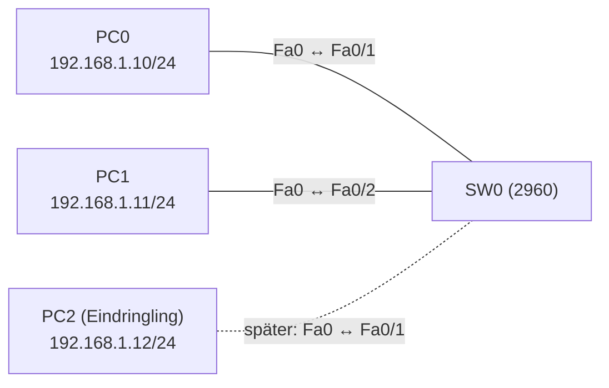

# Übung 5.3: Port Security

| | |
|---|---|
| **Modul** | 5 – Sicherheit |
| **Stufe** | Aufbau |
| **Geschätzte Zeit** | ca. 45–60 Minuten |
| **Werkzeug** | Cisco Packet Tracer |
| **Vorwissen** | Übung 2.1 (Access-Ports), Übung 5.1 (Ports abschalten) |

> **Stand der Prüfung:** Entwurf. Die Befehle `switchport mode access`, `switchport port-security`, `switchport port-security maximum`, `switchport port-security mac-address`, `show port-security interface` und das Verhalten im Modus `shutdown` (Meldungen, Zustand `err-disabled`, Wiederherstellung mit `shutdown` und `no shutdown`) sind durch ein Tutorial belegt (siehe Quellen). **Nicht belegt** sind `switchport port-security mac-address sticky`, `switchport port-security violation restrict|protect`, `errdisable recovery` und das globale `show port-security`. Nicht bestätigt ist außerdem, wie Packet Tracer ein Umstecken eines Geräts darstellt, ob die Meldungen und Zähler wie im Tutorial erscheinen und alle GUI-Wege.

## Lernziele

Nach dieser Übung kannst du

- erklären, was Port Security schützt und wogegen sie nicht hilft,
- einen Access-Port auf eine feste MAC-Adresse und auf eine Höchstzahl begrenzen,
- die drei Verletzungsmodi `shutdown`, `restrict` und `protect` unterscheiden,
- Sticky-Learning einsetzen,
- einen ausgesperrten Port (`err-disabled`) wiederherstellen,
- mit `show port-security interface` Zustand, Zähler und Adressen lesen.

## Voraussetzungen

Access-Ports und MAC-Adressen kennst du aus Modul 1 und 2. Hier lernt der Switch, **welche** Geräte an einem Port erlaubt sind.

## Grundbegriffe

| Begriff | Bedeutung |
|---|---|
| Port Security | Funktion am Access-Port, die erlaubte MAC-Adressen begrenzt. |
| Secure MAC | MAC-Adresse, die der Port als erlaubt führt. |
| Maximum | Höchstzahl erlaubter MAC-Adressen am Port (Standard 1). |
| Sticky | Der Switch lernt erlaubte Adressen automatisch aus dem ersten Verkehr und übernimmt sie in die Konfiguration. |
| Violation | Verstoß: eine nicht erlaubte MAC-Adresse sendet am Port oder das Maximum ist überschritten. |
| `shutdown` (Modus) | Port wird in den Zustand `err-disabled` gesetzt und bleibt aus. |
| `restrict` | Verstoßende Frames werden verworfen, ein Zähler und eine Meldung entstehen, der Port bleibt aktiv. |
| `protect` | Verstoßende Frames werden stumm verworfen, ohne Meldung. |

> **Merksatz:** Port Security schützt vor einem *angeschlossenen unbekannten Gerät*, nicht vor einem Gerät, das eine erlaubte MAC-Adresse fälscht.

## Topologie und Adressplan



| Gerät | Port / Interface | IP-Adresse | Subnetzmaske |
|---|---|---|---|
| PC0 | FastEthernet0 | `192.168.1.10` | `255.255.255.0` |
| PC1 | FastEthernet0 | `192.168.1.11` | `255.255.255.0` |
| PC2 | FastEthernet0 | `192.168.1.12` | `255.255.255.0` |

Kein Router. Ein einziger Switch mit Standard-VLAN 1. PC2 ist zunächst nicht angeschlossen.

## Aufgabe

> **Schema dieser Übungsreihe: zwei Wege pro Schritt.** Wo es in Packet Tracer keinen CLI-Weg gibt (Geräte platzieren, verkabeln, PC-Adressen, Umstecken), steht das ausdrücklich dabei. Alle Befehle stehen in Codeblöcken. Die CLI-Befehle und GUI-Wege sind in dieser Entwurfsfassung noch nicht in Packet Tracer bestätigt.

**1. Neues Projekt beginnen** und Geräte platzieren: ein Switch (*2960*), drei PCs

- **GUI:** *File* → *New*, Geräte ziehen.
- **CLI:** Entfällt (nur grafisch möglich).

**2. Verkabeln** mit *Copper Straight-Through*: PC0 → SW0 `Fa0/1`, PC1 → SW0 `Fa0/2`. PC2 vorerst nur platzieren

- **GUI:** Kategorie *Connections*, Kabeltyp anklicken, beide Geräte anklicken, Ports wählen.
- **CLI:** Entfällt (Kabel gibt es nur grafisch).

**3. Adressen vergeben** (Plan oben)

- **GUI:** PC → *Desktop* → *IP Configuration*.
- **CLI:** Entfällt (die PCs haben keine IOS-CLI).

**4. Vorher testen**

- **GUI:** *Add Simple PDU*: PC0 → PC1.
- **CLI:** Am PC0:
  ```text
  PC> ping 192.168.1.11
  ```
  Der Ping klappt (der erste Versuch kann wegen ARP verloren gehen).

**5. MAC-Adressen der PCs ermitteln**

- **GUI:** PC → *Desktop* → *IP Configuration* oder *Config* → *FastEthernet0*: Feld *MAC Address*.
- **CLI:** Am PC:
  ```text
  PC> ipconfig /all
  ```
  Auf dem Switch:
  ```text
  SW0> enable
  SW0# show mac address-table
  ```
  Notiere die MAC-Adresse von PC0 (`Fa0/1`) und PC1 (`Fa0/2`).

**6. Port Security mit fester MAC einschalten**

- **GUI:** Entfällt (nur CLI).
- **CLI:** Auf SW0 für `Fa0/1`:
  ```text
  SW0# configure terminal
  SW0(config)# interface fastethernet 0/1
  SW0(config-if)# switchport mode access
  SW0(config-if)# switchport port-security
  SW0(config-if)# switchport port-security maximum 1
  SW0(config-if)# switchport port-security mac-address <MAC von PC0>
  SW0(config-if)# end
  ```
  Ersetze `<MAC von PC0>` durch die notierte Adresse im Format `aaaa.bbbb.cccc`. `switchport mode access` ist Voraussetzung.

**7. Zustand ansehen**

- **GUI:** Entfällt.
- **CLI:**
  ```text
  SW0# show port-security interface fastethernet 0/1
  ```
  Du siehst `Port Security: Enabled`, `Violation Mode: Shutdown`, `Maximum MAC Addresses: 1`. Der Wert `Security Violation Count` ist 0.

**8. Verstoß auslösen**

- **GUI:** Kabel von PC0 zu `Fa0/1` entfernen und PC2 mit `Fa0/1` verbinden (*Copper Straight-Through*). Setze `192.168.1.12` und pinge dann `192.168.1.11`.
- **CLI:** Am PC2:
  ```text
  PC> ping 192.168.1.11
  ```
  Der Switch setzt `Fa0/1` auf `err-disabled`. Es erscheinen Meldungen wie `%PM-4-ERR_DISABLE: psecure-violation error detected on Fa0/1` und `%PORT_SECURITY-2-PSECURE_VIOLATION` (Format laut Tutorial, in Packet Tracer nicht bestätigt).

**9. Folgen prüfen**

- **GUI:** Der Link-Punkt am Port wird rot.
- **CLI:** Auf SW0:
  ```text
  SW0# show port-security interface fastethernet 0/1
  SW0# show interfaces fastethernet 0/1
  SW0# show ip interface brief
  ```
  `Port Status` ist `Secure-shutdown`, der Zähler `Security Violation Count` ist größer als 0, die Schnittstelle `down (err-disabled)`.

**10. Port wiederherstellen**

- **GUI:** Entfällt.
- **CLI:** Zuerst den ursprünglichen PC0 wieder anschließen, dann:
  ```text
  SW0# configure terminal
  SW0(config)# interface fastethernet 0/1
  SW0(config-if)# shutdown
  SW0(config-if)# no shutdown
  SW0(config-if)# end
  ```
  Laut Tutorial genügt `no shutdown` allein nicht, es braucht erst `shutdown` und dann `no shutdown`. Teste den Ping erneut.

**11. Sticky-Learning an Port 2**

- **GUI:** Entfällt (nur CLI).
- **CLI:** Auf SW0 für `Fa0/2` (nicht belegt in der genutzten Quelle):
  ```text
  SW0(config)# interface fastethernet 0/2
  SW0(config-if)# switchport mode access
  SW0(config-if)# switchport port-security
  SW0(config-if)# switchport port-security maximum 1
  SW0(config-if)# switchport port-security mac-address sticky
  SW0(config-if)# end
  ```
  Sende einen Ping von PC1, damit der Switch die MAC lernt. Prüfe `show port-security interface fastethernet 0/2` und `show running-config interface fastethernet 0/2`: Die gelernte Adresse steht als `sticky` in der Konfiguration.

**12. Verletzungsmodus ändern**

- **GUI:** Entfällt.
- **CLI:** Auf SW0 für `Fa0/2` (nicht belegt):
  ```text
  SW0(config)# interface fastethernet 0/2
  SW0(config-if)# switchport port-security violation restrict
  SW0(config-if)# end
  ```
  Stecke PC2 an `Fa0/2` und pinge. Der Port bleibt aktiv, die Frames von PC2 werden verworfen, der Zähler steigt (nicht bestätigt). Teste auch `protect`.

**13. Speichern**

- **GUI:** `Strg+S` als `05.3-port-security.pkt`.
- **CLI:**
  ```text
  SW0# copy running-config startup-config
  ```

## Hintergrund: Wie arbeitet Port Security?

1. **Lernen:** Der Switch lernt MAC-Adressen über die Quelladresse der Frames. Port Security begrenzt, **wie viele** und **welche** er an diesem Port zulässt.
2. **Prüfen:** Kommt ein Frame mit einer nicht erlaubten Quelladresse oder wird das Maximum überschritten, liegt ein Verstoß vor.
3. **Reaktion:** Der Modus legt fest, was passiert: `shutdown` schaltet den Port ab (sicherste Variante, Port muss manuell zurückgesetzt werden), `restrict` verwirft und meldet, `protect` verwirft still.
4. **Sticky:** Der Switch schreibt gelernte Adressen als `switchport port-security mac-address sticky <MAC>` in die laufende Konfiguration. Sie bleiben nach dem Speichern erhalten.
5. **Grenzen:** MAC-Adressen lassen sich fälschen. Port Security ist eine Hürde, kein vollständiger Schutz.

## Hinweise

- Die Funktion funktioniert nur an statischen Access-Ports (oder Trunks mit Zusatzeinstellung), nicht an dynamisch ausgehandelten Ports.
- Bei `maximum 1` und einer festen Adresse ist genau ein Gerät erlaubt. Ein Switch oder Access Point dahinter bringt weitere Adressen und löst Verstöße aus.
- Ein Port im Zustand `err-disabled` zeigt rotes Licht, auch wenn das Kabel in Ordnung ist.
- Automatische Wiederherstellung mit `errdisable recovery` ist möglich (laut Tutorial Standardzeit 300 Sekunden), der Befehl selbst ist hier nicht belegt.
- Port Security ersetzt nicht das Abschalten ungenutzter Ports (Übung 5.1).

## Prüfbefehle

Am Switch (CLI):

```text
SW0> enable
SW0# show port-security interface fastethernet 0/1
SW0# show port-security
SW0# show mac address-table
SW0# show interfaces fastethernet 0/1
SW0# show running-config interface fastethernet 0/1
```

| CLI-Befehl | Was er zeigt | GUI-Weg |
|---|---|---|
| `show port-security interface <Port>` | Modus, Maximum, Zähler, letzte Quelladresse, Port-Status | – (nur CLI) |
| `show port-security` | Übersicht aller geschützten Ports (nicht belegt) | – |
| `show mac address-table` | Gelernte MAC-Adressen je Port | – |
| `show interfaces <Port>` | Zustand `err-disabled` | Switch → *Config* → Port |

**Kontrollfragen**

1. Wogegen schützt Port Security, wogegen nicht?
2. Was passiert im Modus `shutdown`, und wie stellst du den Port wieder her?
3. Was ist der Unterschied zwischen `restrict` und `protect`?
4. Wozu dient `sticky`?
5. Warum hilft ein Wechsel des Kabels allein nicht, wenn der Port `err-disabled` ist?

## Erweiterungen

- **Zwei Geräte:** `maximum 2` setzen und einen kleinen Switch mit zwei PCs an den Port hängen.
- **Automatische Wiederherstellung:** `errdisable recovery cause psecure-violation` und ein Zeitintervall (nicht belegt).
- **Port Security und DHCP:** Prüfen, wie sich ein Eindringling mit festen Adressen verhält.
- **Weiter:** Übung 5.4 filtert Verkehr auf Layer 3.

---

## Musterlösung

<details>
<summary>Musterlösung anzeigen</summary>

**Fester Port (Schritt 6):**

```text
SW0(config)# interface fastethernet 0/1
SW0(config-if)# switchport mode access
SW0(config-if)# switchport port-security
SW0(config-if)# switchport port-security maximum 1
SW0(config-if)# switchport port-security mac-address 0001.AAAA.BBBB
```

Die Adresse ist ein Beispiel; nimm die von PC0.

**Zustand nach dem Verstoß (Schritt 9, Format laut Tutorial, nicht in Packet Tracer bestätigt):**

```text
SW0# show port-security interface fastethernet 0/1
Port Security              : Enabled
Port Status                : Secure-shutdown
Violation Mode             : Shutdown
Maximum MAC Addresses      : 1
Total MAC Addresses        : 1
Configured MAC Addresses   : 1
Sticky MAC Addresses       : 0
Security Violation Count   : 1
```

```text
SW0# show interfaces fastethernet 0/1
FastEthernet0/1 is down, line protocol is down (err-disabled)
```

**Wiederherstellen (Schritt 10):** `shutdown` und danach `no shutdown`, nachdem der erlaubte PC wieder angeschlossen ist.

**Sticky (Schritt 11, nicht belegt):** Nach dem ersten Ping steht in `show running-config interface fastethernet 0/2` eine Zeile `switchport port-security mac-address sticky <MAC>`.

**Modi (Schritt 12, nicht belegt):** `restrict` und `protect` halten den Port aktiv. `restrict` erhöht den Zähler und meldet, `protect` verwirft still.

**Antworten auf die Kontrollfragen:**

1. Sie schützt vor dem Anschluss unbekannter Geräte an einen Port; sie schützt nicht vor gefälschten (kopierten) MAC-Adressen.
2. Der Port geht in `err-disabled` und bleibt aus. Wiederherstellung mit `shutdown` und anschließend `no shutdown`.
3. Beide verwerfen verstoßende Frames. `restrict` zählt und meldet, `protect` verwirft ohne Meldung und Zähler.
4. Der Switch lernt die erlaubte MAC-Adresse selbst und schreibt sie in die Konfiguration.
5. Der Port ist per Software abgeschaltet. Erst `shutdown`/`no shutdown` (oder automatische Wiederherstellung) schaltet ihn wieder ein.

</details>

---

## Quellen

- Networklessons, *How to configure port-security on Cisco Switch* ([networklessons.com](https://networklessons.com/switching/how-to-configure-port-security-on-cisco-switch)): `switchport mode access`, `switchport port-security`, `switchport port-security maximum 1`, `switchport port-security mac-address <MAC>`; Meldungen `%PM-4-ERR_DISABLE`, `%PORT_SECURITY-2-PSECURE_VIOLATION`; Ausgabe von `show port-security interface`; Zustand `err-disabled`; Wiederherstellung mit `shutdown` und `no shutdown`; Erwähnung von `errdisable recovery` mit Standardzeit 300 Sekunden. Die Seite nennt die Modi `restrict` und `protect` und Sticky-Learning, zeigt aber keine Befehle dafür.
- `switchport port-security mac-address sticky`, `switchport port-security violation restrict|protect`, `errdisable recovery cause …`, `show port-security` und das Verhalten in Packet Tracer: nicht aus der genannten Quelle belegt.
- Die gezeigten Ausgaben folgen dem Format der Quelle oder sind konstruierte Beispiele und nicht aus Packet Tracer übernommen.

---

Lizenz: [CC BY-NC-SA 4.0](https://creativecommons.org/licenses/by-nc-sa/4.0/deed.de), Urheber: AnsibleArtisan4711. Cisco, Cisco IOS und Cisco Packet Tracer sind Marken von Cisco Systems, Inc. und/oder ihrer Tochtergesellschaften; dieses Dokument steht in keiner Verbindung zu Cisco.
