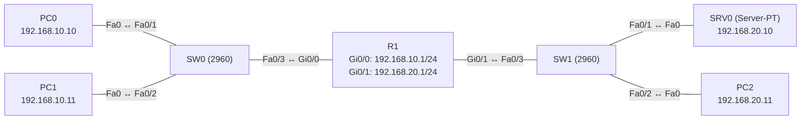

# Übung 5.4: Standard-ACLs

| | |
|---|---|
| **Modul** | 5 – Sicherheit |
| **Stufe** | Aufbau |
| **Geschätzte Zeit** | ca. 60–75 Minuten |
| **Werkzeug** | Cisco Packet Tracer |
| **Vorwissen** | Übung 1.2 (zwei Netze und ein Router), Übung 1.3 (Subnetting, Wildcard-Maske aus Übung 3.5) |

> **Stand der Prüfung:** Entwurf. Die Befehle `access-list` (Standard, Nummern 1–99), `ip access-list standard`, `ip access-group … in|out`, `show access-lists` und `show ip interface` sind allgemeines Cisco-IOS-Wissen und hier nicht aus einer Quelle im Wortlaut belegt. Das Muster `access-list 7 permit 10.10.10.0 0.0.0.255` ist in einem Cisco-NAT-Dokument belegt (siehe Quellen). **Nicht bestätigt** sind alle gezeigten Ausgaben (Trefferzähler), das Verhalten von Pings zum Router bei gesetzter ACL, die Bearbeitung von ACL-Zeilen mit Sequenznummern in Packet Tracer sowie alle GUI-Wege.

## Lernziele

Nach dieser Übung kannst du

- erklären, was eine Standard-ACL filtert (nur die **Quelladresse**) und was nicht,
- eine nummerierte und eine benannte Standard-ACL anlegen,
- die ACL an einem Interface in der richtigen Richtung anwenden,
- die Regel „Standard-ACLs so nah wie möglich am Ziel“ begründen,
- das implizite `deny any` am Ende jeder ACL erklären,
- mit `show access-lists` und `show ip interface` die Wirkung prüfen.

## Voraussetzungen

Wildcard-Masken (Übung 3.5), Routing zwischen zwei Netzen (Übung 1.2).

## Grundbegriffe

| Begriff | Bedeutung |
|---|---|
| ACL | *Access Control List*: Liste von `permit`- und `deny`-Regeln, die ein Router von oben nach unten prüft. |
| Standard-ACL | Prüft nur die Quelladresse. Nummern 1–99 (und 1300–1999) oder benannt. |
| `in` / `out` | Richtung am Interface: `in` prüft eingehende, `out` ausgehende Pakete. |
| Implizites `deny any` | Unsichtbare letzte Regel: Was nicht erlaubt ist, wird verworfen. |
| Wildcard-Maske | `0` = muss passen, `1` = egal (`0.0.0.255` für ein /24). |
| `host` | Kurzform für die Wildcard `0.0.0.0` (genau diese Adresse). |
| `any` | Kurzform für `0.0.0.0 255.255.255.255` (jede Adresse). |

> **Merksatz:** Die erste passende Regel gilt. Am Ende jeder ACL steht unsichtbar `deny any`. Eine ACL mit nur `deny` sperrt alles.

## Topologie und Adressplan

R1 trennt das Büro-Netz vom Server-Netz.



| Gerät | Port / Interface | IP-Adresse | Subnetzmaske | Default Gateway |
|---|---|---|---|---|
| PC0 | FastEthernet0 | `192.168.10.10` | `255.255.255.0` | `192.168.10.1` |
| PC1 | FastEthernet0 | `192.168.10.11` | `255.255.255.0` | `192.168.10.1` |
| R1 | `GigabitEthernet0/0` | `192.168.10.1` | `255.255.255.0` | – |
| R1 | `GigabitEthernet0/1` | `192.168.20.1` | `255.255.255.0` | – |
| SRV0 | FastEthernet0 | `192.168.20.10` | `255.255.255.0` | `192.168.20.1` |
| PC2 | FastEthernet0 | `192.168.20.11` | `255.255.255.0` | `192.168.20.1` |

Ziel: PC1 darf das Server-Netz `192.168.20.0/24` **nicht** erreichen, PC0 schon.

## Aufgabe

> **Schema dieser Übungsreihe: zwei Wege pro Schritt.** Wo es in Packet Tracer keinen CLI-Weg gibt (Geräte platzieren, verkabeln, PC-Adressen), steht das ausdrücklich dabei. Alle Befehle stehen in Codeblöcken. Die CLI-Befehle und GUI-Wege sind in dieser Entwurfsfassung noch nicht in Packet Tracer bestätigt.

**1. Neues Projekt beginnen** und Geräte platzieren: ein Router (*1941*), zwei Switches (*2960*), ein *Server-PT*, drei PCs

- **GUI:** *File* → *New*, Geräte ziehen.
- **CLI:** Entfällt (nur grafisch möglich).

**2. Verkabeln** mit *Copper Straight-Through* (laut Diagramm)

- **GUI:** Kategorie *Connections*, Kabeltyp anklicken, beide Geräte anklicken, Ports wählen.
- **CLI:** Entfällt (Kabel gibt es nur grafisch).

**3. Interfaces und Endgeräte einrichten**

- **GUI:** PCs und Server → *Desktop* → *IP Configuration* → *Static*. Router → *Config* → Interface.
- **CLI:** Auf R1:
  ```text
  Router> enable
  Router# configure terminal
  Router(config)# hostname R1
  R1(config)# interface gigabitethernet 0/0
  R1(config-if)# ip address 192.168.10.1 255.255.255.0
  R1(config-if)# no shutdown
  R1(config-if)# exit
  R1(config)# interface gigabitethernet 0/1
  R1(config-if)# ip address 192.168.20.1 255.255.255.0
  R1(config-if)# no shutdown
  R1(config-if)# end
  ```

**4. Vorher testen: alles erreichbar**

- **GUI:** *Add Simple PDU*: PC0 → SRV0, PC1 → SRV0, PC1 → PC2.
- **CLI:** An PC0 und PC1:
  ```text
  PC> ping 192.168.20.10
  PC> ping 192.168.20.11
  ```
  Alle Pings klappen (der erste Versuch kann wegen ARP verloren gehen).

**5. Standard-ACL anlegen: PC1 sperren**

- **GUI:** Entfällt (nur CLI).
- **CLI:** Auf R1:
  ```text
  R1# configure terminal
  R1(config)# access-list 10 deny host 192.168.10.11
  R1(config)# access-list 10 permit any
  ```
  Zeile 1 sperrt genau PC1, Zeile 2 erlaubt alle anderen. Ohne die zweite Zeile würde das implizite `deny any` **alles** sperren.

**6. ACL am Interface anwenden: nah am Ziel**

- **GUI:** Entfällt (nur CLI).
- **CLI:**
  ```text
  R1(config)# interface gigabitethernet 0/1
  R1(config-if)# ip access-group 10 out
  R1(config-if)# end
  ```
  Die ACL prüft alle Pakete, die R1 in das Server-Netz sendet.

**7. Wirkung testen**

- **GUI:** *Add Simple PDU*: PC0 → SRV0 (erfolgreich), PC1 → SRV0 und PC1 → PC2 (schlägt fehl).
- **CLI:** An PC1:
  ```text
  PC> ping 192.168.20.10
  ```
  Der Ping schlägt fehl (R1 meldet „Destination host unreachable“, nicht bestätigt). Am PC0 klappt derselbe Ping.

**8. Trefferzähler ablesen**

- **GUI:** Entfällt.
- **CLI:** Auf R1:
  ```text
  R1# show access-lists
  R1# show ip interface gigabitethernet 0/1
  ```
  `show access-lists` zeigt je Regel die Anzahl der Treffer (`(n matches)`). `show ip interface` zeigt „Outgoing access list is 10“.

**9. Platzierung: ACL auf dem Quell-Interface**

- **GUI:** Entfällt.
- **CLI:** Entferne die ACL von `Gi0/1` und lege sie auf `Gi0/0` (eingehend):
  ```text
  R1# configure terminal
  R1(config)# interface gigabitethernet 0/1
  R1(config-if)# no ip access-group 10 out
  R1(config-if)# exit
  R1(config)# interface gigabitethernet 0/0
  R1(config-if)# ip access-group 10 in
  R1(config-if)# end
  ```
  Teste: PC1 kommt nicht mehr zum Server, aber auch nicht mehr zum Gateway `192.168.10.1` (die ACL gilt für **alles**, was von PC1 in R1 eintrifft). Das ist der Grund für die Regel, Standard-ACLs nahe am Ziel zu platzieren. Stelle danach den Zustand aus Schritt 6 wieder her.

**10. Gegenprobe: implizites deny**

- **GUI:** Entfällt.
- **CLI:** Ersetze die ACL durch eine, die nur sperrt:
  ```text
  R1# configure terminal
  R1(config)# no access-list 10
  R1(config)# access-list 10 deny host 192.168.10.11
  R1(config)# interface gigabitethernet 0/1
  R1(config-if)# ip access-group 10 out
  R1(config-if)# end
  ```
  Jetzt ist auch PC0 gesperrt. Das implizite `deny any` am Ende greift. Behebe es mit `access-list 10 permit any`.
  Beachte: `no access-list 10` löscht die ganze ACL.

**11. Benannte Standard-ACL**

- **GUI:** Entfällt.
- **CLI:** Statt der nummerierten:
  ```text
  R1# configure terminal
  R1(config)# no access-list 10
  R1(config)# ip access-list standard PC1-SPERREN
  R1(config-std-nacl)# deny host 192.168.10.11
  R1(config-std-nacl)# permit any
  R1(config-std-nacl)# exit
  R1(config)# interface gigabitethernet 0/1
  R1(config-if)# ip access-group PC1-SPERREN out
  R1(config-if)# end
  R1# show access-lists
  ```
  Benannte ACLs lassen sich in der Regel zeilenweise bearbeiten. Das Einfügen mit Sequenznummer (z. B. `5 deny host 192.168.10.12`) ist in Packet Tracer nicht bestätigt.

**12. Netz sperren statt Host**

- **GUI:** Entfällt.
- **CLI:** Sperre das ganze Netz `192.168.10.0/24`, außer `192.168.10.10`:
  ```text
  R1(config)# ip access-list standard PC1-SPERREN
  R1(config-std-nacl)# no deny host 192.168.10.11
  R1(config-std-nacl)# permit host 192.168.10.10
  R1(config-std-nacl)# deny 192.168.10.0 0.0.0.255
  R1(config-std-nacl)# permit any
  R1(config-std-nacl)# end
  ```
  Die Reihenfolge entscheidet: `permit host 192.168.10.10` muss vor dem `deny` des Netzes stehen. Eine neue Zeile wird hinten angehängt; prüfe mit `show access-lists`, wo sie landet.

**13. Speichern**

- **GUI:** `Strg+S` als `05.4-standard-acls.pkt`.
- **CLI:**
  ```text
  R1# copy running-config startup-config
  ```

## Hintergrund: Wie prüft ein Router eine ACL?

1. **Von oben nach unten:** Der Router vergleicht das Paket mit jeder Regel und stoppt bei der ersten passenden. Alle weiteren Regeln werden nicht mehr geprüft.
2. **Nur die Quelle:** Eine Standard-ACL kennt weder Ziel, Protokoll noch Port. Sie kann „Absender X darf nicht“, aber nicht „X darf nicht auf Port 80“.
3. **Richtung:** `in` prüft Pakete, bevor R1 routet, `out` danach. Es gilt eine ACL je Interface, Richtung und Protokoll.
4. **Implizites Ende:** Passt keine Regel, wird verworfen. Deshalb steht am Ende meist ein `permit any`.
5. **Platzierung:** Eine Standard-ACL sieht nur die Quelle. Würde man sie nahe der Quelle setzen, sperrt man deren gesamten Verkehr, nicht nur den zum Ziel. Deshalb setzt man sie so nah wie möglich am **Ziel**.
6. **Pakete des Routers selbst:** Eine `out`-ACL filtert keine Pakete, die der Router selbst erzeugt.

## Hinweise

- Die Wildcard-Maske ist nicht die Subnetzmaske. Für ein /24 `0.0.0.255`.
- `access-list 10 …` ohne Interface-Anwendung bewirkt nichts. Erst `ip access-group` aktiviert die Liste.
- `no access-list 10` entfernt die gesamte Liste, nicht eine Zeile.
- Nach einer Änderung prüfen, ob die ACL noch am Interface anliegt.
- Bei „zu viel gesperrt“ zuerst nach dem fehlenden `permit any` am Ende suchen.

## Prüfbefehle

Am Router (CLI):

```text
R1> enable
R1# show access-lists
R1# show ip interface gigabitethernet 0/1
R1# show running-config | section access
R1# show running-config interface gigabitethernet 0/1
```

| CLI-Befehl | Was er zeigt | GUI-Weg |
|---|---|---|
| `show access-lists` | Regeln mit Sequenznummer und Trefferzahl | – (nur CLI) |
| `show ip interface <Port>` | „Inbound/Outgoing access list is …“ | – |
| `show running-config interface <Port>` | Die Zeile `ip access-group … in|out` | Router → *Config* → *Running Config* |
| `ping` (PC) | Wirkung der Regel | *Add Simple PDU* |

**Kontrollfragen**

1. Was prüft eine Standard-ACL, und was kann sie nicht prüfen?
2. Warum wird eine Standard-ACL nahe am Ziel angewendet?
3. Was passiert mit einem Paket, das keine Regel trifft?
4. Was bewirkt `access-list 10 permit any` am Ende?
5. Welchen Unterschied macht `in` gegenüber `out`?

## Erweiterungen

- **Fernzugang beschränken:** Eine Standard-ACL per `access-class 10 in` auf `line vty 0 4` legen, damit nur ein Admin-PC per SSH zugreifen darf (nach Übung 5.2, nicht bestätigt).
- **Mehrere Hosts:** Zwei Hosts in einer Zeile mit passender Wildcard-Maske sperren, z. B. `192.168.10.10` bis `192.168.10.11` mit `0.0.0.1`.
- **Dokumentation:** Mit `remark` Kommentare in die ACL schreiben (nicht bestätigt).
- **Weiter:** Übung 5.5 filtert zusätzlich nach Protokoll und Port.

---

## Musterlösung

<details>
<summary>Musterlösung anzeigen</summary>

**Nummerierte ACL (Schritte 5, 6):**

```text
R1(config)# access-list 10 deny host 192.168.10.11
R1(config)# access-list 10 permit any
R1(config)# interface gigabitethernet 0/1
R1(config-if)# ip access-group 10 out
```

**Test (Schritt 7):** PC0 → SRV0 und PC2 klappen, PC1 → SRV0 und PC2 schlagen fehl.

**Trefferzähler (Schritt 8, sinngemäß, nicht bestätigt):**

```text
R1# show access-lists
Standard IP access list 10
    10 deny   host 192.168.10.11 (4 match(es))
    20 permit any (8 match(es))
```

Die Zahlen hängen von den gesendeten Pings ab.

**Platzierung (Schritt 9):** Auf `Gi0/0 in` wird PC1 komplett gesperrt, auch vom Gateway. Auf `Gi0/1 out` betrifft es nur den Verkehr ins Server-Netz.

**Gegenprobe (Schritt 10):** Mit nur `deny host 192.168.10.11` sperrt das implizite `deny any` auch PC0. Abhilfe: `access-list 10 permit any`.

**Benannte ACL (Schritt 11):**

```text
R1(config)# ip access-list standard PC1-SPERREN
R1(config-std-nacl)# deny host 192.168.10.11
R1(config-std-nacl)# permit any
R1(config)# interface gigabitethernet 0/1
R1(config-if)# ip access-group PC1-SPERREN out
```

**Netz sperren (Schritt 12):** Reihenfolge `permit host 192.168.10.10`, `deny 192.168.10.0 0.0.0.255`, `permit any`. PC0 kommt durch, PC1 nicht.

**Antworten auf die Kontrollfragen:**

1. Nur die Quelladresse; nicht Ziel, Protokoll oder Port.
2. Sie sieht nur die Quelle. Nahe an der Quelle würde sie deren gesamten Verkehr sperren, nicht nur den zum Ziel.
3. Es wird durch das implizite `deny any` am Ende verworfen.
4. Es erlaubt alles, was vorher nicht gesperrt wurde, und verhindert, dass das implizite `deny any` alles sperrt.
5. `in` prüft Pakete beim Eintritt in das Interface (vor dem Routing), `out` beim Austritt (nach dem Routing).

</details>

---

## Quellen

- Cisco, *Configuring Static and Dynamic NAT Simultaneously* ([cisco.com](https://www.cisco.com/c/en/us/support/docs/ip/network-address-translation-nat/13778-9.html)): Muster einer nummerierten Standard-ACL mit Wildcard-Maske (`access-list 7 permit 10.10.10.0 0.0.0.255`). Die Quelle behandelt ACLs nur als Hilfsmittel für NAT.
- `ip access-group`, benannte Standard-ACLs, `host`/`any`, implizites `deny any`, Platzierungsregel, `show access-lists` und `show ip interface`: allgemeines Cisco-IOS-Wissen, hier nicht aus einer Quelle im Wortlaut belegt.
- Die gezeigten Ausgaben sind ein konstruiertes Beispiel im IOS-Format und nicht aus Packet Tracer übernommen.

---

Lizenz: [CC BY-NC-SA 4.0](https://creativecommons.org/licenses/by-nc-sa/4.0/deed.de), Urheber: AnsibleArtisan4711. Cisco, Cisco IOS und Cisco Packet Tracer sind Marken von Cisco Systems, Inc. und/oder ihrer Tochtergesellschaften; dieses Dokument steht in keiner Verbindung zu Cisco.
