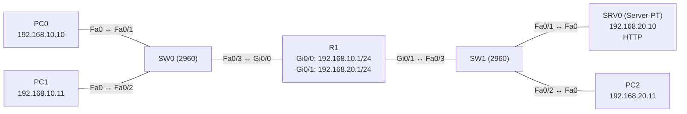

# Übung 5.5: Erweiterte ACLs

| | |
|---|---|
| **Modul** | 5 – Sicherheit |
| **Stufe** | Fortgeschritten |
| **Geschätzte Zeit** | ca. 75–90 Minuten |
| **Werkzeug** | Cisco Packet Tracer |
| **Vorwissen** | Übung 5.4 (Standard-ACLs), Übung 4.3 (Server-PT) |

> **Stand der Prüfung:** Entwurf. Die Befehle `ip access-list extended`, `permit|deny tcp|icmp|ip … eq …`, `ip access-group`, `show access-lists` sind allgemeines Cisco-IOS-Wissen und hier nicht aus einer Quelle im Wortlaut belegt. **Nicht bestätigt** sind alle Ausgaben (Trefferzähler), das Verhalten von Packet Tracer bei ICMP-Filtern mit Typangabe (`echo`, `echo-reply`), das Einfügen von Regeln mit Sequenznummern, die Bedienung des HTTP-Dienstes am *Server-PT* und der *Web Browser* sowie alle GUI-Wege.

## Lernziele

Nach dieser Übung kannst du

- erklären, was eine erweiterte ACL gegenüber einer Standard-ACL zusätzlich prüft (Ziel, Protokoll, Port),
- eine benannte erweiterte ACL mit TCP-, ICMP- und IP-Regeln schreiben,
- die Reihenfolge der Regeln begründen und Regeln gezielt einfügen,
- die ACL nahe der Quelle anwenden und die Platzierungsregel begründen,
- mit Trefferzählern nachvollziehen, welche Regel gegriffen hat,
- typische Fehler (falsche Reihenfolge, vergessenes `permit`, falsche Richtung) erkennen.

## Voraussetzungen

Übung 5.4. Die Topologie ist dieselbe, aber jetzt sollen PCs nur noch **Webseiten** vom Server abrufen dürfen.

## Grundbegriffe

| Begriff | Bedeutung |
|---|---|
| Erweiterte ACL | Prüft Protokoll, Quelle, Ziel und Ports. Nummern 100–199 (und 2000–2699) oder benannt. |
| Protokoll | `ip` (alles), `tcp`, `udp`, `icmp`. |
| Port-Operatoren | `eq` (gleich), `gt`, `lt`, `neq`, `range`. |
| Well-known Ports | HTTP 80, HTTPS 443, DNS 53 (UDP/TCP), SSH 22, Telnet 23. |
| Sequenznummer | Reihenfolge der Zeile in der ACL (10, 20, 30 …). Neue Zeilen lassen sich dazwischen einfügen. |
| Trefferzähler | `(n matches)` in `show access-lists`. |

> **Merksatz:** Erweiterte ACLs setzt man so nah wie möglich an der **Quelle**, weil sie genau genug filtern, um unerwünschten Verkehr früh zu stoppen.

## Topologie und Adressplan

Gleicher Aufbau wie in Übung 5.4.



| Gerät | Port / Interface | IP-Adresse | Subnetzmaske | Default Gateway |
|---|---|---|---|---|
| PC0 | FastEthernet0 | `192.168.10.10` | `255.255.255.0` | `192.168.10.1` |
| PC1 | FastEthernet0 | `192.168.10.11` | `255.255.255.0` | `192.168.10.1` |
| R1 | `GigabitEthernet0/0` | `192.168.10.1` | `255.255.255.0` | – |
| R1 | `GigabitEthernet0/1` | `192.168.20.1` | `255.255.255.0` | – |
| SRV0 | FastEthernet0 | `192.168.20.10` | `255.255.255.0` | `192.168.20.1` |
| PC2 | FastEthernet0 | `192.168.20.11` | `255.255.255.0` | `192.168.20.1` |

Soll: Das Büro-Netz `192.168.10.0/24` darf auf `SRV0` nur Port 80 (HTTP) nutzen. Ping und andere Ports sind gesperrt; den Ping erlaubst du erst in Schritt 7 gezielt wieder.

## Aufgabe

> **Schema dieser Übungsreihe: zwei Wege pro Schritt.** Wo es in Packet Tracer keinen CLI-Weg gibt (Geräte platzieren, verkabeln, PC-Adressen), steht das ausdrücklich dabei. Alle Befehle stehen in Codeblöcken. Die CLI-Befehle und GUI-Wege sind in dieser Entwurfsfassung noch nicht in Packet Tracer bestätigt.

**1. Aufbau aus Übung 5.4 übernehmen** (Projekt kopieren oder neu bauen) und keine ACLs setzen

- **GUI:** *File* → *Open* der Datei aus Übung 5.4, *Save As* `05.5-erweiterte-acls.pkt`; dort die ACLs entfernen. Oder neu bauen wie in 5.4.
- **CLI:** Auf R1 alte ACLs entfernen:
  ```text
  R1# configure terminal
  R1(config)# interface gigabitethernet 0/1
  R1(config-if)# no ip access-group PC1-SPERREN out
  R1(config-if)# exit
  R1(config)# no ip access-list standard PC1-SPERREN
  ```
  (Namen anpassen.) Sonst die Interfaces wie in 5.4 Schritt 3 einrichten.

**2. Vorher testen**

- **GUI:** PC0 → *Desktop* → *Web Browser*: `http://192.168.20.10`. Danach *Add Simple PDU* PC0 → SRV0.
- **CLI:** An PC0:
  ```text
  PC> ping 192.168.20.10
  ```
  Webseite und Ping funktionieren (der HTTP-Dienst am Server-PT ist standardmäßig an, nicht bestätigt).

**3. Erweiterte ACL: nur Web erlauben**

- **GUI:** Entfällt (nur CLI).
- **CLI:** Auf R1:
  ```text
  R1# configure terminal
  R1(config)# ip access-list extended NUR-WEB
  R1(config-ext-nacl)# permit tcp 192.168.10.0 0.0.0.255 host 192.168.20.10 eq 80
  R1(config-ext-nacl)# exit
  ```
  Die Regel erlaubt TCP von allen Hosts in `192.168.10.0/24` zum Server auf Port 80. Alles andere trifft das implizite `deny ip any any`.

**4. ACL anwenden: nah an der Quelle**

- **GUI:** Entfällt (nur CLI).
- **CLI:**
  ```text
  R1(config)# interface gigabitethernet 0/0
  R1(config-if)# ip access-group NUR-WEB in
  R1(config-if)# end
  ```
  Die ACL prüft alle Pakete, die vom Büro-Netz in R1 eintreffen.

**5. Wirkung testen**

- **GUI:** PC0 → *Web Browser*: `http://192.168.20.10` (klappt). *Add Simple PDU* PC0 → SRV0 (schlägt fehl).
- **CLI:** An PC0:
  ```text
  PC> ping 192.168.20.10
  PC> ping 192.168.10.1
  ```
  Beide Pings schlagen fehl. Auch der Ping auf das eigene Gateway `192.168.10.1` fällt unter die ACL, denn sie gilt für alle Pakete, die auf `Gi0/0` eintreffen, auch die an R1 selbst. (Nicht bestätigt in Packet Tracer.)

**6. Trefferzähler lesen**

- **GUI:** Entfällt.
- **CLI:** Auf R1:
  ```text
  R1# show access-lists
  R1# show ip interface gigabitethernet 0/0
  ```
  Du siehst bei der `permit`-Zeile Treffer für den Web-Aufruf. Das implizite `deny` hat keinen sichtbaren Zähler. Mit einer abschließenden Zeile `deny ip any any` bekommst du einen.

**7. Ping erlauben**

- **GUI:** Entfällt.
- **CLI:** Füge Regeln hinzu:
  ```text
  R1(config)# ip access-list extended NUR-WEB
  R1(config-ext-nacl)# permit icmp 192.168.10.0 0.0.0.255 host 192.168.20.10 echo
  R1(config-ext-nacl)# permit icmp 192.168.10.0 0.0.0.255 host 192.168.10.1 echo
  R1(config-ext-nacl)# deny ip any any
  R1(config-ext-nacl)# end
  R1# show access-lists
  ```
  Jetzt kommen Pings zum Server und zum Gateway durch. Die Rückrichtung läuft über `Gi0/1`, wo keine ACL liegt. Die Option `echo` begrenzt die Regel auf Echo-Anfragen (nicht bestätigt in Packet Tracer).

**8. Einzelne Hosts herausnehmen: Reihenfolge**

- **GUI:** Entfällt.
- **CLI:** PC1 soll nicht einmal die Webseite sehen. Füge eine Zeile am **Anfang** ein:
  ```text
  R1(config)# ip access-list extended NUR-WEB
  R1(config-ext-nacl)# 5 deny ip host 192.168.10.11 any
  R1(config-ext-nacl)# end
  R1# show access-lists
  ```
  Der Eintrag erhält die Sequenznummer 5 und steht vor allen anderen. Teste Webseite und Ping von PC0 (klappt) und PC1 (gesperrt). Das Einfügen mit Sequenznummer ist in Packet Tracer nicht bestätigt; alternativ ACL löschen und in der richtigen Reihenfolge neu schreiben.

**9. Gegenprobe: falsche Reihenfolge**

- **GUI:** Entfällt.
- **CLI:** Lege die ACL neu an, mit dem `permit` für das Netz **vor** dem `deny` für PC1:
  ```text
  R1(config)# no ip access-list extended NUR-WEB
  R1(config)# ip access-list extended NUR-WEB
  R1(config-ext-nacl)# permit tcp 192.168.10.0 0.0.0.255 host 192.168.20.10 eq 80
  R1(config-ext-nacl)# deny ip host 192.168.10.11 any
  R1(config-ext-nacl)# end
  ```
  Die Sperre für PC1 greift nie, denn die erste Regel erlaubt PC1 schon. PC1 kann die Webseite öffnen. Behebe es durch die richtige Reihenfolge. Nach `no ip access-list …` ist die Anwendung am Interface wirkungslos, bis die ACL neu angelegt ist; prüfe, ob `ip access-group` noch am Interface steht.

**10. Gegenprobe: falsche Richtung**

- **GUI:** Entfällt.
- **CLI:** Entferne die ACL von `Gi0/0 in` und lege sie auf `Gi0/1 in`:
  ```text
  R1(config)# interface gigabitethernet 0/0
  R1(config-if)# no ip access-group NUR-WEB in
  R1(config-if)# exit
  R1(config)# interface gigabitethernet 0/1
  R1(config-if)# ip access-group NUR-WEB in
  R1(config-if)# end
  ```
  `Gi0/1 in` prüft, was aus dem Server-Netz kommt, also die Antworten. Die Pakete der Büro-PCs passieren ungefiltert; die Antwortpakete des Servers werden durch die ACL verworfen. Beobachte, was der Browser anzeigt. Danach den ursprünglichen Zustand herstellen.

**11. Weitere Dienste: DNS und SSH**

- **GUI:** Entfällt.
- **CLI:** Ergänze Regeln:
  ```text
  R1(config)# ip access-list extended NUR-WEB
  R1(config-ext-nacl)# permit udp 192.168.10.0 0.0.0.255 host 192.168.20.10 eq 53
  R1(config-ext-nacl)# permit tcp host 192.168.10.10 host 192.168.20.10 eq 22
  R1(config-ext-nacl)# end
  ```
  DNS-Abfragen laufen über UDP Port 53; SSH nutzt TCP Port 22.

**12. Speichern**

- **GUI:** `Strg+S`.
- **CLI:**
  ```text
  R1# copy running-config startup-config
  ```

## Hintergrund: Wie genau filtert eine erweiterte ACL?

1. **Fünf Angaben:** Aktion (`permit`/`deny`), Protokoll, Quelle, Ziel und optional Ports bzw. ICMP-Typ.
2. **Von oben nach unten, erste passende Regel gilt.** Spezielle Regeln gehören nach oben, allgemeine nach unten.
3. **Implizites `deny ip any any`** am Ende: Was nicht ausdrücklich erlaubt ist, wird verworfen.
4. **Richtung und Platzierung:** Erweiterte ACLs nahe der Quelle spart Verkehr im Netz und filtert genau genug. Die Richtung `in` prüft Pakete, bevor sie geroutet werden.
5. **Rückverkehr:** Eine ACL, die nur in einer Richtung wirkt, lässt die Antworten auf der Gegenrichtung ungehindert durch, solange dort keine ACL liegt. Mit zusätzlichen ACLs müssen auch die Antworten ausdrücklich erlaubt sein.
6. **Pakete an den Router:** Eine `in`-ACL auf einem Interface gilt auch für Pakete, die an den Router selbst gerichtet sind.

## Hinweise

- Bei benannten ACLs bearbeitest du den Eintrag im Modus `(config-ext-nacl)#`. Bei nummerierten (`access-list 110 …`) lassen sich Zeilen nur durch Neuanlegen ändern.
- `host` und `any` verkürzen die Schreibweise.
- Ein Tippfehler in der Wildcard-Maske ändert die Regel erheblich. Prüfe mit `show access-lists`.
- ICMP hat Typen (`echo`, `echo-reply`, `unreachable`). Sperrst du alles, brechen auch Fehlermeldungen weg.
- Mehr Treffer pro Regel erkennt man nur, wenn die Zeile existiert. Daher oft ein explizites `deny ip any any` am Ende.

## Prüfbefehle

Am Router (CLI):

```text
R1> enable
R1# show access-lists
R1# show ip interface gigabitethernet 0/0
R1# show running-config | section access
R1# clear access-list counters
```

| CLI-Befehl | Was er zeigt | GUI-Weg |
|---|---|---|
| `show access-lists` | Regeln mit Sequenznummer und Trefferzähler | – (nur CLI) |
| `show ip interface <Port>` | Angewendete ACL und Richtung | – |
| `clear access-list counters` | Setzt die Zähler zurück (nicht bestätigt) | – |
| *Web Browser*, `ping` (PC) | Wirkung der Regeln | PC → *Desktop* → *Web Browser* |

**Kontrollfragen**

1. Welche Angaben kann eine erweiterte ACL zusätzlich zu einer Standard-ACL prüfen?
2. Warum setzt man erweiterte ACLs nahe der Quelle?
3. Warum sperrt eine zu allgemeine Regel am Anfang später stehende Ausnahmen aus?
4. Wie erlaubst du nur Webseiten (HTTP) zu einem Server?
5. Was bewirkt es, wenn die ACL in der falschen Richtung am Interface liegt?

## Erweiterungen

- **HTTPS:** Port 443 ergänzen. Der Server-PT bietet unter *Services* → *HTTP* auch HTTPS an (nicht bestätigt).
- **Established:** `permit tcp any any established` kennenlernen und mit dem Rückverkehr vergleichen (nicht bestätigt).
- **Log:** `deny ip any any log` nutzen und auf der Konsole die Meldungen beobachten (nicht bestätigt).
- **Weiter:** Modul 6 verbindet Standorte (WAN, VPN).

---

## Musterlösung

<details>
<summary>Musterlösung anzeigen</summary>

**Endstand der ACL:**

```text
R1(config)# ip access-list extended NUR-WEB
R1(config-ext-nacl)# deny ip host 192.168.10.11 any
R1(config-ext-nacl)# permit tcp 192.168.10.0 0.0.0.255 host 192.168.20.10 eq 80
R1(config-ext-nacl)# permit udp 192.168.10.0 0.0.0.255 host 192.168.20.10 eq 53
R1(config-ext-nacl)# permit icmp 192.168.10.0 0.0.0.255 host 192.168.20.10 echo
R1(config-ext-nacl)# permit icmp 192.168.10.0 0.0.0.255 host 192.168.10.1 echo
R1(config-ext-nacl)# deny ip any any
R1(config)# interface gigabitethernet 0/0
R1(config-if)# ip access-group NUR-WEB in
```

**Anzeige (sinngemäß, nicht bestätigt):**

```text
R1# show access-lists
Extended IP access list NUR-WEB
    5 deny ip host 192.168.10.11 any (3 match(es))
    10 permit tcp 192.168.10.0 0.0.0.255 host 192.168.20.10 eq www (12 match(es))
    20 permit udp 192.168.10.0 0.0.0.255 host 192.168.20.10 eq domain
    30 permit icmp 192.168.10.0 0.0.0.255 host 192.168.20.10 echo (4 match(es))
    40 permit icmp 192.168.10.0 0.0.0.255 host 192.168.10.1 echo
    50 deny ip any any (2 match(es))
```

IOS zeigt Portnamen wie `www` und `domain` statt Nummern. Die Zahlen hängen von den Tests ab.

**Test:** PC0: Webseite ok, Ping ok. PC1: alles gesperrt.

**Falsche Reihenfolge (Schritt 9):** Das `permit` für das Netz steht vor dem `deny` für PC1 und erlaubt PC1 die Webseite; das `deny` greift nie.

**Falsche Richtung (Schritt 10):** `Gi0/1 in` prüft nur Pakete aus dem Server-Netz. Die Antworten kommen von `192.168.20.10`, die Regel erlaubt aber nur Quellen aus `192.168.10.0/24`; sie treffen das implizite `deny`, die Webseite lädt nicht.

**Antworten auf die Kontrollfragen:**

1. Ziel-Adresse, Protokoll (IP, TCP, UDP, ICMP) und Ports bzw. ICMP-Typ.
2. Weil sie genau genug filtert, um unerwünschten Verkehr früh zu stoppen und Bandbreite zu sparen.
3. Die erste passende Regel gilt. Steht die allgemeine Regel vorn, wird die Ausnahme nie erreicht.
4. Mit `permit tcp <Quelle> host <Server> eq 80`; der Rest trifft das implizite `deny`.
5. Die ACL prüft den falschen Verkehr. Hier verwirft sie die Antworten des Servers, und die Büro-PCs werden nicht gefiltert.

</details>

---

## Quellen

- `ip access-list extended`, Protokolle und Port-Operatoren, `ip access-group`, `show access-lists`, Trefferzähler, Platzierungsregeln und Verhalten bei Pings: allgemeines Cisco-IOS-Wissen, hier nicht aus einer Quelle im Wortlaut belegt.
- Cisco, *Configuring Static and Dynamic NAT Simultaneously* ([cisco.com](https://www.cisco.com/c/en/us/support/docs/ip/network-address-translation-nat/13778-9.html)): Muster einer ACL mit Wildcard-Maske, nur als Hilfsmittel für NAT.
- Die gezeigten Ausgaben sind ein konstruiertes Beispiel im IOS-Format und nicht aus Packet Tracer übernommen.

---

Lizenz: [CC BY-NC-SA 4.0](https://creativecommons.org/licenses/by-nc-sa/4.0/deed.de), Urheber: AnsibleArtisan4711. Cisco, Cisco IOS und Cisco Packet Tracer sind Marken von Cisco Systems, Inc. und/oder ihrer Tochtergesellschaften; dieses Dokument steht in keiner Verbindung zu Cisco.
