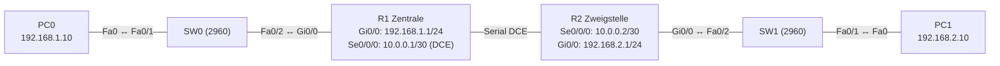

# Übung 6.2: Standortkopplung über die WAN-Verbindung

| | |
|---|---|
| **Modul** | 6 – WAN und VPN |
| **Stufe** | Aufbau |
| **Geschätzte Zeit** | ca. 60–75 Minuten |
| **Werkzeug** | Cisco Packet Tracer |
| **Vorwissen** | Übung 6.1 (serielle Verbindung), Übung 3.1 (statische Routen), Übung 3.5 (OSPF) |

> **Stand der Prüfung:** Entwurf. Aufbau und Befehle für Routing sind aus den Übungen 3.1 und 3.5 übernommen; die seriellen Befehle gelten wie in Übung 6.1. Dort sind sie nur teilweise belegt. **Nicht bestätigt** sind alle gezeigten Ausgaben, das Modul *HWIC-2T*, Kabel *Serial DCE* und die DCE-Seite, `bandwidth` auf seriellen Interfaces in Packet Tracer sowie alle GUI-Wege.

## Lernziele

Nach dieser Übung kannst du

- zwei Standorte (je ein LAN) über eine WAN-Verbindung koppeln,
- das Routing über die WAN-Strecke zuerst statisch und dann mit OSPF einrichten,
- die Rolle der Default-Route am Zweigstandort erklären,
- den Verkehr mit `tracert` verfolgen und den Weg über die WAN-Adressen erkennen,
- Ausfälle der Strecke beobachten und deren Auswirkung auf beide LANs beschreiben.

## Voraussetzungen

Übung 6.1 (serielle Verbindung), statische Routen und OSPF aus Modul 3.

## Grundbegriffe

| Begriff | Bedeutung |
|---|---|
| Standort (Site) | Ein Gebäude oder Netz mit eigenem LAN, über WAN mit anderen verbunden. |
| Zentrale / Zweigstelle | Hauptstandort mit den Diensten bzw. kleinerer Standort, der über die Zentrale ins Netz geht. |
| Verbindungsnetz | Das /30 zwischen den Routern. |
| Stub-Netz | Netz mit nur einem Weg hinaus, hier das LAN am Rand. |
| Default-Route an der Zweigstelle | Alles Unbekannte geht zur Zentrale. |

> **Merksatz:** Eine WAN-Verbindung ist nur ein weiteres Netz zwischen zwei Routern. Das Routing ist dasselbe wie in Modul 3.

## Topologie und Adressplan



| Gerät | Port / Interface | IP-Adresse | Subnetzmaske | Default Gateway |
|---|---|---|---|---|
| PC0 | FastEthernet0 | `192.168.1.10` | `255.255.255.0` | `192.168.1.1` |
| PC1 | FastEthernet0 | `192.168.2.10` | `255.255.255.0` | `192.168.2.1` |
| R1 | `GigabitEthernet0/0` | `192.168.1.1` | `255.255.255.0` | – |
| R1 | `Serial0/0/0` | `10.0.0.1` | `255.255.255.252` | – |
| R2 | `Serial0/0/0` | `10.0.0.2` | `255.255.255.252` | – |
| R2 | `GigabitEthernet0/0` | `192.168.2.1` | `255.255.255.0` | – |

## Aufgabe

> **Schema dieser Übungsreihe: zwei Wege pro Schritt.** Wo es in Packet Tracer keinen CLI-Weg gibt (Geräte platzieren, Module einsetzen, verkabeln, PC-Adressen), steht das ausdrücklich dabei. Alle Befehle stehen in Codeblöcken. Die CLI-Befehle und GUI-Wege sind in dieser Entwurfsfassung noch nicht in Packet Tracer bestätigt.

**1. Aufbau wie in Übung 6.1 plus LANs**

- **GUI:** Zwei Router (*1941*) mit *HWIC-2T* ausstatten (Router ausschalten, Modul einsetzen, einschalten), zwei Switches (*2960*) und zwei PCs setzen. Verkabeln: PC0 → SW0 `Fa0/1`, SW0 `Fa0/2` → R1 `Gi0/0`, R2 `Gi0/0` → SW1 `Fa0/2`, SW1 `Fa0/1` → PC1 (*Copper Straight-Through*), R1 `Serial0/0/0` → R2 `Serial0/0/0` (*Serial DCE*, R1 zuerst anklicken).
- **CLI:** Entfällt (nur grafisch möglich).

**2. Interfaces einrichten**

- **GUI:** PCs → *Desktop* → *IP Configuration* → *Static*. Router → *Config* → Interface.
- **CLI:** R1:
  ```text
  Router> enable
  Router# configure terminal
  Router(config)# hostname R1
  R1(config)# interface gigabitethernet 0/0
  R1(config-if)# ip address 192.168.1.1 255.255.255.0
  R1(config-if)# no shutdown
  R1(config-if)# exit
  R1(config)# interface serial 0/0/0
  R1(config-if)# ip address 10.0.0.1 255.255.255.252
  R1(config-if)# clock rate 64000
  R1(config-if)# no shutdown
  R1(config-if)# end
  ```
  R2:
  ```text
  Router> enable
  Router# configure terminal
  Router(config)# hostname R2
  R2(config)# interface serial 0/0/0
  R2(config-if)# ip address 10.0.0.2 255.255.255.252
  R2(config-if)# no shutdown
  R2(config-if)# exit
  R2(config)# interface gigabitethernet 0/0
  R2(config-if)# ip address 192.168.2.1 255.255.255.0
  R2(config-if)# no shutdown
  R2(config-if)# end
  ```
  Prüfe `show ip interface brief` und `ping 10.0.0.2` von R1 aus. Die Strecke muss `up/up` sein, bevor es weitergeht.

**3. Vorher testen**

- **GUI:** *Add Simple PDU*: PC0 → PC1.
- **CLI:** Am PC0:
  ```text
  PC> ping 192.168.2.10
  ```
  Schlägt fehl. Die Router kennen nur ihre direkt angeschlossenen Netze.

**4. Statische Routen einrichten**

- **GUI:** Router → *Config* → *Routing* → *Static*: Netzwerk, Maske, Next Hop. (nicht bestätigt, alternativ CLI)
- **CLI:** R1 (Weg zur Zweigstelle):
  ```text
  R1# configure terminal
  R1(config)# ip route 192.168.2.0 255.255.255.0 10.0.0.2
  R1(config)# end
  ```
  R2 (Zweigstelle: Standardroute zur Zentrale):
  ```text
  R2# configure terminal
  R2(config)# ip route 0.0.0.0 0.0.0.0 10.0.0.1
  R2(config)# end
  ```
  Die Zweigstelle kennt nur einen Weg hinaus, deshalb reicht die Default-Route.

**5. Verbindung prüfen**

- **GUI:** *Add Simple PDU*: PC0 → PC1 und umgekehrt.
- **CLI:** Am PC0:
  ```text
  PC> ping 192.168.2.10
  PC> tracert 192.168.2.10
  ```
  `tracert` zeigt `192.168.1.1`, `10.0.0.2`, `192.168.2.10`. Auf R1 und R2: `show ip route`.

**6. Statisches Routing durch OSPF ersetzen**

- **GUI:** Entfällt (nur CLI).
- **CLI:** Statische Routen entfernen, OSPF einrichten:
  ```text
  R1# configure terminal
  R1(config)# no ip route 192.168.2.0 255.255.255.0 10.0.0.2
  R1(config)# router ospf 1
  R1(config-router)# network 192.168.1.0 0.0.0.255 area 0
  R1(config-router)# network 10.0.0.0 0.0.0.3 area 0
  R1(config-router)# passive-interface gigabitethernet 0/0
  R1(config-router)# end
  ```
  ```text
  R2# configure terminal
  R2(config)# no ip route 0.0.0.0 0.0.0.0 10.0.0.1
  R2(config)# router ospf 1
  R2(config-router)# network 192.168.2.0 0.0.0.255 area 0
  R2(config-router)# network 10.0.0.0 0.0.0.3 area 0
  R2(config-router)# passive-interface gigabitethernet 0/0
  R2(config-router)# end
  ```

**7. OSPF prüfen**

- **GUI:** Entfällt.
- **CLI:**
  ```text
  R1# show ip ospf neighbor
  R1# show ip route
  ```
  Der Nachbar R2 steht im Zustand `FULL`, `show ip route` zeigt `O 192.168.2.0/24`. Der Ping zwischen den PCs klappt wieder.
  Zur Serial-Strecke: OSPF behandelt sie als Punkt-zu-Punkt. Es gibt dort keine Wahl von DR/BDR (nicht bestätigt).

**8. Ausfall der Strecke**

- **GUI:** Das serielle Kabel löschen oder `Serial0/0/0` an R1 auf *Off*.
- **CLI:** Auf R1:
  ```text
  R1# configure terminal
  R1(config)# interface serial 0/0/0
  R1(config-if)# shutdown
  R1(config-if)# end
  R1# show ip route
  ```
  Die OSPF-Routen zur Zweigstelle verschwinden. Der Ping zwischen den PCs schlägt fehl. Danach `no shutdown`.

**9. Auswirkung beobachten: LANs bleiben intern erreichbar**

- **GUI:** *Add Simple PDU*: PC0 → R1 (`192.168.1.1`), PC1 → R2 (`192.168.2.1`).
- **CLI:** Am PC0 und PC1:
  ```text
  PC> ping 192.168.1.1
  PC> ping 192.168.2.1
  ```
  Innerhalb der Standorte funktioniert alles weiter; nur die Strecke zwischen den Standorten ist weg. Das spricht dafür, jeden Standort so zu planen, dass lokale Dienste ohne WAN funktionieren.

**10. Kosten der Strecke ansehen**

- **GUI:** Entfällt.
- **CLI:**
  ```text
  R1# show ip ospf interface brief
  ```
  Das serielle Interface hat höhere Kosten als ein Gigabit-Port, weil die Standardbandbreite einer seriellen Schnittstelle niedrig ist (T1 = 1544 kbit/s, nicht bestätigt). Mit `bandwidth 64` ließe sich der Wert an die tatsächliche Taktrate anpassen.

**11. Speichern**

- **GUI:** `Strg+S` als `06.2-standortkopplung.pkt`.
- **CLI:**
  ```text
  R1# copy running-config startup-config
  ```

## Hintergrund: Standortkopplung im Überblick

1. **Zwei Routing-Arten:** Statisch ist übersichtlich bei wenigen Netzen, braucht aber Handarbeit bei jeder Änderung. OSPF passt sich an, verlangt aber Planung (Area, Router-ID).
2. **Default-Route an der Zweigstelle:** Die Zweigstelle hat nur einen Ausgang. Die Zentrale kennt die Netze und die Außenwelt, deshalb genügt `0.0.0.0/0`.
3. **Zentrale mit Rückroute:** Die Zentrale muss das Netz der Zweigstelle kennen, sonst fehlt die Rückroute (Übung 3.1).
4. **Passive Interfaces:** Zum LAN hin sendet OSPF unnötige Hello-Pakete; `passive-interface` spart sie (Übung 3.6).
5. **Kosten:** Langsame Strecken haben hohe Kosten. Das beeinflusst die Wegewahl, sobald es mehrere Wege gibt.
6. **WAN-Technik:** Echte WANs nutzen Provider-Leitungen, MPLS, Ethernet-WAN oder VPN (Übung 6.3 und 6.4). Die serielle Strecke ist die einfachste Form für das Labor.

## Hinweise

- Reihenfolge: erst die Strecke `up/up`, dann das Routing.
- Bei OSPF auf Serial in Packet Tracer kann die Nachbarschaft länger brauchen; *Fast Forward Time* nutzen.
- Entferne vor dem Umstieg auf OSPF die statischen Routen, sonst gewinnen sie (Administrative Distance 1 gegenüber 110).
- Auch `passive-interface` auf dem LAN-Port nicht vergessen.
- Der Next Hop einer statischen Route ist die Adresse der Gegenseite, nicht die eigene.

## Prüfbefehle

Am PC (Command Prompt):

```text
PC> ipconfig
PC> ping 192.168.2.10
PC> tracert 192.168.2.10
```

Am Router (CLI):

```text
R1> enable
R1# show ip interface brief
R1# show ip route
R1# show ip ospf neighbor
R1# show ip ospf interface brief
R1# show running-config | section router ospf
```

| CLI-Befehl | Was er zeigt | GUI-Weg |
|---|---|---|
| `show ip interface brief` | Status der seriellen und LAN-Schnittstellen | Router → *Config* → Interface |
| `show ip route` | Routen (`S`, `O`, `C`, `L`) | Werkzeug *Inspect* → *Routing Table* |
| `show ip ospf neighbor` | OSPF-Nachbar und Zustand | – (nur CLI) |
| `tracert` (PC) | Weg zwischen den Standorten | – |

**Kontrollfragen**

1. Warum genügt an der Zweigstelle eine Default-Route?
2. Welche Route braucht die Zentrale, und warum?
3. Warum entfernst du die statischen Routen, bevor OSPF übernimmt?
4. Was bleibt bei einem Ausfall der WAN-Strecke erreichbar?
5. Wie beeinflusst die serielle Strecke die OSPF-Kosten?

## Erweiterungen

- **Dritter Standort:** Eine zweite Zweigstelle über `Serial0/0/1` anbinden.
- **Redundanz:** Zweite Strecke aufbauen und Kosten so wählen, dass die zweite nur bei Ausfall genutzt wird.
- **Summarisierung:** Die Zweigstellen-Netze zusammenfassen (Übung 3.2).
- **Weiter:** Übung 6.3 ersetzt die Strecke durch einen Tunnel über ein fremdes Netz.

---

## Musterlösung

<details>
<summary>Musterlösung anzeigen</summary>

**Statisch (Schritt 4):**

```text
R1(config)# ip route 192.168.2.0 255.255.255.0 10.0.0.2
R2(config)# ip route 0.0.0.0 0.0.0.0 10.0.0.1
```

**OSPF (Schritt 6):**

```text
R1(config)# router ospf 1
R1(config-router)# network 192.168.1.0 0.0.0.255 area 0
R1(config-router)# network 10.0.0.0 0.0.0.3 area 0
R1(config-router)# passive-interface gigabitethernet 0/0
R2(config)# router ospf 1
R2(config-router)# network 192.168.2.0 0.0.0.255 area 0
R2(config-router)# network 10.0.0.0 0.0.0.3 area 0
R2(config-router)# passive-interface gigabitethernet 0/0
```

**Weg (Schritt 5):** `tracert` von PC0 zu PC1 zeigt `192.168.1.1`, `10.0.0.2`, `192.168.2.10`.

**Routen (Schritt 7, sinngemäß, nicht bestätigt):**

```text
R1# show ip route ospf
O    192.168.2.0/24 [110/65] via 10.0.0.2, 00:01:12, Serial0/0/0
```

Die Metrik hängt von der Bandbreite der seriellen Schnittstelle ab; sie ist hier ein Beispielwert.

**Ausfall (Schritt 8):** Die Route zu `192.168.2.0/24` verschwindet, der Ping zwischen den PCs schlägt fehl, die Pings an das eigene Gateway klappen weiter.

**Antworten auf die Kontrollfragen:**

1. Weil es nur einen Weg hinaus gibt; alles Unbekannte geht zur Zentrale.
2. Eine Route zum Zweigstellen-Netz `192.168.2.0/24` über `10.0.0.2`, sonst findet die Antwort den Rückweg nicht.
3. Statische Routen haben die Administrative Distance 1 und würden OSPF-Routen (110) verdrängen.
4. Alle Geräte innerhalb des jeweiligen Standorts; nur die Verbindung dazwischen fehlt.
5. Eine langsame Strecke bekommt hohe Kosten und wird gegenüber schnelleren Wegen weniger bevorzugt.

</details>

---

## Quellen

- Die Befehle für statisches Routing und OSPF sind aus den Übungen 3.1 und 3.5 übernommen, dort mit ihren Quellen. Für die serielle Strecke gelten die Quellen aus Übung 6.1 (Cisco-Packet-Tracer-Lab 3.1.2.7).
- Die Standard-Bandbreite serieller Schnittstellen (T1), das Verhalten von OSPF auf Punkt-zu-Punkt-Strecken und die Rolle von Default-Routen: allgemeines Wissen, hier nicht aus einer Quelle im Wortlaut belegt.
- Die gezeigten Ausgaben sind ein konstruiertes Beispiel im IOS-Format und nicht aus Packet Tracer übernommen.

---

Lizenz: [CC BY-NC-SA 4.0](https://creativecommons.org/licenses/by-nc-sa/4.0/deed.de), Urheber: AnsibleArtisan4711. Cisco, Cisco IOS und Cisco Packet Tracer sind Marken von Cisco Systems, Inc. und/oder ihrer Tochtergesellschaften; dieses Dokument steht in keiner Verbindung zu Cisco.
