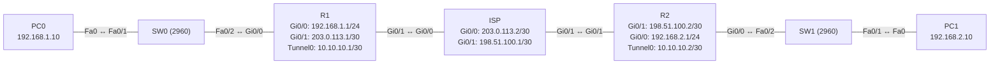

# Übung 6.3: GRE-Tunnel

| | |
|---|---|
| **Modul** | 6 – WAN und VPN |
| **Stufe** | Fortgeschritten |
| **Geschätzte Zeit** | ca. 60–75 Minuten |
| **Werkzeug** | Cisco Packet Tracer |
| **Vorwissen** | Übung 4.4 (private/öffentliche Adressen), Übung 3.2 (Default-Route), Übung 6.2 (Standortkopplung) |

> **Stand der Prüfung:** Entwurf. Die Befehle `interface tunnel 0`, `ip address`, `tunnel source`, `tunnel destination`, `tunnel mode gre ip`, `no shutdown` und die statische Route durch den Tunnel sind durch ein Cisco-Packet-Tracer-Lab belegt (siehe Quellen). **Nicht bestätigt** sind `tunnel source` mit einem Ethernet-Interface statt der seriellen Schnittstelle des Labs, alle gezeigten Ausgaben, das Verhalten des Tunnelzustands bei falschem Ziel, der Befehl `show interfaces tunnel 0`, die Darstellung im Simulationsmodus sowie alle GUI-Wege.

## Lernziele

Nach dieser Übung kannst du

- erklären, was ein GRE-Tunnel ist und warum er private Netze über ein öffentliches Netz verbinden kann,
- ein Tunnel-Interface mit Quelle, Ziel und Tunnel-Adresse einrichten,
- das Routing durch den Tunnel mit einer statischen Route festlegen,
- im `tracert` erkennen, dass das Provider-Netz im Pfad nicht sichtbar ist,
- begründen, warum GRE allein **nicht verschlüsselt**,
- typische Fehler (falsche Adresse, fehlende Route zum Tunnelende) erkennen.

## Voraussetzungen

Private Adressen sind im Internet nicht routbar (Übung 4.4). GRE kapselt private Pakete in ein öffentlich routbares Paket.

## Grundbegriffe

| Begriff | Bedeutung |
|---|---|
| GRE | *Generic Routing Encapsulation*: Kapselt ein Paket in ein anderes IP-Paket (IP-Protokoll 47). |
| Tunnel | Logische Punkt-zu-Punkt-Verbindung über ein fremdes Netz. |
| Tunnel-Interface | Virtuelles Interface (`interface tunnel 0`), das wie eine Leitung zwischen zwei Routern wirkt. |
| Tunnel-Quelle / -Ziel | Öffentliche Adressen der beiden Tunnelenden (`tunnel source`, `tunnel destination`). |
| Tunnel-Adresse | Private Adresse des Tunnel-Interfaces, hier im Netz `10.10.10.0/30`. |
| Underlay / Overlay | Das tragende Netz (öffentlich) und das darüberliegende Tunnelnetz (privat). |
| Provider (ISP) | Betreiber des Zwischennetzes. Er kennt nur öffentliche Adressen. |

> **Merksatz:** Der Tunnel macht aus zwei weit entfernten Routern zwei direkte Nachbarn. Das Zwischennetz sieht nur das äußere Paket.

## Topologie und Adressplan

Zwei Standorte sind über ein Provider-Netz verbunden, das die privaten Netze nicht kennt.



| Gerät | Port / Interface | IP-Adresse | Subnetzmaske | Default Gateway |
|---|---|---|---|---|
| PC0 | FastEthernet0 | `192.168.1.10` | `255.255.255.0` | `192.168.1.1` |
| PC1 | FastEthernet0 | `192.168.2.10` | `255.255.255.0` | `192.168.2.1` |
| R1 | `GigabitEthernet0/0` | `192.168.1.1` | `255.255.255.0` | – |
| R1 | `GigabitEthernet0/1` | `203.0.113.1` | `255.255.255.252` | – |
| R1 | `Tunnel0` | `10.10.10.1` | `255.255.255.252` | – |
| ISP | `GigabitEthernet0/0` | `203.0.113.2` | `255.255.255.252` | – |
| ISP | `GigabitEthernet0/1` | `198.51.100.1` | `255.255.255.252` | – |
| R2 | `GigabitEthernet0/1` | `198.51.100.2` | `255.255.255.252` | – |
| R2 | `GigabitEthernet0/0` | `192.168.2.1` | `255.255.255.0` | – |
| R2 | `Tunnel0` | `10.10.10.2` | `255.255.255.252` | – |

Die Adressen `203.0.113.0/24` und `198.51.100.0/24` sind für Dokumentation reserviert und stehen hier für öffentliche Adressen.

## Aufgabe

> **Schema dieser Übungsreihe: zwei Wege pro Schritt.** Wo es in Packet Tracer keinen CLI-Weg gibt (Geräte platzieren, verkabeln, PC-Adressen), steht das ausdrücklich dabei. Alle Befehle stehen in Codeblöcken. Die CLI-Befehle und GUI-Wege sind in dieser Entwurfsfassung noch nicht in Packet Tracer bestätigt.

### Teil A: Aufbau ohne Tunnel

**1. Neues Projekt beginnen** und Geräte platzieren: drei Router (*1941*), zwei Switches (*2960*), zwei PCs

- **GUI:** *File* → *New*, Geräte ziehen.
- **CLI:** Entfällt (nur grafisch möglich).

**2. Verkabeln:** Endgeräte und Switches mit *Copper Straight-Through* (PC0 → SW0 `Fa0/1`, SW0 `Fa0/2` → R1 `Gi0/0`, R2 `Gi0/0` → SW1 `Fa0/2`, SW1 `Fa0/1` → PC1). Router untereinander mit *Copper Cross-Over* (R1 `Gi0/1` ↔ ISP `Gi0/0`, ISP `Gi0/1` ↔ R2 `Gi0/1`, nicht bestätigt)

- **GUI:** Kategorie *Connections*, Kabeltyp anklicken, beide Geräte anklicken, Ports wählen.
- **CLI:** Entfällt (Kabel gibt es nur grafisch).

**3. Interfaces einrichten und Default-Routen setzen**

- **GUI:** PCs → *Desktop* → *IP Configuration* → *Static*. Router → *Config* → Interface.
- **CLI:** R1:
  ```text
  Router> enable
  Router# configure terminal
  Router(config)# hostname R1
  R1(config)# interface gigabitethernet 0/0
  R1(config-if)# ip address 192.168.1.1 255.255.255.0
  R1(config-if)# no shutdown
  R1(config-if)# exit
  R1(config)# interface gigabitethernet 0/1
  R1(config-if)# ip address 203.0.113.1 255.255.255.252
  R1(config-if)# no shutdown
  R1(config-if)# exit
  R1(config)# ip route 0.0.0.0 0.0.0.0 203.0.113.2
  R1(config)# end
  ```
  ISP:
  ```text
  Router> enable
  Router# configure terminal
  Router(config)# hostname ISP
  ISP(config)# interface gigabitethernet 0/0
  ISP(config-if)# ip address 203.0.113.2 255.255.255.252
  ISP(config-if)# no shutdown
  ISP(config-if)# exit
  ISP(config)# interface gigabitethernet 0/1
  ISP(config-if)# ip address 198.51.100.1 255.255.255.252
  ISP(config-if)# no shutdown
  ISP(config-if)# end
  ```
  R2:
  ```text
  Router> enable
  Router# configure terminal
  Router(config)# hostname R2
  R2(config)# interface gigabitethernet 0/1
  R2(config-if)# ip address 198.51.100.2 255.255.255.252
  R2(config-if)# no shutdown
  R2(config-if)# exit
  R2(config)# interface gigabitethernet 0/0
  R2(config-if)# ip address 192.168.2.1 255.255.255.0
  R2(config-if)# no shutdown
  R2(config-if)# exit
  R2(config)# ip route 0.0.0.0 0.0.0.0 198.51.100.1
  R2(config)# end
  ```
  Der ISP bekommt **keine** Routen zu den privaten Netzen.

**4. Vorher testen**

- **GUI:** *Add Simple PDU*: R1 → R2 (`198.51.100.2`), PC0 → PC1.
- **CLI:** Auf R1 und am PC0:
  ```text
  R1# ping 198.51.100.2
  PC> ping 192.168.2.10
  ```
  Der Ping zwischen den **öffentlichen** Adressen klappt (ggf. erst nach einem Versuch). Der Ping zwischen den privaten Netzen schlägt fehl, denn der ISP kennt sie nicht.

### Teil B: Tunnel

**5. Tunnel-Interface auf R1**

- **GUI:** Entfällt (nur CLI).
- **CLI:**
  ```text
  R1# configure terminal
  R1(config)# interface tunnel 0
  R1(config-if)# ip address 10.10.10.1 255.255.255.252
  R1(config-if)# tunnel source gigabitethernet 0/1
  R1(config-if)# tunnel destination 198.51.100.2
  R1(config-if)# tunnel mode gre ip
  R1(config-if)# no shutdown
  R1(config-if)# end
  ```
  Das Lab nutzt als Quelle die serielle Schnittstelle; hier ist es das Ethernet-Interface zum ISP. Alternativ kannst du die Adresse `203.0.113.1` angeben.

**6. Tunnel-Interface auf R2**

- **GUI:** Entfällt (nur CLI).
- **CLI:**
  ```text
  R2# configure terminal
  R2(config)# interface tunnel 0
  R2(config-if)# ip address 10.10.10.2 255.255.255.252
  R2(config-if)# tunnel source gigabitethernet 0/1
  R2(config-if)# tunnel destination 203.0.113.1
  R2(config-if)# tunnel mode gre ip
  R2(config-if)# no shutdown
  R2(config-if)# end
  ```

**7. Tunnel prüfen**

- **GUI:** Entfällt.
- **CLI:** Auf R1:
  ```text
  R1# show ip interface brief
  R1# ping 10.10.10.2
  ```
  `Tunnel0` steht auf `up`/`up`, der Ping auf das Tunnel-Ende `10.10.10.2` klappt (nicht bestätigt: Der erste Versuch kann verloren gehen).

**8. Routen durch den Tunnel**

- **GUI:** Router → *Config* → *Routing* → *Static* (nicht bestätigt, alternativ CLI).
- **CLI:** R1:
  ```text
  R1# configure terminal
  R1(config)# ip route 192.168.2.0 255.255.255.0 10.10.10.2
  R1(config)# end
  ```
  R2:
  ```text
  R2# configure terminal
  R2(config)# ip route 192.168.1.0 255.255.255.0 10.10.10.1
  R2(config)# end
  ```
  Der Next Hop ist jeweils das **Tunnel**-Ende des anderen Routers.

**9. Standorte testen**

- **GUI:** *Add Simple PDU*: PC0 → PC1 und PC1 → PC0.
- **CLI:** Am PC0:
  ```text
  PC> ping 192.168.2.10
  PC> tracert 192.168.2.10
  ```
  Beide Richtungen klappen. `tracert` zeigt `192.168.1.1`, `10.10.10.2` und `192.168.2.10`. Der ISP taucht **nicht** auf, weil der Tunnel ihn verbirgt.

**10. Verkehr im Simulationsmodus ansehen**

- **GUI:** Unten rechts auf *Simulation* wechseln, Filter auf *ICMP* setzen, einen Ping von PC0 nach PC1 senden. Beim Weg über den ISP die Paketdetails öffnen (*Inspect PDU*/Umschlag): außen steht ein IP-Paket von `203.0.113.1` an `198.51.100.2` mit GRE, innen das private Paket (nicht bestätigt).
- **CLI:** Entfällt (die Paketansicht ist nur grafisch).
  Nichts davon ist verschlüsselt. Wer den Verkehr mitliest, sieht das innere Paket im Klartext.

**11. Gegenprobe: falsches Tunnel-Ziel**

- **GUI:** Entfällt.
- **CLI:** Auf R1:
  ```text
  R1# configure terminal
  R1(config)# interface tunnel 0
  R1(config-if)# tunnel destination 198.51.100.9
  R1(config-if)# end
  R1# ping 10.10.10.2
  ```
  Der Ping schlägt fehl, weil die Pakete nicht beim R2 ankommen. Setze das Ziel wieder auf `198.51.100.2` (der Tunnelzustand kann trotzdem `up` zeigen, nicht bestätigt).

**12. Gegenprobe: Route fehlt**

- **GUI:** Entfällt.
- **CLI:** Auf R1 `no ip route 192.168.2.0 255.255.255.0 10.10.10.2`. Der Ping `10.10.10.2` funktioniert weiter, aber PC0 erreicht PC1 nicht mehr. Stelle die Route wieder her.

**13. Speichern**

- **GUI:** `Strg+S` als `06.3-gre-tunnel.pkt`.
- **CLI:** Auf allen Routern:
  ```text
  R1# copy running-config startup-config
  ```

## Hintergrund: Was macht GRE mit dem Paket?

1. **Ausgangspunkt:** PC0 sendet ein Paket von `192.168.1.10` an `192.168.2.10`. R1 routet es laut Route an `10.10.10.2`, also in den Tunnel.
2. **Kapselung:** R1 verpackt das komplette private Paket mit einem GRE-Header und einem neuen IP-Header. Quelle ist `203.0.113.1` (Tunnel-Quelle), Ziel `198.51.100.2` (Tunnel-Ziel).
3. **Transport:** Der ISP sieht nur das äußere Paket mit öffentlichen Adressen und leitet es per Default/connected weiter.
4. **Entkapselung:** R2 entfernt den äußeren Header und gibt das innere Paket an das LAN weiter.
5. **Routing:** Aus Sicht der Router sind R1 und R2 direkte Nachbarn im Netz `10.10.10.0/30`. Deshalb kann man statisches Routing oder auch OSPF über den Tunnel betreiben.
6. **Keine Verschlüsselung:** GRE schützt weder Vertraulichkeit noch Integrität. Dafür kombiniert man es mit IPsec (Übung 6.4 zeigt IPsec als eigenständiges VPN).

## Hinweise

- Die Tunnel-Adresse ist ein eigenes Netz. Sie darf nicht mit LAN-Netzen überlappen.
- Das Tunnelziel muss über das **äußere** Netz erreichbar sein, nicht durch den Tunnel selbst (sonst entsteht eine Routing-Schleife).
- `tunnel mode gre ip` ist der Standard. Der Befehl zeigt, dass es ein GRE-Tunnel über IP ist.
- Der Tunnel erhöht die Paketgröße (Overhead); große Pakete können fragmentiert werden.
- Der ISP-Router braucht keine Kenntnis der privaten Netze und der Tunnel-Adressen.
- In Packet Tracer kann es nötig sein, die Tunnel-Interfaces nach einer Änderung kurz aus- und wieder einzuschalten.

## Prüfbefehle

Am Router (CLI):

```text
R1> enable
R1# show ip interface brief
R1# show interfaces tunnel 0
R1# show ip route
R1# ping 10.10.10.2
R1# traceroute 192.168.2.10
```

| CLI-Befehl | Was er zeigt | GUI-Weg |
|---|---|---|
| `show ip interface brief` | Zustand von `Tunnel0` | Router → *Config* → Interface |
| `show interfaces tunnel 0` | Quelle, Ziel, Modus, Zähler (nicht bestätigt) | – (nur CLI) |
| `show ip route` | Statische Route über `10.10.10.2` | Werkzeug *Inspect* → *Routing Table* |
| `tracert` (PC) | Weg ohne sichtbare ISP-Hops | – |

**Kontrollfragen**

1. Warum kommen private Adressen ohne Tunnel nicht über den ISP?
2. Was ist der Unterschied zwischen der Tunnel-Quelle/-Ziel und der Tunnel-Adresse?
3. Warum taucht der ISP im `tracert` nicht auf?
4. Warum ist ein GRE-Tunnel allein keine sichere Verbindung?
5. Welche Route würde einen Tunnel unbrauchbar machen, wenn das Tunnelziel durch den Tunnel selbst erreichbar wäre?

## Erweiterungen

- **OSPF über den Tunnel:** `router ospf 1` mit `network 10.10.10.0 0.0.0.3 area 0` und den LANs (Übung 3.5).
- **Keepalive:** `keepalive 5 3` auf dem Tunnel einstellen und den Ausfall beobachten (nicht bestätigt).
- **MTU:** `ip mtu 1400` setzen und `show interfaces tunnel 0` ansehen (nicht bestätigt).
- **Weiter:** Übung 6.4 verschlüsselt den Verkehr mit IPsec.

---

## Musterlösung

<details>
<summary>Musterlösung anzeigen</summary>

**R1, vollständig (Teil B):**

```text
R1(config)# interface tunnel 0
R1(config-if)# ip address 10.10.10.1 255.255.255.252
R1(config-if)# tunnel source gigabitethernet 0/1
R1(config-if)# tunnel destination 198.51.100.2
R1(config-if)# tunnel mode gre ip
R1(config-if)# no shutdown
R1(config)# ip route 192.168.2.0 255.255.255.0 10.10.10.2
```

**R2:**

```text
R2(config)# interface tunnel 0
R2(config-if)# ip address 10.10.10.2 255.255.255.252
R2(config-if)# tunnel source gigabitethernet 0/1
R2(config-if)# tunnel destination 203.0.113.1
R2(config-if)# tunnel mode gre ip
R2(config-if)# no shutdown
R2(config)# ip route 192.168.1.0 255.255.255.0 10.10.10.1
```

**Vorher (Schritt 4):** Ping `R1` → `198.51.100.2` klappt, `PC0` → `PC1` schlägt fehl.

**Weg (Schritt 9, sinngemäß, nicht bestätigt):**

```text
PC> tracert 192.168.2.10
  1   192.168.1.1
  2   10.10.10.2
  3   192.168.2.10
```

Der ISP erscheint nicht, weil der Tunnel ein einziger Hop ist.

**Falsches Ziel (Schritt 11):** Pings in den Tunnel kommen nicht an; auch der Weg zwischen den PCs ist unterbrochen.

**Antworten auf die Kontrollfragen:**

1. Private Adressen werden im Internet nicht geroutet; der ISP hat keine Routen dorthin.
2. Quelle und Ziel sind die öffentlichen Adressen der Tunnelenden (außen). Die Tunnel-Adresse gehört zu einem privaten Netz zwischen beiden Tunnel-Interfaces (innen).
3. Der Tunnel kapselt das Paket in ein äußeres. Für die inneren Router ist der Tunnel eine direkte Verbindung, der ISP zählt nicht als Hop.
4. GRE verschlüsselt nichts. Das innere Paket steht im Klartext im äußeren.
5. Eine Route zum Tunnelziel (öffentliche Adresse) über den Tunnel: Das Tunnelpaket müsste durch den Tunnel, der es erst erzeugt (rekursive Schleife).

</details>

---

## Quellen

- Cisco Networking Academy, *Packet Tracer – Configuring GRE* (7.2.2.3, [ccna.ilkom.unsri.ac.id](https://ccna.ilkom.unsri.ac.id/4/course/files/7.2.2.3%20Packet%20Tracer%20-%20Configuring%20GRE%20Instructions.pdf)): `interface tunnel 0`, `ip address 10.10.10.1 255.255.255.252`, `tunnel source s0/0/0`, `tunnel destination <Adresse>`, `tunnel mode gre ip`, `no shutdown`, statische Route `ip route 192.168.2.0 255.255.255.0 10.10.10.2`; Prüfung mit `show ip interface brief`, Ping und Pfadverfolgung (Pfad ohne öffentliche Adressen). Im Lab ist die Tunnelquelle eine serielle Schnittstelle.
- IP-Protokoll 47, Kapselung und fehlende Verschlüsselung, Rekursion bei falscher Route zum Tunnelziel, MTU: allgemeines Wissen, hier nicht aus der genannten Quelle im Wortlaut belegt.
- Die gezeigten Ausgaben sind ein konstruiertes Beispiel im IOS-Format und nicht aus Packet Tracer übernommen.

---

Lizenz: [CC BY-NC-SA 4.0](https://creativecommons.org/licenses/by-nc-sa/4.0/deed.de), Urheber: AnsibleArtisan4711. Cisco, Cisco IOS und Cisco Packet Tracer sind Marken von Cisco Systems, Inc. und/oder ihrer Tochtergesellschaften; dieses Dokument steht in keiner Verbindung zu Cisco.
