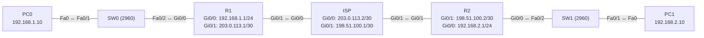

# Übung 6.4: Site-to-Site-VPN mit IPsec

| | |
|---|---|
| **Modul** | 6 – WAN und VPN |
| **Stufe** | Fortgeschritten |
| **Geschätzte Zeit** | ca. 75–90 Minuten |
| **Werkzeug** | Cisco Packet Tracer |
| **Vorwissen** | Übung 6.3 (GRE-Tunnel), Übung 5.4/5.5 (ACLs) |

> **Stand der Prüfung:** Entwurf. Die Befehlsfolge `access-list`, `crypto isakmp policy` (`encryption aes`, `authentication pre-share`, `group 5`), `crypto isakmp key … address …`, `crypto ipsec transform-set … esp-aes esp-sha-hmac`, `crypto map … ipsec-isakmp` (`set peer`, `set transform-set`, `match address`), `crypto map` am Interface und die Lizenz `license boot module c2900 technology-package securityk9` samt Prüfung mit `show version` sind durch ein Cisco-Packet-Tracer-Lab belegt (siehe Quellen). **Nicht belegt** sind der Lizenzbefehl für den Router 1941 (`c1900` statt `c2900`), `show crypto isakmp sa` und `show crypto ipsec sa` (das Lab nutzt sie nicht), die gezeigten Ausgaben und Zähler, die Dauer des Verbindungsaufbaus, die Darstellung im Simulationsmodus sowie alle GUI-Wege.

## Lernziele

Nach dieser Übung kannst du

- das Grundprinzip eines IPsec-Site-to-Site-VPN beschreiben (Phase 1 und Phase 2),
- die Sicherheitslizenz (securityk9) in Packet Tracer aktivieren,
- „interessanten Verkehr“ mit einer ACL festlegen,
- ISAKMP-Richtlinie, Schlüssel, Transform-Set und Crypto-Map konfigurieren und am Interface anwenden,
- das VPN mit `show crypto isakmp sa` und `show crypto ipsec sa` prüfen,
- erklären, was GRE (Übung 6.3) von IPsec unterscheidet, und typische Fehler (ungleiche Parameter, falsche ACL) finden.

## Voraussetzungen

Aufbau mit Provider-Router wie in Übung 6.3, ACL-Grundlagen (Modul 5).

## Grundbegriffe

| Begriff | Bedeutung |
|---|---|
| VPN | *Virtual Private Network*: geschützte Verbindung über ein öffentliches Netz. |
| IPsec | Protokollfamilie für Verschlüsselung und Authentifizierung auf IP-Ebene. |
| IKE / ISAKMP (Phase 1) | Aushandlung und Aufbau eines gesicherten Kanals zwischen den Routern (Algorithmus, Schlüsseltausch, Authentifizierung). |
| IPsec-SA (Phase 2) | Aushandlung der eigentlichen Verkehrsverschlüsselung (Transform-Set). |
| Pre-shared Key | Vorab vereinbartes gemeinsames Geheimnis. |
| Transform-Set | Kombination aus Verschlüsselung und Integritätsprüfung (hier `esp-aes esp-sha-hmac`). |
| Crypto-Map | Verknüpft Peer, Transform-Set und ACL und wird am Interface angewendet. |
| Interessanter Verkehr | Verkehr, den die ACL auswählt und der durch das VPN geschützt wird. |
| Peer | Gegenstelle des VPN. |

> **Merksatz:** Beide Seiten müssen dieselben Parameter, spiegelverkehrte ACLs und den gleichen Schlüssel haben. Ein Unterschied genügt, und es kommt kein VPN zustande.

## Topologie und Adressplan

Gleicher Aufbau wie in Übung 6.3, aber ohne Tunnel-Interface.



| Gerät | Port / Interface | IP-Adresse | Subnetzmaske | Default Gateway |
|---|---|---|---|---|
| PC0 | FastEthernet0 | `192.168.1.10` | `255.255.255.0` | `192.168.1.1` |
| PC1 | FastEthernet0 | `192.168.2.10` | `255.255.255.0` | `192.168.2.1` |
| R1 | `GigabitEthernet0/0` | `192.168.1.1` | `255.255.255.0` | – |
| R1 | `GigabitEthernet0/1` | `203.0.113.1` | `255.255.255.252` | – |
| ISP | `GigabitEthernet0/0` | `203.0.113.2` | `255.255.255.252` | – |
| ISP | `GigabitEthernet0/1` | `198.51.100.1` | `255.255.255.252` | – |
| R2 | `GigabitEthernet0/1` | `198.51.100.2` | `255.255.255.252` | – |
| R2 | `GigabitEthernet0/0` | `192.168.2.1` | `255.255.255.0` | – |

Übungswerte: Pre-shared Key `GeheimerSchluessel1`, ISAKMP-Policy 10, Transform-Set `TS-VPN`, Crypto-Map `CMAP`, ACL 110.

## Aufgabe

> **Schema dieser Übungsreihe: zwei Wege pro Schritt.** Wo es in Packet Tracer keinen CLI-Weg gibt (Geräte platzieren, verkabeln, PC-Adressen), steht das ausdrücklich dabei. Alle Befehle stehen in Codeblöcken. Die CLI-Befehle und GUI-Wege sind in dieser Entwurfsfassung noch nicht in Packet Tracer bestätigt.

### Teil A: Aufbau

**1. Aufbau aus Übung 6.3 übernehmen, ohne Tunnel** (Projekt kopieren oder neu bauen; Schritte 1–3 aus 6.3)

- **GUI:** *File* → *Open* des Projekts aus Übung 6.3, *Save As* `06.4-site-to-site-vpn-mit-ipsec.pkt`. Das Tunnel-Interface entfernen oder neu bauen wie in 6.3 Schritt 1–3.
- **CLI:** Falls übernommen, auf R1 und R2 den Tunnel und die Routen durch den Tunnel entfernen:
  ```text
  R1(config)# no interface tunnel 0
  R1(config)# no ip route 192.168.2.0 255.255.255.0 10.10.10.2
  R2(config)# no interface tunnel 0
  R2(config)# no ip route 192.168.1.0 255.255.255.0 10.10.10.1
  ```

**2. Vorher testen**

- **GUI:** *Add Simple PDU*: PC0 → PC1.
- **CLI:** Am PC0:
  ```text
  PC> ping 192.168.2.10
  ```
  Schlägt fehl. Die Default-Routen bringen das Paket zum ISP, der die privaten Adressen nicht kennt.

### Teil B: IPsec vorbereiten

**3. Sicherheitslizenz prüfen und aktivieren**

- **GUI:** Router → *Config*/*Physical* (je nach Version unter *Config* → *Settings* → *Technology Package*) nicht bestätigt; nutze die CLI.
- **CLI:** Auf R1 und R2:
  ```text
  R1# show version
  R1# configure terminal
  R1(config)# license boot module c1900 technology-package securityk9
  R1(config)# end
  R1# copy running-config startup-config
  R1# reload
  R1# show version
  ```
  Das Lab nennt den Befehl für die Routerreihe 2900 (`c2900`); für den 1941 ist `c1900` zu erwarten (nicht bestätigt). Nach dem Neustart zeigt `show version` in der Lizenztabelle `securityk9` mit dem Eintrag `Technology Package License Information` als aktiv (laut Lab die Kontrolle). Bestätige die Lizenzabfrage mit `yes`.

**4. Interessanten Verkehr festlegen (ACL)**

- **GUI:** Entfällt (nur CLI).
- **CLI:** Auf R1 (von LAN A nach LAN B):
  ```text
  R1# configure terminal
  R1(config)# access-list 110 permit ip 192.168.1.0 0.0.0.255 192.168.2.0 0.0.0.255
  ```
  Auf R2 **spiegelverkehrt** (von LAN B nach LAN A):
  ```text
  R2# configure terminal
  R2(config)# access-list 110 permit ip 192.168.2.0 0.0.0.255 192.168.1.0 0.0.0.255
  ```

### Teil C: IPsec konfigurieren

**5. Phase 1: ISAKMP-Richtlinie und Schlüssel**

- **GUI:** Entfällt (nur CLI).
- **CLI:** Auf R1:
  ```text
  R1(config)# crypto isakmp policy 10
  R1(config-isakmp)# encryption aes
  R1(config-isakmp)# authentication pre-share
  R1(config-isakmp)# group 5
  R1(config-isakmp)# exit
  R1(config)# crypto isakmp key GeheimerSchluessel1 address 198.51.100.2
  ```
  Auf R2 dieselbe Richtlinie, der Schlüssel zeigt auf die Adresse von R1:
  ```text
  R2(config)# crypto isakmp policy 10
  R2(config-isakmp)# encryption aes
  R2(config-isakmp)# authentication pre-share
  R2(config-isakmp)# group 5
  R2(config-isakmp)# exit
  R2(config)# crypto isakmp key GeheimerSchluessel1 address 203.0.113.1
  ```
  Die Richtlinie muss auf beiden Seiten gleich sein. Das Lab setzt keinen eigenen Hash, es gelten die Standardwerte der IOS-Version (nicht bestätigt).

**6. Phase 2: Transform-Set**

- **GUI:** Entfällt.
- **CLI:** Auf R1 und R2:
  ```text
  R1(config)# crypto ipsec transform-set TS-VPN esp-aes esp-sha-hmac
  ```
  Verwende denselben Befehl mit demselben Namen und denselben Algorithmen auf R2.

**7. Crypto-Map anlegen**

- **GUI:** Entfällt.
- **CLI:** Auf R1:
  ```text
  R1(config)# crypto map CMAP 10 ipsec-isakmp
  R1(config-crypto-map)# set peer 198.51.100.2
  R1(config-crypto-map)# set transform-set TS-VPN
  R1(config-crypto-map)# match address 110
  R1(config-crypto-map)# exit
  ```
  Auf R2:
  ```text
  R2(config)# crypto map CMAP 10 ipsec-isakmp
  R2(config-crypto-map)# set peer 203.0.113.1
  R2(config-crypto-map)# set transform-set TS-VPN
  R2(config-crypto-map)# match address 110
  R2(config-crypto-map)# exit
  ```

**8. Crypto-Map am Interface anwenden**

- **GUI:** Entfällt.
- **CLI:** Am **äußeren** Interface (zum ISP):
  ```text
  R1(config)# interface gigabitethernet 0/1
  R1(config-if)# crypto map CMAP
  R1(config-if)# end
  ```
  ```text
  R2(config)# interface gigabitethernet 0/1
  R2(config-if)# crypto map CMAP
  R2(config-if)# end
  ```

### Teil D: Prüfen

**9. Verkehr auslösen**

- **GUI:** *Add Simple PDU*: PC0 → PC1, mehrfach senden.
- **CLI:** Am PC0:
  ```text
  PC> ping 192.168.2.10
  PC> ping 192.168.2.10
  ```
  Die ersten Pings können ausfallen, während die Router Phase 1 und 2 aushandeln. Danach klappen sie (nicht bestätigt).

**10. VPN-Status prüfen**

- **GUI:** Entfällt.
- **CLI:** Auf R1:
  ```text
  R1# show crypto isakmp sa
  R1# show crypto ipsec sa
  ```
  `show crypto isakmp sa` zeigt Phase 1 (Zustand `QM_IDLE`, wenn aufgebaut). `show crypto ipsec sa` zeigt Phase 2 mit den Zählern `#pkts encaps` und `#pkts decaps`. Nach jedem Ping steigen die Zähler (die Befehle sind im Lab nicht verwendet, Ausgabe nicht bestätigt).

**11. Im Simulationsmodus ansehen**

- **GUI:** *Simulation*, Filter auf *ICMP* und *ESP* (falls vorhanden), Ping von PC0 nach PC1. Beim ISP zeigen die Paketdetails ein ESP-Paket zwischen `203.0.113.1` und `198.51.100.2` (nicht bestätigt).
- **CLI:** Entfällt (die Paketansicht ist nur grafisch).

**12. Gegenprobe: Schlüssel stimmt nicht**

- **GUI:** Entfällt.
- **CLI:** Auf R2 den Schlüssel ändern:
  ```text
  R2(config)# no crypto isakmp key GeheimerSchluessel1 address 203.0.113.1
  R2(config)# crypto isakmp key FalscherSchluessel address 203.0.113.1
  R2(config)# end
  R2# clear crypto sa
  ```
  Der Ping von PC0 zu PC1 schlägt fehl; `show crypto isakmp sa` zeigt keine aktive Verbindung. Der Befehl `clear crypto sa` ist nicht belegt, notfalls beide Router neu laden. Setze den richtigen Schlüssel wieder.

**13. Gegenprobe: ACL nicht gespiegelt**

- **GUI:** Entfällt.
- **CLI:** Auf R2 die ACL auf `access-list 110 permit ip 192.168.2.0 0.0.0.255 192.168.3.0 0.0.0.255` ändern (falsches Zielnetz). Das VPN kommt nicht zustande, weil die beiden Seiten nicht denselben Verkehr beschreiben. Stelle sie wieder her.

**14. Speichern**

- **GUI:** `Strg+S`.
- **CLI:** Auf allen Routern:
  ```text
  R1# copy running-config startup-config
  ```

## Hintergrund: Wie arbeitet IPsec?

1. **Auslöser:** Ein Paket, das zur ACL passt, trifft am äußeren Interface ein. Die Crypto-Map sagt: Dieses Paket schützen.
2. **Phase 1 (ISAKMP):** Die Router verhandeln einen gesicherten Kanal zwischen sich (Verschlüsselung, Schlüsselaustausch, Authentifizierung mit Pre-shared Key).
3. **Phase 2 (IPsec):** Über den gesicherten Kanal vereinbaren sie die Parameter für den Nutzverkehr (Transform-Set) und erzeugen IPsec-SAs.
4. **Nutzverkehr:** Das private Paket wird verschlüsselt (ESP), mit neuem IP-Header an die öffentliche Adresse des Peers geschickt und dort entschlüsselt.
5. **Nicht passender Verkehr:** Pakete, die nicht zur ACL passen, gehen unverschlüsselt weiter.
6. **Unterschied zu GRE:** GRE bildet eine routbare Tunnel-Schnittstelle, verschlüsselt aber nichts. IPsec mit Crypto-Map verschlüsselt, bildet aber kein eigenes Interface und trägt nur IP-Unicast. Beides lässt sich kombinieren (GRE over IPsec); das Lab 7.3.2.8 zeigt das.

## Hinweise

- Zur Nutzung von `crypto` müssen Lizenz und Router stimmen. Ohne `securityk9` sind die Befehle unbekannt.
- Beide Seiten brauchen identische ISAKMP-Parameter, denselben Schlüssel, gleiche Transform-Sets und gespiegelte ACLs.
- Die Crypto-Map hängt am **äußeren** Interface.
- Die ACL beschreibt die zu schützenden Netze, nicht die öffentlichen Adressen.
- NAT und IPsec zusammen erfordern zusätzliche Regeln (verhindere, dass NAT den VPN-Verkehr umschreibt). Hier gibt es kein NAT.
- Der Pre-shared Key steht in der Konfiguration; in der Praxis verschlüsselt man Schlüssel (`service password-encryption`, nicht bestätigt) und nutzt lange Zufallswerte.

## Prüfbefehle

Am Router (CLI):

```text
R1> enable
R1# show version
R1# show running-config | section crypto
R1# show crypto isakmp sa
R1# show crypto ipsec sa
R1# show access-lists
```

| CLI-Befehl | Was er zeigt | GUI-Weg |
|---|---|---|
| `show version` | Technology Package License (securityk9) | Router → *Config* → *Settings* (nicht bestätigt) |
| `show crypto isakmp sa` | Phase-1-Verbindung (Peer, Zustand) | – (nur CLI) |
| `show crypto ipsec sa` | Phase-2-Verbindung, Zähler `encaps`/`decaps` | – |
| `show access-lists` | Trefferzähler der ACL 110 | – |
| `ping` (PC) | Erreichbarkeit der Gegenseite | *Add Simple PDU* |

**Kontrollfragen**

1. Was geschieht in Phase 1 und was in Phase 2?
2. Warum muss die ACL auf R2 spiegelverkehrt zur ACL auf R1 sein?
3. Auf welches Interface gehört die Crypto-Map, und warum?
4. Wodurch unterscheidet sich IPsec von GRE?
5. Welche Parameter müssen auf beiden Seiten übereinstimmen?

## Erweiterungen

- **Weiteres Netz:** Ein zusätzliches LAN an R1 mit in die ACL aufnehmen.
- **Anderer Algorithmus:** `encryption 3des` (Policy) und passendes Transform-Set; beide Seiten ändern.
- **GRE over IPsec:** Lab 7.3.2.8 als Vorlage nutzen (Tunnel plus Crypto-Map auf dem Tunnelverkehr).
- **Weiter:** Modul 7 behandelt IPv6.

---

## Musterlösung

<details>
<summary>Musterlösung anzeigen</summary>

**R1:**

```text
R1(config)# access-list 110 permit ip 192.168.1.0 0.0.0.255 192.168.2.0 0.0.0.255
R1(config)# crypto isakmp policy 10
R1(config-isakmp)# encryption aes
R1(config-isakmp)# authentication pre-share
R1(config-isakmp)# group 5
R1(config-isakmp)# exit
R1(config)# crypto isakmp key GeheimerSchluessel1 address 198.51.100.2
R1(config)# crypto ipsec transform-set TS-VPN esp-aes esp-sha-hmac
R1(config)# crypto map CMAP 10 ipsec-isakmp
R1(config-crypto-map)# set peer 198.51.100.2
R1(config-crypto-map)# set transform-set TS-VPN
R1(config-crypto-map)# match address 110
R1(config-crypto-map)# exit
R1(config)# interface gigabitethernet 0/1
R1(config-if)# crypto map CMAP
```

**R2:**

```text
R2(config)# access-list 110 permit ip 192.168.2.0 0.0.0.255 192.168.1.0 0.0.0.255
R2(config)# crypto isakmp policy 10
R2(config-isakmp)# encryption aes
R2(config-isakmp)# authentication pre-share
R2(config-isakmp)# group 5
R2(config-isakmp)# exit
R2(config)# crypto isakmp key GeheimerSchluessel1 address 203.0.113.1
R2(config)# crypto ipsec transform-set TS-VPN esp-aes esp-sha-hmac
R2(config)# crypto map CMAP 10 ipsec-isakmp
R2(config-crypto-map)# set peer 203.0.113.1
R2(config-crypto-map)# set transform-set TS-VPN
R2(config-crypto-map)# match address 110
R2(config-crypto-map)# exit
R2(config)# interface gigabitethernet 0/1
R2(config-if)# crypto map CMAP
```

**Status (Schritt 10, sinngemäß, nicht bestätigt):**

```text
R1# show crypto isakmp sa
dst             src             state          conn-id slot status
198.51.100.2    203.0.113.1     QM_IDLE           1001    0 ACTIVE
```

In `show crypto ipsec sa` steigen `#pkts encaps` und `#pkts decaps` mit jedem Ping.

**Gegenproben:** Mit falschem Schlüssel oder nicht gespiegelter ACL entsteht kein VPN; die Pings zwischen den LANs schlagen fehl.

**Antworten auf die Kontrollfragen:**

1. Phase 1 baut den gesicherten Verwaltungskanal zwischen den Routern auf (Algorithmus, Schlüssel, Authentifizierung). Phase 2 vereinbart die Verschlüsselung des Nutzverkehrs (IPsec-SA).
2. Jede Seite muss denselben Verkehr als schützenswert erkennen, nur aus ihrer Sicht (Quelle und Ziel vertauscht). Sonst passen die ausgehandelten Selektoren nicht zusammen.
3. Auf das äußere Interface zum ISP, weil dort der Verkehr das Netz verlässt und verschlüsselt werden muss.
4. GRE kapselt in ein routbares Tunnel-Interface, verschlüsselt aber nicht. IPsec verschlüsselt und authentifiziert, trägt aber nur IP-Unicast und bildet kein eigenes Interface (mit Crypto-Map).
5. ISAKMP-Richtlinie (Verschlüsselung, Authentifizierung, Gruppe), Pre-shared Key, Transform-Set; ACLs gespiegelt, Peer-Adressen gegenseitig.

</details>

---

## Quellen

- Cisco Networking Academy, *Packet Tracer – Configuring GRE Over IPsec* (7.3.2.8, [ccna.ilkom.unsri.ac.id](https://ccna.ilkom.unsri.ac.id/4/course/files/7.3.2.8%20Packet%20Tracer%20-%20Configuring%20GRE%20Over%20IPsec%20Instructions.pdf)): `license boot module c2900 technology-package securityk9`, `access-list 102 permit ip …`, `crypto isakmp policy 102` mit `encryption aes`, `authentication pre-share`, `group 5`, `crypto isakmp key cisco address <Peer>`, `crypto ipsec transform-set R1_R2_Set esp-aes esp-sha-hmac`, `crypto map … ipsec-isakmp` mit `set peer`, `set transform-set`, `match address`, `crypto map` am Interface; einzige Verifikation `show version` für die Lizenz. Das Lab enthält weder `show crypto isakmp sa` noch `show crypto ipsec sa` und setzt keinen eigenen Hash.
- Cisco Networking Academy, *Packet Tracer – Configuring GRE* (7.2.2.3): Grundlage des Aufbaus aus Übung 6.3.
- Phasen von IKE/IPsec, `show crypto isakmp sa`, `show crypto ipsec sa`, `clear crypto sa`, Lizenzbefehl `c1900`, Verhalten bei Fehlkonfiguration: allgemeines Wissen, hier nicht aus den genannten Quellen belegt.
- Die gezeigten Ausgaben sind ein konstruiertes Beispiel im IOS-Format und nicht aus Packet Tracer übernommen.

---

Lizenz: [CC BY-NC-SA 4.0](https://creativecommons.org/licenses/by-nc-sa/4.0/deed.de), Urheber: AnsibleArtisan4711. Cisco, Cisco IOS und Cisco Packet Tracer sind Marken von Cisco Systems, Inc. und/oder ihrer Tochtergesellschaften; dieses Dokument steht in keiner Verbindung zu Cisco.
