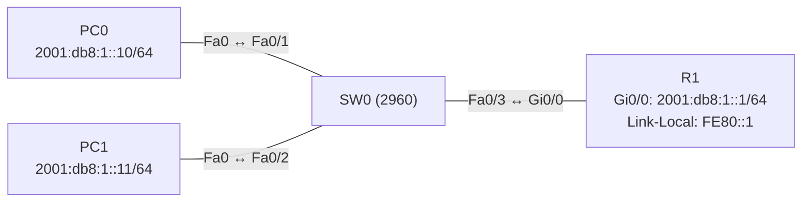

# Übung 7.1: IPv6-Adressen verstehen und vergeben

| | |
|---|---|
| **Modul** | 7 – IPv6 |
| **Stufe** | Grundlage |
| **Geschätzte Zeit** | ca. 60–75 Minuten |
| **Werkzeug** | Cisco Packet Tracer |
| **Vorwissen** | Übung 1.2 (zwei Netze und ein Router), Übung 1.3 (Subnetting) |

> **Stand der Prüfung:** Entwurf. Die Befehle `ipv6 unicast-routing`, `ipv6 address <Präfix>/64 eui-64`, `ipv6 address FC00::1/64`, `show ipv6 interface brief`, `show ipv6 interface` und am PC `ipconfig /all` sowie `ping -6` sind durch ein Cisco-Lab belegt (siehe Quellen); das Lab zeigt keinen Befehl für eine manuelle Link-Local-Adresse. **Nicht bestätigt** sind in Packet Tracer `ipv6 address … link-local`, das Eingabefeld für IPv6 im PC-Fenster, `ping` mit IPv6-Adressen am PC (Packet Tracer akzeptiert die Adresse hinter `ping`, das Lab nennt `ping -6`), die genauen Ausgaben und alle GUI-Wege. Die Rechenaufgaben (Schreibweise, EUI-64) sind Standardwissen und per Hand nachprüfbar.

## Lernziele

Nach dieser Übung kannst du

- IPv6-Adressen kürzen und wieder ausschreiben,
- Global Unicast, Unique Local, Link-Local und Multicast anhand des Präfixes erkennen,
- den Aufbau einer /64-Adresse (Präfix und Interface-ID) erklären,
- eine Interface-ID per EUI-64 aus einer MAC-Adresse bilden,
- auf Router und PCs IPv6-Adressen vergeben und mit `show ipv6 interface brief` prüfen,
- Pings über IPv6 durchführen.

## Voraussetzungen

IPv4-Adressierung und Subnetting (Modul 1). Hier kommt eine neue Schreibweise, aber dasselbe Prinzip: Adresse, Präfix, Gateway.

## Grundbegriffe

| Begriff | Bedeutung |
|---|---|
| IPv6-Adresse | 128 Bit, geschrieben als 8 Blöcke zu je 4 Hexadezimalziffern, getrennt durch `:`. |
| Kürzen | Führende Nullen in einem Block weglassen; **eine** Folge von Nullblöcken durch `::` ersetzen. |
| Präfixlänge | Anzahl der Netz-Bits (z. B. `/64`), wie bei IPv4. |
| Interface-ID | Die hinteren 64 Bit einer /64-Adresse, die das Gerät im Netz kennzeichnen. |
| Global Unicast | Weltweit routbar, Präfix `2000::/3` (z. B. `2001:db8::/32` für Dokumentation). |
| Unique Local (ULA) | Privat, Präfix `FC00::/7` (praktisch `FD…`). Gegenstück zu `192.168.x.x`. |
| Link-Local | Nur im lokalen Netz gültig, Präfix `FE80::/10`. Jedes IPv6-Interface hat eine. |
| Multicast | `FF00::/8`. Ersetzt Broadcast (z. B. `FF02::1` alle Geräte im Netz). |
| EUI-64 | Verfahren, um die Interface-ID aus der MAC-Adresse zu bilden. |
| Loopback | `::1`. |

> **Merksatz:** Es gibt kein Broadcast mehr. Jede Schnittstelle hat mehrere Adressen gleichzeitig: mindestens Link-Local und meist eine globale.

## Topologie und Adressplan

Ein Router mit einem LAN, zwei PCs und einem Switch.



| Gerät | Port / Interface | IPv6-Adresse | Präfix | Default Gateway |
|---|---|---|---|---|
| R1 | `GigabitEthernet0/0` | `2001:db8:1::1` | `/64` | – |
| R1 | `GigabitEthernet0/0` | `FE80::1` (link-local) | `/10` | – |
| PC0 | FastEthernet0 | `2001:db8:1::10` | `/64` | `2001:db8:1::1` |
| PC1 | FastEthernet0 | `2001:db8:1::11` | `/64` | `2001:db8:1::1` |

`2001:db8::/32` ist für Dokumentation reserviert.

## Aufgabe

> **Schema dieser Übungsreihe: zwei Wege pro Schritt.** Wo es in Packet Tracer keinen CLI-Weg gibt (Geräte platzieren, verkabeln, PC-Adressen), steht das ausdrücklich dabei. Alle Befehle stehen in Codeblöcken. Die CLI-Befehle und GUI-Wege sind in dieser Entwurfsfassung noch nicht in Packet Tracer bestätigt.

### Teil A: Rechnen auf Papier

**1. Adressen kürzen**

- **GUI:** Entfällt, Rechenaufgabe auf Papier.
- **CLI:** Entfällt.

Kürze folgende Adressen so weit wie möglich:

1. `2001:0db8:0000:0000:0000:0000:0000:0001`
2. `2001:0db8:0001:0000:0000:0ab9:c0a8:0102`
3. `fe80:0000:0000:0000:0202:b3ff:fe1e:8329`

**2. Adressen ausschreiben**

- **GUI:** Entfällt.
- **CLI:** Entfällt.

Schreibe die gekürzten Adressen vollständig aus: `2001:db8::a:0:0:1`, `fe80::1`, `2001:db8:acad::fe55:6789:b210:1f44`.

**3. Adresstypen bestimmen**

- **GUI:** Entfällt.
- **CLI:** Entfällt.

Ordne zu (Global Unicast, Unique Local, Link-Local, Multicast, Loopback): `2001:db8:1::1`, `fd12:3456:789a::1`, `fe80::1`, `ff02::1`, `::1`.

**4. Interface-ID per EUI-64 bilden**

- **GUI:** Entfällt.
- **CLI:** Entfällt.

Die MAC-Adresse lautet `0001.4321.AAAA` (`00:01:43:21:AA:AA`). Bilde die EUI-64-Interface-ID: Mitte `FF:FE` einfügen und das siebte Bit des ersten Bytes (U/L-Bit) umkehren.

### Teil B: Umsetzung in Packet Tracer

**5. Neues Projekt beginnen** und Geräte platzieren: ein Router (*1941*), ein Switch (*2960*), zwei PCs

- **GUI:** *File* → *New*, Geräte ziehen.
- **CLI:** Entfällt (nur grafisch möglich).

**6. Verkabeln** mit *Copper Straight-Through*: PC0 → SW0 `Fa0/1`, PC1 → SW0 `Fa0/2`, SW0 `Fa0/3` → R1 `Gi0/0`

- **GUI:** Kategorie *Connections*, Kabeltyp anklicken, beide Geräte anklicken, Ports wählen.
- **CLI:** Entfällt (Kabel gibt es nur grafisch).

**7. Router: IPv6 einschalten und Adresse vergeben**

- **GUI:** Router → *Config* → *GigabitEthernet0/0*: Im Bereich *IPv6 Address* die Adresse `2001:db8:1::1` und Präfix `64` eintragen (nicht bestätigt), *Port Status* *On*.
- **CLI:** Auf R1:
  ```text
  Router> enable
  Router# configure terminal
  Router(config)# hostname R1
  R1(config)# ipv6 unicast-routing
  R1(config)# interface gigabitethernet 0/0
  R1(config-if)# ipv6 address 2001:db8:1::1/64
  R1(config-if)# ipv6 address fe80::1 link-local
  R1(config-if)# no shutdown
  R1(config-if)# end
  ```
  `ipv6 unicast-routing` schaltet das IPv6-Routing ein (nötig, damit der Router Pakete weiterleitet und später Router Advertisements sendet). Der Befehl `ipv6 address … link-local` setzt die Link-Local-Adresse von Hand (im Lab nicht gezeigt, nicht bestätigt).

**8. Adressen am Router ansehen**

- **GUI:** Entfällt.
- **CLI:**
  ```text
  R1# show ipv6 interface brief
  R1# show ipv6 interface gigabitethernet 0/0
  ```
  `show ipv6 interface brief` listet je Interface die Link-Local- und die globale Adresse. `show ipv6 interface` zeigt zusätzlich die Multicast-Gruppen, denen der Router angehört (z. B. `FF02::1`, `FF02::2`).

**9. PCs: IPv6-Adressen einrichten**

- **GUI:** PC0 → *Desktop* → *IP Configuration*: Im Bereich *IPv6 Configuration* auf *Static* stellen. *IPv6 Address* `2001:db8:1::10/64`, *IPv6 Gateway* `2001:db8:1::1`. PC1 ebenso mit `2001:db8:1::11/64`.
- **CLI:** Entfällt (der PC hat keine IOS-CLI). Prüfe im *Command Prompt*:
  ```text
  PC> ipconfig /all
  ```
  Du siehst die IPv6-Adresse, die Link-Local-Adresse (`FE80::…`) und das Gateway.

**10. Verbindung testen**

- **GUI:** *Add Simple PDU*: PC0 → PC1 (bei IPv6 nur mit Eingabe der Adresse möglich, nicht bestätigt).
- **CLI:** Am PC0:
  ```text
  PC> ping 2001:db8:1::11
  PC> ping 2001:db8:1::1
  ```
  Das Lab verwendet `ping -6 <Adresse>`; in Packet Tracer genügt oft die Adresse. Beide Wege probieren.

**11. Link-Local-Verkehr ausprobieren**

- **GUI:** Entfällt.
- **CLI:** Am PC0 die Link-Local-Adresse von R1 anpingen:
  ```text
  PC> ping fe80::1
  ```
  Ob Packet Tracer das ohne Angabe der Schnittstelle akzeptiert, ist offen (nicht bestätigt). Auf dem Router:
  ```text
  R1# ping 2001:db8:1::10
  ```

**12. Globale Adresse nach EUI-64 vergeben**

- **GUI:** Entfällt.
- **CLI:** Auf R1 eine zweite Schnittstelle (oder ein Loopback) mit EUI-64:
  ```text
  R1# configure terminal
  R1(config)# interface gigabitethernet 0/1
  R1(config-if)# ipv6 address 2001:db8:2::/64 eui-64
  R1(config-if)# no shutdown
  R1(config-if)# end
  R1# show ipv6 interface brief
  ```
  Die Interface-ID wird aus der MAC-Adresse des Interfaces gebildet. Vergleiche mit deiner Rechnung aus Teil A (MAC-Adresse mit `show interfaces gigabitethernet 0/1` ablesen).

**13. Unique-Local-Adresse**

- **GUI:** Entfällt.
- **CLI:** Auf R1:
  ```text
  R1(config)# interface gigabitethernet 0/0
  R1(config-if)# ipv6 address fd00:1::1/64
  R1(config-if)# end
  R1# show ipv6 interface brief
  ```
  Ein Interface kann mehrere IPv6-Adressen haben. Entferne die zusätzliche Adresse wieder mit `no ipv6 address fd00:1::1/64`.

**14. Speichern**

- **GUI:** `Strg+S` als `07.1-ipv6-adressen-verstehen-und-vergeben.pkt`.
- **CLI:**
  ```text
  R1# copy running-config startup-config
  ```

## Hintergrund: IPv6 im Überblick

1. **Adressraum:** 128 Bit statt 32. Dadurch braucht man kein NAT mehr, und ein Standardnetz ist ein /64 mit 2^64 Adressen.
2. **Aufbau:** Bei einem Global-Unicast-/64 sind die ersten 64 Bit das Präfix (Provider-Präfix plus Teilnetz-ID), die letzten 64 Bit die Interface-ID.
3. **Kürzen:** Führende Nullen entfallen. Eine einzige Folge aus Nullblöcken wird durch `::` ersetzt, bevorzugt die längste. Zweimal `::` in einer Adresse ist verboten.
4. **Link-Local:** Entsteht automatisch (meist EUI-64 oder zufällig) und gilt nur im Segment. Sie dient dem Nachbarschaftsverkehr; Router nutzen sie als Next Hop.
5. **Multicast statt Broadcast:** `FF02::1` erreicht alle Geräte im Segment, `FF02::2` alle Router.
6. **EUI-64:** MAC-Adresse halbieren, `FFFE` einfügen und das U/L-Bit invertieren. Dadurch lässt sich die MAC aus der Adresse ablesen, deshalb nutzen viele Systeme heute zufällige Interface-IDs.
7. **Nachbarerkennung:** Statt ARP nutzt IPv6 das Neighbor Discovery Protocol (ICMPv6).

## Hinweise

- `::` darf nur einmal vorkommen. `2001:db8::1::2` ist ungültig.
- Ein Router mit `ipv6 unicast-routing` verhält sich anders als ohne: Ohne den Befehl sendet er keine Router Advertisements und leitet keinen IPv6-Verkehr weiter.
- Die Link-Local-Adresse eines Routers darf je Interface eine feste, leicht merkbare Adresse sein (z. B. `FE80::1`).
- Pings auf Link-Local-Adressen brauchen auf Routern die Angabe der Schnittstelle (`ping fe80::1`, dann fragt IOS nach dem Interface; nicht bestätigt).
- Die Rechenaufgaben lassen sich selbst kontrollieren; die Musterlösung steht unten.

## Prüfbefehle

Am PC (Command Prompt):

```text
PC> ipconfig /all
PC> ping 2001:db8:1::1
```

Am Router (CLI):

```text
R1> enable
R1# show ipv6 interface brief
R1# show ipv6 interface gigabitethernet 0/0
R1# show ipv6 route
R1# show running-config interface gigabitethernet 0/0
```

| CLI-Befehl | Was er zeigt | GUI-Weg |
|---|---|---|
| `show ipv6 interface brief` | Link-Local- und globale Adressen je Interface | Router → *Config* → Interface |
| `show ipv6 interface <Port>` | Details, Multicast-Gruppen, ND-Einstellungen | – (nur CLI) |
| `show ipv6 route` | Routingtabelle (`C`, `L`) | Werkzeug *Inspect* → *Routing Table* |
| `ipconfig /all` (PC) | IPv6-Adresse, Link-Local, Gateway | PC → *Desktop* → *IP Configuration* |
| `ping` | Erreichbarkeit | *Add Simple PDU* |

**Kontrollfragen**

1. Welche zwei Regeln gelten beim Kürzen einer IPv6-Adresse?
2. Woran erkennst du eine Link-Local-, eine Unique-Local- und eine Global-Unicast-Adresse?
3. Wie viele Bits hat die Interface-ID in einem /64, und wie wird sie per EUI-64 gebildet?
4. Wozu braucht ein Router `ipv6 unicast-routing`?
5. Warum gibt es in IPv6 keinen Broadcast mehr?

## Erweiterungen

- **Dualer Betrieb:** Auf demselben Interface zusätzlich IPv4 vergeben (Dual Stack) und beide Protokolle testen.
- **Subnetting:** Aus `2001:db8:acad::/48` vier /64-Netze bilden (`:1::/64` bis `:4::/64`) und in einen Adressplan eintragen.
- **Zufällige Interface-ID:** Prüfen, ob die PCs ihre Link-Local-Adresse per EUI-64 bilden (Vergleich mit der MAC-Adresse).
- **Weiter:** Übung 7.2 lässt die PCs ihre Adresse automatisch bilden.

---

## Musterlösung

<details>
<summary>Musterlösung anzeigen</summary>

**Teil A, Aufgabe 1 (Kürzen):**

1. `2001:db8::1`
2. `2001:db8:1::ab9:c0a8:102`
3. `fe80::202:b3ff:fe1e:8329`

Bei Nr. 2 wird die längste Nullfolge (die beiden Blöcke `0000:0000`) durch `::` ersetzt, die führenden Nullen entfallen.

**Aufgabe 2 (Ausschreiben):**

- `2001:db8::a:0:0:1` → `2001:0db8:0000:0000:000a:0000:0000:0001`
- `fe80::1` → `fe80:0000:0000:0000:0000:0000:0000:0001`
- `2001:db8:acad::fe55:6789:b210:1f44` → `2001:0db8:acad:0000:fe55:6789:b210:1f44`

Der Bereich zwischen den Doppelpunkten ergibt so viele Nullblöcke, wie zu acht Blöcken fehlen.

**Aufgabe 3 (Typen):**

| Adresse | Typ |
|---|---|
| `2001:db8:1::1` | Global Unicast (Dokumentationspräfix) |
| `fd12:3456:789a::1` | Unique Local |
| `fe80::1` | Link-Local |
| `ff02::1` | Multicast (alle Geräte im Segment) |
| `::1` | Loopback |

**Aufgabe 4 (EUI-64):** MAC `00:01:43:21:AA:AA`.

1. `FF:FE` in die Mitte: `00:01:43:FF:FE:21:AA:AA`.
2. U/L-Bit (siebtes Bit des ersten Bytes) umkehren: `00` = `0000 0000` → `0000 0010` = `02`.
3. Ergebnis: `0201:43FF:FE21:AAAA`.

Mit dem Präfix `2001:db8:2::/64` ergibt das `2001:db8:2:0:201:43ff:fe21:aaaa`.

**Router (Schritt 7):**

```text
R1(config)# ipv6 unicast-routing
R1(config)# interface gigabitethernet 0/0
R1(config-if)# ipv6 address 2001:db8:1::1/64
R1(config-if)# ipv6 address fe80::1 link-local
R1(config-if)# no shutdown
```

**Anzeige (Schritt 8, sinngemäß, nicht bestätigt):**

```text
R1# show ipv6 interface brief
GigabitEthernet0/0     [up/up]
    FE80::1
    2001:DB8:1::1
GigabitEthernet0/1     [down/down]
    unassigned
```

**Test (Schritt 10):** Pings zwischen PC0, PC1 und R1 klappen (der erste Versuch kann verloren gehen).

**Antworten auf die Kontrollfragen:**

1. Führende Nullen in jedem Block weglassen; genau eine (die längste) Folge von Nullblöcken durch `::` ersetzen.
2. Link-Local beginnt mit `FE80`, Unique Local mit `FC`/`FD`, Global Unicast mit `2` oder `3` (`2000::/3`).
3. 64 Bit. Bei EUI-64: MAC halbieren, `FFFE` einfügen, U/L-Bit invertieren.
4. Er schaltet das IPv6-Routing ein: Der Router leitet IPv6-Pakete weiter und sendet Router Advertisements.
5. Multicast-Adressen erreichen gezielt Gruppen (z. B. `FF02::1` alle Geräte, `FF02::2` alle Router), Broadcast ist nicht vorgesehen.

</details>

---

## Quellen

- Cisco Networking Academy, *Lab – Configuring IPv6 Static and Default Routes* (6.2.4.5, [cisco.tu-sofia.bg](https://cisco.tu-sofia.bg/wp-content/uploads/courses/CCNA2/course/files/6.2.4.5%20Lab%20-%20Configuring%20IPv6%20Static%20and%20Default%20Routes.pdf)): `ipv6 unicast-routing`, `ipv6 address 2001:DB8:ACAD:A::/64 eui-64`, `ipv6 address FC00::1/64`, Verifikation mit `show ipv6 interface brief`, `show ipv6 interface`, `show ipv6 route`, am PC `ipconfig /all` und `ping -6 <Adresse>`. Das Lab zeigt keinen Befehl für eine manuelle Link-Local-Adresse und keine Beispielausgaben.
- Schreibweise, Kürzungsregeln, Adresstypen und Präfixe, EUI-64-Verfahren, Multicast-Adressen und Neighbor Discovery: allgemeines Wissen zu IPv6, hier nicht aus der genannten Quelle im Wortlaut belegt.
- Die gezeigten Ausgaben sind ein konstruiertes Beispiel im IOS-Format und nicht aus Packet Tracer übernommen.

---

Lizenz: [CC BY-NC-SA 4.0](https://creativecommons.org/licenses/by-nc-sa/4.0/deed.de), Urheber: AnsibleArtisan4711. Cisco, Cisco IOS und Cisco Packet Tracer sind Marken von Cisco Systems, Inc. und/oder ihrer Tochtergesellschaften; dieses Dokument steht in keiner Verbindung zu Cisco.
