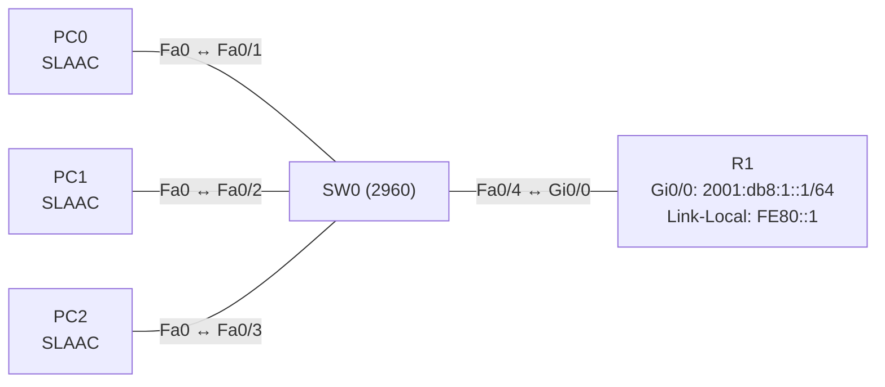

# Übung 7.2: Automatische Adressvergabe mit SLAAC

| | |
|---|---|
| **Modul** | 7 – IPv6 |
| **Stufe** | Aufbau |
| **Geschätzte Zeit** | ca. 45–60 Minuten |
| **Werkzeug** | Cisco Packet Tracer |
| **Vorwissen** | Übung 7.1 (IPv6-Adressen), Übung 4.1 (DHCP) |

> **Stand der Prüfung:** Entwurf. Die Befehle `ipv6 unicast-routing`, `ipv6 address … /64`, `show ipv6 interface brief`, `ipconfig /all` sind durch ein Cisco-Lab belegt (siehe Quellen, Übung 7.1). **Nicht belegt** sind in dieser Fassung die Funktion von Router Advertisements und SLAAC in Packet Tracer, die Einstellung *Auto Config* am PC, die Befehle `ipv6 nd ra suppress`, `show ipv6 neighbors` und `show ipv6 interface` mit RA-Daten, die gezeigten Ausgaben, die Bildung der Adresse (EUI-64 oder zufällig) am Packet-Tracer-PC sowie alle GUI-Wege.

## Lernziele

Nach dieser Übung kannst du

- erklären, wie ein IPv6-Gerät ohne DHCP an eine globale Adresse kommt (SLAAC),
- beschreiben, was ein Router Advertisement (RA) enthält und wer es sendet,
- PCs auf automatische IPv6-Konfiguration stellen und das Ergebnis prüfen,
- die erhaltene Adresse mit der Rechnung aus Übung 7.1 vergleichen,
- das Default Gateway als Link-Local-Adresse des Routers erkennen,
- SLAAC, zustandsloses DHCPv6 und zustandsbehaftetes DHCPv6 unterscheiden.

## Voraussetzungen

Übung 7.1: Link-Local, Global Unicast, EUI-64.

## Grundbegriffe

| Begriff | Bedeutung |
|---|---|
| SLAAC | *Stateless Address Autoconfiguration*: Das Gerät bildet seine Adresse selbst aus Präfix und Interface-ID. |
| Router Advertisement (RA) | ICMPv6-Nachricht, mit der ein Router Präfix, Präfixlänge und sich selbst als Gateway bekannt gibt. |
| Router Solicitation (RS) | Anfrage eines Geräts, das nicht auf das nächste RA warten will. |
| `FF02::2` | Multicast-Adresse „alle Router im Segment“, an die RS gehen. |
| Neighbor Discovery | IPv6-Verfahren für Adressauflösung (ersetzt ARP), Router-Suche und Adressprüfung. |
| Stateless DHCPv6 | Adresse per SLAAC, weitere Angaben (z. B. DNS) per DHCPv6. |
| Stateful DHCPv6 | Alle Angaben, auch die Adresse, kommen per DHCPv6 (wie DHCP in IPv4). |

> **Merksatz:** Beim SLAAC liefert der Router das Präfix, das Gerät bildet den Rest selbst. Das Default Gateway ist die Link-Local-Adresse des Routers.

## Topologie und Adressplan



| Gerät | Port / Interface | IPv6-Adresse | Präfix | Default Gateway |
|---|---|---|---|---|
| R1 | `GigabitEthernet0/0` | `2001:db8:1::1` | `/64` | – |
| R1 | `GigabitEthernet0/0` | `FE80::1` (link-local) | `/10` | – |
| PC0, PC1, PC2 | FastEthernet0 | per SLAAC | `/64` | `FE80::1` |

## Aufgabe

> **Schema dieser Übungsreihe: zwei Wege pro Schritt.** Wo es in Packet Tracer keinen CLI-Weg gibt (Geräte platzieren, verkabeln, PC-Einstellungen), steht das ausdrücklich dabei. Alle Befehle stehen in Codeblöcken. Die CLI-Befehle und GUI-Wege sind in dieser Entwurfsfassung noch nicht in Packet Tracer bestätigt.

**1. Neues Projekt beginnen** und Geräte platzieren: ein Router (*1941*), ein Switch (*2960*), drei PCs

- **GUI:** *File* → *New*, Geräte ziehen.
- **CLI:** Entfällt (nur grafisch möglich).

**2. Verkabeln** mit *Copper Straight-Through*: PC0–PC2 → SW0 `Fa0/1`–`Fa0/3`, SW0 `Fa0/4` → R1 `Gi0/0`

- **GUI:** Kategorie *Connections*, Kabeltyp anklicken, beide Geräte anklicken, Ports wählen.
- **CLI:** Entfällt (Kabel gibt es nur grafisch).

**3. Router einrichten: ohne IPv6-Routing**

- **GUI:** Router → *Config* → *GigabitEthernet0/0*: IPv6-Adresse `2001:db8:1::1/64` (nicht bestätigt), *Port Status* *On*.
- **CLI:** Auf R1 (noch **ohne** `ipv6 unicast-routing`):
  ```text
  Router> enable
  Router# configure terminal
  Router(config)# hostname R1
  R1(config)# interface gigabitethernet 0/0
  R1(config-if)# ipv6 address 2001:db8:1::1/64
  R1(config-if)# ipv6 address fe80::1 link-local
  R1(config-if)# no shutdown
  R1(config-if)# end
  ```

**4. PCs auf automatische Konfiguration stellen**

- **GUI:** Jeder PC → *Desktop* → *IP Configuration*: im Bereich *IPv6 Configuration* *Auto Config* wählen (nicht bestätigt).
- **CLI:** Entfällt (der PC hat keine IOS-CLI). Prüfe im *Command Prompt*:
  ```text
  PC> ipconfig /all
  ```
  Ohne `ipv6 unicast-routing` bekommen die PCs keine globale Adresse, weil der Router keine Router Advertisements sendet (nicht bestätigt). Sie haben nur eine Link-Local-Adresse (`FE80::…`).

**5. IPv6-Routing am Router einschalten**

- **GUI:** Entfällt (nur CLI).
- **CLI:**
  ```text
  R1# configure terminal
  R1(config)# ipv6 unicast-routing
  R1(config)# end
  ```
  Damit beginnt der Router, Router Advertisements zu senden.

**6. Ergebnis am PC prüfen**

- **GUI:** PC → *Desktop* → *IP Configuration*: Falls die Anzeige nicht aktualisiert wird, kurz auf *Static* und wieder auf *Auto Config* stellen.
- **CLI:** Im *Command Prompt*:
  ```text
  PC> ipconfig /all
  ```
  Notiere für jeden PC: IPv6-Adresse (mit Präfix `2001:db8:1::`), Link-Local-Adresse, Default Gateway. Das Default Gateway ist `FE80::1`, die Link-Local-Adresse des Routers (nicht bestätigt).

**7. Adresse mit der Rechnung vergleichen**

- **GUI:** PC → *Config* → *FastEthernet0*: *MAC Address* ablesen.
- **CLI:** Im *Command Prompt*:
  ```text
  PC> ipconfig /all
  ```
  Bilde aus der MAC-Adresse von PC0 die EUI-64-Interface-ID (Übung 7.1) und vergleiche mit den hinteren 64 Bit der erhaltenen Adresse. Stimmen sie überein? (Packet Tracer bildet die Adresse in der Regel per EUI-64, nicht bestätigt.)

**8. Verbindung testen**

- **GUI:** *Add Simple PDU*: PC0 → PC1 (bei IPv6 nur mit Adresseingabe, nicht bestätigt).
- **CLI:** Am PC0:
  ```text
  PC> ping <IPv6-Adresse von PC1>
  PC> ping 2001:db8:1::1
  ```

**9. Nachbarn und Router am Router ansehen**

- **GUI:** Entfällt.
- **CLI:** Auf R1:
  ```text
  R1# show ipv6 interface brief
  R1# show ipv6 neighbors
  ```
  `show ipv6 neighbors` zeigt die gelernten Adressen der PCs samt MAC-Adresse (ersetzt die ARP-Tabelle; nicht bestätigt).

**10. Gegenprobe: Router Advertisements abschalten**

- **GUI:** Entfällt.
- **CLI:** Auf R1:
  ```text
  R1# configure terminal
  R1(config)# interface gigabitethernet 0/0
  R1(config-if)# ipv6 nd ra suppress
  R1(config-if)# end
  ```
  Stelle die PCs neu auf *Auto Config* (oder starte sie neu). Neue PCs bekommen keine globale Adresse mehr (nicht bestätigt). Hebe die Unterdrückung mit `no ipv6 nd ra suppress` wieder auf.

**11. Router als Gateway abschalten und beobachten**

- **GUI:** Entfällt.
- **CLI:** Zusätzlich `shutdown` auf `Gi0/0`: Das Gateway fällt weg, die PCs verlieren den Weg ins Router-Netz. Danach `no shutdown`.

**12. Speichern**

- **GUI:** `Strg+S` als `07.2-automatische-adressvergabe-slaac.pkt`.
- **CLI:**
  ```text
  R1# copy running-config startup-config
  ```

## Hintergrund: Wie bekommt ein PC seine Adresse?

1. **Link-Local zuerst:** Beim Start bildet jedes Gerät eine Link-Local-Adresse (`FE80::/10` plus Interface-ID) und prüft per Neighbor Discovery, dass sie frei ist.
2. **Router Solicitation:** Es sendet eine RS an `FF02::2` („Gibt es Router?“).
3. **Router Advertisement:** Der Router antwortet (und sendet regelmäßig auch ungefragt) mit dem Präfix `2001:db8:1::/64`, der Präfixlänge und Flags.
4. **SLAAC:** Das Gerät kombiniert das Präfix mit einer Interface-ID (EUI-64 oder zufällig) zur globalen Adresse. Eine Prüfung auf Doppelvergabe folgt.
5. **Default Gateway:** Das Gerät nimmt die Quelladresse des RA, also die **Link-Local-Adresse** des Routers, als Gateway.
6. **Mit oder ohne DHCPv6:** Ein Flag im RA sagt, ob zusätzlich DHCPv6 zu nutzen ist (Stateless für DNS, Stateful für alles). Packet-Tracer-Router bieten diese Funktionen nur eingeschränkt.

## Hinweise

- Ohne `ipv6 unicast-routing` sendet ein Router **keine** RAs, auch wenn das Interface eine IPv6-Adresse hat.
- SLAAC funktioniert nur mit einem /64-Präfix.
- Die PCs bekommen keine Angabe zu DNS, solange kein DHCPv6 beteiligt ist.
- Ändert sich das Präfix am Router, ändern sich die Adressen der PCs mit.
- Das Gateway bleibt auch bei geänderter globaler Adresse dasselbe (Link-Local).

## Prüfbefehle

Am PC (Command Prompt):

```text
PC> ipconfig /all
PC> ping 2001:db8:1::1
```

Am Router (CLI):

```text
R1> enable
R1# show ipv6 interface brief
R1# show ipv6 interface gigabitethernet 0/0
R1# show ipv6 neighbors
R1# show ipv6 route
```

| CLI-Befehl | Was er zeigt | GUI-Weg |
|---|---|---|
| `ipconfig /all` (PC) | Globale Adresse, Link-Local, Gateway | PC → *Desktop* → *IP Configuration* |
| `show ipv6 interface <Port>` | Multicast-Gruppen, ND-Daten, ggf. RA-Intervalle (nicht bestätigt) | – (nur CLI) |
| `show ipv6 neighbors` | Gelernte Nachbarn mit MAC | – |
| `show ipv6 route` | Routen des Routers | Werkzeug *Inspect* → *Routing Table* |

**Kontrollfragen**

1. Welche Aufgabe hat das Router Advertisement?
2. Warum sendet ein Router ohne `ipv6 unicast-routing` keine RAs?
3. Aus welchen zwei Teilen besteht eine per SLAAC gebildete Adresse?
4. Welche Adresse tragen die PCs als Default Gateway ein, und warum?
5. Worin unterscheiden sich SLAAC, Stateless DHCPv6 und Stateful DHCPv6?

## Erweiterungen

- **Zweites LAN:** Ein weiteres Interface mit `2001:db8:2::/64` und PCs per SLAAC.
- **Datenschutz:** Prüfen, ob moderne Systeme die Adresse zufällig statt per EUI-64 bilden (Packet Tracer nicht).
- **DHCPv6:** Zustandsloses DHCPv6 mit DNS-Server testen (`ipv6 dhcp pool`, nicht bestätigt).
- **Weiter:** Übung 7.3 verbindet zwei IPv6-Netze mit statischen Routen.

---

## Musterlösung

<details>
<summary>Musterlösung anzeigen</summary>

**Router:**

```text
R1(config)# ipv6 unicast-routing
R1(config)# interface gigabitethernet 0/0
R1(config-if)# ipv6 address 2001:db8:1::1/64
R1(config-if)# ipv6 address fe80::1 link-local
R1(config-if)# no shutdown
```

**PCs:** *IPv6 Configuration* → *Auto Config*.

**Ohne `ipv6 unicast-routing` (Schritt 4):** Die PCs haben nur eine Link-Local-Adresse.

**Mit `ipv6 unicast-routing` (Schritt 6, sinngemäß, nicht bestätigt):**

| | Globale Adresse | Link-Local | Default Gateway |
|---|---|---|---|
| PC0 | `2001:DB8:1:0:201:43FF:FE21:AAAA` | `FE80::201:43FF:FE21:AAAA` | `FE80::1` |

Die Interface-ID richtet sich nach der MAC-Adresse des jeweiligen PCs; das Beispiel setzt die MAC `0001.4321.AAAA` aus Übung 7.1 voraus.

**EUI-64-Vergleich (Schritt 7):** Aus MAC `00:01:43:21:AA:AA` wird `0201:43FF:FE21:AAAA`. Das passt zu den hinteren 64 Bit im Beispiel.

**Gegenprobe (Schritt 10):** Mit `ipv6 nd ra suppress` sendet der Router keine RAs, neue PCs bleiben bei Link-Local.

**Antworten auf die Kontrollfragen:**

1. Es teilt den Geräten das Präfix, die Präfixlänge und den Router als Gateway mit.
2. Das Senden von RAs ist Teil des IPv6-Routings; ohne den Befehl verhält sich das Gerät wie ein Host.
3. Aus dem Präfix (64 Bit vom Router) und der Interface-ID (64 Bit vom Gerät, EUI-64 oder zufällig).
4. Die Link-Local-Adresse des Routers (`FE80::1`), weil sie im Segment immer gültig ist und sich nicht mit dem globalen Präfix ändert.
5. SLAAC: nur Präfix vom Router, ohne Server. Stateless DHCPv6: Adresse per SLAAC, zusätzliche Angaben per DHCPv6. Stateful DHCPv6: Adresse und Angaben vom DHCPv6-Server, vergleichbar mit DHCP in IPv4.

</details>

---

## Quellen

- Cisco Networking Academy, *Lab – Configuring IPv6 Static and Default Routes* (6.2.4.5, [cisco.tu-sofia.bg](https://cisco.tu-sofia.bg/wp-content/uploads/courses/CCNA2/course/files/6.2.4.5%20Lab%20-%20Configuring%20IPv6%20Static%20and%20Default%20Routes.pdf)): `ipv6 unicast-routing`, `ipv6 address … /64`, Prüfung mit `show ipv6 interface brief` und `ipconfig /all`. Das Lab behandelt SLAAC nicht.
- Ablauf von SLAAC, Router Advertisement und Router Solicitation, Rolle von `FF02::2`, Verwendung der Link-Local-Adresse als Gateway, DHCPv6-Varianten, `ipv6 nd ra suppress`, `show ipv6 neighbors`: allgemeines IPv6-Wissen, hier nicht aus einer Quelle im Wortlaut belegt.
- Die gezeigten Ausgaben sind ein konstruiertes Beispiel im IOS-Format und nicht aus Packet Tracer übernommen.

---

Lizenz: [CC BY-NC-SA 4.0](https://creativecommons.org/licenses/by-nc-sa/4.0/deed.de), Urheber: AnsibleArtisan4711. Cisco, Cisco IOS und Cisco Packet Tracer sind Marken von Cisco Systems, Inc. und/oder ihrer Tochtergesellschaften; dieses Dokument steht in keiner Verbindung zu Cisco.
