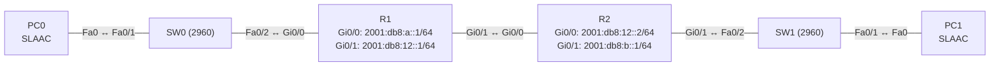

# Übung 7.3: Statisches IPv6-Routing

| | |
|---|---|
| **Modul** | 7 – IPv6 |
| **Stufe** | Aufbau |
| **Geschätzte Zeit** | ca. 60–75 Minuten |
| **Werkzeug** | Cisco Packet Tracer |
| **Vorwissen** | Übung 7.1 und 7.2 (IPv6-Adressen, SLAAC), Übung 3.1 und 3.2 (statische Routen, Default-Route) |

> **Stand der Prüfung:** Entwurf. Die Befehle `ipv6 unicast-routing`, `ipv6 address … /64`, `ipv6 route <Präfix> <Next Hop>`, `ipv6 route <Präfix> <Interface>`, `ipv6 route ::/0 …`, `no ipv6 route …`, `show ipv6 interface brief` und `show ipv6 route` sind durch ein Cisco-Lab belegt (siehe Quellen). **Nicht bestätigt** sind die Next-Hop-Angabe mit Link-Local-Adresse und Interface (`ipv6 route … <Interface> <FE80::…>`), die Routencodes und gezeigten Ausgaben in Packet Tracer, der Kabeltyp zwischen den Routern, SLAAC-Adressen der PCs und alle GUI-Wege.

## Lernziele

Nach dieser Übung kannst du

- zwei IPv6-Netze über zwei Router verbinden,
- statische IPv6-Routen mit Next-Hop-Adresse und mit Ausgangsschnittstelle schreiben,
- eine IPv6-Default-Route (`::/0`) setzen,
- `show ipv6 route` lesen,
- erklären, warum IPv6-Routing ohne `ipv6 unicast-routing` nicht funktioniert und was bei einer Link-Local-Adresse als Next Hop zu beachten ist,
- den Unterschied zu IPv4-Routing (Übung 3.1) nennen.

## Voraussetzungen

IPv6-Adressen (7.1), statisches Routing mit IPv4 (3.1, 3.2).

## Grundbegriffe

| Begriff | Bedeutung |
|---|---|
| `ipv6 route` | Befehl für statische IPv6-Routen: `ipv6 route <Präfix>/<Länge> <Next Hop und/oder Interface>`. |
| Rekursive Route | Route mit Next-Hop-Adresse; der Router muss diese Adresse selbst erst auflösen. |
| Direkt angeschlossene Route | Route nur mit Ausgangsschnittstelle (`ipv6 route … serial 0/0/1`). |
| `::/0` | IPv6-Default-Route (Gegenstück zu `0.0.0.0/0`). |
| Link-Local als Next Hop | Eine Link-Local-Adresse ist nur pro Schnittstelle eindeutig, deshalb muss die Schnittstelle mit angegeben werden. |
| Routencode `S` | Statische Route in `show ipv6 route`. |

> **Merksatz:** Das Prinzip ist wie in IPv4: Wo muss das Paket hin, wer ist der nächste Router? Neu ist nur die Schreibweise und `ipv6 unicast-routing`.

## Topologie und Adressplan



| Gerät | Port / Interface | IPv6-Adresse | Präfix | Link-Local |
|---|---|---|---|---|
| R1 | `GigabitEthernet0/0` | `2001:db8:a::1` | `/64` | `FE80::1` |
| R1 | `GigabitEthernet0/1` | `2001:db8:12::1` | `/64` | `FE80::1` |
| R2 | `GigabitEthernet0/0` | `2001:db8:12::2` | `/64` | `FE80::2` |
| R2 | `GigabitEthernet0/1` | `2001:db8:b::1` | `/64` | `FE80::2` |
| PC0 | FastEthernet0 | per SLAAC (`2001:db8:a::/64`) | `/64` | Gateway `FE80::1` |
| PC1 | FastEthernet0 | per SLAAC (`2001:db8:b::/64`) | `/64` | Gateway `FE80::2` |

Falls die automatische Adressvergabe der PCs nicht klappt, vergibst du die Adressen von Hand: PC0 `2001:db8:a::10/64` mit Gateway `2001:db8:a::1`, PC1 `2001:db8:b::10/64` mit Gateway `2001:db8:b::1`.

## Aufgabe

> **Schema dieser Übungsreihe: zwei Wege pro Schritt.** Wo es in Packet Tracer keinen CLI-Weg gibt (Geräte platzieren, verkabeln, PC-Einstellungen), steht das ausdrücklich dabei. Alle Befehle stehen in Codeblöcken. Die CLI-Befehle und GUI-Wege sind in dieser Entwurfsfassung noch nicht in Packet Tracer bestätigt.

**1. Neues Projekt beginnen** und Geräte platzieren: zwei Router (*1941*), zwei Switches (*2960*), zwei PCs

- **GUI:** *File* → *New*, Geräte ziehen.
- **CLI:** Entfällt (nur grafisch möglich).

**2. Verkabeln:** Endgeräte und Switches mit *Copper Straight-Through* (PC0 → SW0 `Fa0/1`, SW0 `Fa0/2` → R1 `Gi0/0`, R2 `Gi0/1` → SW1 `Fa0/2`, SW1 `Fa0/1` → PC1), R1 `Gi0/1` ↔ R2 `Gi0/0` mit *Copper Cross-Over* (nicht bestätigt)

- **GUI:** Kategorie *Connections*, Kabeltyp anklicken, beide Geräte anklicken, Ports wählen.
- **CLI:** Entfällt (Kabel gibt es nur grafisch).

**3. IPv6-Adressen auf den Routern**

- **GUI:** Router → *Config* → Interface: IPv6-Adresse und Präfix eintragen (nicht bestätigt), *Port Status* *On*.
- **CLI:** R1:
  ```text
  Router> enable
  Router# configure terminal
  Router(config)# hostname R1
  R1(config)# ipv6 unicast-routing
  R1(config)# interface gigabitethernet 0/0
  R1(config-if)# ipv6 address 2001:db8:a::1/64
  R1(config-if)# ipv6 address fe80::1 link-local
  R1(config-if)# no shutdown
  R1(config-if)# exit
  R1(config)# interface gigabitethernet 0/1
  R1(config-if)# ipv6 address 2001:db8:12::1/64
  R1(config-if)# ipv6 address fe80::1 link-local
  R1(config-if)# no shutdown
  R1(config-if)# end
  ```
  R2:
  ```text
  Router> enable
  Router# configure terminal
  Router(config)# hostname R2
  R2(config)# ipv6 unicast-routing
  R2(config)# interface gigabitethernet 0/0
  R2(config-if)# ipv6 address 2001:db8:12::2/64
  R2(config-if)# ipv6 address fe80::2 link-local
  R2(config-if)# no shutdown
  R2(config-if)# exit
  R2(config)# interface gigabitethernet 0/1
  R2(config-if)# ipv6 address 2001:db8:b::1/64
  R2(config-if)# ipv6 address fe80::2 link-local
  R2(config-if)# no shutdown
  R2(config-if)# end
  ```

**4. PCs konfigurieren**

- **GUI:** PC → *Desktop* → *IP Configuration* → im Bereich *IPv6 Configuration* *Auto Config* (oder *Static* mit den Handwerten oben).
- **CLI:** Entfällt (der PC hat keine IOS-CLI). Prüfe mit `ipconfig /all` im *Command Prompt*.

**5. Vorher testen: nur direkte Nachbarn**

- **GUI:** *Add Simple PDU*: PC0 → PC1 (IPv6-Adresse von PC1 eintragen, nicht bestätigt).
- **CLI:** Am PC0:
  ```text
  PC> ping <IPv6-Adresse von PC1>
  ```
  Der Ping schlägt fehl. Auf R1 zeigt `show ipv6 route` nur die direkten Netze:
  ```text
  R1# show ipv6 route
  ```

**6. Route von R1 zu LAN B (mit Next-Hop-Adresse)**

- **GUI:** Entfällt (nur CLI).
- **CLI:**
  ```text
  R1# configure terminal
  R1(config)# ipv6 route 2001:db8:b::/64 2001:db8:12::2
  R1(config)# end
  ```
  Die Route ist rekursiv: R1 löst die Next-Hop-Adresse `2001:db8:12::2` über sein direkt angeschlossenes Netz auf.

**7. Route von R2 zu LAN A (mit Ausgangsschnittstelle)**

- **GUI:** Entfällt (nur CLI).
- **CLI:** Auf R2 die Variante nur mit Schnittstelle (nach dem Muster im Lab):
  ```text
  R2# configure terminal
  R2(config)# ipv6 route 2001:db8:a::/64 gigabitethernet 0/0
  R2(config)# end
  ```
  Bei Ethernet-Schnittstellen ist die reine Angabe der Schnittstelle problematisch (Mehrfachzugriffsnetz), das Lab nutzt sie an seriellen Strecken. Wenn der Ping nicht klappt, nimm die Next-Hop-Variante (nächster Schritt).

**8. Alternativ: Route mit Next Hop und Schnittstelle**

- **GUI:** Entfällt.
- **CLI:** Auf R2 ersetzen:
  ```text
  R2# configure terminal
  R2(config)# no ipv6 route 2001:db8:a::/64 gigabitethernet 0/0
  R2(config)# ipv6 route 2001:db8:a::/64 2001:db8:12::1
  R2(config)# end
  ```
  Statt der globalen Adresse kannst du auch die Link-Local-Adresse des Nachbarn verwenden. Dann musst du die Schnittstelle angeben: `ipv6 route 2001:db8:a::/64 gigabitethernet 0/0 fe80::1` (nicht bestätigt).

**9. Routen prüfen**

- **GUI:** Werkzeug *Inspect* → Router → *Routing Table* (nicht bestätigt).
- **CLI:**
  ```text
  R1# show ipv6 route
  R2# show ipv6 route
  ```
  Neue Zeilen mit `S` für die statischen Routen.

**10. Verbindung testen**

- **GUI:** *Add Simple PDU*: PC0 → PC1 und PC1 → PC0.
- **CLI:** Am PC0:
  ```text
  PC> ping <IPv6-Adresse von PC1>
  PC> tracert <IPv6-Adresse von PC1>
  ```
  `tracert` zeigt `2001:db8:a::1` (R1) und `2001:db8:12::2` (R2) bzw. die Link-Local-Adressen (nicht bestätigt).

**11. Default-Route statt Einzelroute**

- **GUI:** Entfällt.
- **CLI:** Auf R2 die Einzelroute durch eine Standardroute ersetzen (R2 ist ein Stub-Router):
  ```text
  R2# configure terminal
  R2(config)# no ipv6 route 2001:db8:a::/64 2001:db8:12::1
  R2(config)# ipv6 route ::/0 2001:db8:12::1
  R2(config)# end
  R2# show ipv6 route
  ```
  Die Standardroute `::/0` fängt alles Unbekannte ab. Der Ping von PC1 zu PC0 klappt weiterhin.

**12. Gegenprobe: Route fehlt oder IPv6-Routing aus**

- **GUI:** Entfällt.
- **CLI:** Auf R1 die Route entfernen: `no ipv6 route 2001:db8:b::/64 2001:db8:12::2`. Der Ping von PC0 zu PC1 schlägt fehl, obwohl R2 antworten würde (Rückroute vorhanden, Hinweg fehlt). Stelle sie wieder her. Entferne auf R2 testweise `ipv6 unicast-routing` (`no ipv6 unicast-routing`): R2 leitet nichts mehr weiter. Setze den Befehl wieder.

**13. Speichern**

- **GUI:** `Strg+S` als `07.3-statisches-ipv6-routing.pkt`.
- **CLI:**
  ```text
  R1# copy running-config startup-config
  ```

## Hintergrund: Statisches Routing in IPv6

1. **Wie in IPv4:** Der Router schlägt das Zielpräfix in der Routingtabelle nach (längster Treffer) und leitet an den Next Hop weiter. Auch hier brauchen beide Richtungen eine Route.
2. **`ipv6 unicast-routing` ist Pflicht:** Ohne den Befehl arbeitet der Router wie ein Host und leitet keine IPv6-Pakete weiter.
3. **Next-Hop-Varianten:** (a) globale Adresse des Nachbarn, (b) Ausgangsschnittstelle, (c) Link-Local-Adresse plus Schnittstelle. Variante (c) ist üblich, weil Link-Local-Adressen stabil bleiben.
4. **Default-Route:** `ipv6 route ::/0 <Next Hop>`.
5. **Routencodes:** `C` direkt angeschlossen, `L` lokale Adresse, `S` statisch, `O` OSPF. Zusätzlich führt IOS ein `L FF00::/8`-Multicast-Eintrag.
6. **Kein NAT:** Die Netze sind global eindeutig und brauchen keine Adressumsetzung.

## Hinweise

- Das Präfix in `ipv6 route` muss die Netzadresse sein (`2001:db8:b::/64`), nicht eine Host-Adresse.
- Bei Ethernet-Strecken immer Next-Hop-Adresse verwenden (ggf. mit Schnittstelle).
- Link-Local-Adressen sind nur pro Schnittstelle eindeutig. Auf R1 und R2 sind sie hier absichtlich gleich bei beiden Interfaces (`FE80::1`); das ist erlaubt, weil sie pro Link gelten.
- Fehlt der Pfad zurück, kommt der Ping nicht an, obwohl der Hinweg läuft.
- IPv4 und IPv6 sind getrennt: Routen, ACLs und Dienste müssen für beide Protokolle angelegt werden.

## Prüfbefehle

Am PC (Command Prompt):

```text
PC> ipconfig /all
PC> ping <IPv6-Adresse von PC1>
PC> tracert <IPv6-Adresse von PC1>
```

Am Router (CLI):

```text
R1> enable
R1# show ipv6 interface brief
R1# show ipv6 route
R1# show running-config | section ipv6
```

| CLI-Befehl | Was er zeigt | GUI-Weg |
|---|---|---|
| `show ipv6 interface brief` | Adressen und Zustand | Router → *Config* → Interface |
| `show ipv6 route` | Routingtabelle mit Codes `C`, `L`, `S` | Werkzeug *Inspect* → *Routing Table* |
| `ping`/`tracert` (PC) | Erreichbarkeit und Weg | *Add Simple PDU* |

**Kontrollfragen**

1. Wie sieht die IPv6-Default-Route aus, und wann setzt man sie?
2. Wozu braucht der Router `ipv6 unicast-routing`?
3. Welche drei Möglichkeiten gibt es, den Next Hop einer statischen IPv6-Route anzugeben?
4. Warum muss bei einer Link-Local-Adresse als Next Hop die Schnittstelle mit angegeben werden?
5. Was ist in `show ipv6 route` der Unterschied zwischen `C` und `L`?

## Erweiterungen

- **Dritter Router:** Eine Kette R1–R2–R3 mit zusätzlichen Netzen und Zusammenfassung (Übung 3.2 in IPv6).
- **Floating Route:** Eine zweite Route mit höherer Administrative Distance (`ipv6 route … 250`) als Reserve (nicht bestätigt).
- **Dual Stack:** Gleichzeitig IPv4 und IPv6 betreiben und beide Protokolle testen.
- **Weiter:** Übung 7.4 ersetzt die statischen Routen durch OSPFv3.

---

## Musterlösung

<details>
<summary>Musterlösung anzeigen</summary>

**Statische Routen (Schritte 6, 8):**

```text
R1(config)# ipv6 route 2001:db8:b::/64 2001:db8:12::2
R2(config)# ipv6 route 2001:db8:a::/64 2001:db8:12::1
```

**Default-Route auf R2 (Schritt 11):**

```text
R2(config)# no ipv6 route 2001:db8:a::/64 2001:db8:12::1
R2(config)# ipv6 route ::/0 2001:db8:12::1
```

**Anzeige auf R1 (Schritt 9, sinngemäß, nicht bestätigt):**

```text
R1# show ipv6 route
C   2001:DB8:A::/64 [0/0] via GigabitEthernet0/0, directly connected
L   2001:DB8:A::1/128 [0/0] via GigabitEthernet0/0, receive
C   2001:DB8:12::/64 [0/0] via GigabitEthernet0/1, directly connected
L   2001:DB8:12::1/128 [0/0] via GigabitEthernet0/1, receive
S   2001:DB8:B::/64 [1/0] via 2001:DB8:12::2
L   FF00::/8 [0/0] via Null0, receive
```

**Test (Schritt 10):** Pings in beide Richtungen klappen (der erste Versuch kann wegen Neighbor Discovery verloren gehen).

**Gegenprobe (Schritt 12):** Ohne die Route auf R1 kommt der Ping nicht ans Ziel; ohne `ipv6 unicast-routing` auf R2 leitet R2 nicht weiter.

**Antworten auf die Kontrollfragen:**

1. `ipv6 route ::/0 <Next Hop>`; man setzt sie an Stub-Routern oder für den Weg ins Internet.
2. Er schaltet das Weiterleiten von IPv6-Paketen ein; ohne ihn verhält sich der Router wie ein Host.
3. Mit der globalen Adresse des Nachbarn, mit der Ausgangsschnittstelle oder mit der Link-Local-Adresse samt Schnittstelle.
4. Eine Link-Local-Adresse kann auf jedem Link vorkommen. Erst die Schnittstelle macht sie eindeutig.
5. `C` ist das direkt angeschlossene Netz (z. B. `/64`), `L` ist die eigene Adresse als `/128`.

</details>

---

## Quellen

- Cisco Networking Academy, *Lab – Configuring IPv6 Static and Default Routes* (6.2.4.5, [cisco.tu-sofia.bg](https://cisco.tu-sofia.bg/wp-content/uploads/courses/CCNA2/course/files/6.2.4.5%20Lab%20-%20Configuring%20IPv6%20Static%20and%20Default%20Routes.pdf)): `ipv6 unicast-routing`, `ipv6 route 2001:DB8:ACAD:B::/64 serial 0/0/1` (Ausgangsschnittstelle), `ipv6 route 2001:DB8:ACAD:B::/64 FC00::2` (Next-Hop-Adresse), `ipv6 route ::/0 serial 0/0/1` (Default), `no ipv6 route …`; Prüfung mit `show ipv6 interface brief`, `show ipv6 route`, `ping -6`. Das Lab beschreibt zwei direkt angeschlossene und drei lokale Einträge sowie einen Multicast-Eintrag zu Null0 in der Routingtabelle, zeigt aber keine Ausgabebeispiele.
- Next Hop mit Link-Local-Adresse und Schnittstelle, Verhalten bei Ethernet-Schnittstellen, Routencodes und Floating Routes: allgemeines Wissen, hier nicht aus der genannten Quelle im Wortlaut belegt.
- Die gezeigten Ausgaben sind ein konstruiertes Beispiel im IOS-Format und nicht aus Packet Tracer übernommen.

---

Lizenz: [CC BY-NC-SA 4.0](https://creativecommons.org/licenses/by-nc-sa/4.0/deed.de), Urheber: AnsibleArtisan4711. Cisco, Cisco IOS und Cisco Packet Tracer sind Marken von Cisco Systems, Inc. und/oder ihrer Tochtergesellschaften; dieses Dokument steht in keiner Verbindung zu Cisco.
