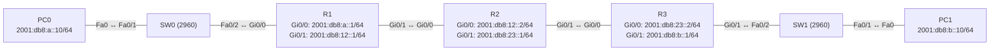

# Übung 7.4: OSPFv3

| | |
|---|---|
| **Modul** | 7 – IPv6 |
| **Stufe** | Fortgeschritten |
| **Geschätzte Zeit** | ca. 75–90 Minuten |
| **Werkzeug** | Cisco Packet Tracer |
| **Vorwissen** | Übung 3.5 und 3.6 (OSPF), Übung 7.3 (statisches IPv6-Routing) |

> **Stand der Prüfung:** Entwurf. Aus den herangezogenen Quellen sind nur `ipv6 unicast-routing`, `ipv6 address`, `show ipv6 interface brief` und `show ipv6 route` belegt (siehe Quellen, Übung 7.3), und aus Übung 3.5 die OSPF-Grundlagen für IPv4. **Nicht belegt** sind in dieser Fassung alle OSPFv3-Befehle (`ipv6 router ospf`, `router-id`, `ipv6 ospf <ID> area <Area>`, `passive-interface`, `show ipv6 ospf neighbor`, `show ipv6 ospf interface brief`, `show ipv6 protocols`, `show ipv6 route ospf`), die Unterstützung von OSPFv3 und dieser Befehle im verwendeten Packet Tracer, alle Ausgaben und alle GUI-Wege. Die Übung ist daher als Entwurf besonders zu prüfen.

## Lernziele

Nach dieser Übung kannst du

- erklären, was OSPFv3 ist und worin es sich von OSPFv2 unterscheidet,
- OSPFv3 für IPv6 einrichten (Prozess, Router-ID, Aktivierung am Interface),
- Nachbarschaften und gelernte Routen prüfen,
- erklären, warum es bei OSPFv3 keine `network`-Anweisung gibt,
- passive Interfaces und Kosten wie in OSPFv2 einsetzen,
- typische Fehler (fehlende Router-ID, fehlendes `ipv6 unicast-routing`, falsche Area) erkennen.

## Voraussetzungen

OSPF mit IPv4 (3.5, 3.6) und IPv6-Grundlagen (7.1 bis 7.3).

## Grundbegriffe

| Begriff | Bedeutung |
|---|---|
| OSPFv3 | Version von OSPF für IPv6. Arbeitet wie OSPFv2 (Link State, Areas, DR/BDR, Kosten). |
| Prozess-ID | Lokale Nummer des Prozesses (`ipv6 router ospf 1`). |
| Router-ID | 32-Bit-Kennung im IPv4-Format, die OSPFv3 auch dann braucht, wenn nur IPv6 läuft. Ohne IPv4-Adresse muss sie von Hand gesetzt werden. |
| Aktivierung am Interface | Statt `network` setzt man `ipv6 ospf <ID> area <Area>` direkt am Interface. |
| Link-Local | Nachbarn tauschen OSPFv3-Pakete über Link-Local-Adressen aus. Die Next Hops sind deshalb Link-Local-Adressen. |
| Multicast `FF02::5` / `FF02::6` | OSPFv3 Hello und Updates (alle OSPF-Router / DR-Router). |

> **Merksatz:** OSPFv3 arbeitet nach demselben Prinzip wie OSPFv2, aber die Interfaces werden direkt aktiviert, und eine Router-ID im IPv4-Format ist nötig.

## Topologie und Adressplan

Gleicher Aufbau wie in Übung 3.5, aber mit IPv6.



| Gerät | Port / Interface | IPv6-Adresse | Link-Local | Router-ID |
|---|---|---|---|---|
| PC0 | FastEthernet0 | `2001:db8:a::10/64` (Gateway `2001:db8:a::1`) | – | – |
| PC1 | FastEthernet0 | `2001:db8:b::10/64` (Gateway `2001:db8:b::1`) | – | – |
| R1 | `Gi0/0` / `Gi0/1` | `2001:db8:a::1/64` / `2001:db8:12::1/64` | `FE80::1` | `1.1.1.1` |
| R2 | `Gi0/0` / `Gi0/1` | `2001:db8:12::2/64` / `2001:db8:23::1/64` | `FE80::2` | `2.2.2.2` |
| R3 | `Gi0/0` / `Gi0/1` | `2001:db8:23::2/64` / `2001:db8:b::1/64` | `FE80::3` | `3.3.3.3` |

## Aufgabe

> **Schema dieser Übungsreihe: zwei Wege pro Schritt.** Wo es in Packet Tracer keinen CLI-Weg gibt (Geräte platzieren, verkabeln, PC-Adressen), steht das ausdrücklich dabei. Alle Befehle stehen in Codeblöcken. Die CLI-Befehle und GUI-Wege sind in dieser Entwurfsfassung noch nicht in Packet Tracer bestätigt.

**1. Neues Projekt beginnen** und Geräte platzieren: drei Router (*1941*), zwei Switches (*2960*), zwei PCs

- **GUI:** *File* → *New*, Geräte ziehen.
- **CLI:** Entfällt (nur grafisch möglich).

**2. Verkabeln:** Endgeräte und Switches mit *Copper Straight-Through* (PC0 → SW0 `Fa0/1`, SW0 `Fa0/2` → R1 `Gi0/0`, R3 `Gi0/1` → SW1 `Fa0/2`, SW1 `Fa0/1` → PC1), Router untereinander mit *Copper Cross-Over* (R1 `Gi0/1` ↔ R2 `Gi0/0`, R2 `Gi0/1` ↔ R3 `Gi0/0`, nicht bestätigt)

- **GUI:** Kategorie *Connections*, Kabeltyp anklicken, beide Geräte anklicken, Ports wählen.
- **CLI:** Entfällt (Kabel gibt es nur grafisch).

**3. Interfaces und PCs einrichten** (Plan oben)

- **GUI:** PCs → *Desktop* → *IP Configuration* → IPv6 *Static*. Router → *Config* → Interface (nicht bestätigt).
- **CLI:** R1:
  ```text
  Router> enable
  Router# configure terminal
  Router(config)# hostname R1
  R1(config)# ipv6 unicast-routing
  R1(config)# interface gigabitethernet 0/0
  R1(config-if)# ipv6 address 2001:db8:a::1/64
  R1(config-if)# ipv6 address fe80::1 link-local
  R1(config-if)# no shutdown
  R1(config-if)# exit
  R1(config)# interface gigabitethernet 0/1
  R1(config-if)# ipv6 address 2001:db8:12::1/64
  R1(config-if)# ipv6 address fe80::1 link-local
  R1(config-if)# no shutdown
  R1(config-if)# end
  ```
  R2:
  ```text
  Router> enable
  Router# configure terminal
  Router(config)# hostname R2
  R2(config)# ipv6 unicast-routing
  R2(config)# interface gigabitethernet 0/0
  R2(config-if)# ipv6 address 2001:db8:12::2/64
  R2(config-if)# ipv6 address fe80::2 link-local
  R2(config-if)# no shutdown
  R2(config-if)# exit
  R2(config)# interface gigabitethernet 0/1
  R2(config-if)# ipv6 address 2001:db8:23::1/64
  R2(config-if)# ipv6 address fe80::2 link-local
  R2(config-if)# no shutdown
  R2(config-if)# end
  ```
  R3:
  ```text
  Router> enable
  Router# configure terminal
  Router(config)# hostname R3
  R3(config)# ipv6 unicast-routing
  R3(config)# interface gigabitethernet 0/0
  R3(config-if)# ipv6 address 2001:db8:23::2/64
  R3(config-if)# ipv6 address fe80::3 link-local
  R3(config-if)# no shutdown
  R3(config-if)# exit
  R3(config)# interface gigabitethernet 0/1
  R3(config-if)# ipv6 address 2001:db8:b::1/64
  R3(config-if)# ipv6 address fe80::3 link-local
  R3(config-if)# no shutdown
  R3(config-if)# end
  ```

**4. Vorher testen**

- **GUI:** *Add Simple PDU*: PC0 → PC1.
- **CLI:** Am PC0:
  ```text
  PC> ping 2001:db8:b::10
  ```
  Der Ping schlägt fehl; die Router kennen nur ihre direkten Netze.

**5. OSPFv3 auf R1 einrichten**

- **GUI:** Entfällt (nur CLI).
- **CLI:**
  ```text
  R1# configure terminal
  R1(config)# ipv6 router ospf 1
  R1(config-rtr)# router-id 1.1.1.1
  R1(config-rtr)# exit
  R1(config)# interface gigabitethernet 0/0
  R1(config-if)# ipv6 ospf 1 area 0
  R1(config-if)# exit
  R1(config)# interface gigabitethernet 0/1
  R1(config-if)# ipv6 ospf 1 area 0
  R1(config-if)# end
  ```
  Statt `network`-Anweisungen aktivierst du OSPFv3 direkt am Interface. Die Router-ID setzt du von Hand, weil auf den Interfaces keine IPv4-Adresse liegt.

**6. OSPFv3 auf R2 und R3**

- **GUI:** Entfällt.
- **CLI:** R2:
  ```text
  R2# configure terminal
  R2(config)# ipv6 router ospf 1
  R2(config-rtr)# router-id 2.2.2.2
  R2(config-rtr)# exit
  R2(config)# interface gigabitethernet 0/0
  R2(config-if)# ipv6 ospf 1 area 0
  R2(config-if)# exit
  R2(config)# interface gigabitethernet 0/1
  R2(config-if)# ipv6 ospf 1 area 0
  R2(config-if)# end
  ```
  R3:
  ```text
  R3# configure terminal
  R3(config)# ipv6 router ospf 1
  R3(config-rtr)# router-id 3.3.3.3
  R3(config-rtr)# exit
  R3(config)# interface gigabitethernet 0/0
  R3(config-if)# ipv6 ospf 1 area 0
  R3(config-if)# exit
  R3(config)# interface gigabitethernet 0/1
  R3(config-if)# ipv6 ospf 1 area 0
  R3(config-if)# end
  ```
  Warte einige Sekunden (*Fast Forward Time*).

**7. Nachbarschaften prüfen**

- **GUI:** Entfällt.
- **CLI:** Auf R2:
  ```text
  R2# show ipv6 ospf neighbor
  R2# show ipv6 ospf interface brief
  ```
  R2 hat zwei Nachbarn (`1.1.1.1` und `3.3.3.3`) im Zustand `FULL`. Notiere Rolle (`DR`/`BDR`) und die Link-Local-Adressen der Nachbarn.

**8. Gelernte Routen ansehen**

- **GUI:** Werkzeug *Inspect* → *Routing Table* (nicht bestätigt).
- **CLI:** Auf R1:
  ```text
  R1# show ipv6 route
  R1# show ipv6 route ospf
  ```
  Neue Zeilen mit `O` für `2001:db8:23::/64` und `2001:db8:b::/64`. Als Next Hop erscheint die **Link-Local-Adresse** von R2 (`FE80::2`).

**9. Verbindung testen**

- **GUI:** *Add Simple PDU*: PC0 → PC1.
- **CLI:** Am PC0:
  ```text
  PC> ping 2001:db8:b::10
  PC> tracert 2001:db8:b::10
  ```
  Beide Richtungen klappen, ohne dass eine statische Route nötig war.

**10. Protokollübersicht**

- **GUI:** Entfällt.
- **CLI:** Auf R2:
  ```text
  R2# show ipv6 protocols
  ```
  Zeigt Prozess, Router-ID und die beteiligten Interfaces.

**11. LAN-Interfaces passiv setzen**

- **GUI:** Entfällt.
- **CLI:** Auf R1 und R3:
  ```text
  R1# configure terminal
  R1(config)# ipv6 router ospf 1
  R1(config-rtr)# passive-interface gigabitethernet 0/0
  R1(config-rtr)# end
  ```
  Das LAN bleibt als Netz im OSPF-Gebiet erreichbar, sendet aber keine Hello-Pakete mehr (wie in Übung 3.6; nicht bestätigt für OSPFv3 in Packet Tracer).

**12. Kosten ändern**

- **GUI:** Entfällt.
- **CLI:** Auf R1:
  ```text
  R1# configure terminal
  R1(config)# interface gigabitethernet 0/1
  R1(config-if)# ipv6 ospf cost 50
  R1(config-if)# end
  R1# show ipv6 ospf interface brief
  ```
  Die Kosten des Interfaces ändern sich; das Metrik der Routen steigt entsprechend (nicht bestätigt).

**13. Gegenprobe: Router-ID fehlt**

- **GUI:** Entfällt.
- **CLI:** Auf R3 den Prozess neu anlegen, ohne `router-id`:
  ```text
  R3# configure terminal
  R3(config)# no ipv6 router ospf 1
  R3(config)# ipv6 router ospf 1
  R3(config-rtr)# exit
  ```
  Ohne IPv4-Adresse findet der Router keine Router-ID und der Prozess startet nicht oder meldet einen Fehler (nicht bestätigt). Setze `router-id 3.3.3.3` und aktiviere die Interfaces (`ipv6 ospf 1 area 0`) erneut.

**14. Gegenprobe: falsche Area**

- **GUI:** Entfällt.
- **CLI:** Auf R2 `Gi0/1`: `ipv6 ospf 1 area 1`. Die Nachbarschaft zu R3 fällt aus, weil die Area nicht übereinstimmt. Stelle `area 0` wieder her.

**15. Speichern**

- **GUI:** `Strg+S` als `07.4-ospfv3.pkt`.
- **CLI:**
  ```text
  R1# copy running-config startup-config
  ```

## Hintergrund: Was ist bei OSPFv3 anders?

1. **Gleiches Prinzip:** Hello, Nachbarn, Datenbank, SPF-Berechnung, DR/BDR, Kosten. Die Konzepte aus Übung 3.5 und 3.6 gelten unverändert.
2. **Aktivierung am Interface:** OSPFv3 kennt keine `network`-Anweisungen. Jedes Interface wird mit `ipv6 ospf <ID> area <Area>` einbezogen. Dadurch werden alle seine Präfixe beworben.
3. **Link-Local-Kommunikation:** Nachbarn senden Pakete mit Link-Local-Quelladressen an `FF02::5` und `FF02::6`. Routen zeigen auf die Link-Local-Adresse des Nachbarn.
4. **Router-ID:** Sie hat IPv4-Format. Gibt es keine IPv4-Adresse und keine manuelle Router-ID, startet der Prozess nicht.
5. **Prozess pro Router:** Die Prozess-ID gilt wie bei OSPFv2 nur lokal.
6. **Auf Instanzen:** Neuere IOS-Versionen erlauben mit OSPFv3 auch IPv4 über dieselbe Instanz. Das ist in dieser Übung kein Thema.

## Hinweise

- `ipv6 unicast-routing` ist Voraussetzung.
- Das Präfix des Interfaces kommt automatisch ins OSPF, wenn das Interface aktiviert ist; es gibt keine Wildcard-Maske.
- Nachbarn müssen dieselbe Area, dasselbe Subnetz und passende Timer haben.
- Die gleichen Link-Local-Adressen auf zwei Interfaces desselben Routers sind unproblematisch.
- Bei Fehlern zuerst `show ipv6 ospf interface brief` und `show ipv6 ospf neighbor` ansehen.

## Prüfbefehle

Am PC (Command Prompt):

```text
PC> ipconfig /all
PC> ping 2001:db8:b::10
PC> tracert 2001:db8:b::10
```

Am Router (CLI):

```text
R1> enable
R1# show ipv6 interface brief
R1# show ipv6 route
R1# show ipv6 route ospf
R1# show ipv6 ospf neighbor
R1# show ipv6 ospf interface brief
R1# show ipv6 protocols
```

| CLI-Befehl | Was er zeigt | GUI-Weg |
|---|---|---|
| `show ipv6 ospf neighbor` | Nachbarn, Router-ID, Zustand, Rolle | – (nur CLI) |
| `show ipv6 ospf interface brief` | OSPFv3-Interfaces mit Area, Kosten, Nachbarn | – |
| `show ipv6 route ospf` | Gelernte OSPF-Routen (`O`) mit Link-Local-Next-Hop | Werkzeug *Inspect* → *Routing Table* |
| `show ipv6 protocols` | Prozess, Router-ID, Interfaces | – |

**Kontrollfragen**

1. Welche Befehle ersetzen die `network`-Anweisung von OSPFv2?
2. Warum braucht OSPFv3 eine Router-ID im IPv4-Format?
3. Welche Adresse erscheint als Next Hop in den OSPFv3-Routen?
4. Was muss zwischen zwei Nachbarn übereinstimmen?
5. Welche Konzepte aus Übung 3.5/3.6 gelten unverändert?

## Erweiterungen

- **Dual Stack:** Auf denselben Routern zusätzlich OSPFv2 für IPv4 betreiben.
- **Ausfall:** Eine Verbindung abschalten und die Konvergenz beobachten.
- **Zusammenfassung:** Mit statischen IPv6-Routen und OSPFv3 vergleichen (Übung 7.3).
- **Weiter:** Modul 8 übt die Fehlersuche.

---

## Musterlösung

<details>
<summary>Musterlösung anzeigen</summary>

**OSPFv3 (Schritte 5, 6):**

```text
R1(config)# ipv6 router ospf 1
R1(config-rtr)# router-id 1.1.1.1
R1(config)# interface gigabitethernet 0/0
R1(config-if)# ipv6 ospf 1 area 0
R1(config)# interface gigabitethernet 0/1
R1(config-if)# ipv6 ospf 1 area 0
```

R2 und R3 analog mit `2.2.2.2` und `3.3.3.3`.

**Nachbarn (Schritt 7, sinngemäß, nicht bestätigt):**

```text
R2# show ipv6 ospf neighbor
Neighbor ID     Pri   State           Dead Time   Interface ID    Interface
3.3.3.3           1   FULL/DR         00:00:35    4               GigabitEthernet0/1
1.1.1.1           1   FULL/BDR        00:00:33    4               GigabitEthernet0/0
```

Die Rollen hängen von der Reihenfolge ab.

**Routen (Schritt 8, sinngemäß, nicht bestätigt):**

```text
R1# show ipv6 route ospf
O   2001:DB8:B::/64 [110/3]
     via FE80::2, GigabitEthernet0/1
O   2001:DB8:23::/64 [110/2]
     via FE80::2, GigabitEthernet0/1
```

**Antworten auf die Kontrollfragen:**

1. `ipv6 ospf <ID> area <Area>` am Interface (und `ipv6 router ospf <ID>` für den Prozess).
2. OSPF kennzeichnet Router in einem 32-Bit-Feld; ohne IPv4-Adresse muss man es von Hand setzen.
3. Die Link-Local-Adresse des Nachbarn, weil die Nachbarn über Link-Local kommunizieren.
4. Area, Subnetz (Präfix), Hello-/Dead-Intervall.
5. Nachbarschaften, Kosten, DR/BDR-Wahl, passive Interfaces, Konvergenzverhalten.

</details>

---

## Quellen

- Cisco Networking Academy, *Lab – Configuring IPv6 Static and Default Routes* (6.2.4.5, [cisco.tu-sofia.bg](https://cisco.tu-sofia.bg/wp-content/uploads/courses/CCNA2/course/files/6.2.4.5%20Lab%20-%20Configuring%20IPv6%20Static%20and%20Default%20Routes.pdf)): `ipv6 unicast-routing`, `ipv6 address`, `show ipv6 interface brief`, `show ipv6 route`. OSPFv3 behandelt das Lab nicht.
- Cisco Networking Academy, *Lab – Configuring Basic Single-Area OSPFv2* (8.2.4.5): OSPF-Grundlagen für IPv4 (siehe Übung 3.5), Grundlage der Konzepte.
- Alle OSPFv3-Befehle und -Aussagen (`ipv6 router ospf`, `router-id`, `ipv6 ospf <ID> area <Area>`, Multicast `FF02::5/6`, Link-Local-Next-Hops, `show ipv6 ospf …`): allgemeines Wissen, hier nicht aus einer Quelle im Wortlaut belegt. Prüfe die Befehle vor der Übung in der Packet-Tracer-Hilfe (`?`) oder in der Cisco-Dokumentation.
- Die gezeigten Ausgaben sind ein konstruiertes Beispiel im IOS-Format und nicht aus Packet Tracer übernommen.

---

Lizenz: [CC BY-NC-SA 4.0](https://creativecommons.org/licenses/by-nc-sa/4.0/deed.de), Urheber: AnsibleArtisan4711. Cisco, Cisco IOS und Cisco Packet Tracer sind Marken von Cisco Systems, Inc. und/oder ihrer Tochtergesellschaften; dieses Dokument steht in keiner Verbindung zu Cisco.
