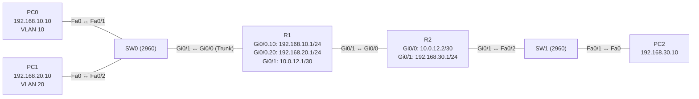

# Übung 8.1: Vorgehen bei der Fehlersuche

| | |
|---|---|
| **Modul** | 8 – Fehlersuche |
| **Stufe** | Grundlage |
| **Geschätzte Zeit** | ca. 90–120 Minuten (Aufbau und Dialog) |
| **Werkzeug** | Cisco Packet Tracer |
| **Vorwissen** | Module 1 bis 3 (Adressierung, VLANs, Trunks, Routing) |

> **Stand der Prüfung:** Entwurf. Die Übung baut auf Befehlen aus den Modulen 1 bis 3 auf (VLANs, Router-on-a-Stick, statische Routen); deren Stand steht in den jeweiligen Übungen. **Nicht bestätigt** sind in Packet Tracer die gezeigten Ausgaben, das Verhalten der Schnittstellen nach dem Entfernen eines Kabels, die Meldungen von `ping` bei unerreichbaren Zielen und alle GUI-Wege. Die Methodik (Schichtenmodell, Protokollführung) ist allgemeines Netzwerkwissen und nicht aus einer Quelle im Wortlaut belegt.

## Lernziele

Nach dieser Übung kannst du

- ein Problem als Symptom beschreiben, ohne die Ursache schon zu behaupten,
- die Fehlersuche systematisch nach Schichten eingrenzen (von der Leitung bis zur Anwendung),
- zu jeder Schicht die passenden Prüfbefehle auswählen,
- den **Soll-Zustand** eines Netzes dokumentieren, damit Abweichungen auffallen,
- die Suche in einem Protokoll festhalten (Symptom, Vermutung, Test, Ergebnis, Maßnahme),
- das **Referenznetz** aufbauen, das in den Übungen 8.2 bis 8.5 mit Störungen versehen wird.

## Voraussetzungen

Du kannst VLANs, Trunks, Router-on-a-Stick und statische Routen einrichten (Module 2 und 3). In den folgenden Übungen baust du Fehler in dieses Netz ein, suchst sie und behebst sie.

## Grundbegriffe

| Begriff | Bedeutung |
|---|---|
| Symptom | Was beobachtet wird (z. B. „PC0 erreicht PC2 nicht“). Nicht die Ursache. |
| Ursache | Warum es passiert (z. B. „fehlende Rückroute auf R2“). |
| Hypothese | Begründete Vermutung, die man mit einem Test prüft. |
| Soll-Zustand (Baseline) | Dokumentierter Zustand, wie das Netz im Normalbetrieb aussieht. |
| Bottom-up | Von der Leitung (Schicht 1) nach oben prüfen. |
| Top-down | Von der Anwendung nach unten prüfen. |
| Divide and Conquer | In der Mitte (z. B. Ping zum Gateway) beginnen und je nach Ergebnis nach oben oder unten gehen. |
| Protokoll | Mitschrift der Suche. Sie verhindert, dass man Schritte wiederholt, und hilft, Änderungen rückgängig zu machen. |

> **Merksatz:** Erst beobachten, dann vermuten, dann prüfen, dann **eine** Sache ändern, dann erneut prüfen.

## Topologie und Adressplan (Referenznetz)

Dieses Netz bleibt in allen Übungen des Moduls gleich.



| Gerät | Port / Interface | IP-Adresse | Subnetzmaske | Default Gateway | VLAN |
|---|---|---|---|---|---|
| PC0 | FastEthernet0 ↔ SW0 `Fa0/1` | `192.168.10.10` | `255.255.255.0` | `192.168.10.1` | 10 (VERKAUF) |
| PC1 | FastEthernet0 ↔ SW0 `Fa0/2` | `192.168.20.10` | `255.255.255.0` | `192.168.20.1` | 20 (TECHNIK) |
| PC2 | FastEthernet0 ↔ SW1 `Fa0/1` | `192.168.30.10` | `255.255.255.0` | `192.168.30.1` | – |
| R1 | `Gi0/0.10` (Subinterface) | `192.168.10.1` | `255.255.255.0` | – | 10 |
| R1 | `Gi0/0.20` (Subinterface) | `192.168.20.1` | `255.255.255.0` | – | 20 |
| R1 | `Gi0/1` | `10.0.12.1` | `255.255.255.252` | – | – |
| R2 | `Gi0/0` | `10.0.12.2` | `255.255.255.252` | – | – |
| R2 | `Gi0/1` | `192.168.30.1` | `255.255.255.0` | – | – |

Routen: R1 `192.168.30.0/24` über `10.0.12.2`; R2 `192.168.10.0/24` und `192.168.20.0/24` über `10.0.12.1`.

## Aufgabe

> **Schema dieser Übungsreihe: zwei Wege pro Schritt.** Wo es in Packet Tracer keinen CLI-Weg gibt (Geräte platzieren, verkabeln, PC-Adressen), steht das ausdrücklich dabei. Alle Befehle stehen in Codeblöcken. Die CLI-Befehle und GUI-Wege sind in dieser Entwurfsfassung noch nicht in Packet Tracer bestätigt.

### Teil A: Referenznetz aufbauen

**1. Neues Projekt beginnen** und Geräte platzieren: zwei Router (*1941*), zwei Switches (*2960*), drei PCs

- **GUI:** *File* → *New*, Geräte ziehen.
- **CLI:** Entfällt (nur grafisch möglich).

**2. Verkabeln:** Endgeräte, Switches und Router–Switch mit *Copper Straight-Through* (PC0 → SW0 `Fa0/1`, PC1 → SW0 `Fa0/2`, SW0 `Gi0/1` → R1 `Gi0/0`, R2 `Gi0/1` → SW1 `Fa0/2`, SW1 `Fa0/1` → PC2); R1 `Gi0/1` ↔ R2 `Gi0/0` mit *Copper Cross-Over* (nicht bestätigt)

- **GUI:** Kategorie *Connections*, Kabeltyp anklicken, beide Geräte anklicken, Ports wählen.
- **CLI:** Entfällt (Kabel gibt es nur grafisch).

**3. Switch SW0: VLANs, Access-Ports, Trunk**

- **GUI:** SW0 → *Config* → *VLAN Database*: VLAN 10 `VERKAUF` und VLAN 20 `TECHNIK` anlegen. Unter *Interface* `Fa0/1` auf *Access*, VLAN 10; `Fa0/2` auf *Access*, VLAN 20; `Gi0/1` auf *Trunk*.
- **CLI:** Auf SW0:
  ```text
  Switch> enable
  Switch# configure terminal
  Switch(config)# hostname SW0
  SW0(config)# vlan 10
  SW0(config-vlan)# name VERKAUF
  SW0(config-vlan)# exit
  SW0(config)# vlan 20
  SW0(config-vlan)# name TECHNIK
  SW0(config-vlan)# exit
  SW0(config)# interface fastethernet 0/1
  SW0(config-if)# switchport mode access
  SW0(config-if)# switchport access vlan 10
  SW0(config-if)# exit
  SW0(config)# interface fastethernet 0/2
  SW0(config-if)# switchport mode access
  SW0(config-if)# switchport access vlan 20
  SW0(config-if)# exit
  SW0(config)# interface gigabitethernet 0/1
  SW0(config-if)# switchport mode trunk
  SW0(config-if)# end
  ```
  SW1 bleibt unkonfiguriert (VLAN 1).

**4. Router R1: Subinterfaces und Verbindung zu R2**

- **GUI:** Subinterfaces gibt es im Router-GUI nicht. Nutze die CLI.
- **CLI:** Auf R1:
  ```text
  Router> enable
  Router# configure terminal
  Router(config)# hostname R1
  R1(config)# interface gigabitethernet 0/0
  R1(config-if)# no shutdown
  R1(config-if)# exit
  R1(config)# interface gigabitethernet 0/0.10
  R1(config-subif)# encapsulation dot1Q 10
  R1(config-subif)# ip address 192.168.10.1 255.255.255.0
  R1(config-subif)# exit
  R1(config)# interface gigabitethernet 0/0.20
  R1(config-subif)# encapsulation dot1Q 20
  R1(config-subif)# ip address 192.168.20.1 255.255.255.0
  R1(config-subif)# exit
  R1(config)# interface gigabitethernet 0/1
  R1(config-if)# ip address 10.0.12.1 255.255.255.252
  R1(config-if)# no shutdown
  R1(config-if)# exit
  R1(config)# ip route 192.168.30.0 255.255.255.0 10.0.12.2
  R1(config)# end
  ```

**5. Router R2**

- **GUI:** R2 → *Config* → Interfaces: Adresse, Maske, *Port Status* *On*; Routen unter *Routing* → *Static*.
- **CLI:** Auf R2:
  ```text
  Router> enable
  Router# configure terminal
  Router(config)# hostname R2
  R2(config)# interface gigabitethernet 0/0
  R2(config-if)# ip address 10.0.12.2 255.255.255.252
  R2(config-if)# no shutdown
  R2(config-if)# exit
  R2(config)# interface gigabitethernet 0/1
  R2(config-if)# ip address 192.168.30.1 255.255.255.0
  R2(config-if)# no shutdown
  R2(config-if)# exit
  R2(config)# ip route 192.168.10.0 255.255.255.0 10.0.12.1
  R2(config)# ip route 192.168.20.0 255.255.255.0 10.0.12.1
  R2(config)# end
  ```

**6. PCs konfigurieren**

- **GUI:** PC → *Desktop* → *IP Configuration* → *Static* (Werte siehe Tabelle).
- **CLI:** Entfällt (der PC hat keine IOS-CLI).

**7. Soll-Zustand prüfen**

- **GUI:** *Add Simple PDU*: PC0 → PC1, PC0 → PC2, PC1 → PC2.
- **CLI:** Am PC0:
  ```text
  PC> ping 192.168.10.1
  PC> ping 192.168.20.10
  PC> ping 192.168.30.10
  ```
  Alle Pings klappen (der erste Versuch kann wegen ARP verloren gehen). Wenn nicht, beheben, **bevor** du weitermachst.

### Teil B: Soll-Zustand dokumentieren

**8. Messprotokoll „Soll“ ausfüllen**

- **GUI:** Entfällt.
- **CLI:** Notiere in einer Tabelle (Vorlage unten) die Ausgabe dieser Befehle:
  ```text
  PC> ipconfig
  PC> ping 192.168.30.10
  PC> tracert 192.168.30.10
  SW0# show vlan brief
  SW0# show interfaces trunk
  R1# show ip interface brief
  R1# show ip route
  R2# show ip route
  ```
  Du brauchst die Ausgaben später als Vergleich: Jede Abweichung ist ein Hinweis.

| Prüfung | Befehl | Soll-Wert |
|---|---|---|
| PC0 hat die richtige Adresse | `ipconfig` | `192.168.10.10`, Gateway `192.168.10.1` |
| PC0 erreicht Gateway | `ping 192.168.10.1` | 4 Antworten |
| PC0 erreicht PC1 (anderes VLAN) | `ping 192.168.20.10` | 4 Antworten |
| PC0 erreicht PC2 (anderer Standort) | `ping 192.168.30.10` | 4 Antworten |
| Weg PC0 → PC2 | `tracert 192.168.30.10` | `192.168.10.1`, `10.0.12.2`, `192.168.30.10` |
| VLAN-Zuordnung | `show vlan brief` | `Fa0/1` in VLAN 10, `Fa0/2` in VLAN 20 |
| Trunk | `show interfaces trunk` | `Gi0/1` trunking, VLANs 10 und 20 erlaubt |
| Router-Interfaces | `show ip interface brief` | alle `up/up` |
| Routen R1 | `show ip route` | `C` für 10/20/12, `S 192.168.30.0/24` |
| Routen R2 | `show ip route` | `C` für 12/30, `S` für 10 und 20 |

### Teil C: Symptome erleben (bekannte Störungen)

Du kennst die Ursachen und lernst, wie sie sich zeigen. Ändere jeweils **eine** Sache, beobachte, und stelle den Zustand wieder her.

**9. Störung 1: Kabel entfernen**

- **GUI:** Das Kabel zwischen PC0 und SW0 löschen.
- **CLI:** Am PC0 `ping 192.168.10.1`, auf SW0 `show interfaces fastethernet 0/1` und `show ip interface brief`. Der Port steht auf `down`. Kabel wieder anschließen.

**10. Störung 2: Schnittstelle abschalten**

- **GUI:** R2 → *Config* → `GigabitEthernet0/0`: *Port Status* *Off*.
- **CLI:** Auf R2:
  ```text
  R2# configure terminal
  R2(config)# interface gigabitethernet 0/0
  R2(config-if)# shutdown
  R2(config-if)# end
  ```
  Beobachte, was am PC0 (`ping 192.168.30.10`), auf R1 (`show ip interface brief`, `show ip route`) und auf R2 passiert. Dann `no shutdown`.

**11. Störung 3: falsche Maske am PC**

- **GUI:** PC0 → *IP Configuration*: Maske auf `255.255.255.252` ändern.
- **CLI:** Am PC0 `ipconfig` und `ping 192.168.10.1`. Der PC hält das Gateway für nicht erreichbar. Maske wieder auf `255.255.255.0`.

**12. Protokoll führen**

- **GUI:** Entfällt.
- **CLI:** Entfällt. Lege für jede der drei Störungen eine Zeile im Protokoll an:

| Nr. | Symptom (beobachtet) | Hypothese | Test (Befehl) | Ergebnis | Maßnahme |
|---|---|---|---|---|---|
| 1 | | | | | |
| 2 | | | | | |
| 3 | | | | | |

**13. Speichern**

- **GUI:** `Strg+S` als `08.1-vorgehen-bei-der-fehlersuche.pkt`. **Dieses Projekt bleibt das Referenznetz für 8.2 bis 8.5.** Speichere vor jeder Störungsübung eine Kopie.
- **CLI:** Auf allen Geräten:
  ```text
  R1# copy running-config startup-config
  ```

### Teil D: Dialog

**14. Ergebnisse besprechen**

Lege mir deine drei Zeilen aus dem Protokoll und das ausgefüllte Soll-Messprotokoll vor. Wir besprechen:

- Welche Schicht zeigte welche Störung zuerst?
- Welcher Befehl hat die Ursache am schnellsten eingegrenzt?
- Wo hast du gesucht, obwohl die Ursache an einer anderen Stelle lag?

Im Dialog bekommst du danach **neue Störungen**, ohne dass du die Ursache vorab kennst (siehe Hinweise).

## Hintergrund: Systematisch eingrenzen

1. **Symptom genau beschreiben:** Wer kann was nicht? Seit wann? Was hat sich geändert? „Das Netz geht nicht“ ist kein Symptom.
2. **Schichten:** Schicht 1 (Kabel, Link-Licht, `up/down`), Schicht 2 (VLAN, Trunk, MAC-Tabelle), Schicht 3 (Adresse, Maske, Gateway, Routen), darüber Dienste (DHCP, DNS, ACL, NAT).
3. **Ping-Leiter vom PC aus:** `127.0.0.1` (Netzwerksoftware), eigene Adresse, Default Gateway, Gerät im anderen Netz, Name. Die erste Stufe, die fehlschlägt, grenzt die Ursache ein.
4. **Hin- und Rückweg:** Ein Ping braucht beide Richtungen. Kommt der Hinweg an, aber keine Antwort zurück, fehlt oft die Rückroute.
5. **Eine Änderung zugleich:** Wer mehrere Dinge gleichzeitig ändert, weiß nicht mehr, was geholfen hat.
6. **Soll mit Ist vergleichen:** Ohne dokumentierten Soll-Zustand weiß man nicht, was „normal“ ist.
7. **Dokumentieren:** Das Protokoll zeigt, was schon geprüft ist, und erlaubt Änderungen rückgängig zu machen.

## Hinweise

- Die Befehle `show ip interface brief`, `show vlan brief`, `show interfaces trunk`, `show ip route` und `ping` beantworten die meisten Fragen.
- „Administratively down“ heißt: per `shutdown` abgeschaltet. „Down“ heißt: Leitung nicht erkannt.
- Packet Tracer verhält sich bei Ping zum ersten Mal oft anders (ARP-Verlust). Pings wiederholen, bevor du auf einen Fehler schließt.
- **Dialog-Modus:** Du kannst mir zu jeder Übung (und jedem Modul) sagen: „Gib mir eine Störung für Modul X.“ Ich nenne dir dann nur das Symptom und die Befehle zum Einbauen in einer Form, die die Ursache nicht verrät (z. B. als Befehlsfolge ohne Kommentar), und wir besprechen deine Suche Schritt für Schritt.
- Die Übungen 8.2 bis 8.5 enthalten die Störungen **eingeklappt**. Öffne sie erst, wenn du sie einbauen willst; die Lösung steht in einem eigenen Abschnitt.

## Prüfbefehle

Am PC (Command Prompt):

```text
PC> ipconfig
PC> ping 127.0.0.1
PC> ping <eigene Adresse>
PC> ping <Gateway>
PC> ping <entferntes Ziel>
PC> tracert <entferntes Ziel>
```

Am Switch / Router (CLI):

```text
SW0> enable
SW0# show vlan brief
SW0# show interfaces trunk
SW0# show mac address-table
R1> enable
R1# show ip interface brief
R1# show ip route
R1# show running-config
```

| Ebene | Frage | Befehl | GUI-Weg |
|---|---|---|---|
| 1 | Ist die Leitung da? | `show ip interface brief`, `show interfaces <Port>` | Link-Punkte, Port Status |
| 2 | Stimmen VLAN und Trunk? | `show vlan brief`, `show interfaces trunk` | Switch → *Config* |
| 2 | Wo wurde die MAC gelernt? | `show mac address-table` | – |
| 3 | Stimmen Adresse, Maske, Gateway? | `ipconfig`, `show running-config` | PC → *IP Configuration* |
| 3 | Gibt es eine Route? | `show ip route` | Werkzeug *Inspect* → *Routing Table* |
| 3 | Wohin geht das Paket? | `ping`, `tracert` | *Add Simple PDU* |

**Kontrollfragen**

1. Warum beschreibt man zuerst das Symptom und nicht die Ursache?
2. In welcher Reihenfolge prüft man bei Bottom-up?
3. Was sagt `ping` auf das Default Gateway aus, und was nicht?
4. Warum ändert man immer nur eine Sache zugleich?
5. Wozu dient der dokumentierte Soll-Zustand?

## Erweiterungen

- **Weiteres Gerät:** Ein Netzwerkdiagramm mit Adressplan ergänzen.
- **Befehlskarte:** Eine eigene Merkliste „Symptom → erster Befehl“ anlegen.
- **Top-down:** Dieselbe Störung von oben (Anwendung) nach unten angehen und die Wege vergleichen.
- **Weiter:** Übung 8.2 beginnt mit Fehlern in der Adressierung.

---

## Musterlösung

<details>
<summary>Musterlösung anzeigen</summary>

**Soll-Zustand (Schritt 7/8):** Alle Pings klappen; `tracert` von PC0 zu PC2 zeigt `192.168.10.1`, `10.0.12.2`, `192.168.30.10` (nicht bestätigt: Darstellung in Packet Tracer).

**Störung 1 (Kabel):** `Fa0/1` steht auf `down`. PC0 erreicht nichts, nicht einmal das Gateway. Schicht 1 ist die Ursache; `show ip interface brief` am Switch zeigt es sofort.

**Störung 2 (R2 `Gi0/0` aus):** R1 verliert die Verbindung zu R2. In `show ip route` auf R1 fehlt die statische Route zu `192.168.30.0/24` (der Next Hop ist nicht mehr über ein aktives Interface erreichbar; nicht bestätigt). PC0 erreicht Gateway und PC1, aber nicht PC2.

**Störung 3 (Maske `/30`):** PC0 hält `192.168.10.1` für nicht im eigenen Netz und kann das Gateway nicht erreichen. `ping 192.168.10.1` schlägt fehl, obwohl Kabel, VLAN und Router in Ordnung sind. Die Ursache ist nur mit `ipconfig` zu sehen.

**Beispielprotokoll für Störung 2:**

| Nr. | Symptom | Hypothese | Test | Ergebnis | Maßnahme |
|---|---|---|---|---|---|
| 2 | PC0 erreicht PC2 nicht, Gateway und PC1 schon | Fehler hinter R1 | `show ip route` auf R1 | `S`-Route fehlt | – |
| 2 | – | Verbindung R1–R2 gestört | `show ip interface brief` auf R1 und R2 | R2 `Gi0/0` administratively down | `no shutdown` |

**Antworten auf die Kontrollfragen:**

1. Wer eine Ursache vorab annimmt, sucht nur noch danach und übersieht andere Hinweise.
2. Schicht 1 (Leitung, Port), Schicht 2 (VLAN, Trunk), Schicht 3 (Adresse, Route), darüber die Dienste.
3. Ein erfolgreicher Ping zum Gateway zeigt, dass Leitung, VLAN und Adresse im eigenen Netz stimmen; er sagt nichts über Routen dahinter.
4. Sonst weiß man nicht, welche Änderung gewirkt hat, und neue Fehler können unbemerkt entstehen.
5. Er ist der Maßstab, an dem jede Abweichung erkannt wird.

</details>

---

## Quellen

- Die Methodik der Fehlersuche (Schichtenmodell, Bottom-up/Top-down/Divide and Conquer, Ping-Leiter, Soll-Dokumentation) ist allgemeines Netzwerkwissen und hier nicht aus einer Quelle im Wortlaut belegt.
- Die Befehle für VLANs, Subinterfaces und statische Routen stammen aus den Übungen 2.1, 3.1 und 3.3 und sind dort mit ihrem Stand ausgewiesen.
- Die gezeigten Ausgaben sind ein konstruiertes Beispiel im IOS-Format und nicht aus Packet Tracer übernommen.

---

Lizenz: [CC BY-NC-SA 4.0](https://creativecommons.org/licenses/by-nc-sa/4.0/deed.de), Urheber: AnsibleArtisan4711. Cisco, Cisco IOS und Cisco Packet Tracer sind Marken von Cisco Systems, Inc. und/oder ihrer Tochtergesellschaften; dieses Dokument steht in keiner Verbindung zu Cisco.
